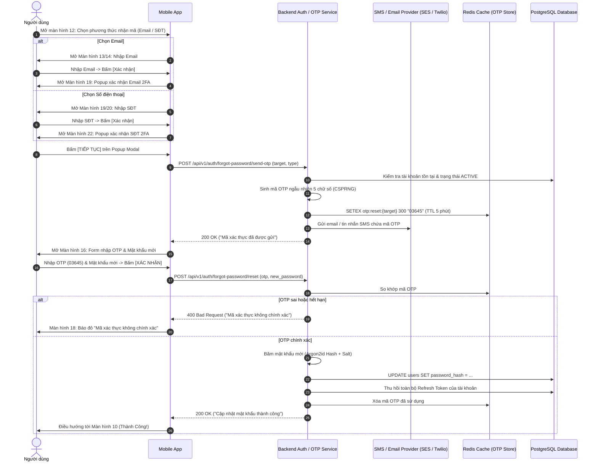

# TÀI LIỆU ĐẶC TẢ YÊU CẦU PHẦN MỀM (SRS)
## Module: Xác thực & Khôi phục Tài khoản (Account Recovery & 2FA)
### Phân hệ: Đặt lại mật khẩu 2 yếu tố qua Email & Số điện thoại (Màn hình 12 - 22)

| Thông tin | Chi tiết |
| :--- | :--- |
| **Mã tài liệu** | `SRS_MOD_AUTH_2FA_001` |
| **Tên module** | Đặt lại mật khẩu qua Email & Số điện thoại (Màn hình 12 - 22) |
| **Dự án** | VMO ERP System |
| **Nền tảng** | iOS & Android (Mobile App) + Backend OTP Microservices |
| **Tệp thiết kế nguồn** | `ERP - App.fig` (Section: `Thay đổi thông tin` - Các màn hình: `12`, `13`, `14`, `15`, `16`, `17`, `18`, `19`, `20`, `21`, `22`) |
| **Phiên bản SRS** | 1.0 (Chuẩn hóa 100% theo bản vẽ Figma) |
| **Ngày tạo** | 21/10/2026 |
| **Trạng thái** | Sẵn sàng triển khai (Ready for Dev/QA) |

---

## 1. Giới thiệu tổng quan phân hệ (Overview & Scope)

### 1.1 Mục đích tài liệu
Tài liệu này đặc tả chi tiết toàn bộ luồng nghiệp vụ **Đặt lại mật khẩu (Forgot / Reset Password)** sử dụng cơ chế xác thực hai yếu tố (**2FA OTP**) gửi qua **Email** hoặc **Tin nhắn SMS (Số điện thoại)**, tương ứng với toàn bộ các màn hình từ **12 đến 22** thuộc banner `Thay đổi thông tin` trong file thiết kế Figma.

### 1.2 Danh mục các màn hình chi tiết (Màn hình 12 đến 22)
1. **Màn hình 12:** `Chọn phương thức nhận mã xác thực` (Gửi mã qua Email hoặc Gửi mã qua Số điện thoại).
2. **Nhánh A - Khôi phục qua Email:**
   * **Màn hình 13:** `Nhập Email khôi phục (Trống / Default)`.
   * **Màn hình 14:** `Nhập Email khôi phục (Đang nhập / Typing)`.
   * **Màn hình 15:** `Nhập Email khôi phục (Báo lỗi / Error: "Email không chính xác")`.
   * **Màn hình 19 (Nhánh Email):** `Popup Modal Xác nhận Email nhận mã xác thực 2 yếu tố`.
3. **Nhánh B - Khôi phục qua Số điện thoại:**
   * **Màn hình 19 (Nhánh SĐT):** `Nhập Số điện thoại khôi phục (Trống / Default)`.
   * **Màn hình 20:** `Nhập Số điện thoại khôi phục (Đang nhập / Typing)`.
   * **Màn hình 21:** `Nhập Số điện thoại khôi phục (Báo lỗi / Error: "Số điện thoại không chính xác")`.
   * **Màn hình 22:** `Popup Modal Xác nhận Số điện thoại nhận mã xác thực 2 yếu tố`.
4. **Màn hình Nhập mã OTP & Thiết lập mật khẩu mới:**
   * **Màn hình 16:** `Nhập OTP & Mật khẩu mới (Trống / Default)`.
   * **Màn hình 17:** `Nhập OTP & Mật khẩu mới (Đang nhập / Typing)`.
   * **Màn hình 18:** `Nhập OTP & Mật khẩu mới (Báo lỗi / Error)`.

---

## 2. BƯỚC 1: CHỌN PHƯƠNG THỨC NHẬN MÃ (MÀN HÌNH 12)

### 2.1 Bố cục giao diện Mobile (Màn hình 12)
```
+-------------------------------------------------+
|  [Status Bar: Time, Wifi, Battery]              |
|  [<]                 Đặt lại mật khẩu           |
|                                                 |
|  Bạn muốn nhận mã để đặt lại mật khẩu           |
|  bằng cách nào?                                 |
|                                                 |
|  (o) Gửi mã qua email                           |
|                                                 |
|  ( ) Gửi mã qua số điện thoại                   |
|                                                 |
|  +---------------------+ +--------------------+ |
|  |        HỦY          | |      XÁC NHẬN      | |
|  +---------------------+ +--------------------+ |
|                [Home Indicator]                 |
+-------------------------------------------------+
```

### 2.2 Đặc tả tương tác
* **Tiêu đề câu hỏi:** *"Bạn muốn nhận mã để đặt lại mật khẩu bằng cách nào?"*.
* **Tùy chọn 1:** `Gửi mã qua email` (Mặc định được chọn). Chạm xác nhận sẽ chuyển hướng sang Nhánh A (Màn hình 13).
* **Tùy chọn 2:** `Gửi mã qua số điện thoại`. Chạm xác nhận sẽ chuyển hướng sang Nhánh B (Màn hình 19).
* **Nút Hủy:** Đóng luồng khôi phục, quay về màn hình Đăng nhập hoặc Thông tin cá nhân.

---

## 3. BƯỚC 2 - NHÁNH A: KHÔI PHÚC BẰNG EMAIL (MÀN HÌNH 13, 14, 15, 19)

### 3.1 Bố cục màn hình Nhập Email (Màn hình 13, 14, 15)
```
+-------------------------------------------------+
|  [Status Bar]                                   |
|  [<]                 Đặt lại mật khẩu           |
|                                                 |
|  Vui lòng nhập email của bạn.                   |
|  Chúng tôi sẽ sử dụng địa chỉ này để gửi mã     |
|  khôi phục tài khoản.                           |
|                                                 |
|  Email                                          |
|  +-------------------------------------------+  |
|  | Hello@vmogroup.com                        |  |
|  +-------------------------------------------+  |
|  * Email không chính xác                        |
|                                                 |
|  +---------------------+ +--------------------+ |
|  |        HỦY          | |      XÁC NHẬN      | |
|  +---------------------+ +--------------------+ |
|                [Home Indicator]                 |
+-------------------------------------------------+
```

### 3.2 Bố cục Popup Modal Xác nhận Email 2FA (Màn hình 19 - Nhánh Email)
Khi người dùng bấm `[ XÁC NHẬN ]` ở Màn hình 14, hệ thống hiển thị Popup Modal xác nhận:
```
+-------------------------------------------------+
|                                                 |
|                 (Màn hình nền mờ)               |
|                                                 |
|  +-------------------------------------------+  |
|  | Xác nhận email của bạn                    |  |
|  |                                           |  |
|  | Email Hello@vmogroup.com dùng cho         |  |
|  | tính năng xác thực 2 yếu tố.              |  |
|  | Chúng tôi sẽ gửi mã xác minh cho bạn      |  |
|  | qua email này.                            |  |
|  |                                           |  |
|  |   [   HỦY   ]          [   TIẾP TỤC   ]   |  |
|  +-------------------------------------------+  |
|                                                 |
+-------------------------------------------------+
```

### 3.3 Chi tiết các trạng thái Nhánh Email
* **Màn hình 13 (Default):** Ô Email trống, hiển thị hướng dẫn: *"Vui lòng nhập email của bạn. Chúng tôi sẽ sử dụng địa chỉ này để gửi mã khôi phục tài khoản."*.
* **Màn hình 14 (Typing):** Người dùng nhập địa chỉ email hợp lệ: `Hello@vmogroup.com`. Nút `Xác nhận` sáng cam.
* **Màn hình 15 (Error):** Nếu email sai định dạng hoặc không tồn tại trong hệ thống:
  * Xuất hiện dòng chữ đỏ dưới ô nhập: *"Email không chính xác"*.
  * Viền ô nhập đổi sang màu đỏ rực.
* **Màn hình 19 (Popup 2FA):**
  * Tiêu đề: *"Xác nhận email của bạn"*.
  * Nội dung: *"Email Hello@vmogroup.com dùng cho tính năng xác thực 2 yếu tố. Chúng tôi sẽ gửi mã xác minh cho bạn qua email này"*.
  * Khi bấm `[ Tiếp tục ]`: Backend kích hoạt gửi mã OTP 5 chữ số qua email và chuyển sang Màn hình 16.

---

## 4. BƯỚC 2 - NHÁNH B: KHÔI PHÚC BẰNG SỐ ĐIỆN THOẠI (MÀN HÌNH 19, 20, 21, 22)

### 4.1 Bố cục màn hình Nhập Số điện thoại (Màn hình 19, 20, 21)
```
+-------------------------------------------------+
|  [Status Bar]                                   |
|  [<]                 Đặt lại mật khẩu           |
|                                                 |
|  Vui lòng nhập số điện thoại của bạn.           |
|  Chúng tôi sẽ sử dụng số này để gửi mã          |
|  khôi phục tài khoản.                           |
|                                                 |
|  Số điện thoại                                  |
|  +-------------------------------------------+  |
|  | 0123465749                                |  |
|  +-------------------------------------------+  |
|  * Số điện thoại không chính xác                |
|                                                 |
|  +---------------------+ +--------------------+ |
|  |        HỦY          | |      XÁC NHẬN      | |
|  +---------------------+ +--------------------+ |
|                [Home Indicator]                 |
+-------------------------------------------------+
```

### 4.2 Bố cục Popup Modal Xác nhận Số điện thoại 2FA (Màn hình 22)
Khi người dùng bấm `[ XÁC NHẬN ]` ở Màn hình 20:
```
+-------------------------------------------------+
|                                                 |
|                 (Màn hình nền mờ)               |
|                                                 |
|  +-------------------------------------------+  |
|  | Xác nhận số điện thoại của bạn            |  |
|  |                                           |  |
|  | Số điện thoại 0123465749 dùng cho         |  |
|  | tính năng xác thực 2 yếu tố.              |  |
|  | Chúng tôi sẽ gửi mã xác minh cho bạn      |  |
|  | qua số này.                               |  |
|  |                                           |  |
|  |   [   HỦY   ]          [   TIẾP TỤC   ]   |  |
|  +-------------------------------------------+  |
|                                                 |
+-------------------------------------------------+
```

### 4.3 Chi tiết các trạng thái Nhánh Số điện thoại
* **Màn hình 19 (Default):** Hướng dẫn: *"Vui lòng nhập số điện thoại của bạn. Chúng tôi sẽ sử dụng số này để gửi mã khôi phục tài khoản."*.
* **Màn hình 20 (Typing):** Người dùng nhập số điện thoại đăng ký tài khoản (ví dụ: `0123465749`).
* **Màn hình 21 (Error):** Nếu số điện thoại không đúng chuẩn hoặc không khớp với hồ sơ:
  * Hiển thị dòng chữ đỏ: *"Số điện thoại không chính xác"*.
  * Viền ô nhập đổi sang màu đỏ.
* **Màn hình 22 (Popup 2FA):**
  * Tiêu đề: *"Xác nhận số điện thoại của bạn"*.
  * Nội dung: *"Số điện thoại 0123465749 dùng cho tính năng xác thực 2 yếu tố. Chúng tôi sẽ gửi mã xác minh cho bạn qua số này"*.
  * Khi bấm `[ Tiếp tục ]`: Backend gửi SMS Brandname chứa mã OTP 5 chữ số và chuyển sang Màn hình 16.

---

## 5. BƯỚC 3: NHẬP OTP & THIẾT LẬP MẬT KHẨU MỚI (MÀN HÌNH 16, 17, 18)

### 5.1 Bố cục giao diện Mobile (Màn hình 16, 17, 18)
```
+-------------------------------------------------+
|  [Status Bar]                                   |
|  [<]                 Đặt lại mật khẩu           |
|                                                 |
|  Tạo mật khẩu mới. Bạn sẽ sử dụng mật khẩu      |
|  này để truy cập tài khoản                      |
|                                                 |
|  Mã xác thực                                    |
|  +-------------------------------------------+  |
|  | 03645                                     |  |
|  +-------------------------------------------+  |
|  * Mã xác thực không chính xác                  |
|                                                 |
|  Mật khẩu mới                                   |
|  +-------------------------------------------+  |
|  | ••••••••••••••                        [o] |  |
|  +-------------------------------------------+  |
|                                                 |
|  Xác nhận mật khẩu                              |
|  +-------------------------------------------+  |
|  | Matkhau1234                           [o] |  |
|  +-------------------------------------------+  |
|  * Xác nhận mật khẩu không khớp                 |
|                                                 |
|                  (o) Gửi lại mã                 |
|                                                 |
|  +---------------------+ +--------------------+ |
|  |        HỦY          | |      XÁC NHẬN      | |
|  +---------------------+ +--------------------+ |
|                [Home Indicator]                 |
+-------------------------------------------------+
```

### 5.2 Đặc tả chi tiết 3 trạng thái
1. **Màn hình 16 (Default / Empty):**
   * Hướng dẫn: *"Tạo mật khẩu mới. Bạn sẽ sử dụng mật khẩu này để truy cập tài khoản"*.
   * Gồm 3 trường nhập liệu: `Mã xác thực`, `Mật khẩu mới`, `Xác nhận mật khẩu`.
   * Liên kết: `(o) Gửi lại mã` (kèm bộ đếm ngược thời gian countdown 60 giây).
2. **Màn hình 17 (Typing):**
   * Người dùng nhập mã OTP nhận được: `03645`.
   * Nhập mật khẩu mới (ẩn ký tự) và xác nhận mật khẩu `Matkhau1234`.
3. **Màn hình 18 (Error):**
   * Khi mã OTP nhập sai: Dưới ô mã xác thực báo đỏ *"Mã xác thực không chính xác"*.
   * Khi 2 mật khẩu không trùng khớp: Dưới ô xác nhận báo đỏ *"Xác nhận mật khẩu không khớp"*.
4. **Kết quả xử lý:**
   * **Nếu thành công:** Hệ thống tự động chuyển tiếp tới **Màn hình 10 (`Thành Công!`)**.
   * **Nếu lỗi máy chủ:** Hệ thống tự động chuyển tiếp tới **Màn hình 11 (`Opps!`)**.

---

## 6. Sơ đồ luồng xử lý toàn trình (Sequence Diagram)



---

## 7. Đặc tả Hợp đồng API phía Backend (Backend API Contracts)

### 7.1 API 1: Gửi mã OTP xác thực 2 yếu tố
* **Method:** `POST` | **Path:** `/api/v1/auth/forgot-password/send-otp`
* **Content-Type:** `application/json`

#### Request Body
```json
{
  "target": "Hello@vmogroup.com", // hoặc "0123465749"
  "channel": "EMAIL"             // hoặc "SMS"
}
```

#### Response Thành công (`200 OK`)
```json
{
  "success": true,
  "code": 200,
  "message": "Mã xác thực đã được gửi thành công. Vui lòng kiểm tra hộp thư/tin nhắn.",
  "data": {
    "channel": "EMAIL",
    "expires_in": 300,
    "resend_cooldown": 60
  }
}
```

#### Response Lỗi không tìm thấy tài khoản (`404 Not Found`)
```json
{
  "success": false,
  "code": 404,
  "error": "ACCOUNT_NOT_FOUND",
  "message": "Email không chính xác",
  "field": "email"
}
```

---

### 7.2 API 2: Gửi lại mã OTP (Resend OTP)
* **Method:** `POST` | **Path:** `/api/v1/auth/forgot-password/resend-otp`
* **Request Body:**
```json
{
  "target": "Hello@vmogroup.com",
  "channel": "EMAIL"
}
```

---

### 7.3 API 3: Xác thực OTP và Thiết lập mật khẩu mới
* **Method:** `POST` | **Path:** `/api/v1/auth/forgot-password/reset`
* **Content-Type:** `application/json`

#### Request Body
```json
{
  "target": "Hello@vmogroup.com",
  "channel": "EMAIL",
  "otp_code": "03645",
  "new_password": "NewSecurePassword123@",
  "confirm_password": "NewSecurePassword123@"
}
```

#### Response Thành công (`200 OK`) -> Chuyển Màn hình 10
```json
{
  "success": true,
  "code": 200,
  "message": "Mật khẩu của bạn đã được cập nhật thành công!"
}
```

#### Response Lỗi mã OTP sai (`400 Bad Request`) -> Màn hình 18
```json
{
  "success": false,
  "code": 400,
  "error": "INVALID_OTP",
  "message": "Mã xác thực không chính xác",
  "field": "otp_code"
}
```

---

## 8. Lược đồ Cơ sở dữ liệu chuẩn hóa (PostgreSQL Schema DDL)

```sql
-- 1. Bảng lưu trữ nhật ký mã xác thực OTP
CREATE TABLE auth_otp_verifications (
    id BIGSERIAL PRIMARY KEY,
    user_id BIGINT NULL REFERENCES users(id) ON DELETE CASCADE,
    target VARCHAR(128) NOT NULL, -- Email hoặc Số điện thoại
    channel VARCHAR(10) NOT NULL, -- 'EMAIL', 'SMS'
    otp_code_hash VARCHAR(64) NOT NULL, -- Lưu trữ SHA-256 băm của mã OTP
    is_used BOOLEAN NOT NULL DEFAULT FALSE,
    attempts_count INT NOT NULL DEFAULT 0,
    expires_at TIMESTAMP WITH TIME ZONE NOT NULL,
    created_at TIMESTAMP WITH TIME ZONE DEFAULT CURRENT_TIMESTAMP
);

CREATE INDEX idx_otp_target ON auth_otp_verifications(target, channel, is_used);

-- 2. Bảng nhật ký khôi phục mật khẩu (Audit Recovery Logs)
CREATE TABLE audit_password_resets (
    id BIGSERIAL PRIMARY KEY,
    user_id BIGINT NOT NULL REFERENCES users(id) ON DELETE CASCADE,
    reset_method VARCHAR(10) NOT NULL, -- 'EMAIL', 'SMS'
    ip_address VARCHAR(45) NOT NULL,
    user_agent TEXT,
    created_at TIMESTAMP WITH TIME ZONE DEFAULT CURRENT_TIMESTAMP
);
```
