# TÀI LIỆU ĐẶC TẢ YÊU CẦU PHẦN MỀM (SRS)
## Phân hệ: Điều Hướng Toàn Cục, Trung Tâm Thông Báo & Phát Tin Doanh Nghiệp trên Cổng Web Admin
### Module: Khung Điều hướng Master Shell, Thông báo Thời gian thực WebSocket & Studio Soạn thảo Phát tin Nội bộ

| Thông tin | Chi tiết |
| :--- | :--- |
| **Mã tài liệu** | `SRS_WEB_NAV_NOTI_001` |
| **Tên phân hệ** | Điều hướng Toàn cục, Trung tâm Thông báo & Phát tin Doanh nghiệp trên Web Admin |
| **Dự án** | VMO ERP System - Web Admin Management Portal |
| **Nền tảng** | Web Application (Desktop Browser: Chrome, Safari, Edge, Firefox) + Backend Notification Microservices |
| **Tài liệu tham chiếu Mobile** | [SRS_Dieu_Huong_Va_Thong_Bao.md](file:///Users/hoangkien/project/erp/SRS_Dieu_Huong_Va_Thong_Bao.md), [SRS_Quan_Tri_Thong_Tin_Nhan_Su.md](file:///Users/hoangkien/project/erp/SRS_Quan_Tri_Thong_Tin_Nhan_Su.md), [SRS_Login_Web_Admin.md](file:///Users/hoangkien/project/erp/SRS_Login_Web_Admin.md) |
| **Tệp thiết kế nguồn** | `ERP - App.fig` (Các Frame Web Desktop: `Desktop - 2`, `Group 6889`, `Group 6890`, `Admin Menu`) |
| **Độ phân giải chuẩn** | Desktop ($1440 \times 1024$, $1920 \times 1080$), Co giãn tối thiểu $1280 \times 800$, Hỗ trợ màn hình siêu rộng (Ultra-wide 2K/4K) |
| **Phiên bản SRS** | 1.0 (Chuẩn hóa toàn diện Khung Master Shell, Menu Phân quyền 2 Cấp, WebSocket STOMP, Broadcast Studio & DDL) |
| **Ngày tạo** | 21/10/2026 |
| **Trạng thái** | Sẵn sàng triển khai (Ready for Dev/QA) |

---

## 1. Giới thiệu tổng quan phân hệ (Overview & Scope)

### 1.1 Mục đích tài liệu
Tài liệu này đặc tả toàn diện các yêu cầu giao diện người dùng (UI/UX), yêu cầu chức năng (FR), quy tắc nghiệp vụ (BR), kiến trúc dòng dữ liệu thời gian thực (Real-time WebSocket), hợp đồng API RESTful và lược đồ cơ sở dữ liệu quan hệ (PostgreSQL DDL) cho phân hệ **"Điều hướng Toàn cục, Trung tâm Thông báo & Phát tin Doanh nghiệp" (Global Navigation, Real-time Notification & Broadcast Hub)** trên Cổng Web Admin của hệ thống VMO ERP.

Nếu trên ứng dụng Mobile, việc điều hướng bị giới hạn trong thanh trượt Drawer đơn giản và thông báo chỉ là danh sách nhận tin một chiều; thì trên **Cổng Web Admin Desktop**, đây là **Khung Xương sống Điều hành (Enterprise Application Shell)** và **Trung tâm Truyền thông Đa kênh Toàn diện (Omni-channel Broadcast Command Center)** giúp Ban Lãnh đạo (BOD), Phòng Truyền thông, Phòng Nhân sự (HR) và Cán bộ Quản lý:
1. Định hướng luồng làm việc nhất quán qua thanh Topbar 64px, Breadcrumbs đa tầng và Sidebar thu gọn/mở rộng linh hoạt với phân quyền RBAC chặt chẽ.
2. Tiếp nhận và xử lý tức thời các thông báo nghiệp vụ (Đơn nghỉ phép chờ duyệt, Đơn OT, Cảnh báo vi phạm chấm công) qua giao diện Popover thời gian thực (WebSocket / SSE).
3. **Phát tin thông báo tập trung toàn doanh nghiệp (Broadcast Studio):** Soạn thảo bài viết đa phương tiện (WYSIWYG Rich Text), định tuyến đối tượng nhận tin theo cây cơ cấu 81 đơn vị, trụ sở làm việc, cấp bậc chức danh; đồng thời đẩy thông báo đa kênh (Web Banner, Mobile Push FCM/APNs, Email hàng loạt).

---

### 1.2 Bảng so sánh Kiến trúc: Mobile App vs. Web Admin

| Tiêu chuẩn So sánh | Ứng dụng Di động ([SRS_Dieu_Huong_Va_Thong_Bao.md](file:///Users/hoangkien/project/erp/SRS_Dieu_Huong_Va_Thong_Bao.md)) | Cổng Quản trị Web (`SRS_Dieu_Huong_Va_Thong_Bao_Web_Admin.md`) |
| :--- | :--- | :--- |
| **Mô hình Điều hướng** | Drawer Navigation trượt từ mép trái màn hình ($375 \times 812$), che khuất nội dung trang khi mở. | **Khung Shell Đa vùng Cố định ($1440 \times 1024$ / $1920 \times 1080$):** Header Topbar 64px cố định + Sidebar cánh trái 260px (hỗ trợ thu gọn thành Mini-Sidebar 80px), Breadcrumb phân cấp, phím tắt toàn cục `Ctrl+K`. |
| **Phân quyền Menu** | Chỉ ẩn/hiện icon Cài đặt và số lượng thẻ chức năng Dashboard Chấm công (7 thẻ vs 18 thẻ). | **Phân quyền RBAC 2 Tầng Chuyên sâu:** Menu được phân thành 2 nhóm: *Nhóm Nghiệp vụ Vận hành* (Tổng quan, Nhân sự, Chấm công, Phép, Dự án) và *Nhóm Quản trị Cấp cao* (Cơ cấu 81 đơn vị, Bảo mật 2FA, Studio Phát tin, Audit Log). |
| **Cơ chế Nhận Thông báo** | Danh sách cuộn dọc tĩnh + Push Notification màn hình khóa iOS/Android qua FCM/APNs. | **Trung tâm Thông báo Thời gian thực 3 Cấp:** (1) Badge số đỏ tức thì qua WebSocket STOMP; (2) Toast Alert nổi góc dưới phải màn hình kèm âm thanh; (3) Notification Popover Dropdown 420px có 3 tab phân loại. |
| **Tác vụ Thông báo** | Chỉ xem nội dung và bấm vào để chuyển trang (Deep Link). | Đánh dấu đã đọc từng tin / tất cả, Lọc tin "Cần tôi phê duyệt", Phê duyệt nhanh 1 chạm (Quick Approve) trực tiếp trên popover không cần chuyển trang. |
| **Khả năng Phát tin (Broadcast)**| Không có chức năng tạo hoặc gửi thông báo. | **Studio Phát tin Doanh nghiệp Toàn diện (Broadcast Studio):** Soạn thảo WYSIWYG, đính kèm file, chọn đối tượng nhận tin theo cây 81 đơn vị, lên lịch hẹn giờ gửi, đồng bộ thông báo tới cả Web, Mobile Push và Email. |
| **Theo dõi & Đo lường** | Không có số liệu thống kê. | **Bảng Thống kê Hiệu quả Truyền thông (Analytics Dashboard):** Đo lường tỷ lệ nhận tin (Delivered), tỷ lệ mở đọc (Read Rate), danh sách nhân sự chưa đọc thông báo khẩn cấp để HR đôn đốc. |

---

## 2. Danh mục Chức năng Phân hệ Web Admin (Functional Scope)

```mermaid
graph TD
    A[CỔNG WEB ADMIN: ĐIỀU HƯỚNG TOÀN CỤC & TRUNG TÂM THÔNG BÁO] --> B[PHẦN 1: KHUNG ĐIỀU HƯỚNG MASTER SHELL]
    A --> C[PHẦN 2: TRUNG TÂM THÔNG BÁO THỜI GIAN THỰC]
    A --> D[PHẦN 3: STUDIO SOẠN THẢO & PHÁT TIN DOANH NGHIỆP]
    A --> E[PHẦN 4: CẤU HÌNH TEMPLATE & ĐO LƯỜNG TRUYỀN THÔNG]

    B --> B1[SCR_WEB_NAV_001: Header Topbar 64px - Breadcrumb & Global Search]
    B --> B2[SCR_WEB_NAV_002: Collapsible Sidebar 260px / 80px Phân quyền RBAC]
    B --> B3[Phím tắt toàn cục điều hướng nhanh Ctrl+K / Command Palette]
    B --> B4[User Profile Dropdown: Cài đặt cá nhân, Đổi mật khẩu, Đăng xuất]

    C --> C1[SCR_WEB_NOTI_001: Notification Popover 420px - 3 Tab phân loại]
    C --> C2[Toast Notification góc phải kèm âm thanh thông báo dịu]
    C --> C3[SCR_WEB_NOTI_002: Trang Trung tâm Thông báo Toàn màn hình]
    C --> C4[Hành vi Quick Action: Phê duyệt nhanh đơn nghỉ phép/OT ngay trên thông báo]

    D --> D1[SCR_WEB_BROADCAST_001: Studio Soạn thảo Rich Text WYSIWYG]
    D --> D2[Bộ lọc Nhắm đối tượng: Toàn công ty, 81 Đơn vị, Trụ sở, Chức danh]
    D --> D3[Phát tin Đa kênh Omni-channel: Web Banner + Mobile Push + Email]
    D --> D4[Lập lịch Hẹn giờ phát tin & Đặt độ ưu tiên Khẩn cấp - Emergency Pop]

    E --> E1[SCR_WEB_TEMPLATE_001: Quản trị Mẫu Thông báo Kích hoạt Tự động]
    E --> E2[SCR_WEB_ANALYTICS_001: Dashboard Giám sát Tỷ lệ Nhận & Đọc tin]
    E --> E3[Kết xuất danh sách nhân sự chưa đọc thông báo bắt buộc sang Excel]
```



---

## 3. Đặc tả Chi tiết Giao diện Web Desktop (Wireframes & Screen Specs)

---

### PHẦN 1: KHUNG ĐIỀU HƯỚNG TOÀN CỤC MASTER SHELL (`SCR_WEB_NAV_001` & `SCR_WEB_NAV_002`)
*Khớp với bản vẽ Figma Desktop: `Desktop - 2` ($1440 \times 1024$), `Group 6889`, `Admin Menu`.*

#### 3.1 Bản vẽ Tổng thể Khung Giao diện Master Shell ($1440 \times 1024$ px)
```
+-----------------------------------------------------------------------------------------------------------------------------+
| [LOGO VMO] | [≡]   Trang chủ > Quản trị Nhân sự > Danh bạ Cư dân VMO                 [🔍 Tìm kiếm (Ctrl+K)] [🔔 2] (Admin v)|
+-----------------------------------------------------------------------------------------------------------------------------+
| (SIDEBAR CÁNH TRÁI: 260px)       | (KHÔNG GIAN NỘI DUNG CHÍNH: 1180px)                                                      |
|                                  |                                                                                          |
| VẬN HÀNH DOANH NGHIỆP            |  QUẢN LÝ NHÂN SỰ & CƯ DÂN VMO                                     [ + Thao tác v ]       |
| • [📊] Tổng quan                 |  Tổng số: 921 nhân sự toàn hệ thống                                                      |
| • [👥] Nhân sự & Cư dân (Active) |  +------------------------------------------------------------------------------------+  |
| • [⏰] Chấm công                 |  | [All (921)]* | Phòng Nhân Sự (28) | Phòng Kinh Doanh (64) | Phòng QA (42) | SWAT... |  |
| • [🏖️] Ngày nghỉ & Phép         |  +------------------------------------------------------------------------------------+  |
| • [⚡] Làm thêm giờ (OT)          |                                                                                          |
| • [📁] Quản lý Dự án             |  [ Bảng dữ liệu Data Table hiển thị mượt mà bên trong khung làm việc ]                    |
| • [💬] Thảo luận nội bộ          |                                                                                          |
| • [📖] Hướng dẫn sử dụng         |                                                                                          |
|                                  |                                                                                          |
| QUẢN TRỊ CẤP CAO (ADMIN ONLY)    |                                                                                          |
| • [🏢] Cây cơ cấu 81 đơn vị      |                                                                                          |
| • [📢] Studio Phát tin (Broadcast)                                                                                          |
| • [🔐] An toàn & Bảo mật 2FA     |                                                                                          |
| • [📋] Nhật ký Kiểm toán (Audit) |                                                                                          |
| • [⚙️] Cấu hình Hệ thống         |                                                                                          |
|                                  |                                                                                          |
| -------------------------------- |                                                                                          |
| [🔒] Phiên làm việc: Bảo mật TLS |                                                                                          |
| [<< Thu gọn thanh menu ]         |                                                                                          |
+-----------------------------------------------------------------------------------------------------------------------------+
```

#### 3.2 Đặc tả Chi tiết Thành phần Điều hướng

1. **Header Topbar Cố định (Chiều cao 64px, z-index 1000):**
   * **Logo VMO:** Đặt góc trái trên cùng, kích thước $120 \times 32$ px. Bấm vào logo luôn điều hướng về trang Tổng quan (`/admin/dashboard`).
   * **Nút Thu gọn / Mở rộng Menu `[≡]`:** Nhấp để chuyển đổi giữa 2 chế độ: Sidebar đầy đủ (260px) và Sidebar thu gọn mini (80px).
   * **Đường dẫn phân cấp (Breadcrumb Navigation):** Hiển thị vị trí thực tế của người dùng: `Trang chủ > Quản trị Nhân sự > Danh bạ Cư dân VMO`. Mỗi cấp là một liên kết bấm được (Clickable Link) để lùi cấp nhanh.
   * **Thanh Tìm kiếm Toàn cục `[🔍 Tìm kiếm nhanh (Ctrl+K)]`:**
     * Độ rộng 320px. Bấm phím tắt `Ctrl + K` (Windows) hoặc `Cmd + K` (macOS) sẽ mở Command Palette nổi giữa màn hình.
     * Cho phép tìm kiếm xuyên suốt: Nhân viên, Đơn từ cần duyệt, Dự án, hoặc nhảy nhanh đến bất kỳ màn hình nào.
   * **Biểu tượng Chuông Thông báo `[🔔 2]`:** Hiển thị badge tròn màu đỏ với số thông báo chưa đọc. Bấm vào kích hoạt Popover Dropdown (`SCR_WEB_NOTI_001`).
   * **Khối Tài khoản Người dùng (User Profile Avatar):**
     * Hiển thị Avatar tròn 36px, Tên người dùng và vai trò (`Admin`).
     * Nhấp vào mở menu xổ xuống: `Hồ sơ của tôi`, `Cài đặt giao diện (Sáng/Tối)`, `Đổi mật khẩu`, `Đăng xuất an toàn`.

2. **Sidebar Cánh trái Phân quyền RBAC (Chiều rộng 260px):**
   * Phân chia thành 2 nhóm danh mục rõ ràng:
     * **Nhóm 1: Vận hành Doanh nghiệp (Core Modules):** Hiển thị cho toàn bộ cấp Quản lý, Lead và PM.
     * **Nhóm 2: Quản trị Cấp cao (Admin Only):** Chỉ hiển thị cho tài khoản có vai trò `SUPER_ADMIN` hoặc `HR_MANAGER`.
   * **Trạng thái Active:** Mục menu đang được chọn có nền cam nhạt (`#FFF2E8`), viền cam bên phải 3px và chữ màu cam đậm VMO (`#F05A22`) in đậm.
   * **Chế độ Mini-Sidebar (Thu gọn 80px):** Ẩn toàn bộ văn bản, chỉ hiển thị Icon căn giữa. Khi người dùng rê chuột (Hover) vào icon bất kỳ, hệ thống hiển thị Tooltip nổi màu đen chú thích tên chức năng.

---

### PHẦN 2: TRUNG TÂM THÔNG BÁO THỜI GIAN THỰC & TOAST ALERT (`SCR_WEB_NOTI_001` & `SCR_WEB_NOTI_002`)

#### 3.3 Bản vẽ Popover Dropdown Thông báo Thời gian thực ($420$ px Width)
```
+-----------------------------------------------------------------------------------+
|  THÔNG BÁO (2 chưa đọc)                     [ Đánh dấu đã đọc tất cả ] [⚙️ Cài đặt]|
+-----------------------------------------------------------------------------------+
|  [ Tất cả (12) ]*         |  [ Cần xử lý (2) ]          |  [ Tin công ty (5) ]    |
+-----------------------------------------------------------------------------------+
|                                                                                   |
|  [🔴] (Avatar)  GIẢI TRÌNH CHẤM CÔNG CẦN DUYỆT                      10 phút trước |
|                 Nguyễn Văn A (TT PM 18) vừa gửi giải trình đi muộn                |
|                 ngày 20/10 (Mã vi phạm: M836).                                    |
|                 [ ❌ Từ chối ]            [ ✅ Duyệt nhanh ]                      |
|  -------------------------------------------------------------------------------  |
|  [🔴] (Avatar)  ĐƠN NGHỈ PHÉP MỚI                                    35 phút trước |
|                 Collins Jackson gửi đơn xin nghỉ phép 02 ngày                     |
|                 (25/10 - 26/10/2026). Lý do: Việc gia đình.                       |
|                 [ Chi tiết đơn ]          [ ✅ Phê duyệt ]                        |
|  -------------------------------------------------------------------------------  |
|  [⚪] [📢]       THÔNG BÁO NGHỈ LỄ QUỐC KHÁNH                       Hôm qua 15:30 |
|                 Phòng Hành chính đã ban hành lịch nghỉ lễ chính thức              |
|                 cho toàn thể 921 cán bộ nhân viên VMO.                            |
|  -------------------------------------------------------------------------------  |
|  [⚪] [⚡]       PHÊ DUYỆT LÀM THÊM GIỜ (OT) THÀNH CÔNG               19/10 18:00 |
|                 Yêu cầu OT dự án FinTech (5 nhân sự) đã được PMO duyệt.           |
|                                                                                   |
+-----------------------------------------------------------------------------------+
|  [ Xem toàn bộ lịch sử thông báo (12) -> ]                                        |
+-----------------------------------------------------------------------------------+
```

#### 3.4 Bản vẽ Toast Notification & Quick Action (Góc dưới bên phải màn hình)
Khi Backend bắn sự kiện qua WebSocket STOMP, góc dưới bên phải màn hình Web Admin tự động trượt ra Toast thông báo trong 5 giây kèm âm thanh nhẹ:
```
+------------------------------------------------------------------------+
| [🔔 VMO ERP REALTIME]                                             [X]  |
| ĐƠN NGHỈ PHÉP CHỜ BẠN DUYỆT                                Vừa xong   |
| Collins Jackson vừa gửi đơn nghỉ phép ngày 25/10 - 26/10.               |
|                                                                        |
| [ 👁 Xem chi tiết ]              [ ❌ Từ chối ]      [ ✅ Phê duyệt ]   |
+------------------------------------------------------------------------+
```

##### Đặc tả Tương tác Phê duyệt Nhanh (Quick Action Inline):
* Người quản lý có thể nhấp trực tiếp vào nút `[ ✅ Phê duyệt ]` ngay trên Toast thông báo hoặc Popover Dropdown.
* Hệ thống gọi API phê duyệt ngầm, đổi trạng thái thông báo thành "Đã xử lý", hiển thị dấu tick xanh thành công mà không làm gián đoạn công việc người dùng đang thao tác trên trang hiện tại.

---

### PHẦN 3: STUDIO PHÁT TIN DOANH NGHIỆP TOÀN DIỆN (`SCR_WEB_BROADCAST_001`)
*Chức năng Độc quyền trên Web Admin phục vụ Ban Lãnh đạo, HR và Truyền thông nội bộ.*

#### 3.5 Bản vẽ Giao diện Soạn thảo Phát tin Tập trung ($1180$ px Content Area)
```
+-----------------------------------------------------------------------------------------------------------------------------+
|  STUDIO PHÁT TIN DOANH NGHIỆP (ENTERPRISE BROADCAST STUDIO)                                   [ Lưu nháp ] [ 🚀 Phát tin ]  |
+-----------------------------------------------------------------------------------------------------------------------------+
|                                                                                                                             |
|  1. TIÊU ĐỀ THÔNG BÁO *                                                                                                     |
|  +-----------------------------------------------------------------------------------------------------------------------+  |
|  | [THÔNG BÁO KHẨN] Kế hoạch làm việc linh hoạt WFH ứng phó bão số 6 tại khu vực Hà Nội                                  |  |
|  +-----------------------------------------------------------------------------------------------------------------------+  |
|                                                                                                                             |
|  2. ĐỐI TƯỢNG NHẬN TIN (AUDIENCE TARGETING) *                                                                               |
|  +-----------------------------------------------------------------------------------------------------------------------+  |
|  | Phạm vi gửi:     ( ) Toàn bộ công ty (921 NV)    (o) Chọn lọc theo đơn vị & trụ sở                                     |  |
|  |                                                                                                                       |  |
|  | Theo Đơn vị:     [X] All Khối PM (720)   [X] SWAT (18)   [ ] Phòng Hành chính   [ ] BOD                               |  |
|  | Theo Trụ sở:     [X] IDMC 5 Cầu Giấy     [X] TTC 11 Duy Tân      [ ] VP Đà Nẵng       [ ] VP Tokyo (Japan)            |  |
|  | Theo Cấp bậc:    [X] Tất cả các cấp bậc (Từ Thực tập sinh đến Giám đốc Trung tâm)                                     |  |
|  | Số lượng dự kiến nhận tin: 685 nhân sự                                                                                 |  |
|  +-----------------------------------------------------------------------------------------------------------------------+  |
|                                                                                                                             |
|  3. KÊNH PHÁT TIN & MỨC ĐỘ ƯU TIÊN *                                                                                        |
|  +-----------------------------------------------------------------------------------------------------------------------+  |
|  | Kênh phát sóng:  [X] Web Admin Banner nổi     [X] Mobile Push Notification (FCM/APNs)   [X] Gửi Email Doanh nghiệp    |  |
|  | Mức độ ưu tiên:  ( ) Bình thường (Normal)     ( ) Quan trọng (High)                     (o) Khẩn cấp (Urgent Pop-up)  |  |
|  | [X] Yêu cầu nhân viên bấm nút "Đã đọc và hiểu rõ" khi mở ứng dụng di động                                              |  |
|  +-----------------------------------------------------------------------------------------------------------------------+  |
|                                                                                                                             |
|  4. NỘI DUNG THÔNG BÁO CHI TIẾT (RICH TEXT WYSIWYG EDITOR)                                                                  |
|  +-----------------------------------------------------------------------------------------------------------------------+  |
|  | [ B ] [ I ] [ U ] [ H1 ] [ H2 ] [ 🔗 Link ] [ 📷 Ảnh ] [ 📎 Đính kèm tệp PDF/Doc ] [ 📊 Bảng ] [ Căn lề v ]             |  |
|  | --------------------------------------------------------------------------------------------------------------------- |  |
|  | Kính gửi toàn thể Cư dân VMO tại khu vực Hà Nội,                                                                     |  |
|  |                                                                                                                       |  |
|  | Căn cứ theo bản tin dự báo thời tiết khẩn cấp của Trung tâm KTTV Quốc gia về diễn biến bão số 6,                      |  |
|  | Ban Giám đốc thông báo chính sách làm việc từ xa (Work From Home) như sau:                                            |  |
|  | 1. Thời gian áp dụng: Từ Thứ Năm (22/10) đến hết Thứ Sáu (23/10/2026).                                                |  |
|  | 2. Chế độ chấm công: Nhân viên thực hiện Check-in WFH trên ứng dụng ERP Mobile đúng khung giờ quy định.               |  |
|  |                                                                                                                       |  |
|  | Đính kèm: [📎 Quy_che_WFH_mua_bao_VMO_2026.pdf (1.4 MB)]                                                              |  |
|  +-----------------------------------------------------------------------------------------------------------------------+  |
|                                                                                                                             |
|  5. THỜI GIAN PHÁT SÓNG:  (o) Phát tin ngay lập tức       ( ) Hẹn giờ phát sóng: [ 22/10/2026 07:00 ] [📅]                 |
+-----------------------------------------------------------------------------------------------------------------------------+
```

---

### PHẦN 4: THỐNG KÊ HIỆU QUẢ TRUYỀN THÔNG & ĐO LƯỜNG TỶ LỆ ĐỌC (`SCR_WEB_ANALYTICS_001`)

#### 3.6 Bản vẽ Báo cáo Đo lường Phát tin
```
+-----------------------------------------------------------------------------------------------------------------------------+
|  BÁO CÁO HIỆU QUẢ PHÁT TIN: [THÔNG BÁO KHẨN] Kế hoạch làm việc linh hoạt WFH...                      [ 📤 Xuất danh sách ]  |
+-----------------------------------------------------------------------------------------------------------------------------+
|  Ngày gửi: 21/10/2026 15:00 | Người gửi: Ban Giám Đốc | Kênh: Web + Mobile Push + Email | Mức độ: Khẩn cấp                  |
|                                                                                                                             |
|  +---------------------------+ +---------------------------+ +---------------------------+ +-----------------------------+  |
|  | TỔNG ĐỐI TƯỢNG NHẬN       | | ĐÃ NHẬN THÀNH CÔNG (PUSH) | | ĐÃ MỞ & ĐỌC NỘI DUNG      | | CHƯA ĐỌC NỘI DUNG           |  |
|  | 685 nhân sự (100%)        | | 682 nhân sự (99.5%)       | | 614 nhân sự (89.6%)       | | 71 nhân sự (10.4%)          |  |
|  +---------------------------+ +---------------------------+ +---------------------------+ +-----------------------------+  |
|                                                                                                                             |
|  DANH SÁCH NHÂN SỰ CHƯA ĐỌC THÔNG BÁO KHẨN (71 NHÂN SỰ)                                 [ 🔔 Gửi lại thông báo nhắc nhở ]   |
|  +-----------------------------------------------------------------------------------------------------------------------+  |
|  | MÃ NV   | HỌ VÀ TÊN         | PHÒNG BAN             | VỊ TRÍ      | SĐT LIÊN HỆ   | TRẠNG THÁI APP   | HÀNH ĐỘNG      |  |
|  +---------+-------------------+-----------------------+-------------+---------------+------------------+----------------+  |
|  | VMO0123 | Ian Chesnut       | Trung Tâm PM Số 18    | Tester      | 0987.654.321  | Đang Offline     | [ Gửi SMS nhắc]|  |
|  | VMO0125 | Collins Jackson   | Trung Tâm PM Số 18    | Developer   | 0912.333.444  | Online 5m trước  | [ Gửi Push lại]|  |
|  +---------+-------------------+-----------------------+-------------+---------------+------------------+----------------+  |
+-----------------------------------------------------------------------------------------------------------------------------+
```

---

## 4. Đặc tả Yêu cầu Chức năng (Functional Requirements) & Quy tắc Nghiệp vụ

### 4.1 Quy tắc Nghiệp vụ (Business Rules - BR)

1. **BR-NAV-001 (Kiểm soát Truy cập Menu Theo Vai trò - RBAC Strict Guard):**
   * Mỗi mục menu trên Sidebar được gắn với một hoặc nhiều quyền hạn (Permissions) cụ thể.
   * Nếu người dùng không có quyền truy cập module (Ví dụ: `EMPLOYEE` cố tình gõ trực tiếp URL `/admin/broadcasts`), hệ thống chặn truy cập và chuyển hướng về trang `/admin/403-forbidden`.
2. **BR-NOTI-001 (Cơ chế Đẩy Tin Thời Gian Thực WebSocket STOMP):**
   * Kết nối WebSocket được bảo mật qua kênh `wss://erp.vmo.vn/ws/notifications` với giao thức STOMP.
   * Mỗi người dùng đăng nhập sẽ lắng nghe (Subscribe) vào kênh riêng: `/topic/user.{user_id}.notifications`.
   * Khi sự kiện nghiệp vụ phát sinh (Duyệt/từ chối đơn, vi phạm chấm công), hệ thống đẩy gói tin JSON trong vòng **$\le 500$ ms**.
   * Trường hợp mất kết nối mạng, trình duyệt tự động kích hoạt cơ chế Fallback sang **HTTP Long Polling (mỗi 30 giây/lần)** và tự động kết nối lại WebSocket khi có mạng.
3. **BR-BROADCAST-001 (Định tuyến Đối tượng Nhận tin Đa chiều):**
   * Khi chọn phạm vi gửi tin theo cây cơ cấu 81 đơn vị, hệ thống tự động giải mã cây đệ quy (`recursive query`) để lấy toàn bộ các đơn vị cấp con trực thuộc.
   * Cơ chế tự động loại trừ trùng lặp (Deduplication): Đảm bảo 1 nhân sự thuộc nhiều dự án chỉ nhận đúng 1 thông báo và 1 email duy nhất.
4. **BR-BROADCAST-002 (Cơ chế Thông báo Khẩn cấp - Emergency Pop-up):**
   * Nếu bài phát tin được gắn nhãn `Khẩn cấp (Urgent Pop-up)`:
     * Trên Web Admin: Hiển thị Modal chắn màn hình (Blocking Modal) ngay khi người dùng đăng nhập hoặc đang thao tác.
     * Trên Mobile: Bật cờ ưu tiên cao nhất (`priority: high` trong FCM payload) để đánh thức ứng dụng và phát âm thanh cảnh báo.
     * Người dùng bắt buộc phải bấm nút `[ Tôi đã đọc và hiểu rõ nội dung ]` thì Modal mới đóng lại; hệ thống ghi nhận thời điểm đọc chính xác vào CSDL.

---

## 5. Đặc tả Hợp đồng API Phía Backend & WebSocket

---

### 5.1 Giao thức Kết nối WebSocket STOMP Thời Gian Thực

* **WebSocket URL:** `wss://erp.vmo.vn/ws/notifications`
* **Xác thực:** Gửi Bearer JWT Token trong STOMP Connect Headers:
```stomp
CONNECT
accept-version:1.2,1.1
heart-beat:10000,10000
Authorization:Bearer eyJhbGciOi...
host:erp.vmo.vn
^@
```
* **Topic Đăng ký Lắng nghe (Subscribe):** `/topic/user.{user_id}.notifications`
* **Gói tin Tin nhắn Đẩy từ Server (Incoming Payload JSON):**
```json
{
  "event_id": "evt_9a8b7c6d-0001-4000-8000-000000000001",
  "category": "LEAVE_APPROVAL",
  "priority": "HIGH",
  "title": "Đơn xin nghỉ phép mới cần phê duyệt",
  "body": "Collins Jackson (TT PM 18) vừa gửi đơn nghỉ phép 02 ngày (25/10 - 26/10/2026).",
  "deep_link": "/admin/leave-management?request_id=req_12345",
  "sender": {
    "name": "Collins Jackson",
    "avatar_url": "https://cdn.vmo.vn/avatars/0125.jpg"
  },
  "quick_actions": [
    {
      "action_code": "APPROVE",
      "label": "Phê duyệt",
      "api_endpoint": "/api/v1/admin/leave/requests/req_12345/quick-approve"
    },
    {
      "action_code": "REJECT",
      "label": "Từ chối",
      "api_endpoint": "/api/v1/admin/leave/requests/req_12345/quick-reject"
    }
  ],
  "created_at": "2026-10-21T15:05:00Z"
}
```

---

### 5.2 API 1: Lấy Danh sách Thông báo của Người dùng (`GET /api/v1/admin/notifications`)

* **Method:** `GET` | **Path:** `/api/v1/admin/notifications`
* **Query Parameters:**
  * `tab` (string, default: `ALL`): `ALL`, `ACTION_REQUIRED`, `COMPANY`.
  * `is_read` (boolean, optional): `true` hoặc `false`.
  * `page` (int, default: 1), `limit` (int, default: 20).
* **Response Body JSON (200 OK):**
```json
{
  "success": true,
  "status_code": 200,
  "data": {
    "unread_count": 2,
    "total_count": 12,
    "items": [
      {
        "id": "notif_e4b3c2a1-0001-4000-8000-abcdef012345",
        "category": "ACTION_REQUIRED",
        "title": "Giải trình chấm công cần duyệt",
        "body": "Nguyễn Văn A vừa gửi giải trình đi muộn ngày 20/10 (Mã: M836).",
        "deep_link": "/admin/attendance/explanations?id=exp_001",
        "is_read": false,
        "created_at": "2026-10-21T14:55:00Z"
      }
    ]
  }
}
```

---

### 5.3 API 2: Tạo và Phát Tin Doanh nghiệp Đa kênh (`POST /api/v1/admin/broadcasts`)

* **Method:** `POST` | **Path:** `/api/v1/admin/broadcasts`
* **Request Body JSON:**
```json
{
  "title": "[THÔNG BÁO KHẨN] Kế hoạch làm việc linh hoạt WFH ứng phó bão số 6",
  "content_html": "<p>Kính gửi toàn thể Cư dân VMO khu vực Hà Nội...</p>",
  "target_criteria": {
    "scope": "CUSTOM", // "ALL" hoặc "CUSTOM"
    "department_ids": ["d1a2b3c4-0018-4000-8000-000000000018"],
    "office_locations": ["IDMC 5", "TTC 11"],
    "job_levels": [] // Trống là áp dụng toàn bộ cấp bậc
  },
  "delivery_channels": ["WEB_BANNER", "MOBILE_PUSH", "EMAIL"],
  "priority": "URGENT", // "NORMAL", "HIGH", "URGENT"
  "require_acknowledgement": true,
  "attachment_urls": [
    "https://s3.vmo.vn/announcements/Quy_che_WFH_mua_bao_VMO_2026.pdf"
  ],
  "scheduled_at": null // null là phát tin ngay lập tức
}
```
* **Response Body JSON (201 Created):**
```json
{
  "success": true,
  "status_code": 201,
  "message": "Chiến dịch phát tin doanh nghiệp đã được kích hoạt thành công",
  "data": {
    "broadcast_id": "bc_9a8b7c6d-5555-4000-8000-000000000099",
    "total_recipients_queued": 685,
    "channels_dispatched": ["WEB_BANNER", "MOBILE_PUSH", "EMAIL"],
    "status": "PROCESSING"
  }
}
```

---

## 6. Lược đồ Cơ sở Dữ liệu Quan hệ (PostgreSQL Database DDL)

```sql
-- ============================================================================
-- PHÂN HỆ ĐIỀU HƯỚNG TOÀN CỤC & TRUNG TÂM THÔNG BÁO (VMO ERP WEB ADMIN)
-- Lược đồ DDL PostgreSQL 15+
-- ============================================================================

CREATE EXTENSION IF NOT EXISTS "uuid-ossp";

-- 1. BẢNG DANH MỤC MENU ĐIỀU HƯỚNG PHÂN QUYỀN (APP_NAVIGATION_MENUS)
CREATE TABLE app_navigation_menus (
    id UUID PRIMARY KEY DEFAULT uuid_generate_v4(),
    menu_code VARCHAR(50) NOT NULL UNIQUE,
    label VARCHAR(100) NOT NULL,
    icon_name VARCHAR(50) NOT NULL,
    route_path VARCHAR(200) NOT NULL,
    parent_id UUID REFERENCES app_navigation_menus(id) ON DELETE CASCADE,
    sort_order INT NOT NULL DEFAULT 1,
    required_roles VARCHAR(50)[] NOT NULL DEFAULT ARRAY['ADMIN'],
    is_admin_only BOOLEAN NOT NULL DEFAULT FALSE,
    is_active BOOLEAN NOT NULL DEFAULT TRUE,
    created_at TIMESTAMP WITH TIME ZONE DEFAULT CURRENT_TIMESTAMP
);

CREATE INDEX idx_nav_menus_parent_order ON app_navigation_menus(parent_id, sort_order);

-- 2. BẢNG THÔNG BÁO CÁ NHÂN NGƯỜI DÙNG (USER_NOTIFICATIONS)
CREATE TYPE notif_category_enum AS ENUM ('ACTION_REQUIRED', 'ATTENDANCE', 'LEAVE', 'OVERTIME', 'COMPANY', 'SYSTEM');
CREATE TYPE notif_priority_enum AS ENUM ('NORMAL', 'HIGH', 'URGENT');

CREATE TABLE user_notifications (
    id UUID PRIMARY KEY DEFAULT uuid_generate_v4(),
    recipient_id UUID NOT NULL REFERENCES employees(id) ON DELETE CASCADE,
    sender_id UUID REFERENCES employees(id),
    category notif_category_enum NOT NULL DEFAULT 'SYSTEM',
    priority notif_priority_enum NOT NULL DEFAULT 'NORMAL',
    title VARCHAR(255) NOT NULL,
    body TEXT NOT NULL,
    deep_link TEXT,
    payload_json JSONB,
    is_read BOOLEAN NOT NULL DEFAULT FALSE,
    read_at TIMESTAMP WITH TIME ZONE,
    is_deleted BOOLEAN NOT NULL DEFAULT FALSE,
    created_at TIMESTAMP WITH TIME ZONE DEFAULT CURRENT_TIMESTAMP
);

CREATE INDEX idx_notif_recipient_read ON user_notifications(recipient_id, is_read, created_at DESC);

-- 3. BẢNG CHIẾN DỊCH PHÁT TIN DOANH NGHIỆP (BROADCAST_CAMPAIGNS)
CREATE TYPE broadcast_status_enum AS ENUM ('DRAFT', 'SCHEDULED', 'PROCESSING', 'COMPLETED', 'CANCELLED');

CREATE TABLE broadcast_campaigns (
    id UUID PRIMARY KEY DEFAULT uuid_generate_v4(),
    campaign_code VARCHAR(50) NOT NULL UNIQUE,
    title VARCHAR(255) NOT NULL,
    content_html TEXT NOT NULL,
    creator_id UUID NOT NULL REFERENCES employees(id),
    target_criteria JSONB NOT NULL, -- {"scope": "CUSTOM", "department_ids": [...], "office_locations": [...]}
    delivery_channels VARCHAR(50)[] NOT NULL, -- ARRAY['WEB_BANNER', 'MOBILE_PUSH', 'EMAIL']
    priority notif_priority_enum NOT NULL DEFAULT 'NORMAL',
    require_acknowledgement BOOLEAN NOT NULL DEFAULT FALSE,
    attachment_urls TEXT[],
    scheduled_at TIMESTAMP WITH TIME ZONE,
    dispatched_at TIMESTAMP WITH TIME ZONE,
    status broadcast_status_enum NOT NULL DEFAULT 'DRAFT',
    total_recipients INT DEFAULT 0,
    delivered_count INT DEFAULT 0,
    read_count INT DEFAULT 0,
    created_at TIMESTAMP WITH TIME ZONE DEFAULT CURRENT_TIMESTAMP,
    updated_at TIMESTAMP WITH TIME ZONE DEFAULT CURRENT_TIMESTAMP
);

CREATE INDEX idx_broadcast_status ON broadcast_campaigns(status, scheduled_at);

-- 4. BẢNG THEO DÕI TRẠNG THÁI NHẬN TIN CỦA TỪNG NHÂN SỰ (BROADCAST_RECIPIENTS)
CREATE TABLE broadcast_recipients (
    campaign_id UUID NOT NULL REFERENCES broadcast_campaigns(id) ON DELETE CASCADE,
    employee_id UUID NOT NULL REFERENCES employees(id) ON DELETE CASCADE,
    is_delivered BOOLEAN NOT NULL DEFAULT FALSE,
    delivered_at TIMESTAMP WITH TIME ZONE,
    is_read BOOLEAN NOT NULL DEFAULT FALSE,
    read_at TIMESTAMP WITH TIME ZONE,
    acknowledged_at TIMESTAMP WITH TIME ZONE, -- Thời điểm bấm nút 'Đã đọc và hiểu rõ'
    PRIMARY KEY (campaign_id, employee_id)
);

CREATE INDEX idx_broadcast_recipients_emp ON broadcast_recipients(employee_id, is_read);

-- 5. BẢNG QUẢN LÝ MẪU THÔNG BÁO TỰ ĐỘNG (NOTIFICATION_TEMPLATES)
CREATE TABLE notification_templates (
    id UUID PRIMARY KEY DEFAULT uuid_generate_v4(),
    template_code VARCHAR(100) NOT NULL UNIQUE, -- ATT_VIOLATION_M836, LEAVE_APPROVED...
    category notif_category_enum NOT NULL,
    title_template VARCHAR(255) NOT NULL,
    body_template TEXT NOT NULL,
    available_variables VARCHAR(50)[] NOT NULL, -- ARRAY['employee_name', 'violation_date', 'reason']
    default_channels VARCHAR(50)[] NOT NULL,
    is_active BOOLEAN NOT NULL DEFAULT TRUE,
    updated_at TIMESTAMP WITH TIME ZONE DEFAULT CURRENT_TIMESTAMP
);

-- 6. BẢNG LƯU TRỮ TOKEN THIẾT BỊ MOBILE ĐỂ GỬI PUSH (USER_DEVICE_TOKENS)
CREATE TABLE user_device_tokens (
    id UUID PRIMARY KEY DEFAULT uuid_generate_v4(),
    user_id UUID NOT NULL REFERENCES employees(id) ON DELETE CASCADE,
    fcm_token TEXT NOT NULL UNIQUE,
    device_type VARCHAR(20) NOT NULL, -- IOS, ANDROID
    device_model VARCHAR(100),
    os_version VARCHAR(50),
    is_active BOOLEAN NOT NULL DEFAULT TRUE,
    last_active_at TIMESTAMP WITH TIME ZONE DEFAULT CURRENT_TIMESTAMP
);

CREATE INDEX idx_user_devices ON user_device_tokens(user_id, is_active);
```

---

## 7. Yêu cầu Phi chức năng & Hiệu năng Cao (NFR & Performance)

1. **Hiệu năng Đẩy tin Thời gian thực (Real-time Latency):**
   * Tốc độ truyền tải thông báo qua WebSocket STOMP tới máy trạm Web Admin đạt $\le 200$ ms tính từ thời điểm sự kiện nghiệp vụ được commit vào CSDL.
2. **Khả năng Phân phối Dữ liệu Lớn (Fan-out Scalability):**
   * Khi phát tin toàn công ty cho 921+ nhân viên, tiến trình hàng đợi bất đồng bộ Celery + Redis phân tán gói tin Push và Email hoàn tất trong vòng $\le 5$ giây mà không làm nghẽn luồng xử lý API chính.
3. **Chống Trùng lặp & Rung lắc Mạng (Idempotency & Reconnection):**
   * Mỗi thông báo có `event_id` duy nhất. Giao diện Web có cơ chế Deduplication lọc bỏ gói tin trùng nếu đường truyền mạng bị ngắt quãng và kết nối lại.

---

## 8. Kế hoạch Kiểm thử & Tiêu chí Nghiệm thu (QA Acceptance Criteria)

| Mã Kịch bản | Tên Kịch bản Kiểm thử | Thao tác Thực hiện | Kết quả Kỳ vọng (Pass Criteria) |
| :--- | :--- | :--- | :--- |
| **TC_WEB_NAV_001** | Thu gọn và mở rộng thanh Sidebar | Nhấp icon `[≡]` ở Topbar | Sidebar co lại thành 80px (chỉ hiện icon); hover vào icon hiển thị tooltip; bảng dữ liệu tự động mở rộng thích ứng. |
| **TC_WEB_NAV_002** | Phím tắt tìm kiếm toàn cục | Bấm `Ctrl+K` trên bàn phím | Command Palette hiển thị mượt mà giữa màn hình; gõ tên nhân viên điều hướng tức thì tới trang hồ sơ. |
| **TC_WEB_NOTI_001** | Nhận thông báo WebSocket thời gian thực | Nhân viên A nộp đơn nghỉ phép trên mobile app | Trên màn hình Web Admin của Quản lý B, badge chuông nhảy số đỏ, Toast nổi góc phải trong 5 giây kèm âm thanh nhẹ. |
| **TC_WEB_NOTI_002** | Phê duyệt nhanh 1 chạm trên thông báo | Bấm `[ ✅ Phê duyệt ]` ngay trên popover thông báo | Đơn nghỉ phép được duyệt thành công ngầm; trạng thái thông báo đổi thành "Đã duyệt"; không làm reload trang. |
| **TC_WEB_BROADCAST_001** | Phát tin khẩn cấp toàn công ty | Soạn thông báo chọn mức "Khẩn cấp", đính kèm file PDF và bấm Phát tin | 100% nhân viên đang online nhận được Modal chặn màn hình; ứng dụng di động nhận Push rung chuông. |
| **TC_WEB_BROADCAST_002** | Thống kê tỷ lệ đọc tin | Mở màn hình Báo cáo chiến dịch phát tin | Biểu đồ hiển thị chính xác số người đã nhận, số người đã đọc; bảng danh sách lọc ra đúng 71 người chưa đọc. |
