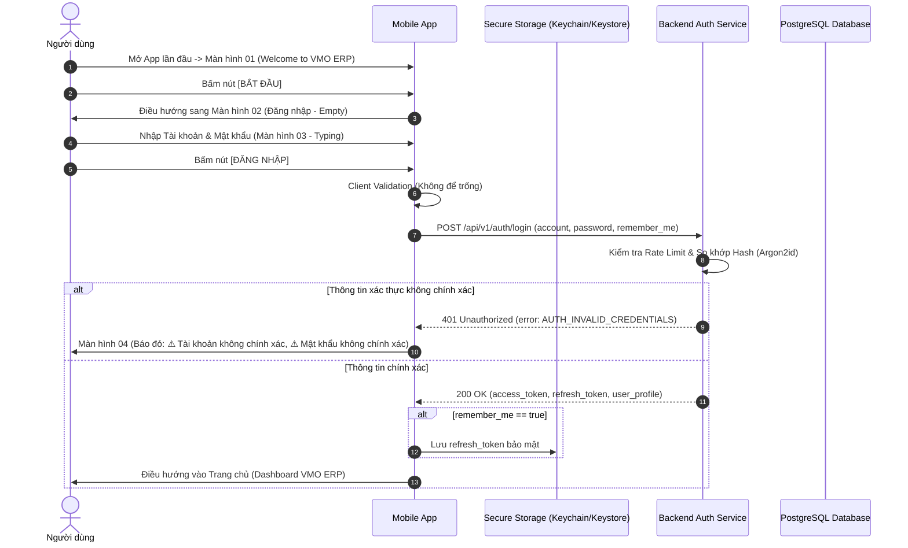
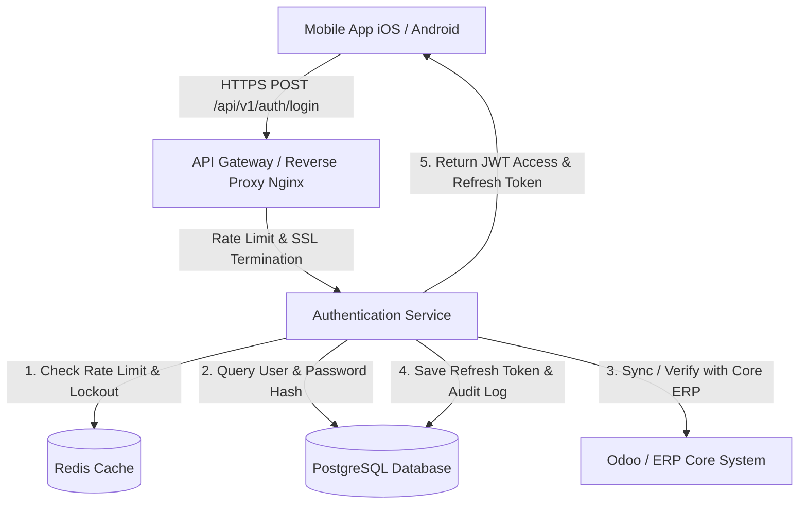
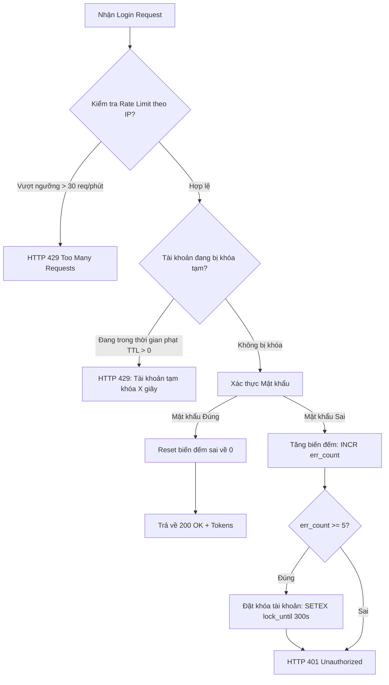

# TÀI LIỆU ĐẶC TẢ YÊU CẦU PHẦN MỀM (SRS)
## Module: Xác thực & Khởi động ứng dụng (Authentication & Onboarding)
### Màn hình: Chào mừng (Welcome) & Đăng nhập Mobile (Màn hình 01 - 04)

| Thông tin | Chi tiết |
| :--- | :--- |
| **Mã màn hình** | `SCR_AUTH_WELCOME_001` & `SCR_AUTH_LOGIN_002` |
| **Tên module** | Khởi động (Welcome) & Đăng nhập Mobile (Màn hình 01 - 04) |
| **Dự án** | VMO ERP System |
| **Nền tảng** | iOS & Android (Mobile App) + Backend Auth Microservices |
| **Tệp thiết kế nguồn** | `ERP - App.fig` (Section: `Đăng nhập` - Các màn hình: `01`, `02`, `03`, `04`) |
| **Phiên bản SRS** | 2.1 (Bản đầy đủ toàn diện cả UI Màn hình 01-04 & Toàn bộ Logic Backend chuyên sâu) |
| **Ngày tạo** | 21/10/2026 |
| **Trạng thái** | Sẵn sàng triển khai (Ready for Dev/QA) |

---

## 1. Giới thiệu tổng quan (Overview & Scope)

### 1.1 Mục đích tài liệu
Tài liệu này đặc tả chi tiết toàn bộ yêu cầu giao diện (UI/UX), yêu cầu chức năng (FR), quy tắc nghiệp vụ (BR), xử lý ngoại lệ và kiến trúc xử lý kỹ thuật phía Backend cho cụm **Màn hình từ 01 đến 04** thuộc phân hệ **"Đăng nhập"** trên ứng dụng di động VMO ERP. Tài liệu phục vụ làm chuẩn kỹ thuật cho đội ngũ phát triển Mobile (React Native / Flutter / Native), Backend API và đội ngũ QA/Tester thiết kế kịch bản kiểm thử (Test Cases).

### 1.2 Phạm vi nghiệp vụ
* **Màn hình 01 (`SCR_AUTH_WELCOME_001`):** Màn hình khởi động, hiển thị Poster nghệ thuật VMO, thông điệp chào mừng và nút `Bắt đầu`.
* **Màn hình 02, 03, 04 (`SCR_AUTH_LOGIN_002`):** Cổng xác thực danh tính duy nhất dành cho người dùng trên thiết bị di động với các trạng thái: Mặc định (Empty), Đang nhập liệu (Typing) và Báo lỗi xác thực (Error State).
* **Cơ chế xác thực tài khoản:** Cho phép nhập **Email công ty** (`Hello@vmogroup.com`) hoặc **Username / Mã nhân viên nội bộ** cùng **Mật khẩu**.
* **Các tính năng tiện ích:**
  * Ghi nhớ phiên đăng nhập (`Nhớ mật khẩu`).
  * Xem / ẩn mật khẩu khi nhập liệu (Show / Hide Password với icon mắt mở `👁` và mắt nhắm).
  * Chuyển hướng tới luồng khôi phục tài khoản xác thực 2 yếu tố (`Đặt lại mật khẩu`).
* **Kiến trúc Backend chuyên sâu:**
  * Thuật toán băm Argon2id / BCrypt cost factor 12, Constant-Time Comparison chống Timing-Attack.
  * Cơ chế cấp phát & xoay vòng Token (RS256 JWT, Refresh Token Rotation - RTR & Replay Detection).
  * Chống tấn công Brute-force qua Redis Sliding Window Counter (bảo vệ 2 tầng theo IP và Account).
  * Quản lý phiên đa thiết bị (tối đa 3 thiết bị) và đồng bộ trạng thái qua FCM Push Tokens.
  * Tích hợp hệ thống lõi ERP / Odoo (Dual-Auth / Hybrid Model).

### 1.3 Đối tượng người dùng
* Toàn bộ nhân viên, quản lý, ban giám đốc sở hữu tài khoản hợp lệ trong hệ thống nội bộ VMO ERP.

---

## 2. Đặc tả chi tiết từng màn hình (Screen-by-Screen Specifications)

---

### 2.1 MÀN HÌNH 01: MÀN HÌNH CHÀO MỪNG (WELCOME / ONBOARDING SCREEN)

#### Sơ đồ bố cục Mobile (Màn hình 01)
```
+-------------------------------------------------+
|  [Status Bar: 9:41, Sóng, Wifi, Pin]            |
|                                                 |
|  +-------------------------------------------+  |
|  |                                           |  |
|  |           [ HÌNH MINH HỌA NGHỆ THUẬT ]    |  |
|  |        Poster khối hình học màu cam/xanh  |  |
|  |        với Logo VMO hình tròn nổi bật     |  |
|  |                                           |  |
|  +-------------------------------------------+  |
|                                                 |
|               Welcome to VMO ERP                |
|                                                 |
|  +-------------------------------------------+  |
|  |                  BẮT ĐẦU                  |  |
|  +-------------------------------------------+  |
|                                                 |
|                [Home Indicator]                 |
+-------------------------------------------------+
```

#### Chi tiết thành phần & Tương tác Màn hình 01
* **Status Bar:** Hiển thị thời gian 9:41, pin, wifi theo chuẩn hệ điều hành.
* **Poster minh họa nghệ thuật:** Card hình chữ nhật đứng bo tròn góc, minh họa hình ảnh đồ họa phong cách Geometric Abstract sử dụng màu cam `#F05A22` chủ đạo, chính giữa là logo hình tròn VMO.
* **Tiêu đề chính:** **`Welcome to VMO ERP`** (Font SF Pro Display / Roboto, Bold, Size 20-22px, màu đen, căn giữa).
* **Nút hành động chính:** **`[ Bắt đầu ]`** (Get Started):
  * Vị trí: Đáy màn hình, cách lề dưới an toàn (Safe area).
  * Kiểu dáng: Nền màu cam thương hiệu VMO, chữ trắng in đậm, bo góc tiêu chuẩn (Border Radius: 12px).
  * Hành vi: Khi người dùng chạm vào nút `[ Bắt đầu ]`, ứng dụng chuyển cảnh mượt mà (Slide transition) sang Màn hình 02 (`Đăng nhập`).

---

### 2.2 MÀN HÌNH 02, 03, 04: MÀN HÌNH ĐĂNG NHẬP (DEFAULT, TYPING, ERROR)

#### Sơ đồ bố cục Mobile tổng thể (Màn hình 02, 03, 04)
```
+-------------------------------------------------+
|  [Status Bar: 9:41]                             |
|  [<]                              [O] [Họa tiết]|
|                                                 |
|  (O) Họa tiết                                   |
|                                                 |
|                    Xin chào!                    |
|           Chào mừng bạn quay trở lại!           |
|                                                 |
|  Tài khoản                                      |
|  +-------------------------------------------+  |
|  | Hello@vmogroup.com                        |  |
|  +-------------------------------------------+  |
|  ⚠️ Tài khoản không chính xác                    |
|                                                 |
|  Mật khẩu                                       |
|  +-------------------------------------------+  |
|  | Daylamatkhau                          [👁] |  |
|  +-------------------------------------------+  |
|  ⚠️ Mật khẩu không chính xác                     |
|                                                 |
|  [X] Nhớ mật khẩu                               |
|                                                 |
|  +-------------------------------------------+  |
|  |                 ĐĂNG NHẬP                 |  |
|  +-------------------------------------------+  |
|                                                 |
|               Đặt lại mật khẩu                  |
|                                                 |
|                [Home Indicator]                 |
+-------------------------------------------------+
```

#### Đặc tả chi tiết 3 trạng thái màn hình Đăng nhập

##### 1. Màn hình 02 (Trạng thái mặc định / Empty):
* **Nút Back `[<]`:** Nằm ở góc trên bên trái, cho phép quay trở lại Màn hình 01 (Welcome).
* **Họa tiết trang trí thương hiệu:** Vòng tròn bo cong màu cam thương hiệu ở góc trên bên phải và góc dưới bên phải.
* **Tiêu đề chào mừng:**
  * Dòng chính: **`Xin chào!`** (Font Bold, Size 24px, màu đen, căn giữa).
  * Dòng phụ: **`Chào mừng bạn quay trở lại!`** (Font Regular, Size 14px, màu xám nhạt, căn giữa).
* **Ô nhập 1 (`Tài khoản`):** Nhãn placeholder hiển thị chữ `Tài khoản`.
* **Ô nhập 2 (`Mật khẩu`):** Nhãn placeholder hiển thị chữ `Mật khẩu`, icon mắt nhắm ở góc phải.
* **Checkbox:** Mặc định được tích chọn **`[X] Nhớ mật khẩu`**.
* **Nút bấm:** Nút chính `[ Đăng nhập ]` (Màu cam, chữ trắng) và liên kết `Đặt lại mật khẩu` màu cam ở dưới.

##### 2. Màn hình 03 (Trạng thái đang nhập liệu / Typing):
* **Ô nhập 1:** Hiển thị tài khoản đã nhập: **`Hello@vmogroup.com`**.
* **Ô nhập 2:** Hiển thị mật khẩu đã nhập dưới dạng dấu chấm tròn bảo mật: **`•••••••••••••••••••••`** (Icon mắt nhắm).
* **Checkbox:** Người dùng bỏ tích chọn **`[ ] Nhớ mật khẩu`**.

##### 3. Màn hình 04 (Trạng thái báo lỗi xác thực / Error State):
* **Ô nhập 1:** Nhập tài khoản không đúng: `Hello@vmogroup.comz`.
  * Xuất hiện thông báo lỗi đỏ kèm icon tam giác cảnh báo: **`⚠️ Tài khoản không chính xác`**.
  * Khung viền ô nhập đổi sang màu đỏ viền (#FF4D4F).
* **Ô nhập 2:** Nhập mật khẩu: `Daylamatkhau`.
  * Icon mắt đang ở trạng thái **Mở mắt `[👁]`** $\rightarrow$ Ký tự mật khẩu hiển thị rõ ràng dạng văn bản thuần (`Daylamatkhau`).
  * Xuất hiện thông báo lỗi đỏ kèm icon tam giác cảnh báo: **`⚠️ Mật khẩu không chính xác`**.
  * Khung viền ô nhập đổi sang màu đỏ viền (#FF4D4F).
* **Checkbox:** Đang được tích chọn **`[X] Nhớ mật khẩu`**.

---

### 2.3 Từ điển thành phần giao diện (UI Elements Dictionary)

| STT | Tên thành phần | Loại Control | Giá trị mặc định / Placeholder | Ràng buộc dữ liệu | Mô tả chi tiết & Hành vi tương tác |
| :---: | :--- | :--- | :--- | :--- | :--- |
| **1** | **Top Status Bar** | System Bar | Thời gian thực, Pin, Sóng mạng | - | Theo chuẩn hệ điều hành iOS (iPhone X/11 trở lên có Notch) hoặc Android StatusBar. |
| **2** | **Nút Back [<]** | Icon Button | Mũi tên trái | Clickable | Nằm ở góc trên bên trái màn hình 02, 03, 04. Chạm vào quay về Màn hình 01. |
| **3** | **Tiêu đề chào mừng** | Static Text | `"Xin chào!"` & `"Chào mừng bạn quay trở lại!"` | - | Font: SF Pro Display / Roboto, Bold 24px và Regular 14px. |
| **4** | **Input Tài khoản** | Text Input Field | Placeholder: `"Tài khoản"` | Max 100 ký tự | Chấp nhận Email công ty (`Hello@vmogroup.com`) hoặc Username nội bộ (`anhnq2`, `VMO1409`). Bàn phím mở ra dạng email input. Hỗ trợ autofill. |
| **5** | **Error Tài khoản** | Dynamic Text + Icon | Ẩn mặc định | Tối đa 2 dòng | Xuất hiện khi sai thông tin. Hiển thị: `"⚠️ Tài khoản không chính xác"` màu đỏ (#FF4D4F). Viền ô chuyển màu đỏ. |
| **6** | **Input Mật khẩu** | Secure Text Field | Placeholder: `"Mật khẩu"` | 6 - 64 ký tự | Mặc định ẩn ký tự dạng chấm tròn. Không cho phép copy/cut để bảo mật. |
| **7** | **Icon Show/Hide Password** | Toggle Icon | Mặc định: Mắt nhắm | Clickable | Khi ở trạng thái mắt nhắm: che ký tự. Khi chạm chuyển sang mắt mở `[👁]`: hiển thị rõ mật khẩu như màn 04 (`Daylamatkhau`). |
| **8** | **Error Mật khẩu** | Dynamic Text + Icon | Ẩn mặc định | Tối đa 2 dòng | Xuất hiện khi sai mật khẩu. Hiển thị: `"⚠️ Mật khẩu không chính xác"` màu đỏ. Viền ô chuyển màu đỏ. |
| **9** | **Checkbox Nhớ mật khẩu** | Checkbox Control | Mặc định: Chọn (`true`) | Boolean | Kèm nhãn `"Nhớ mật khẩu"`. Lưu `Refresh Token` vào Keychain/Keystore để tự động đăng nhập ngầm ở các lần mở app sau. |
| **10** | **Link Đặt lại mật khẩu** | Text Button / Link | `"Đặt lại mật khẩu"` | Clickable | Căn giữa bên dưới nút Đăng nhập. Màu cam thương hiệu (`Orange 01` - `#F05A22`). Khi bấm: chuyển hướng sang luồng khôi phục tài khoản 2FA. |
| **11** | **Nút Đăng nhập** | Primary Button | Label: `"Đăng nhập"` | Clickable | Nền màu cam thương hiệu (`Orange 01`), bo góc tiêu chuẩn (Border Radius: 12px), chữ trắng in đậm (Bold). Có spinner khi gọi API. |
| **12** | **Home Indicator** | System Bar | - | - | Thanh gạt đáy màn hình chuẩn thiết bị màn hình tràn viền. |

---

## 3. Quy tắc nghiệp vụ (Business Rules - BR)

* **BR-AUTH-01 (Định danh đăng nhập - Tài khoản):**
  * Trường `Tài khoản` chấp nhận cả 2 định dạng:
    1. **Email công ty:** Ví dụ `Hello@vmogroup.com`, `tungvt@vmodev.com` (Đúng chuẩn RFC 5322).
    2. **Username / Mã nhân viên nội bộ:** Ví dụ `anhnq2`, `VMO1409`.
  * Hệ thống tự động xóa khoảng trắng ở đầu và cuối chuỗi (`trim()`) trước khi gửi lên API.
* **BR-AUTH-02 (Ràng buộc Mật khẩu & Hiển thị):**
  * Mật khẩu tối thiểu 6 ký tự, tối đa 64 ký tự. Không được để trống.
  * Khi icon con mắt nhắm: Ký tự bị che bằng dấu chấm tròn đen hoặc dấu sao.
  * Khi chạm icon con mắt chuyển sang mở mắt `[👁]`: Ký tự hiển thị rõ ràng (như màn 04: `Daylamatkhau`) để người dùng đối soát khi nhập mật khẩu phức tạp.
* **BR-AUTH-03 (Chức năng Nhớ mật khẩu - Remember Me):**
  * **Nếu tích chọn (`[X]`):** Sau khi xác thực thành công, lưu `Refresh Token` dài hạn (30 ngày) vào phân vùng bảo mật phần cứng của thiết bị (iOS Keychain / Android Keystore). Khi mở lại app, người dùng được tự động đăng nhập ngầm vào thẳng Dashboard.
  * **Nếu bỏ chọn (`[ ]`):** Phiên làm việc chỉ duy trì trong RAM (In-memory) hoặc ngắn hạn (24 giờ). Khi tắt hẳn app hoặc hết phiên, người dùng phải nhập lại tài khoản và mật khẩu.
* **BR-AUTH-04 (Chống tấn công Brute-force & Rate Limiting):**
  * Giới hạn tối đa **5 lần nhập sai liên tiếp** trong vòng 15 phút.
  * Nếu sai quá 5 lần: Khóa tạm thời tính năng đăng nhập trên tài khoản đó trong vòng **5 phút** (`HTTP 429 Too Many Requests`).
* **BR-AUTH-05 (Điều hướng Đặt lại mật khẩu):**
  * Khi người dùng chạm vào liên kết **`Đặt lại mật khẩu`**: Ứng dụng điều hướng sang luồng khôi phục tài khoản xác thực 2 yếu tố (2FA qua Email / SMS) được đặc tả tại [SRS_Dat_Lai_Mat_Khau_2FA.md](file:///Users/hoangkien/project/erp/SRS_Dat_Lai_Mat_Khau_2FA.md).

---

## 4. Sơ đồ luồng xử lý toàn trình (Sequence Diagram)



---

## 5. Đặc tả Hợp đồng API phía Backend (Backend API Contracts)

### 5.1 Endpoint: Xác thực Đăng nhập
* **Method:** `POST`
* **Path:** `/api/v1/auth/login`
* **Content-Type:** `application/json`

#### Request Body
```json
{
  "account": "Hello@vmogroup.com", // Hỗ trợ Email hoặc Username/Mã NV
  "password": "Daylamatkhau123@",
  "device_id": "9B1D6F2C-8E1A-4C7B-B4D8-7264A0184A29",
  "device_name": "iPhone 11 Pro",
  "platform": "ios",
  "remember_me": true
}
```

#### Response: Đăng nhập thành công (`200 OK`)
```json
{
  "success": true,
  "code": 200,
  "message": "Đăng nhập thành công",
  "data": {
    "access_token": "eyJhbGciOiJIUzI1NiIsInR5cCI6IkpXVCJ9...",
    "refresh_token": "def50200a8c2f10b77e...",
    "token_type": "Bearer",
    "expires_in": 1800,
    "user": {
      "id": 1409,
      "employee_code": "VMO-1409",
      "full_name": "Nguyễn Văn A",
      "email": "Hello@vmogroup.com",
      "avatar_url": "https://cdn.erp.vmodev.com/avatar/1409.png",
      "job_title": "Designer",
      "role": "EMPLOYEE"
    }
  }
}
```

#### Response: Lỗi thông tin xác thực (`401 Unauthorized`) -> Chuyển sang Màn hình 04
```json
{
  "success": false,
  "code": 401,
  "error": "AUTH_INVALID_CREDENTIALS",
  "message": "Tài khoản hoặc mật khẩu không chính xác",
  "details": {
    "account_error": "Tài khoản không chính xác",
    "password_error": "Mật khẩu không chính xác"
  }
}
```

#### Response: Tài khoản bị khóa (`403 Forbidden`)
```json
{
  "success": false,
  "code": 403,
  "error": "AUTH_ACCOUNT_DISABLED",
  "message": "Tài khoản của bạn đã bị khóa hoặc ngừng hoạt động. Vui lòng liên hệ HR."
}
```

#### Response: Bị tạm khóa do thử sai quá 5 lần (`429 Too Many Requests`)
```json
{
  "success": false,
  "code": 429,
  "error": "AUTH_RATE_LIMIT_EXCEEDED",
  "message": "Bạn đã nhập sai thông tin quá 5 lần. Vui lòng thử lại sau 300 giây.",
  "retry_after": 300
}
```

---

## 6. Yêu cầu phi chức năng (Non-Functional Requirements - NFR)

1. **Hiệu năng (Performance):**
   * Thời gian khởi chạy và render Màn hình 01 (Welcome): $\le 0.8$ giây.
   * Thời gian phản hồi từ lúc bấm nút `Đăng nhập` tới khi chuyển màn hình: $\le 1.2$ giây trong điều kiện mạng ổn định.
   * Tốc độ phản hồi chạm con mắt ẩn/hiện mật khẩu đạt 60 FPS, không có độ trễ giật (lag).
2. **Bảo mật (Security):**
   * Toàn bộ lưu lượng truyền tải bắt buộc sử dụng **HTTPS / TLS 1.3**.
   * Nghiêm cấm in vết mật khẩu hoặc mã token ra Logcat / Console / Crashlytics.
   * Mã hóa lưu trữ `Refresh Token` bằng iOS Keychain / Android Keystore.
3. **Trải nghiệm người dùng (UX / Usability):**
   * Tương thích với trình quản lý mật khẩu hệ thống (iCloud Keychain, Google Password Manager).
   * Khi ở trường `Tài khoản`, nhấn phím `Next` trên bàn phím sẽ tự động nhảy con trỏ sang trường `Mật khẩu`; khi ở trường `Mật khẩu`, nhấn phím `Done` / `Go` sẽ tự động kích hoạt sự kiện bấm nút `Đăng nhập`.

---

## 7. Đặc tả kỹ thuật & Logic xử lý chi tiết phía Backend (Backend Architecture & Processing Logic)

### 7.1 Sơ đồ kiến trúc xác thực phía Server (Backend Auth Architecture)



---

### 7.2 Thuật toán băm và kiểm tra mật khẩu (Password Hashing & Verification)

1. **Chuẩn thuật toán băm (Hashing Algorithm):**
   * Sử dụng **Argon2id** (chuẩn khuyến nghị OWASP) hoặc **BCrypt** với Cost Factor tối thiểu là `12` (work factor: $2^{12} = 4096$ iterations).
   * Mỗi mật khẩu bắt buộc phải đi kèm một chuỗi muối ngẫu nhiên mã hóa mạnh (**Cryptographic Salt**) độ dài tối thiểu 16 bytes được tạo bằng CSPRNG (Cryptographically Secure Pseudo-Random Number Generator).
2. **Chống tấn công thời gian (Timing-Attack Mitigation):**
   * Quá trình so khớp hash mật khẩu phải sử dụng hàm so sánh với thời gian cố định (**Constant-Time Comparison**, ví dụ: `crypto.timingSafeEqual` trong Node.js hoặc `hmac.compare_digest` trong Python) nhằm ngăn chặn việc tin tặc đo thời gian phản hồi để đoán độ dài và tiền tố mật khẩu.
   * Nếu người dùng nhập một tài khoản không tồn tại trong DB, hệ thống vẫn phải thực hiện một phép tính băm mật khẩu giả định (Dummy Hash Verification) với thời gian trễ tương đương để thời gian phản hồi giữa tài khoản tồn tại và không tồn tại là đồng nhất.

---

### 7.3 Cơ chế quản lý Token & Phiên làm việc (JWT & Refresh Token Rotation - RTR)

#### 7.3.1 Cấu trúc Access Token (Stateless JWT)
* **Thuật toán ký:** `RS256` (Asymmetric Key Pair - Khóa bất đối xứng RSA 2048-bit). Auth Service giữ Private Key để ký, các Microservices khác trong hệ thống ERP chỉ cần Public Key để xác thực chữ ký mà không cần gọi ngược về Auth Service.
* **Thời gian sống (TTL):** Ngắn hạn, từ **15 phút đến 30 phút**.
* **Payload cấu trúc chuẩn:**
```json
{
  "iss": "https://auth.erp.vmodev.com",
  "sub": "1409",
  "aud": "vmo-erp-mobile",
  "iat": 1729500000,
  "exp": 1729501800,
  "jti": "550e8400-e29b-41d4-a716-446655440000",
  "employee_code": "VMO-1409",
  "email": "Hello@vmogroup.com",
  "job_title": "Designer",
  "roles": ["EMPLOYEE"],
  "permissions": ["timesheet:create", "leave:request", "overtime:create"],
  "device_id": "9B1D6F2C-8E1A-4C7B-B4D8-7264A0184A29"
}
```

#### 7.3.2 Cấu trúc Refresh Token (Stateful & Secure Storage)
* **Định dạng:** Chuỗi Opaque ngẫu nhiên độ dài 64 hex characters (256 bits entropy) sinh bởi CSPRNG.
* **Bảo mật lưu trữ:** Phía Backend **không bao giờ lưu trữ Refresh Token dưới dạng Plain Text**. Chỉ lưu giá trị băm **`SHA-256(refresh_token)`** trong cơ sở dữ liệu.
* **Thời gian sống (TTL):**
  * Khi `remember_me = false`: Thời hạn 7 ngày.
  * Khi `remember_me = true`: Thời hạn 30 ngày (tự động gia hạn khi có hoạt động).

#### 7.3.3 Cơ chế Xoay vòng Refresh Token (Refresh Token Rotation - RTR & Replay Detection)
Nhằm triệt tiêu rủi ro lộ Refresh Token trên thiết bị di động:
1. Mỗi khi Mobile App sử dụng một Refresh Token để xin cấp Access Token mới:
   * Backend kiểm tra tính hợp lệ của token trong DB.
   * Lập tức đánh dấu Refresh Token cũ là **`is_revoked = true`** (hoặc xóa khỏi DB).
   * Sinh một cặp Token mới (Access Token mới + Refresh Token mới) trả về cho Client.
2. **Cơ chế phát hiện tấn công tái sử dụng token (Token Replay Attack Detection):**
   * Nếu Backend nhận được một Refresh Token đã bị đánh dấu là `is_revoked = true` được gửi lên để xin cấp quyền:
   * Hệ thống xác định phiên làm việc này đã bị đánh cắp (Token Hijacking).
   * **Hành động tức thì:** Backend lập tức thu hồi toàn bộ nhóm token (**Token Family**) của tài khoản đó, hủy toàn bộ phiên đang hoạt động trên thiết bị tương ứng, buộc người dùng phải đăng nhập lại từ đầu và gửi thông báo cảnh báo bảo mật tới email của nhân viên.

---

### 7.4 Thuật toán chống dò quét Brute-force & Giới hạn tần suất (Rate Limiting via Redis)

Sử dụng Redis theo cơ chế **Sliding Window Counter** hoặc **Token Bucket** với 2 tầng khóa bảo vệ:



1. **Tầng 1: Bảo vệ theo địa chỉ IP thiết bị (`client_ip`)**
   * Giới hạn tối đa **30 lượt yêu cầu đăng nhập / 1 phút / 1 IP**. Vượt ngưỡng sẽ bị chặn ở tầng API Gateway (HTTP 429).
2. **Tầng 2: Bảo vệ theo tài khoản (`account_normalized`)**
   * Khóa Redis: `auth:failed_attempts:{account}` (TTL = 900 giây / 15 phút).
   * Khóa Lockout: `auth:locked:{account}` (TTL = 300 giây / 5 phút).
   * **Quy tắc lũy tiến:**
     * Lần thử sai 1 - 4: Tăng biến đếm `INCR auth:failed_attempts:{account}`. Trả về HTTP 401 kèm thông báo lỗi.
     * Lần thử sai thứ 5: Kích hoạt `SETEX auth:locked:{account} 300 "LOCKED"`. Trả về mã HTTP 429 kèm header `Retry-After: 300`.
     * Nếu tiếp tục tái diễn lần thứ 10: Tăng thời gian phạt lên 15 phút (900s) và gửi email cảnh báo đăng nhập bất thường cho chủ tài khoản.

---

### 7.5 Quản lý phiên đa thiết bị & Đồng bộ trạng thái (Multi-Device Session Policy)

1. **Chính sách phiên làm việc (Session Policy):**
   * Cho phép mỗi nhân viên đăng nhập tối đa trên **3 thiết bị di động đồng thời**.
   * Khi đăng nhập trên thiết bị thứ 4: Hệ thống tự động thu hồi phiên (revoke) của thiết bị có thời gian hoạt động cũ nhất (`last_active_at` xa nhất).
2. **Quản lý thiết bị (Device Registry):**
   * Khi đăng nhập thành công, Backend lưu lại định danh thiết bị:
     * `device_id` (UUID cố định sinh từ phía ứng dụng di động).
     * `device_name` (Ví dụ: "iPhone 11 Pro", "Samsung Galaxy S22").
     * `platform` (`ios` hoặc `android`).
     * `push_token` (FCM Token / APNs Token) phục vụ thông báo đẩy (Push Notifications) khi có phê duyệt đơn từ, chấm công hoặc cảnh báo đăng nhập.
3. **Thu hồi phiên làm việc từ xa (Remote Session Revocation):**
   * Khi nhân viên thực hiện thao tác **Đổi mật khẩu** hoặc yêu cầu **Đăng xuất khỏi tất cả thiết bị**: Backend cập nhật `is_revoked = true` cho toàn bộ Refresh Token của tài khoản đó.

---

### 7.6 Thiết kế lược đồ cơ sở dữ liệu chi tiết (Database Schema DDL)

Hệ thống sử dụng cơ sở dữ liệu quan hệ **PostgreSQL**.

```sql
-- 1. Bảng lưu trữ thông tin người dùng / nhân viên
CREATE TABLE users (
    id BIGSERIAL PRIMARY KEY,
    employee_code VARCHAR(32) NOT NULL UNIQUE,
    username VARCHAR(64) NOT NULL UNIQUE,
    email VARCHAR(128) NOT NULL UNIQUE,
    password_hash VARCHAR(255) NOT NULL,
    full_name VARCHAR(128) NOT NULL,
    avatar_url VARCHAR(512),
    department_id BIGINT,
    job_title VARCHAR(128),
    role VARCHAR(32) NOT NULL DEFAULT 'EMPLOYEE',
    status VARCHAR(20) NOT NULL DEFAULT 'ACTIVE', -- ACTIVE, LOCKED, SUSPENDED, TERMINATED
    failed_login_attempts INT NOT NULL DEFAULT 0,
    locked_until TIMESTAMP WITH TIME ZONE NULL,
    created_at TIMESTAMP WITH TIME ZONE DEFAULT CURRENT_TIMESTAMP,
    updated_at TIMESTAMP WITH TIME ZONE DEFAULT CURRENT_TIMESTAMP
);

CREATE INDEX idx_users_email ON users(email);
CREATE INDEX idx_users_username ON users(username);
CREATE INDEX idx_users_employee_code ON users(employee_code);

-- 2. Bảng quản lý thiết bị người dùng
CREATE TABLE user_devices (
    id BIGSERIAL PRIMARY KEY,
    user_id BIGINT NOT NULL REFERENCES users(id) ON DELETE CASCADE,
    device_id VARCHAR(128) NOT NULL,
    device_name VARCHAR(128),
    platform VARCHAR(20) NOT NULL, -- 'ios', 'android'
    push_token VARCHAR(512),
    is_active BOOLEAN NOT NULL DEFAULT TRUE,
    last_active_at TIMESTAMP WITH TIME ZONE DEFAULT CURRENT_TIMESTAMP,
    created_at TIMESTAMP WITH TIME ZONE DEFAULT CURRENT_TIMESTAMP,
    CONSTRAINT uq_user_device UNIQUE (user_id, device_id)
);

CREATE INDEX idx_user_devices_lookup ON user_devices(user_id, device_id);

-- 3. Bảng quản lý Refresh Token (Hỗ trợ RTR và Token Family)
CREATE TABLE user_refresh_tokens (
    id BIGSERIAL PRIMARY KEY,
    user_id BIGINT NOT NULL REFERENCES users(id) ON DELETE CASCADE,
    device_id VARCHAR(128) NOT NULL,
    token_hash VARCHAR(64) NOT NULL UNIQUE, -- Lưu trữ SHA-256 hash của token
    family_id UUID NOT NULL,               -- Định danh chuỗi luân chuyển token để phát hiện replay attack
    is_revoked BOOLEAN NOT NULL DEFAULT FALSE,
    revoked_at TIMESTAMP WITH TIME ZONE NULL,
    expires_at TIMESTAMP WITH TIME ZONE NOT NULL,
    created_at TIMESTAMP WITH TIME ZONE DEFAULT CURRENT_TIMESTAMP
);

CREATE INDEX idx_refresh_tokens_hash ON user_refresh_tokens(token_hash);
CREATE INDEX idx_refresh_tokens_family ON user_refresh_tokens(family_id);

-- 4. Bảng nhật ký kiểm toán đăng nhập (Audit Login Logs)
CREATE TABLE audit_login_logs (
    id BIGSERIAL PRIMARY KEY,
    user_id BIGINT NULL REFERENCES users(id) ON DELETE SET NULL,
    attempted_account VARCHAR(128) NOT NULL,
    ip_address VARCHAR(45) NOT NULL,
    user_agent TEXT,
    device_id VARCHAR(128),
    status VARCHAR(20) NOT NULL, -- 'SUCCESS', 'FAILED', 'LOCKED', 'BLOCKED'
    failure_reason VARCHAR(128) NULL,
    created_at TIMESTAMP WITH TIME ZONE DEFAULT CURRENT_TIMESTAMP
);

CREATE INDEX idx_audit_logs_account ON audit_login_logs(attempted_account, created_at DESC);
CREATE INDEX idx_audit_logs_ip ON audit_login_logs(ip_address, created_at DESC);
```

---

### 7.7 Tích hợp hệ thống lõi ERP / Odoo (ERP Core Integration)

Dựa trên cấu trúc hệ sinh thái ERP của dự án (tích hợp Odoo):
1. **Mô hình xác thực hai chiều (Dual-Auth / Hybrid Model):**
   * Nếu người dùng đăng nhập lần đầu hoặc đổi mật khẩu: Auth Service gọi đồng bộ sang Odoo Backend qua JSON-RPC / REST API (`/web/session/authenticate` trên Odoo instance) để thẩm thực.
   * Khi Odoo xác thực thành công: Cập nhật thông tin `password_hash` và quyền hạn về PostgreSQL của Auth Service để phục vụ các lần truy vấn siêu tốc tiếp theo.
2. **Bộ nhớ đệm thông tin người dùng (User Permission Caching):**
   * Quyền hạn nhân viên (Roles & Department permissions) được cache vào Redis dưới key `user:permissions:{user_id}` với TTL = 600 giây (10 phút).
   * Khi phòng nhân sự cập nhật chức danh hoặc trạng thái nhân viên trên ERP Core: Phát ra sự kiện Kafka / Redis PubSub `USER_PERMISSIONS_CHANGED` để xóa cache ngay lập tức.

---

### 7.8 Thuật toán mã giả thực thi Backend (Backend Execution Pseudocode)

Dưới đây là mã giả logic tuần tự xử lý API Đăng nhập tại tầng Service:

```python
def handle_login(request_data, client_ip, user_agent):
    raw_account = request_data.get("account")
    account = sanitize_and_lowercase(raw_account)
    password = request_data.get("password")
    device_id = request_data.get("device_id")
    device_name = request_data.get("device_name")
    platform = request_data.get("platform")
    remember_me = bool(request_data.get("remember_me", True)) # Mặc định nhớ mật khẩu

    # 1. Kiểm tra giới hạn tần suất theo IP (DDoS Protection)
    if redis.get_rate_limit(f"ratelimit:ip:{client_ip}") > 30:
        return HTTP_429("Too many requests from this IP", retry_after=60)

    # 2. Kiểm tra tài khoản có đang bị khóa tạm thời không
    if redis.exists(f"auth:locked:{account}"):
        ttl_remaining = redis.ttl(f"auth:locked:{account}")
        return HTTP_429(f"Tài khoản bị tạm khóa do nhập sai nhiều lần. Thử lại sau {ttl_remaining} giây", retry_after=ttl_remaining)

    # 3. Tìm người dùng trong cơ sở dữ liệu (Tìm theo Email HOẶC Username HOẶC Mã NV)
    user = db.users.find_by_account_or_email_or_code(account)
    
    # Kỹ thuật phòng chống Timing Attack: Nếu user không tồn tại, vẫn chạy verify giả
    if not user:
        argon2.verify_dummy_hash(password)
        log_audit(None, account, client_ip, device_id, "FAILED", "USER_NOT_FOUND")
        record_failed_attempt(account)
        return HTTP_401("Tài khoản hoặc mật khẩu không chính xác", field="account")

    # 4. Kiểm tra trạng thái tài khoản
    if user.status != "ACTIVE":
        log_audit(user.id, account, client_ip, device_id, "BLOCKED", f"USER_{user.status}")
        return HTTP_403("Tài khoản của bạn đã bị vô hiệu hóa hoặc ngừng hoạt động", code="AUTH_ACCOUNT_DISABLED")

    # 5. So khớp mật khẩu với hàm hằng thời gian (Constant-time verify)
    is_valid_password = argon2.verify(user.password_hash, password)
    if not is_valid_password:
        failed_count = record_failed_attempt(account)
        log_audit(user.id, account, client_ip, device_id, "FAILED", "WRONG_PASSWORD")
        if failed_count >= 5:
            redis.setex(f"auth:locked:{account}", 300, "LOCKED")
            return HTTP_429("Bạn đã nhập sai quá 5 lần. Tài khoản bị tạm khóa 5 phút.", retry_after=300)
        return HTTP_401("Tài khoản hoặc mật khẩu không chính xác", field="password")

    # 6. Đăng nhập thành công -> Xóa các biến đếm thất bại trong Redis
    redis.delete(f"auth:failed_attempts:{account}")
    redis.delete(f"auth:locked:{account}")

    # 7. Cập nhật thiết bị và quản lý giới hạn 3 thiết bị
    db.user_devices.upsert(
        user_id=user.id,
        device_id=device_id,
        device_name=device_name,
        platform=platform,
        last_active_at=now()
    )
    cleanup_excess_devices(user.id, max_devices=3)

    # 8. Sinh Token Family và sinh cặp Token (RS256 JWT)
    family_id = uuid4()
    access_token_payload = {
        "iss": "https://auth.erp.vmodev.com",
        "sub": str(user.id),
        "employee_code": user.employee_code,
        "email": user.email,
        "job_title": user.job_title,
        "roles": [user.role],
        "device_id": device_id,
        "exp": now_timestamp() + (1800 if not remember_me else 3600) # 30 phút hoặc 60 phút
    }
    access_token = jwt.sign(access_token_payload, private_key, algorithm="RS256")

    raw_refresh_token = generate_secure_random_hex(32)
    refresh_token_hash = sha256(raw_refresh_token)
    refresh_token_ttl_days = 30 if remember_me else 7
    
    db.user_refresh_tokens.create(
        user_id=user.id,
        device_id=device_id,
        token_hash=refresh_token_hash,
        family_id=family_id,
        expires_at=now() + days(refresh_token_ttl_days)
    )

    # 9. Ghi vết kiểm toán thành công (Audit Log)
    log_audit(user.id, account, client_ip, device_id, "SUCCESS", None)

    # 10. Trả về Response chuẩn
    return HTTP_200({
        "success": True,
        "code": 200,
        "message": "Đăng nhập thành công",
        "data": {
            "access_token": access_token,
            "refresh_token": raw_refresh_token,
            "token_type": "Bearer",
            "expires_in": 1800,
            "user": {
                "id": user.id,
                "employee_code": user.employee_code,
                "full_name": user.full_name,
                "email": user.email,
                "avatar_url": user.avatar_url,
                "job_title": user.job_title,
                "department": user.department_name,
                "role": user.role
            }
        }
    })
```
