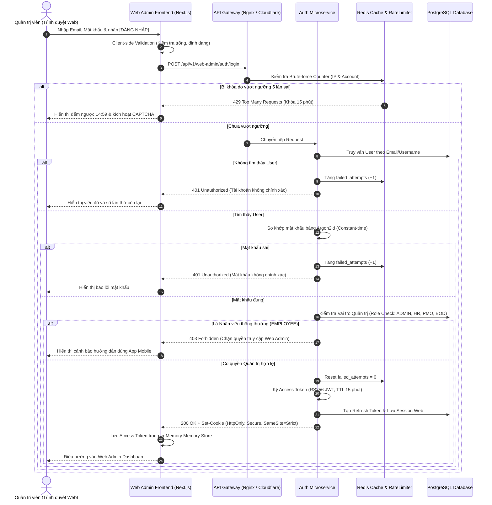

# TÀI LIỆU ĐẶC TẢ YÊU CẦU PHẦN MỀM (SRS)
## Phân hệ: Xác thực & Quản trị Truy cập Cổng Web Admin (Web Admin Authentication & Access Control)
### Màn hình: Đăng nhập Cổng Quản trị Web (Web Admin Login Portal)

| Thông tin | Chi tiết |
| :--- | :--- |
| **Mã tài liệu** | `SRS_WEB_AUTH_LOGIN_001` |
| **Tên phân hệ** | Xác thực & Đăng nhập Cổng Quản trị Web (Web Admin Portal Login) |
| **Dự án** | VMO ERP System - Web Admin Management Portal |
| **Nền tảng** | Web Application (Desktop Browser: Chrome, Safari, Edge, Firefox) + Backend Auth Microservices |
| **Tài liệu tham chiếu gốc** | [SRS_Login_Mobile.md](file:///Users/hoangkien/project/erp/SRS_Login_Mobile.md) |
| **Độ phân giải chuẩn** | Desktop ($1440 \times 900$, $1920 \times 1080$), Hỗ trợ Co giãn thích ứng (Responsive) Tablet ($768 - 1199$px) |
| **Phiên bản SRS** | 1.0 (Chuẩn hóa toàn diện UI Web Desktop, Cơ chế Bảo mật Cookie HttpOnly, RBAC Admin Guard, SSO Google & DDL) |
| **Ngày tạo** | 21/10/2026 |
| **Trạng thái** | Sẵn sàng triển khai (Ready for Dev/QA) |

---

## 1. Giới thiệu tổng quan phân hệ (Overview & Scope)

### 1.1 Mục đích tài liệu
Tài liệu này đặc tả chi tiết toàn bộ yêu cầu giao diện người dùng (UI/UX), yêu cầu chức năng (FR), quy tắc nghiệp vụ (BR), xử lý bảo mật trên trình duyệt web, đặc tả hợp đồng API phía Backend, lược đồ cơ sở dữ liệu quan hệ (PostgreSQL Schema DDL) và các yêu cầu phi chức năng (NFR) cho **Màn hình Đăng nhập Cổng Quản trị Web (Web Admin Login)** thuộc hệ thống VMO ERP.

Tài liệu được phát triển và chuyển đổi từ nền tảng di động [SRS_Login_Mobile.md](file:///Users/hoangkien/project/erp/SRS_Login_Mobile.md), đồng thời bổ sung các tiêu chuẩn bảo mật khắt khe và trải nghiệm đặc thù của môi trường Web Desktop cho các cấp lãnh đạo, quản lý và cán bộ chuyên trách.

### 1.2 Bảng so sánh Kiến trúc: Web Admin Login vs. Mobile Login

| Tiêu chí | Mobile Login ([SRS_Login_Mobile.md](file:///Users/hoangkien/project/erp/SRS_Login_Mobile.md)) | Web Admin Login (`SRS_Login_Web_Admin.md`) |
| :--- | :--- | :--- |
| **Bố cục giao diện** | 1 Cột dọc màn hình đơn ($375 \times 812$), có màn hình Welcome độc lập. | **Split-Screen 2 Cột ($1440 \times 900$ / $1920 \times 1080$):** Cột trái là Hero Branding Banner đồ họa VMO, Cột phải là Form đăng nhập trung tâm. |
| **Tương tác thiết bị** | Chạm cảm ứng (Touch), bàn phím ảo di động. | **Bàn phím vật lý:** Điều hướng phím `Tab`, bấm `Enter` để Submit, Cảnh báo phím `Caps Lock` đang bật, Tích hợp Password Manager (1Password, Chrome Keychain). |
| **Lưu trữ Token** | OS Secure Storage (iOS Keychain / Android KeyStore). | **`HttpOnly`, `SameSite=Strict`, `Secure` Cookies** nhằm triệt tiêu hoàn toàn nguy cơ tấn công XSS (Cross-Site Scripting). |
| **Phân quyền truy cập** | Toàn bộ nhân viên VMO (`EMPLOYEE`, `LEAD`, `PM`, `ADMIN`). | **Admin Role Guard:** Chỉ chấp nhận tài khoản có vai trò Quản trị (`ADMIN`, `HR_MANAGER`, `DEPT_LEAD`, `PMO`, `BOD`). Nhân viên thông thường bị chặn với thông báo điều hướng sang Mobile. |
| **Chống Bot tự động** | Rate Limiting theo Device ID / IP. | Tích hợp **Cloudflare Turnstile / Google reCAPTCHA v3** bảo vệ tự động khi phát hiện đăng nhập sai từ 3 lần trở lên. |
| **Xác thực Doanh nghiệp**| Nhập Username / Email nội bộ. | Hỗ trợ thêm **Đăng nhập một lần (Single Sign-On - SSO)** bằng tài khoản Google Workspace Doanh nghiệp (`@vmo.vn`, `@vmogroup.com`). |
| **Thời gian phiên** | Phiên đăng nhập dài ngày (Refresh Token 30 ngày). | **Idle Session Timeout:** Tự động đăng xuất sau **30 phút** không có thao tác chuột/phím để bảo vệ máy trạm văn phòng. |

---

## 2. Đặc tả chi tiết giao diện Web Desktop (Screen-by-Screen Specifications)

---

### 2.1 Bố cục Giao diện Web Desktop Split-Screen ($1440 \times 900$ px)

```
+-----------------------------------------------------------------------------------------------------------------------+
|                                              VMO ERP WEB ADMIN PORTAL                                                 |
+-----------------------------------------------------------+-----------------------------------------------------------+
|                                                           |                                                           |
|                     [ HERO BRANDING ]                     |                   [ LOGIN FORM CONTAINER ]                |
|                    (Khối Cột Trái: 55%)                   |                     (Khối Cột Phải: 45%)                  |
|                                                           |                                                           |
|  +-----------------------------------------------------+  |                       ( Logo VMO )                        |
|  |                                                     |  |                                                           |
|  |           [ HÌNH MINH HỌA NGHỆ THUẬT 3D ]           |  |                 ĐĂNG NHẬP CỔNG QUẢN TRỊ                   |
|  |         Poster đồ họa Geometric VMO màu cam         |  |             Chào mừng trở lại! Vui lòng đăng nhập         |
|  |                                                     |  |             để quản trị hệ thống doanh nghiệp.            |
|  +-----------------------------------------------------+  |                                                           |
|                                                           |  Tài khoản / Email quản trị *                             |
|                 VMO ENTERPRISE SYSTEM                     |  +-----------------------------------------------------+  |
|         Hệ thống Quản trị Doanh nghiệp Toàn diện          |  | admin.hr@vmogroup.com                               |  |
|                                                           |  +-----------------------------------------------------+  |
|  • Quản lý 921+ Cư dân VMO & Cơ cấu phòng ban             |  ⚠️ Tài khoản không tồn tại hoặc không có quyền Admin      |
|  • Phê duyệt Chấm công, Giải trình & Nghỉ phép đa cấp     |                                                           |
|  • Giám sát Dự án & Quản trị Hợp đồng Lao động            |  Mật khẩu *                                               |
|                                                           |  +-----------------------------------------------------+  |
|  -------------------------------------------------------  |  | •••••••••••••••••••••••••••••                    [👁] |  |
|  Phiên bản Web Admin: v2.5.0 (Build 2026.10)              |  +-----------------------------------------------------+  |
|  © 2026 VMO Holdings. All rights reserved.                |  [⇪ Caps Lock đang bật]                                   |
|                                                           |                                                           |
|                                                           |  [X] Ghi nhớ đăng nhập                  Quên mật khẩu?    |
|                                                           |                                                           |
|                                                           |  +-----------------------------------------------------+  |
|                                                           |  |                      ĐĂNG NHẬP                      |  |
|                                                           |  +-----------------------------------------------------+  |
|                                                           |                                                           |
|                                                           |  ---------------------- HOẶC -----------------------  |
|                                                           |                                                           |
|                                                           |  +-----------------------------------------------------+  |
|                                                           |  | [G] Đăng nhập bằng Google Workspace (@vmo.vn)       |  |
|                                                           |  +-----------------------------------------------------+  |
|                                                           |                                                           |
|                                                           |          [🔒 Kết nối bảo mật TLS 1.3 / AES-256]           |
+-----------------------------------------------------------+-----------------------------------------------------------+
```

---

### 2.2 Đặc tả chi tiết 4 Trạng thái Màn hình Web Admin

#### 1. Trạng thái 1: Mặc định (Default / Empty State)
* **Ô nhập `Tài khoản / Email quản trị`:** 
  * Placeholder: `Nhập email công ty (@vmogroup.com) hoặc mã quản trị`.
  * Viền xám nhạt (`#D9D9D9`), nền trắng.
* **Ô nhập `Mật khẩu`:**
  * Placeholder: `Nhập mật khẩu quản trị`.
  * Icon mắt nhắm (`Eye-invisible`) ở góc phải bên trong ô input.
* **Checkbox `Ghi nhớ đăng nhập`:** Mặc định được tích chọn `[X]`.
* **Nút bấm `[ ĐĂNG NHẬP ]`:** Màu cam thương hiệu VMO (`#F05A22`), chữ in hoa màu trắng, font Bold 16px.
* **Nút bấm `[ Đăng nhập bằng Google Workspace ]`:** Nền trắng viền xám, biểu tượng chữ G màu Google ở bên trái.
* **Liên kết `Quên mật khẩu?`:** Nằm góc phải ngang hàng với checkbox Ghi nhớ, màu cam, hover có gạch chân.

#### 2. Trạng thái 2: Đang nhập liệu & Bật Caps Lock (Typing State)
* Ô input đang focus có viền chuyển sang màu cam VMO (`#F05A22`) kèm hiệu ứng đổ bóng mờ (Glow shadow: `0 0 0 2px rgba(240, 90, 34, 0.2)`).
* **Cảnh báo Caps Lock:** Nếu người dùng đang bật phím Caps Lock trên bàn phím máy tính, hệ thống tự động bắt sự kiện `keyboardEvent.getModifierState('CapsLock')` và hiển thị nhãn cảnh báo màu vàng cam:
  > `[⇪ Caps Lock đang bật - Vui lòng kiểm tra phím viết hoa]`
* **Nút ẩn/hiện mật khẩu:** Khi chạm vào icon mắt, chuyển sang icon mở mắt `[👁]` và chuyển kiểu input từ `password` sang `text`.

#### 3. Trạng thái 3: Báo lỗi xác thực (Error State)
* **Lỗi 1: Tài khoản hoặc mật khẩu không chính xác:**
  * Ô nhập đổi viền sang màu đỏ `#FF4D4F`.
  * Xuất hiện thông báo đỏ dưới ô nhập kèm icon cảnh báo:
    > `⚠️ Thông tin tài khoản hoặc mật khẩu không chính xác. Bạn còn 3 lần thử.`
* **Lỗi 2: Tài khoản hợp lệ nhưng không có quyền Admin (Role Rejection):**
  * Xuất hiện hộp cảnh báo (Alert Banner) màu vàng cam ở đầu form:
    > `⚠️ Tài khoản của bạn [Nguyen Van A - 0123] là nhân viên thông thường, không có quyền truy cập Cổng Quản trị Web Admin. Vui lòng sử dụng ứng dụng di động VMO ERP Mobile.`

#### 4. Trạng thái 4: Khóa tài khoản & Kích hoạt Bot Challenge (Locked & reCAPTCHA State)
* Sau **5 lần nhập sai liên tiếp**:
  * Nút `[ ĐĂNG NHẬP ]` bị vô hiệu hóa (Disabled - Nền xám, cursor `not-allowed`).
  * Khối thông báo lỗi hiển thị đồng hồ đếm ngược:
    > `🚫 Tài khoản đã tạm thời bị khóa 15 phút do nhập sai mật khẩu quá 5 lần. Vui lòng thử lại sau: 14:59 hoặc sử dụng chức năng Quên mật khẩu.`
  * Kích hoạt tiện ích bảo vệ chống Bot tự động (**Cloudflare Turnstile** hoặc **Google reCAPTCHA v3**) xác thực người dùng thật trước khi cho phép bấm nút lần tiếp theo.

---

### 2.3 Từ điển Thành phần Giao diện Web (UI Web Elements Dictionary)

| Mã thành phần | Loại thành phần | Nhãn / Thuộc tính HTML | Trạng thái / Hành vi tương tác |
| :--- | :--- | :--- | :--- |
| `INP_WEB_USER` | Text Input | `name="username" autocomplete="username"` | Bắt buộc nhập, tự động focus khi mở trang. Hỗ trợ Email hoặc Mã NV. |
| `INP_WEB_PWD` | Password Input | `name="password" autocomplete="current-password"` | Bắt buộc nhập, che ký tự dạng bullet (`•`). Bắt sự kiện bật Caps Lock. |
| `BTN_WEB_TOGGLE`| Button Icon | `aria-label="Toggle password visibility"` | Chuyển đổi giữa `type="password"` và `type="text"`. Không làm mất focus. |
| `CHK_WEB_REM` | Checkbox | `name="remember_me"` | Lưu trạng thái tài khoản vào trình duyệt (Cookie 14 ngày). |
| `LNK_WEB_FORGOT`| Anchor Link | `href="/forgot-password"` | Điều hướng sang luồng khôi phục mật khẩu 2FA qua Email. |
| `BTN_WEB_LOGIN` | Primary Button | `type="submit"` | Kích hoạt gửi request đăng nhập. Hiển thị Spinner quay khi đang chờ API. |
| `BTN_WEB_SSO` | Secondary Button| `id="btn-google-sso"` | Mở cửa sổ Pop-up Google OAuth2 Consent Screen xác thực domain `@vmo.vn`. |

---

## 3. Sơ đồ Luồng Xác thực Người dùng Web Admin (User Flow & RBAC Guard)



---

## 4. Yêu cầu Chức năng (Functional Requirements - FR)

* **FR-WEB-001 (Xác thực Đa hình thức):** Hệ thống cho phép người dùng đăng nhập bằng:
  1. Email doanh nghiệp VMO (`ten.nhanvien@vmogroup.com` hoặc `@vmo.vn`).
  2. Mã nhân viên định danh nội bộ (`0123`, `ADMIN_01`).
* **FR-WEB-002 (Bảo vệ Đăng nhập Bằng Phím & Trải nghiệm):**
  * Hỗ trợ phím `Enter`: Khi người dùng đang ở bất kỳ ô nhập nào (Username hoặc Password) và nhấn `Enter`, hệ thống tự động kích hoạt tiến trình gửi form đăng nhập.
  * Hỗ trợ phím `Tab`: Chuyển focus tuần tự: `Tài khoản` $\rightarrow$ `Mật khẩu` $\rightarrow$ `Nút Ẩn/Hiện` $\rightarrow$ `Ghi nhớ đăng nhập` $\rightarrow$ `Quên mật khẩu` $\rightarrow$ `ĐĂNG NHẬP` $\rightarrow$ `Đăng nhập Google`.
  * Cảnh báo `Caps Lock`: Tự động hiện thông báo khi phím viết hoa được bật.
* **FR-WEB-003 (Cơ chế Phân quyền Truy cập Cổng Admin - RBAC Guard):**
  * Ngay sau khi xác thực thông tin tài khoản hợp lệ, hệ thống kiểm tra danh sách vai trò của người dùng.
  * Bắt buộc người dùng phải có ít nhất một trong các vai trò: `ROLE_SYSTEM_ADMIN`, `ROLE_HR_MANAGER`, `ROLE_HR_CB`, `ROLE_PMO`, `ROLE_DEPT_LEAD`, `ROLE_BOD`.
  * Nếu tài khoản chỉ có quyền `ROLE_EMPLOYEE`, hệ thống từ chối đăng nhập với mã lỗi `HTTP 403 Forbidden` và hướng dẫn sử dụng ứng dụng di động.
* **FR-WEB-004 (Tích hợp Đăng nhập Doanh nghiệp Google Workspace SSO):**
  * Cho phép bấm nút `[ Đăng nhập bằng Google Workspace ]`.
  * Mở cửa sổ Popup xác thực OAuth2 / OpenID Connect (OIDC) với Google.
  * Ràng buộc Domain: Chỉ chấp nhận các tài khoản Google có đuôi miền `@vmo.vn` hoặc `@vmogroup.com`. Chặn đứng ngay lập tức các tài khoản cá nhân `@gmail.com` thông thường.
* **FR-WEB-005 (Quản lý Thời gian Bất hoạt - Idle Timeout):**
  * Để ngăn chặn rủi ro người quản lý rời khỏi bàn làm việc tại văn phòng mà không khóa máy trạm, ứng dụng Web Admin tự động theo dõi các sự kiện tương tác (`mousemove`, `keydown`, `scroll`, `click`).
  * Nếu sau **30 phút liên tục** không phát sinh sự kiện nào, hệ thống kích hoạt tự động gọi API Logout, xóa toàn bộ phiên và đưa màn hình về trạng thái Đăng nhập kèm thông báo: *"Phiên làm việc đã hết hạn do bạn không hoạt động trong 30 phút."*

---

## 5. Quy tắc Nghiệp vụ & Bảo mật Trình duyệt Web (Business Rules & Web Security)

### 5.1 Quy tắc Bảo mật Lưu trữ Token (Chống XSS & CSRF)
* **Tuyệt đối KHÔNG lưu Refresh Token trong `localStorage` hoặc `sessionStorage`** của trình duyệt web (vì các vị trí này rất dễ bị mã độc JavaScript đánh cắp thông qua lỗ hổng XSS).
* **Cơ chế lưu trữ Cookie an toàn:**
  * Backend thiết lập Refresh Token qua Header HTTP response:
    ```http
    Set-Cookie: vmo_admin_refresh_token=dGhpcy1pcy1hLXJlZnJlc2gtdG9rZW4...; 
                Path=/api/v1/web-admin/auth; 
                HttpOnly; 
                Secure; 
                SameSite=Strict; 
                Max-Age=1209600
    ```
  * `HttpOnly`: Ngăn chặn hoàn toàn mã JavaScript phía Client truy cập vào Cookie.
  * `Secure`: Chỉ cho phép truyền Cookie qua giao thức mã hóa HTTPS (TLS 1.3).
  * `SameSite=Strict`: Ngăn chặn trình duyệt gửi Cookie trong các yêu cầu điều hướng từ trang web khác, loại bỏ hoàn toàn nguy cơ tấn công Giả mạo yêu cầu chéo trang (CSRF).
* **Access Token:** Lưu trữ trong bộ nhớ tạm thời của ứng dụng JavaScript (In-Memory State - Redux/Zustand), tự động xóa sạch khi người dùng tắt tab hoặc đóng trình duyệt.

### 5.2 Quy tắc Xử lý Rate Limiting & Khóa Tài khoản
* **Tầng 1 (Bảo vệ theo IP):** Tối đa 30 requests đăng nhập trong vòng 1 phút từ cùng 1 địa chỉ IP. Vượt ngưỡng sẽ trả về mã `429 Too Many Requests`.
* **Tầng 2 (Bảo vệ theo Tài khoản):**
  * Sai lần 1 $\rightarrow$ 2: Trả về lỗi bình thường.
  * Sai lần 3 $\rightarrow$ 4: Bắt buộc giải mã thêm **Cloudflare Turnstile / reCAPTCHA**.
  * Sai lần 5: **Khóa tài khoản 15 phút**, gửi email cảnh báo bảo mật tới hòm thư cá nhân của Quản trị viên thông báo phát hiện hành vi cố ý dò quét mật khẩu từ địa chỉ IP và trình duyệt cụ thể.

---

## 6. Đặc tả Hợp đồng API phía Backend (Backend API Contracts)

### 6.1 API 1: Đăng nhập Cổng Web Admin
* **Method:** `POST`
* **Path:** `/api/v1/web-admin/auth/login`
* **Content-Type:** `application/json`

#### Request Body
```json
{
  "username": "admin.hr@vmogroup.com",
  "password": "DayLaMatKhauAdmin2026@!",
  "remember_me": true,
  "captcha_token": "0.turnstile.token.here..." // Bắt buộc nếu failed_attempts >= 3
}
```

#### Response Thành công (`200 OK`)
* **Headers:**
  ```http
  Set-Cookie: vmo_admin_refresh_token=eyJhbGciOi...; Path=/api/v1/web-admin/auth; HttpOnly; Secure; SameSite=Strict; Max-Age=1209600
  ```
* **Body:**
  ```json
  {
    "success": true,
    "code": 200,
    "message": "Xác thực Quản trị viên thành công.",
    "data": {
      "access_token": "eyJhbGciOiJSUzI1NiIsInR5cCI6IkpXVCJ9...",
      "token_type": "Bearer",
      "expires_in": 900, // 15 phút
      "admin_profile": {
        "id": 1,
        "employee_code": "ADMIN_01",
        "full_name": "Admin VMO",
        "email": "admin.hr@vmogroup.com",
        "avatar_url": "https://cdn.erp.vmodev.com/avatars/admin.webp",
        "roles": ["ROLE_SYSTEM_ADMIN", "ROLE_HR_MANAGER"],
        "permissions": [
          "EMP_READ", "EMP_WRITE", "EMP_ARCHIVE",
          "CONTRACT_READ", "CONTRACT_WRITE", "CONTRACT_PRINT",
          "ATTENDANCE_APPROVAL", "LEAVE_APPROVAL", "OT_APPROVAL"
        ],
        "default_landing_page": "/admin/dashboard"
      }
    }
  }
  ```

#### Response Từ chối do không có quyền Admin (`403 Forbidden`)
```json
{
  "success": false,
  "code": 403,
  "error_code": "ERR_NON_ADMIN_ACCESS_DENIED",
  "message": "Tài khoản của bạn không có quyền truy cập Cổng Quản trị Web Admin. Vui lòng sử dụng ứng dụng di động VMO ERP Mobile."
}
```

---

### 6.2 API 2: Đăng nhập bằng Google Workspace SSO
* **Method:** `POST`
* **Path:** `/api/v1/web-admin/auth/google-sso`
* **Content-Type:** `application/json`

#### Request Body
```json
{
  "id_token": "eyJhbGciOiJSUzI1NiIsImtpZCI6IjFhMmIz..." // Token do Google OAuth trả về
}
```

#### Xử lý Backend:
1. Xác thực chữ ký số của `id_token` với Google Public Keys (`https://www.googleapis.com/oauth2/v3/certs`).
2. Kiểm tra trường `email_verified == true` và đuôi miền email thuộc `@vmo.vn` hoặc `@vmogroup.com`.
3. Kiểm tra vai trò Admin của nhân sự trong cơ sở dữ liệu.
4. Trả về kết quả đăng nhập và cấp phát Cookie an toàn.

---

### 6.3 API 3: Làm mới Phiên làm việc (Token Refresh via Cookie)
* **Method:** `POST`
* **Path:** `/api/v1/web-admin/auth/refresh`
* **Headers:** Cookie tự động đính kèm từ trình duyệt (`vmo_admin_refresh_token`).

#### Response Thành công (`200 OK`)
* Cấp Access Token mới (15 phút) và **xoay vòng Refresh Token mới (Refresh Token Rotation - RTR)** vào lại `Set-Cookie`.

---

### 6.4 API 4: Đăng xuất Khỏi Cổng Quản trị (Admin Logout)
* **Method:** `POST`
* **Path:** `/api/v1/web-admin/auth/logout`

#### Response Thành công (`200 OK`)
* **Headers:**
  ```http
  Set-Cookie: vmo_admin_refresh_token=; Path=/api/v1/web-admin/auth; HttpOnly; Secure; SameSite=Strict; Max-Age=0
  ```
* Hủy toàn bộ phiên làm việc của máy trạm trong bảng `web_admin_sessions`.

---

## 7. Lược đồ Cơ sở Dữ liệu chuẩn hóa (PostgreSQL Schema DDL)

```sql
-- 1. Bảng quản lý vai trò quản trị Web Admin (Admin Roles)
CREATE TABLE web_admin_roles (
    id SERIAL PRIMARY KEY,
    role_code VARCHAR(64) UNIQUE NOT NULL, -- 'ROLE_SYSTEM_ADMIN', 'ROLE_HR_MANAGER', 'ROLE_PMO'
    role_name VARCHAR(128) NOT NULL,
    description TEXT NULL,
    is_active BOOLEAN NOT NULL DEFAULT TRUE,
    created_at TIMESTAMP WITH TIME ZONE DEFAULT CURRENT_TIMESTAMP
);

-- 2. Bảng gán quyền hạn quản trị cho người dùng (User Admin Roles)
CREATE TABLE user_admin_roles (
    id BIGSERIAL PRIMARY KEY,
    user_id BIGINT NOT NULL REFERENCES users(id) ON DELETE CASCADE,
    role_id INT NOT NULL REFERENCES web_admin_roles(id) ON DELETE CASCADE,
    assigned_by BIGINT NULL REFERENCES users(id),
    created_at TIMESTAMP WITH TIME ZONE DEFAULT CURRENT_TIMESTAMP,
    CONSTRAINT uq_user_admin_role UNIQUE (user_id, role_id)
);

CREATE INDEX idx_user_admin_roles_uid ON user_admin_roles(user_id);

-- 3. Bảng quản lý phiên làm việc Web Admin trên Trình duyệt (Web Admin Sessions)
CREATE TABLE web_admin_sessions (
    id BIGSERIAL PRIMARY KEY,
    session_id VARCHAR(128) UNIQUE NOT NULL,
    user_id BIGINT NOT NULL REFERENCES users(id) ON DELETE CASCADE,
    refresh_token_hash VARCHAR(255) NOT NULL,
    browser_name VARCHAR(64) NOT NULL, -- 'Chrome', 'Safari', 'Firefox', 'Edge'
    browser_version VARCHAR(32) NOT NULL,
    os_name VARCHAR(64) NOT NULL, -- 'macOS', 'Windows', 'Linux'
    ip_address VARCHAR(45) NOT NULL,
    country_code VARCHAR(10) NULL,
    city_name VARCHAR(128) NULL,
    last_activity_at TIMESTAMP WITH TIME ZONE NOT NULL DEFAULT CURRENT_TIMESTAMP,
    expires_at TIMESTAMP WITH TIME ZONE NOT NULL,
    is_revoked BOOLEAN NOT NULL DEFAULT FALSE,
    revoked_reason VARCHAR(255) NULL,
    created_at TIMESTAMP WITH TIME ZONE DEFAULT CURRENT_TIMESTAMP
);

CREATE INDEX idx_web_admin_sess_uid ON web_admin_sessions(user_id, is_revoked);
CREATE INDEX idx_web_admin_sess_hash ON web_admin_sessions(refresh_token_hash);

-- 4. Bảng nhật ký kiểm toán đăng nhập Web Admin (Web Admin Login Audits)
CREATE TABLE web_admin_login_audits (
    id BIGSERIAL PRIMARY KEY,
    username_entered VARCHAR(255) NOT NULL,
    user_id BIGINT NULL REFERENCES users(id) ON DELETE SET NULL,
    login_status VARCHAR(32) NOT NULL, -- 'SUCCESS', 'FAILED_BAD_PASSWORD', 'FAILED_LOCKED', 'ROLE_DENIED'
    failure_reason TEXT NULL,
    auth_method VARCHAR(32) NOT NULL DEFAULT 'PASSWORD', -- 'PASSWORD', 'GOOGLE_SSO'
    ip_address VARCHAR(45) NOT NULL,
    user_agent TEXT NOT NULL,
    captcha_verified BOOLEAN NOT NULL DEFAULT FALSE,
    response_time_ms INT NOT NULL DEFAULT 0,
    created_at TIMESTAMP WITH TIME ZONE DEFAULT CURRENT_TIMESTAMP
);

CREATE INDEX idx_web_admin_audits_uid ON web_admin_login_audits(user_id, created_at DESC);
CREATE INDEX idx_web_admin_audits_ip ON web_admin_login_audits(ip_address, created_at DESC);
```

---

## 8. Triển khai Mã nguồn Backend Mẫu (FastAPI Python Implementation)

```python
# app/services/web_admin_auth_service.py
from datetime import datetime, timedelta, timezone
from fastapi import HTTPException, Response, Request, status
import argon2
import jwt
import httpx

ph = argon2.PasswordHasher(time_cost=3, memory_cost=65536, parallelism=2)

ADMIN_ALLOWED_ROLES = {
    "ROLE_SYSTEM_ADMIN", "ROLE_HR_MANAGER", "ROLE_HR_CB",
    "ROLE_PMO", "ROLE_DEPT_LEAD", "ROLE_BOD"
}

async def authenticate_web_admin(
    payload: AdminLoginRequest, 
    request: Request, 
    response: Response,
    db_session
):
    ip = request.client.host
    user_agent = request.headers.get("user-agent", "")
    
    # 1. Kiểm tra Rate Limiting & Số lần đăng nhập sai từ Redis
    failed_attempts = await redis_client.get(f"auth:failed:{payload.username}")
    if failed_attempts and int(failed_attempts) >= 5:
        raise HTTPException(
            status_code=status.HTTP_429_TOO_MANY_REQUESTS,
            detail="Tài khoản đã tạm thời bị khóa 15 phút do nhập sai quá 5 lần."
        )
        
    # 2. Truy vấn tài khoản và danh sách quyền từ PostgreSQL
    user = await get_user_with_admin_roles(db_session, payload.username)
    if not user:
        await redis_client.incr(f"auth:failed:{payload.username}")
        await log_admin_audit(payload.username, None, "FAILED_USER_NOT_FOUND", ip, user_agent)
        raise HTTPException(status_code=401, detail="Tài khoản hoặc mật khẩu không chính xác.")
        
    # 3. So khớp Mật khẩu bằng Argon2id
    try:
        ph.verify(user.password_hash, payload.password)
    except argon2.exceptions.VerifyMismatchError:
        await redis_client.incr(f"auth:failed:{payload.username}")
        await redis_client.expire(f"auth:failed:{payload.username}", 900) # 15 mins
        await log_admin_audit(payload.username, user.id, "FAILED_BAD_PASSWORD", ip, user_agent)
        raise HTTPException(status_code=401, detail="Tài khoản hoặc mật khẩu không chính xác.")
        
    # 4. Kiểm tra quyền Quản trị (Admin Role Guard)
    user_roles = set(user.roles)
    if not user_roles.intersection(ADMIN_ALLOWED_ROLES):
        await log_admin_audit(payload.username, user.id, "ROLE_DENIED", ip, user_agent)
        raise HTTPException(
            status_code=status.HTTP_403_FORBIDDEN,
            detail="Tài khoản của bạn không có quyền truy cập Cổng Quản trị Web Admin. Vui lòng sử dụng app mobile."
        )
        
    # 5. Xóa bộ đếm lỗi & Cấp phát JWT Access Token + HttpOnly Cookie
    await redis_client.delete(f"auth:failed:{payload.username}")
    
    access_token = create_access_token(user, expires_delta=timedelta(minutes=15))
    refresh_token = create_refresh_token(user, expires_delta=timedelta(days=14 if payload.remember_me else 1))
    
    # Thiết lập Cookie HttpOnly an toàn chống XSS
    response.set_cookie(
        key="vmo_admin_refresh_token",
        value=refresh_token,
        httponly=True,
        secure=True,
        samesite="Strict",
        max_age=1209600 if payload.remember_me else 86400,
        path="/api/v1/web-admin/auth"
    )
    
    # Lưu session vào Database
    await create_web_admin_session(db_session, user.id, refresh_token, request)
    await log_admin_audit(payload.username, user.id, "SUCCESS", ip, user_agent)
    
    return {
        "access_token": access_token,
        "token_type": "Bearer",
        "expires_in": 900,
        "admin_profile": {
            "id": user.id,
            "employee_code": user.employee_code,
            "full_name": user.full_name,
            "email": user.email,
            "avatar_url": user.avatar_url,
            "roles": user.roles,
            "default_landing_page": "/admin/dashboard"
        }
    }
```

---

## 9. Yêu cầu Phi Chức năng (Non-Functional Requirements - NFR)

1. **Hiệu năng & Tốc độ tải trang (Web Performance):**
   * Thời gian hiển thị nội dung đầu tiên (First Contentful Paint - FCP) của trang Web Admin Login phải $\le 0.8$ giây trên đường truyền mạng tiêu chuẩn văn phòng.
   * Thời gian xử lý API đăng nhập `/api/v1/web-admin/auth/login` (bao gồm xác thực Argon2id và kiểm tra vai trò) phải $\le 180$ ms.
2. **Khả năng tương thích Trình duyệt (Browser Compatibility):**
   * Hoạt động trơn tru 100% trên các trình duyệt hiện đại: Google Chrome $\ge 110$, Mozilla Firefox $\ge 110$, Microsoft Edge $\ge 110$, Apple Safari $\ge 16$.
   * Tương thích với trình quản lý mật khẩu của trình duyệt (Browser Password Autofill) mà không làm vỡ giao diện hoặc mất hiệu ứng floating label.
3. **Bảo mật Đạt chuẩn OWASP Top 10 Web Security:**
   * **A01 (Broken Access Control):** Chặn đứng triệt để tài khoản nhân viên thường truy cập sâu vào các API nội bộ của Web Admin.
   * **A02 (Cryptographic Failures):** Mã hóa toàn bộ dữ liệu trên đường truyền qua HTTPS / TLS 1.3 với chuẩn Cipher Suite an toàn (`TLS_AES_256_GCM_SHA384`).
   * **A03 (Injection):** Sử dụng Object-Relational Mapping (SQLAlchemy ORM) với câu lệnh tham số hóa (Parameterized Queries) để loại bỏ 100% nguy cơ tấn công SQL Injection.
   * **A07 (Identification and Authentication Failures):** Tự động hủy toàn bộ phiên làm việc khi người dùng đổi mật khẩu hoặc bị quản trị viên khóa tài khoản từ xa.
