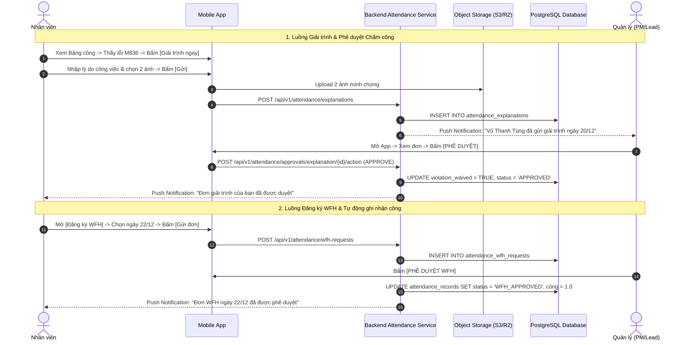

# TÀI LIỆU ĐẶC TẢ YÊU CẦU PHẦN MỀM (SRS)
## Module: Quản lý Chấm công & Thời gian làm việc (Time & Attendance Management)
### Phân hệ: Toàn diện Chấm công, Giải trình, Bổ sung công, WFH, Máy chấm công & Báo cáo

| Thông tin | Chi tiết |
| :--- | :--- |
| **Mã tài liệu** | `SRS_MOD_ATTENDANCE_MASTER` |
| **Tên phân hệ** | Phân hệ Quản lý Chấm công (Attendance & Timesheet System) |
| **Dự án** | VMO ERP System |
| **Nền tảng** | iOS & Android (Mobile App) + Backend Microservices |
| **Tệp thiết kế nguồn** | `ERP - App.fig` (Frame: `Chấm công - Nhân viên`, `Giải trình`, `Đơn đăng ký bổ sung công`, `Đăng ký bổ sung công`, `Phê duyệt chấm công - người quản trị`, `Báo cáo chấm công - Người quản trị`, `WFH - Nhân viên`, `Tạo WFH/ On-site khác`, `Phê duyệt WFH/ On-site khác`, `Cấu hình máy chấm công`) |
| **Phiên bản SRS** | 2.0 (Bản hoàn chỉnh tích hợp 8 chức năng) |
| **Ngày cập nhật** | 21/10/2026 |
| **Trạng thái** | Sẵn sàng triển khai (Ready for Dev/QA) |

---

## 1. Giới thiệu tổng quan phân hệ (Module Overview)

### 1.1 Mục đích tài liệu
Tài liệu này đặc tả chi tiết toàn bộ yêu cầu giao diện (UI/UX), yêu cầu chức năng (FR), quy tắc tính công & phạt chuyên sâu (Business Rules) và kiến trúc xử lý kỹ thuật phía Backend cho toàn bộ **8 chức năng** thuộc phân hệ Chấm công trên ứng dụng di động VMO ERP. Tài liệu là chuẩn kỹ thuật duy nhất cho Mobile App Developer, Backend Developer và QA/Tester.

### 1.2 Danh mục 8 chức năng chi tiết trong phân hệ
1. **Chức năng 1 (`SCR_ATT_001`):** Bảng chấm công & Lịch công cá nhân (Personal Timesheet & Attendance Calendar).
2. **Chức năng 2 (`SCR_ATT_002`):** Đơn giải trình vi phạm chấm công (Đi muộn / Về sớm / Mã M836).
3. **Chức năng 3 (`SCR_ATT_003`):** Đăng ký Bổ sung công (Quên quẹt thẻ / Quên check-out).
4. **Chức năng 4 (`SCR_ATT_004`):** Quản lý & Phê duyệt chấm công (Manager Approval Workflow).
5. **Chức năng 5 (`SCR_ATT_005`):** Báo cáo chấm công tổng hợp của Quản lý / HR (Department Attendance Reports).
6. **Chức năng 6 (`SCR_ATT_006`):** Đăng ký & Phê duyệt Làm việc từ xa (WFH / On-site khách hàng).
7. **Chức năng 7 (`SCR_ATT_007`):** Quản lý & Cấu hình thiết bị Máy chấm công (Attendance Device Management & XLSX Sync).
8. **Chức năng 8 (`SCR_ATT_008`):** Thảo luận & Khiếu nại trên bản ghi Chấm công (Attendance Discussion Thread).

---

## 2. CHỨC NĂNG 1: BẢNG CHẤM CÔNG & LỊCH CÔNG CÁ NHÂN (`SCR_ATT_001`)

### 2.1 Bố cục giao diện Mobile (Figma: `Chấm công - Nhân viên`)
```
+-------------------------------------------------+
|  [Status Bar: Time, Wifi, Battery]              |
|  [<]             Bảng chấm công           [Filter]|
|                                                 |
|  [ < ]               Tháng 12/2021         [ > ]|
|                                                 |
|  +-------------------------------------------+  |
|  | THỐNG KÊ THÁNG 12                         |  |
|  | Công hưởng lương: 22.0  | Thực tế: 21.5    |  |
|  | Đi muộn: 2 lần (M836)   | Về sớm: 0 lần    |  |
|  | Nghỉ có lương: 1.0 ngày | Không lương: 0.5 |  |
|  +-------------------------------------------+  |
|                                                 |
|   T2    T3    T4    T5    T6    T7    CN        |
|  [  ]  [  ]  [ 1]  [ 2]  [ 3]  [ 4]  [ 5]       |
|  [ 6]  [ 7]  [ 8]  [ 9]  [10]  [11]  [12]       |
|  [13]  [14]  [15]  [16]  [17]  [18]  [19]       |
|  [20*] [21]  [22]  [23]  [24]  [25]  [26]       |
|                                                 |
|  Chú thích: (*) Cần giải trình  (o) Đủ công    |
|                                                 |
|  --- CHI TIẾT NGÀY: 20/12/2021 (Thứ 2) ---      |
|  +-------------------------------------------+  |
|  | ! Bạn có 1 bản ghi chấm công cần giải     |  |
|  |   trình. Mã vi phạm: M836 (Muộn 8h36)     |  |
|  |   [ GIẢI TRÌNH NGAY ]                     |  |
|  +-------------------------------------------+  |
|  Giờ vào: 08:36:12      | Giờ ra: 18:05:40      |
|  Thời gian làm việc: 8h | Công tính được: 1.0   |
|  Trạng thái giải trình: Chờ phê duyệt           |
|                                                 |
|  +-------------------------------------------+  |
|  |          ĐĂNG KÝ BỔ SUNG CÔNG             |  |
|  +-------------------------------------------+  |
|                [Home Indicator]                 |
+-------------------------------------------------+
```

#### 2.1.1 Bố cục Danh sách chi tiết ngày chấm công (Figma: `Chấm công - Nhân viên`)
Màn hình cuộn hiển thị chi tiết từng ngày công trong tháng của nhân viên:
```
+-------------------------------------------------+
|  Ian Chesnut                                    |
|                                                 |
|  21/12/2021                                     |
|  Giờ vào:              08:30:25                 |
|  Giờ ra:               08:30:26                 |
|  Giờ làm việc:         00:00                    |
|  Xin nghỉ:             Không                    |
|  Trạng thái Ngày nghỉ:                          |
|  Cần giải trình:       Quên chấm công           |
|  Ngày công hưởng lương: 0,0                     |
|  Trạng thái giải trình: [ Chờ duyệt ]           |
|  +-------------------------------------------+  |
|  |                  HỦY BỎ                   |  |
|  +-------------------------------------------+  |
|                                                 |
|  20/12/2021                                     |
|  Giờ vào:              08:30:25                 |
|  Giờ ra:               08:30:26                 |
|  Giờ làm việc:         00:00                    |
|  Cần giải trình:       Quên chấm công           |
|  Trạng thái giải trình: [ Bị từ chối ]          |
|                                                 |
|  19/12/2021                                     |
|  Giờ vào:              08:30:25                 |
|  Giờ ra:               18:00:26                 |
|  Giờ làm việc:         08:00                    |
|  Ngày công hưởng lương: 1,0                     |
|  Trạng thái giải trình: [ Đã phê duyệt (Xanh) ] |
+-------------------------------------------------+
```

#### 2.1.2 Popup CẢNH BÁO Chốt dữ liệu ngày công (Figma: Ảnh 1 - Màn 7)
Khi nhân viên bấm nút Chốt/Xác nhận ngày công cuối kỳ chấm công:
```
+-------------------------------------------------+
|                                                 |
|                   CẢNH BÁO!                     |
|                                                 |
|  Báo cáo đã chốt dữ liệu, sau khi xác nhận bạn  |
|  sẽ không thể chỉnh sửa báo cáo nữa.            |
|  Nếu có sai sót liên hệ với phòng HR để được    |
|  giải quyết!                                    |
|                                                 |
|  +-------------------------------------------+  |
|  |                  HỦY BỎ                   |  |
|  +-------------------------------------------+  |
|  |              TỰ ĐỘNG ĐIỀN                 |  |
|  +-------------------------------------------+  |
|  |           XÁC NHẬN NGÀY CÔNG              |  |
|  +-------------------------------------------+  |
+-------------------------------------------------+
```
* **Đặc tả tương tác:**
  * `[ HỦY BỎ ]`: Đóng popup modal cảnh báo, trở lại màn hình bảng công.
  * `[ TỰ ĐỘNG ĐIỀN ]`: Hệ thống tự động tạo các bản ghi giải trình hợp lệ cho những ngày quên quẹt thẻ có xác nhận từ PM.
  * `[ XÁC NHẬN NGÀY CÔNG ]`: Khóa vĩnh viễn bảng chấm công tháng của nhân viên, chuyển trạng thái sang `LOCKED_BY_EMPLOYEE`, sẵn sàng để HR kết xuất bảng lương.

### 2.2 Quy tắc tính công & phạt quy chế (Business Rules)
* **BR-ATT-01 (Giờ chuẩn VMO):** Buổi sáng: 08:30 - 12:00 (3.5h). Nghỉ trưa: 12:00 - 13:30 (1.5h). Buổi chiều: 13:30 - 18:00 (4.5h). Đủ 8 tiếng = 1.0 công.
* **BR-ATT-02 (Quy tắc đi muộn đặc thù VMO):**
  * Check-in 08:30:01 - 08:35:59: Ân hạn 5 phút, không ghi nhận vi phạm.
  * Check-in 08:36:00 - 09:00:00: Gắn mã lỗi **`M836`** (Muộn 8h36). Vẫn đủ 1.0 công nếu làm đủ 8 tiếng, nhưng tính vào quota 7/9 lỗi vi phạm trừ khi giải trình lý do công việc.
  * Check-in sau 09:00:00: Gắn mã **`M0900`**, trừ 0.5 công buổi sáng nếu không có giải trình/đơn bổ sung công được duyệt.
* **BR-ATT-03 (Hạn mức 7/9 lỗi):** Mỗi tháng nhân viên có tối đa 7 lần vi phạm nhẹ. Từ lần thứ 8 trở đi sẽ bị cảnh cáo và trừ điểm chuyên cần.

---

## 3. CHỨC NĂNG 2: GIẢI TRÌNH CHẤM CÔNG (`SCR_ATT_002`)

### 3.1 Bố cục giao diện Mobile (Figma: `Giải trình`)

#### 3.1.1 Trạng thái Form mặc định (Figma: Ảnh 1 - Màn 8)
```
+-------------------------------------------------+
|  [Status Bar]                                   |
|  [<]             Giải trình chấm công           |
|                                                 |
|  [🔍 Search                                 [v] ]|
|                                                 |
|  Giờ giải trình                                 |
|  [ 08:30:25                                   ] |
|                                                 |
|  Mã đơn giải trình                              |
|  [ GTCC-20211220-001                          ] |
|                                                 |
|  Nội dung giải trình                            |
|  +-------------------------------------------+  |
|  | Type your message here                    |  |
|  |                                           |  |
|  +-------------------------------------------+  |
|                                                 |
|  +---------------------+ +--------------------+ |
|  |       HỦY BỎ        | |        LƯU         | |
|  +---------------------+ +--------------------+ |
|                [Home Indicator]                 |
+-------------------------------------------------+
```

#### 3.1.2 Trạng thái Form có lỗi vi phạm M836 / Quên chấm công (Figma: Ảnh 1 - Màn 9)
```
+-------------------------------------------------+
|  [Status Bar]                                   |
|  [<]             Giải trình chấm công           |
|                                                 |
|  [🔍 Search                                 [v] ]|
|                                                 |
|  Giờ giải trình                                 |
|  [ 08:36:12                                   ] |
|                                                 |
|  [X] Có lý do công việc (Không tính lỗi vi phạm)|
|                                                 |
|  Mã lỗi vi phạm *                               |
|  [ M836 - Muộn 8h36                         [v] ]|
|                                                 |
|  Nội dung giải trình *                          |
|  +-------------------------------------------+  |
|  | Gặp khách hàng đối tác dự án ERP tại...   |  |
|  |                                           |  |
|  +-------------------------------------------+  |
|                                                 |
|  +---------------------+ +--------------------+ |
|  |       HỦY BỎ        | |      GỬI ĐƠN       | |
|  +---------------------+ +--------------------+ |
|                [Home Indicator]                 |
+-------------------------------------------------+
```

#### 3.1.3 Bottom Sheet Chọn lý do công việc (Figma: Ảnh 1 - Màn 10)
Khi chạm vào trường `Chọn lý do công việc`:
```
+-------------------------------------------------+
|                                                 |
|                 (Màn hình nền mờ)               |
|                                                 |
|  +-------------------------------------------+  |
|  |                 [ Thanh gạt ]             |  |
|  |  Chọn lý do công việc                     |  |
|  |                                           |  |
|  |  (o) Đi gặp khách hàng                    |  |
|  |                                           |  |
|  |  ( ) Làm việc tại nhà (WFH đột xuất)      |  |
|  |                                           |  |
|  |  ( ) Đi đào tạo / Hội thảo nghiệp vụ      |  |
|  |                                           |  |
|  |  ( ) Đi On-site văn phòng đối tác         |  |
|  |                                           |  |
|  |  ( ) Sự cố hệ thống máy chấm công         |  |
|  +-------------------------------------------+  |
+-------------------------------------------------+
```

### 3.2 Quy tắc giải trình (Business Rules)
* **BR-EXP-01:** Chọn `"Lý do công việc"`: Khi quản lý duyệt, mã vi phạm `M836` được xóa cờ (`violation_waived = true`), không tính vào quota 7/9 lỗi.
* **BR-EXP-02:** Chọn `"Lý do cá nhân"`: Khi quản lý duyệt, bản ghi được chấp nhận nhưng vẫn ghi nhận 1 lần vi phạm trong tháng.
* **BR-EXP-03:** Đính kèm tối đa 5 ảnh minh chứng (JPG/PNG/WEBP $\le 5$MB).

---

## 4. CHỨC NĂNG 3: ĐĂNG KÝ BỔ SUNG CÔNG (`SCR_ATT_003`)

### 4.1 Bố cục giao diện Mobile (Figma: `Đăng ký bổ sung công`)
```
+-------------------------------------------------+
|  [Status Bar]                                   |
|  [<]           Đăng ký bổ sung công       [Đơn] |
|                                                 |
|  Mã nhân viên: VMO1409     | Họ tên: Vũ Thanh Tùng|
|  Chức vụ: Tester           | Phòng: PM18         |
|                                                 |
|  Ngày bổ sung công *                            |
|  [ 21/12/2021                              📅 ] |
|                                                 |
|  Loại bổ sung *                                 |
|  (o) Cả ngày      ( ) Buổi sáng   ( ) Buổi chiều|
|                                                 |
|  Giờ vào đề xuất *        Giờ ra đề xuất *      |
|  [ 08:30            🕒 ]  [ 18:00           🕒 ]|
|                                                 |
|  Thời gian nghỉ giữa ca (giờ)                   |
|  [ 1.5                                       ]  |
|                                                 |
|  Lý do bổ sung công *                           |
|  [ Quên quẹt thẻ / vân tay                 [v] ]|
|                                                 |
|  Diễn giải chi tiết *                           |
|  +-------------------------------------------+  |
|  | Em có mặt tại công ty lúc 8h25 nhưng máy |  |
|  | tầng 5 bị đơ vân tay nên không ghi nhận...|  |
|  +-------------------------------------------+  |
|                                                 |
|  Ảnh minh chứng (Tối đa 5 ảnh)                  |
|  [ [+] Thêm ảnh ]                               |
|                                                 |
|  Người duyệt *                                  |
|  [ Nguyễn Quốc Anh (anhnq2)                [v] ]|
|                                                 |
|  +-------------------------------------------+  |
|  |                 GỬI ĐƠN                   |  |
|  +-------------------------------------------+  |
|                [Home Indicator]                 |
+-------------------------------------------------+
```

### 4.2 Quy tắc bổ sung công
* **BR-SUPP-01:** Chỉ được gửi đơn trong vòng **3 ngày làm việc** kể từ ngày thiếu công.
* **BR-SUPP-02:** Luồng phê duyệt 2 cấp: `Quản lý dự án duyệt` $\rightarrow$ `Nhân sự kiểm tra & chốt công`.

---

## 5. CHỨC NĂNG 4: PHÊ DUYỆT CHẤM CÔNG DÀNH CHO QUẢN LÝ (`SCR_ATT_004`)

### 5.1 Bố cục giao diện Mobile (Figma: Ảnh 4 - Màn 1: `Phê duyệt chấm công - người quản trị`)
```
+-------------------------------------------------+
|  [Status Bar]                                   |
|  [≡]           Phê duyệt chấm công       [🔔 2] |
|                                                 |
|  [🔍 Search                                 [v] ]|
|                                                 |
|  ADMIN                               [ Action v ]|
|                                                 |
|  21/12/2021                                     |
|  Nhân viên:            Ian Chesnut - 0123       |
|  Giờ vào:              08:09:25                 |
|  Giờ ra:               08:09:26                 |
|  Giờ làm việc:         00:00                    |
|  Xin nghỉ:             Không                    |
|  Trạng thái Ngày nghỉ...                        |
|  Cần giải trình:       Quên chấm công           |
|  Ngày công hưởng lương: 0,0                     |
|  Trạng thái giải trình: [ Chờ phê duyệt ]       |
|  +---------------------+ +--------------------+ |
|  |       TỪ CHỐI       | |     PHÊ DUYỆT      | |
|  +---------------------+ +--------------------+ |
|                                                 |
|  20/12/2021                                     |
|  Nhân viên:            Jane Bonde - 0124        |
|  Giờ vào:                                       |
|  Giờ ra:                                        |
|  Giờ làm việc:         00:00                    |
|  Xin nghỉ:             Nghỉ cả ngày             |
|  Trạng thái Ngày nghỉ... Ngày nghỉ: Đã duyệt    |
|  Cần giải trình:       Quên chấm công           |
|  Ngày công hưởng lương: 1,0                     |
|  Trạng thái giải trình: [ Đã phê duyệt (Xanh) ] |
|  +-------------------------------------------+  |
|  |                  TỪ CHỐI                  |  |
|  +-------------------------------------------+  |
|                                                 |
|  20/12/2021                                     |
|  Nhân viên:            Jane Bonde - 0124        |
|  Xin nghỉ:             C6                       |
|  Trạng thái giải trình: [ Bị từ chối ]          |
|                [Home Indicator]                 |
+-------------------------------------------------+
```

### 5.2 Popup Modal Nhập Lý do từ chối (Figma: Ảnh 4 - Màn 2)
Khi Quản lý bấm nút `[ TỪ CHỐI ]` trên bất kỳ bản ghi nào:
```
+-------------------------------------------------+
|                                                 |
|                 (Màn hình nền mờ)               |
|                                                 |
|  +-------------------------------------------+  |
|  |  Lý do từ chối                            |  |
|  |                                           |  |
|  |  +-------------------------------------+  |  |
|  |  | Type your message here              |  |  |
|  |  |                                     |  |  |
|  |  +-------------------------------------+  |  |
|  |                                           |  |
|  |  +------------------+ +----------------+  |  |
|  |  |      HỦY BỎ      | |    TỪ CHỐI     |  |  |
|  |  +------------------+ +----------------+  |  |
|  +-------------------------------------------+  |
+-------------------------------------------------+
```
* Bắt buộc nhập lý do (tối thiểu 5 ký tự). Bấm `[ Từ chối ]` để cập nhật trạng thái đơn thành `REJECTED` và gửi thông báo đẩy (Push Notification) đến nhân viên.

### 5.3 Action Bottom Sheet Quản trị (Figma: Ảnh 4 - Màn 3)
Khi bấm vào nút `Action [v]` ở góc trên danh sách phê duyệt:
```
+-------------------------------------------------+
|                                                 |
|                 (Màn hình nền mờ)               |
|                                                 |
|  +-------------------------------------------+  |
|  |                 [ Thanh gạt ]             |  |
|  |  Action                                   |  |
|  |                                           |  |
|  |  ( ) Báo cáo chấm công                    |  |
|  |                                           |  |
|  |  (o) Tải xuống xlsx                       |  |
|  +-------------------------------------------+  |
+-------------------------------------------------+
```

### 5.4 Popup Phê duyệt chi tiết của Người quản lý (Figma: Ảnh 4 - Màn 4)
Khi Quản lý bấm nút `[ PHÊ DUYỆT ]`, hệ thống mở Modal phê duyệt chi tiết với các tùy chọn công và cảnh báo vi phạm:
```
+-------------------------------------------------+
|  [Status Bar]                                   |
|  [<]           Phê duyệt chấm công       [🔔 2] |
|                                                 |
|  Lỗi chấm công                                  |
|  [ Quên chấm công                             ] |
|                                                 |
|  [X] Lý do công việc (Không tính lỗi vi phạm)   |
|  Thời lượng: 0.00 Ngày (Link xanh)              |
|                                                 |
|  Nội dung giải trình                            |
|  +-------------------------------------------+  |
|  | gặp khách hàng A cho dự án VMO22001       |  |
|  +-------------------------------------------+  |
|                                                 |
|  Chọn lý do công việc                           |
|  [ Đi gặp khách hàng                        [v] ]|
|                                                 |
|  Xác nhận ngày công                             |
|  +-------------------------------------------+  |
|  | ( ) Làm cả ngày                           |  |
|  +-------------------------------------------+  |
|  | (o) Làm nửa ngày                          |  |
|  +-------------------------------------------+  |
|  | ( ) Không ngày công                       |  |
|  +-------------------------------------------+  |
|                                                 |
|  Xác nhận ngày công (Vi phạm đi muộn)           |
|  +-------------------------------------------+  |
|  | ( ) Đi muộn có phép hoặc không đi muộn    |  |
|  +-------------------------------------------+  |
|  | (o) Đi muộn không phép                    |  |
|  +-------------------------------------------+  |
|                                                 |
|  ⚠️ CẢNH BÁO BẮT BUỘC DÀNH CHO QUẢN LÝ:         |
|  "Trường bộ phận không phê duyệt giải trình     |
|   nghỉ phép, WFH/Onsite ở đây, hãy yêu cầu      |
|   nhân viên tạo dữ liệu xin nghỉ hoặc           |
|   WFH/onsite ở menu tương ứng!                  |
|   Nhân viên quên Checkin hoặc Checkout,         |
|   hệ thống sẽ hiển thị Ngày công = 0,           |
|   quản lý chú ý trước khi phê duyệt"            |
|                                                 |
|  +---------------------+ +--------------------+ |
|  |       HỦY BỎ        | |      XÁC NHẬN      | |
|  +---------------------+ +--------------------+ |
|                [Home Indicator]                 |
+-------------------------------------------------+
```
* **Đặc tả tương tác & Quy tắc phê duyệt:**
  * Nếu chọn `(o) Làm nửa ngày`: Hệ thống ghi nhận 0.5 công cho ca làm việc hợp lệ.
  * Nếu chọn `(o) Đi muộn không phép`: Ghi nhận 1 lỗi vi phạm vào hạn mức 7/9 lỗi của nhân viên.
  * Khi bấm `[ Xác nhận ]`: Kích hoạt API `POST /api/v1/attendance/approvals/{id}/action` với payload chứa `actual_working_day_value` và `violation_confirmed`.

---

## 6. CHỨC NĂNG 5: BÁO CÁO CHẤM CÔNG TỔNG HỢP CỦA QUẢN LÝ & HR (`SCR_ATT_005`)

### 6.1 Bố cục giao diện Mobile (Figma: `Báo cáo chấm công - Người quản trị`)
```
+-------------------------------------------------+
|  [Status Bar]                                   |
|  [<]           Báo cáo chấm công          [Export]|
|                                                 |
|  [ < ]               Tháng 12/2021         [ > ]|
|  Bộ phận: [ Trung Tâm PM Số 18             [v] ]|
|  [🔍 Tìm kiếm nhân viên...                    ] |
|                                                 |
|  +-------------------------------------------+  |
|  | TỔNG QUAN PHÒNG BAN: 32 Nhân viên         |  |
|  | Tổng công hưởng lương: 685.5 / 704 công   |  |
|  | Tỷ lệ đi làm đúng giờ: 96.2%              |  |
|  | Tổng số lần muộn: 18 lần (14 lần M836)    |  |
|  +-------------------------------------------+  |
|                                                 |
|  DANH SÁCH NHÂN VIÊN                            |
|  +-------------------------------------------+  |
|  | [Avatar] Vũ Thanh Tùng (VMO1409) - Tester  |  |
|  | Công hưởng lương: 22.0  | Thực tế: 21.5    |  |
|  | Đi muộn: 2 lần (M836)   | Phép năm: 1 ngày |  |
|  | Đơn chờ duyệt: 1 đơn giải trình            |  |
|  +-------------------------------------------+  |
|  | [Avatar] Trần Thị B (VMO1520) - Dev        |  |
|  | Công hưởng lương: 21.0  | Thực tế: 21.0    |  |
|  | Đi muộn: 0 lần          | Nghỉ không lương: 1|
|  | Đơn chờ duyệt: Không                       |  |
|  +-------------------------------------------+  |
|                [Home Indicator]                 |
+-------------------------------------------------+
```

### 6.2 Đặc tả nghiệp vụ Báo cáo
* **Lọc đa tiêu chí:** Lọc theo Tháng/Năm, theo Dự án / Phòng ban, tìm kiếm theo Tên / Mã NV.
* **Tính năng Xuất báo cáo (`[Export]`):** Gửi yêu cầu sinh file Excel `.xlsx` chi tiết chấm công từng ngày của phòng ban, gửi link tải về qua email hoặc tải trực tiếp về điện thoại.

---

## 7. CHỨC NĂNG 6: ĐĂNG KÝ & PHÊ DUYỆT LÀM VIỆC TỪ XA (WFH / ON-SITE) (`SCR_ATT_006`)

### 7.1 Bố cục giao diện Mobile Đăng ký WFH của Nhân viên (Figma: `WFH - Nhân viên` & `Tạo WFH/ On-site khác`)
```
+-------------------------------------------------+
|  [Status Bar]                                   |
|  [<]          Đăng ký WFH / On-site khác        |
|                                                 |
|  Hình thức làm việc từ xa *                     |
|  (o) WFH (Tại nhà)      ( ) On-site (Khách hàng)|
|                                                 |
|  Thời gian áp dụng *                            |
|  Từ ngày: [ 22/12/2021 📅 ]  Đến: [ 24/12/2021 📅]|
|  Số ngày đăng ký: 3 ngày công                   |
|                                                 |
|  Địa điểm làm việc cụ thể *                     |
|  [ Nhà riêng: Số 12 ngõ 45 Cầu Giấy, Hà Nội ]   |
|                                                 |
|  Lý do đăng ký *                                |
|  [ Sức khỏe / Yêu cầu dự án                [v] ]|
|                                                 |
|  Kế hoạch & Nhiệm vụ công việc trong ngày *    |
|  +-------------------------------------------+  |
|  | 1. Fix bug module auth dự án ERP          |  |
|  | 2. Tham gia họp Daily lúc 9h qua Teams    |  |
|  | 3. Hoàn thành test cases phần Timesheet   |  |
|  +-------------------------------------------+  |
|                                                 |
|  Người phê duyệt *                              |
|  [ Nguyễn Quốc Anh (anhnq2) - PM           [v] ]|
|                                                 |
|  +-------------------------------------------+  |
|  |                 GỬI ĐƠN                   |  |
|  +-------------------------------------------+  |
|                [Home Indicator]                 |
+-------------------------------------------------+
```

#### 7.1.1 Bố cục Form Tạo On-site Khối Sản xuất - Người quản trị (Figma: Hàng 1 - Màn 14 & 15)
Dành cho Quản lý dự án (PM) cử nhân sự làm việc trực tiếp tại trụ sở đối tác / khách hàng:
```
+-------------------------------------------------+
|  [Status Bar]                                   |
|  [≡]       Tạo On-site khối sản xuất     [🔔 2] |
|                                                 |
|  [🔍 Search                                 [v] ]|
|                                                 |
|  ADMIN                               [ Action v ]|
|                                                 |
|  Phân loại khối *                               |
|  (o) Khối Sản xuất      ( ) Khối Backoffice     |
|                                                 |
|  Chọn Dự án cử đi On-site *                     |
|  [ VMO227 - VMO ERP Mobile                 [v] ]|
|                                                 |
|  Khách hàng & Địa điểm On-site *                |
|  [ Văn phòng Khách hàng Keangnam Landmark 72 [v]|
|                                                 |
|  Thời gian On-site *                            |
|  Từ ngày: [ 27/12/2021 📅 ] Đến:[ 31/12/2021 📅 ]|
|  Thời lượng: 5.0 Ngày làm việc                  |
|                                                 |
|  Danh sách nhân sự tham gia On-site *           |
|  [+] Thêm nhân viên (Đã chọn: 2 nhân sự)        |
|  - Ian Chesnut - 0123 (Tester)                  |
|  - Jane Bonde - 0124 (Developer)                |
|                                                 |
|  Lý do & Nhiệm vụ On-site *                     |
|  [ Phối hợp UAT và Go-live hệ thống tại chỗ[v] ]|
|                                                 |
|  +---------------------+ +--------------------+ |
|  |       HỦY BỎ        | |        LƯU         | |
|  +---------------------+ +--------------------+ |
|                [Home Indicator]                 |
+-------------------------------------------------+
```
* **Action Bottom Sheet On-site (Màn 15):** `(o) Chuyển về nháp`.

#### 7.1.2 Bố cục Màn hình Phê duyệt WFH / On-site khác (Figma: Hàng 1 - Màn 17 & 18)
Màn hình tập trung dành cho Quản lý thẩm định các yêu cầu làm việc từ xa:
```
+-------------------------------------------------+
|  [Status Bar]                                   |
|  [≡]         Phê duyệt WFH/ On-site khác [🔔 2] |
|                                                 |
|  [🔍 Search                                 [v] ]|
|                                                 |
|  ADMIN                               [ Action v ]|
|                                                 |
|  22/12/2021                                     |
|  Nhân viên:            Ian Chesnut - 0123       |
|  Khối yêu cầu:         Khối Sản xuất            |
|  Hình thức:            WFH (Tại nhà)            |
|  Thời gian:            22/12/2021 - 24/12/2021  |
|  Thời lượng:           3.0 Ngày                 |
|  Lý do:                Sức khỏe cần cách ly     |
|  Trạng thái:           [ Chờ phê duyệt ]        |
|  +---------------------+ +--------------------+ |
|  |       TỪ CHỐI       | |     PHÊ DUYỆT      | |
|  +---------------------+ +--------------------+ |
|                [Home Indicator]                 |
+-------------------------------------------------+
```
* **Action Bottom Sheet Phê duyệt WFH/On-site (Màn 18):** `(o) Tải xuống xlsx`.

#### 7.1.3 Bố cục Màn hình Bộ lọc WFH / On-site (Figma: Hàng 1 - Màn 16)
```
+-------------------------------------------------+
|  [Status Bar]                                   |
|  [<]             Bộ lọc WFH / On-site           |
|                                                 |
|  Hình thức làm việc                             |
|  [ Tất cả (WFH & On-site)                   [v] ]|
|                                                 |
|  Khối yêu cầu                                   |
|  [ Khối Sản xuất                            [v] ]|
|                                                 |
|  Dự án / Phòng ban                              |
|  [ Trung tâm PM Số 18                       [v] ]|
|                                                 |
|  Khoảng thời gian                               |
|  Từ ngày: [ dd/mm/yyyy 📅 ] Đến: [ dd/mm/yyyy 📅]|
|                                                 |
|  Trạng thái phê duyệt                           |
|  [ ] Chờ duyệt                                  |
|  [ ] Đã phê duyệt                               |
|  [ ] Bị từ chối                                 |
|                                                 |
|  +---------------------+ +--------------------+ |
|  |       HỦY BỎ        | |      ÁP DỤNG       | |
|  +---------------------+ +--------------------+ |
|                [Home Indicator]                 |
+-------------------------------------------------+
```

### 7.2 Quy tắc nghiệp vụ WFH & Tự động ghi nhận công (Business Rules)
* **BR-WFH-01 (Tự động ghi nhận công):** Khi đơn WFH hoặc On-site được Quản lý duyệt:
  * Hệ thống tự động đánh dấu ngày công tương ứng là `WFH_APPROVED` hoặc `ONSITE_APPROVED`.
  * Nhân viên **không bị tính là vắng mặt (Absent)** dù không có dữ liệu quẹt thẻ ở máy chấm công văn phòng.
  * Tự động cộng 1.0 ngày công chuẩn vào Bảng công tháng.
* **BR-WFH-02 (Giới hạn số ngày WFH):** Theo chính sách công ty, mỗi nhân viên được WFH tối đa 2 ngày/tháng (trừ trường hợp đặc biệt như cách ly dịch bệnh hoặc dự án yêu cầu được Giám đốc khối phê duyệt).

---

## 8. CHỨC NĂNG 7: QUẢN LÝ THIẾT BỊ MÁY CHẤM CÔNG & CẤU HÌNH CA LÀM VIỆC (`SCR_ATT_007`)

### 8.1 Bố cục giao diện Danh sách Thiết bị (Figma: `Cấu hình máy chấm công`)
```
+-------------------------------------------------+
|  [Status Bar]                                   |
|  [<]           Cấu hình máy chấm công     [+ Thêm]|
|                                                 |
|  DANH SÁCH THIẾT BỊ (Đang kết nối: 4/4)         |
|  +-------------------------------------------+  |
|  | [Icon] Máy chấm công Tầng 5 - IDMC 5      |  |
|  | Địa chỉ IP: 192.168.1.105 | Cổng: 4370    |  |
|  | Địa điểm: Tòa nhà IDMC 5 - Tầng 5         |  |
|  | Trạng thái: (•) Đang hoạt động realtime   |  |
|  | Bản ghi cuối: 08:35:12 21/12/2021         |  |
|  +-------------------------------------------+  |
|  | [Icon] Máy chấm công Tầng 8 - IDMC 5      |  |
|  | Địa chỉ IP: 192.168.1.108 | Cổng: 4370    |  |
|  | Địa điểm: Tòa nhà IDMC 5 - Tầng 8         |  |
|  | Trạng thái: (•) Đang hoạt động realtime   |  |
|  +-------------------------------------------+  |
|                                                 |
|  ĐỒNG BỘ THỦ CÔNG                               |
|  +-------------------------------------------+  |
|  | [ Nạp tập tin (Import File) ]              |  |
|  | Hỗ trợ định dạng: .xlsx, .dat từ máy ZKTeco|  |
|  +-------------------------------------------+  |
|  | [ Tải xuống file mẫu (Download Template) ]|  |
|  +-------------------------------------------+  |
|                [Home Indicator]                 |
+-------------------------------------------------+
```

#### 8.1.1 Bố cục Form Chi tiết Thêm mới / Cập nhật Thiết bị (Figma: Hàng 2 - Màn 4)
Khi bấm nút `[+ Thêm]` hoặc chọn 1 máy chấm công để sửa:
```
+-------------------------------------------------+
|  [Status Bar]                                   |
|  [<]             Chi tiết thiết bị              |
|                                                 |
|  Tên máy chấm công *                            |
|  [ Máy chấm công Tầng 5 - IDMC 5              ] |
|                                                 |
|  Địa chỉ IP thiết bị *                          |
|  [ 192.168.1.105                              ] |
|                                                 |
|  Cổng kết nối (Port) *                          |
|  [ 4370                                       ] |
|                                                 |
|  Vị trí lắp đặt / Tòa nhà *                     |
|  [ Tòa nhà IDMC 5 - Tầng 5                    ] |
|                                                 |
|  Trạng thái hoạt động                           |
|  [X] Kích hoạt kết nối realtime                 |
|                                                 |
|  +---------------------+ +--------------------+ |
|  |       HỦY BỎ        | |    LƯU THIẾT BỊ    |  |
|  +---------------------+ +--------------------+ |
|                [Home Indicator]                 |
+-------------------------------------------------+
```

#### 8.1.2 Bố cục Màn hình Cấu hình Ca làm việc chuẩn (Figma: Hàng 2 - Màn 6)
Dành cho HR thiết lập quy định thời gian làm việc toàn hệ thống:
```
+-------------------------------------------------+
|  [Status Bar]                                   |
|  [<]            Cấu hình ca làm việc            |
|                                                 |
|  CA SÁNG                                        |
|  Giờ vào chuẩn: [ 08:30 🕒 ]  Giờ ra: [ 12:00 🕒]|
|  Thời lượng ca sáng: 3.5 giờ                    |
|                                                 |
|  NGHỈ TRƯA                                      |
|  Từ giờ: [ 12:00 🕒 ]         Đến giờ:[ 13:30 🕒]|
|  Thời lượng nghỉ trưa: 1.5 giờ                  |
|                                                 |
|  CA CHIỀU                                       |
|  Giờ vào chuẩn: [ 13:30 🕒 ]  Giờ ra: [ 18:00 🕒]|
|  Thời lượng ca chiều: 4.5 giờ                   |
|                                                 |
|  QUY TẮC ÂN HẠN & MÃ LỖI VI PHẠM                |
|  Thời gian ân hạn không phạt: [ 5 ] phút        |
|  (Cho phép check-in đến 08:35:59)               |
|                                                 |
|  Khung giờ cảnh báo lỗi M836:                   |
|  Từ: [ 08:36:00 ]             Đến: [ 09:00:00 ] |
|                                                 |
|  +---------------------+ +--------------------+ |
|  |       HỦY BỎ        | |    LƯU CẤU HÌNH    |  |
|  +---------------------+ +--------------------+ |
|                [Home Indicator]                 |
+-------------------------------------------------+
```

### 8.2 Nghiệp vụ Quản lý & Đồng bộ thiết bị
* Phục vụ quản trị viên IT / HR giám sát tình trạng máy chấm công đặt tại các văn phòng.
* Hỗ trợ nạp file `.xlsx` khi đường truyền mạng tại văn phòng bị ngắt quãng, đảm bảo dữ liệu quẹt thẻ của nhân viên không bị mất.

---

## 9. CHỨC NĂNG 8: THẢO LUẬN & KHIẾU NẠI TRÊN BẢN GHI CHẤM CÔNG (`SCR_ATT_008`)

### 9.1 Bố cục giao diện Mobile (Figma: Mục `Thảo luận` trong `Chấm công - Nhân viên`)
```
+-------------------------------------------------+
|  --- THẢO LUẬN & KHIẾU NẠI NGÀY 20/12/2021 ---  |
|                                                 |
|  [Avatar] Vũ Thanh Tùng (09:20 20/12):          |
|  Anh ơi sáng nay em vào lúc 8h28 nhưng máy tầng |
|  5 đông quá đến 8h36 em mới quẹt được thẻ ạ.    |
|                                                 |
|  [Avatar] Nguyễn Quốc Anh - PM (09:45 20/12):   |
|  Ok em, anh xác nhận có sự việc này. Em gửi     |
|  đơn giải trình lý do công việc anh duyệt nhé.  |
|                                                 |
|  +-------------------------------------------+  |
|  | Nhập phản hồi hoặc khiếu nại...     [ Gửi]|  |
|  +-------------------------------------------+  |
+-------------------------------------------------+
```

### 9.2 Đặc tả nghiệp vụ Thảo luận
* Cho phép nhân viên, Quản lý và Chuyên viên Nhân sự (HR C&B) trao đổi minh bạch, lưu lại lịch sử hội thoại gắn liền với từng bản ghi ngày công.
* Khi có bình luận mới: Bắn thông báo đẩy (FCM) tới các bên liên quan.

---

## 10. Sơ đồ luồng xử lý toàn trình (Process Sequence Flow)



---

## 11. Đặc tả Hợp đồng API phía Backend (API Integration Contracts)

### 11.1 API 1: Lấy bảng chấm công cá nhân theo tháng
* **Method:** `GET` | **Path:** `/api/v1/attendance/my-timesheet?month=12&year=2021`
* **Response 200 OK:**
```json
{
  "success": true,
  "code": 200,
  "data": {
    "summary": {
      "month": 12, "year": 2021,
      "standard_working_days": 22.0,
      "actual_working_days": 21.5,
      "paid_working_days": 22.0,
      "late_occurrences": 2,
      "early_leave_occurrences": 0,
      "paid_leave_days": 1.0,
      "unpaid_leave_days": 0.5
    },
    "records": [
      {
        "id": 88412,
        "date": "2021-12-20",
        "check_in": "08:36:12",
        "check_out": "18:05:40",
        "working_hours": 8.0,
        "working_day_value": 1.0,
        "status": "LATE",
        "violation_code": "M836",
        "needs_explanation": true
      }
    ]
  }
}
```

### 11.2 API 2: Gửi đơn giải trình chấm công
* **Method:** `POST` | **Path:** `/api/v1/attendance/explanations`
* **Request Body:**
```json
{
  "attendance_record_id": 88412,
  "reason_type": "BUSINESS_REASON",
  "explanation_text": "Đi gặp khách hàng tại Keangnam bàn giao tài liệu kỹ thuật dự án.",
  "image_urls": ["https://cdn.erp.vmodev.com/evidence/att_88412_img1.webp"],
  "approver_id": 412,
  "cc_user_ids": [558]
}
```

### 11.3 API 3: Gửi đơn Đăng ký bổ sung công
* **Method:** `POST` | **Path:** `/api/v1/attendance/supplements`
* **Request Body:**
```json
{
  "date": "2021-12-21",
  "supplement_type": "FULL_DAY",
  "proposed_check_in": "08:30:00",
  "proposed_check_out": "18:00:00",
  "break_hours": 1.5,
  "reason_id": "MACHINE_ERROR",
  "reason_description": "Em có mặt lúc 8h25 nhưng máy tầng 5 bị đơ vân tay.",
  "image_urls": ["https://cdn.erp.vmodev.com/evidence/supp_img1.webp"],
  "approver_id": 412
}
```

### 11.4 API 4: Quản lý phê duyệt / Từ chối đơn
* **Method:** `POST` | **Path:** `/api/v1/attendance/approvals/{request_type}/{id}/action`
* **Request Body:**
```json
{
  "action": "APPROVE", // hoặc "REJECT"
  "comment": "Đã xác nhận sự việc đúng thực tế."
}
```

### 11.5 API 5: Báo cáo chấm công tổng hợp phòng ban (Manager / HR)
* **Method:** `GET` | **Path:** `/api/v1/attendance/reports/department?department_id=18&month=12&year=2021`
* **Response 200 OK:**
```json
{
  "success": true,
  "code": 200,
  "data": {
    "total_employees": 32,
    "total_paid_days": 685.5,
    "on_time_rate": 96.2,
    "employees": [
      {
        "user_id": 1409,
        "employee_code": "VMO-1409",
        "full_name": "Vũ Thanh Tùng",
        "job_title": "Tester",
        "paid_days": 22.0,
        "actual_days": 21.5,
        "late_count": 2,
        "pending_requests_count": 1
      }
    ]
  }
}
```

### 11.6 API 6: Đăng ký Làm việc từ xa (WFH / On-site)
* **Method:** `POST` | **Path:** `/api/v1/attendance/wfh-requests`
* **Request Body:**
```json
{
  "request_type": "WFH", // hoặc "ONSITE"
  "start_date": "2021-12-22",
  "end_date": "2021-12-24",
  "location": "Nhà riêng: Số 12 ngõ 45 Cầu Giấy, Hà Nội",
  "reason": "Sức khỏe / Dự án yêu cầu",
  "tasks_plan": "1. Fix bug auth; 2. Daily meeting Teams; 3. Test timesheet",
  "approver_id": 412
}
```

### 11.7 API 7: Đồng bộ file quẹt thẻ từ Máy chấm công (Import XLSX / DAT)
* **Method:** `POST` | **Path:** `/api/v1/attendance/devices/sync-file`
* **Content-Type:** `multipart/form-data`
* **Body:** `device_id: 5`, `file: raw_checkin_logs.xlsx`

### 11.8 API 8: Thảo luận trên bản ghi ngày công
* **Method:** `POST` | **Path:** `/api/v1/attendance/records/{id}/comments`
* **Request Body:**
```json
{
  "message": "Anh ơi sáng nay em vào lúc 8h28 nhưng máy tầng 5 đông quá đến 8h36 mới quẹt được ạ."
}
```

---

## 12. Đặc tả kỹ thuật & Lược đồ Cơ sở dữ liệu chuẩn hóa (PostgreSQL Schema DDL)

```sql
-- 1. Bảng lưu trữ nhật ký chấm công & ngày công
CREATE TABLE attendance_records (
    id BIGSERIAL PRIMARY KEY,
    user_id BIGINT NOT NULL REFERENCES users(id) ON DELETE CASCADE,
    attendance_date DATE NOT NULL,
    check_in_time TIME WITHOUT TIME ZONE NULL,
    check_out_time TIME WITHOUT TIME ZONE NULL,
    working_hours NUMERIC(4, 2) DEFAULT 0.0,
    working_day_value NUMERIC(3, 2) DEFAULT 0.0, -- 1.0, 0.5, 0.0
    status VARCHAR(30) NOT NULL DEFAULT 'NORMAL', -- 'NORMAL', 'LATE', 'EARLY_LEAVE', 'ABSENT', 'WFH_APPROVED', 'ONSITE_APPROVED'
    violation_code VARCHAR(20) NULL, -- 'M836', 'M0900', 'EARLY', 'MISSING_CHECKOUT'
    violation_waived BOOLEAN NOT NULL DEFAULT FALSE,
    raw_logs JSONB NULL,
    created_at TIMESTAMP WITH TIME ZONE DEFAULT CURRENT_TIMESTAMP,
    updated_at TIMESTAMP WITH TIME ZONE DEFAULT CURRENT_TIMESTAMP,
    CONSTRAINT uq_user_attendance_date UNIQUE (user_id, attendance_date)
);

CREATE INDEX idx_att_records_date ON attendance_records(user_id, attendance_date);
CREATE INDEX idx_att_records_status ON attendance_records(status);

-- 2. Bảng đơn giải trình vi phạm
CREATE TABLE attendance_explanations (
    id BIGSERIAL PRIMARY KEY,
    attendance_record_id BIGINT NOT NULL REFERENCES attendance_records(id) ON DELETE CASCADE,
    user_id BIGINT NOT NULL REFERENCES users(id),
    reason_type VARCHAR(32) NOT NULL, -- 'BUSINESS_REASON', 'PERSONAL_REASON', 'DEVICE_ERROR'
    explanation_text TEXT NOT NULL,
    image_urls JSONB DEFAULT '[]'::jsonb,
    approver_id BIGINT NOT NULL REFERENCES users(id),
    status VARCHAR(20) NOT NULL DEFAULT 'PENDING', -- 'PENDING', 'APPROVED', 'REJECTED'
    reviewer_comment TEXT NULL,
    reviewed_at TIMESTAMP WITH TIME ZONE NULL,
    created_at TIMESTAMP WITH TIME ZONE DEFAULT CURRENT_TIMESTAMP
);

-- 3. Bảng đơn bổ sung công
CREATE TABLE attendance_supplements (
    id BIGSERIAL PRIMARY KEY,
    user_id BIGINT NOT NULL REFERENCES users(id),
    supplement_date DATE NOT NULL,
    supplement_type VARCHAR(20) NOT NULL, -- 'FULL_DAY', 'MORNING', 'AFTERNOON'
    proposed_check_in TIME WITHOUT TIME ZONE NOT NULL,
    proposed_check_out TIME WITHOUT TIME ZONE NOT NULL,
    break_hours NUMERIC(3, 1) DEFAULT 1.5,
    reason_id VARCHAR(32) NOT NULL,
    reason_description TEXT NOT NULL,
    image_urls JSONB DEFAULT '[]'::jsonb,
    approver_id BIGINT NOT NULL REFERENCES users(id),
    status VARCHAR(30) NOT NULL DEFAULT 'PENDING_MANAGER',
    reviewer_comment TEXT NULL,
    reviewed_at TIMESTAMP WITH TIME ZONE NULL,
    created_at TIMESTAMP WITH TIME ZONE DEFAULT CURRENT_TIMESTAMP
);

-- 4. Bảng đơn đăng ký làm việc từ xa (WFH / Onsite)
CREATE TABLE attendance_wfh_requests (
    id BIGSERIAL PRIMARY KEY,
    user_id BIGINT NOT NULL REFERENCES users(id) ON DELETE CASCADE,
    request_type VARCHAR(20) NOT NULL, -- 'WFH', 'ONSITE'
    start_date DATE NOT NULL,
    end_date DATE NOT NULL,
    location TEXT NOT NULL,
    reason TEXT NOT NULL,
    tasks_plan TEXT NOT NULL,
    approver_id BIGINT NOT NULL REFERENCES users(id),
    status VARCHAR(20) NOT NULL DEFAULT 'PENDING', -- 'PENDING', 'APPROVED', 'REJECTED'
    reviewer_comment TEXT NULL,
    reviewed_at TIMESTAMP WITH TIME ZONE NULL,
    created_at TIMESTAMP WITH TIME ZONE DEFAULT CURRENT_TIMESTAMP
);

-- 5. Bảng cấu hình thiết bị máy chấm công
CREATE TABLE attendance_devices (
    id BIGSERIAL PRIMARY KEY,
    device_name VARCHAR(128) NOT NULL,
    device_ip VARCHAR(45) NOT NULL,
    device_port INT NOT NULL DEFAULT 4370,
    location VARCHAR(255) NOT NULL,
    status VARCHAR(20) NOT NULL DEFAULT 'ACTIVE', -- 'ACTIVE', 'INACTIVE', 'OFFLINE'
    last_sync_at TIMESTAMP WITH TIME ZONE NULL,
    created_at TIMESTAMP WITH TIME ZONE DEFAULT CURRENT_TIMESTAMP
);

-- 6. Bảng thảo luận trên từng ngày chấm công
CREATE TABLE attendance_comments (
    id BIGSERIAL PRIMARY KEY,
    attendance_record_id BIGINT NOT NULL REFERENCES attendance_records(id) ON DELETE CASCADE,
    user_id BIGINT NOT NULL REFERENCES users(id),
    message TEXT NOT NULL,
    created_at TIMESTAMP WITH TIME ZONE DEFAULT CURRENT_TIMESTAMP
);

-- 7. Bảng nhật ký kiểm toán (Audit Trail)
CREATE TABLE audit_attendance_logs (
    id BIGSERIAL PRIMARY KEY,
    actor_id BIGINT NOT NULL REFERENCES users(id),
    target_user_id BIGINT NOT NULL REFERENCES users(id),
    action_type VARCHAR(50) NOT NULL,
    reference_id BIGINT NOT NULL,
    details JSONB NULL,
    created_at TIMESTAMP WITH TIME ZONE DEFAULT CURRENT_TIMESTAMP
);
```

---

## 13. Thuật toán Công cụ Tính công & Phát hiện vi phạm (Attendance Engine)

```python
def calculate_daily_attendance(user_id, date, raw_checkin_list):
    """
    Công cụ tự động tính công mỗi đêm hoặc realtime khi có dữ liệu quẹt thẻ.
    """
    # 1. Kiểm tra đơn WFH / Onsite đã được duyệt trước
    wfh = db.attendance_wfh_requests.find_approved(user_id, date)
    if wfh:
        status = "WFH_APPROVED" if wfh.request_type == "WFH" else "ONSITE_APPROVED"
        return save_record(user_id, date, status=status, công=1.0, violation_code=None)

    # 2. Kiểm tra đơn xin nghỉ phép hợp lệ
    leave = db.leaves.find_approved(user_id, date)
    if leave:
        return save_record(user_id, date, status="LEAVE", công=leave.value, violation_code=None)

    # 3. Không có log chấm công -> Đánh dấu Vắng mặt (Absent)
    if not raw_checkin_list:
        return save_record(user_id, date, status="ABSENT", công=0.0, violation_code="NO_CHECKIN")

    first_in = min(raw_checkin_list)
    last_out = max(raw_checkin_list)

    # Chỉ có 1 lần quẹt thẻ
    if first_in == last_out:
        return save_record(user_id, date, first_in, None, status="INCOMPLETE", công=0.0, violation_code="MISSING_CHECKOUT")

    working_duration = calculate_working_hours(first_in, last_out, break_hours=1.5)
    violation_code = None
    status = "NORMAL"

    # Kiểm tra đi muộn (Chuẩn: 08:30)
    if first_in > time(8, 30, 0):
        if first_in <= time(8, 35, 59):
            violation_code = None  # Ân hạn 5 phút
        elif first_in <= time(9, 0, 0):
            violation_code = "M836" # Mã vi phạm M836
            status = "LATE"
        else:
            violation_code = "M0900" # Muộn sau 9h00
            status = "LATE"

    # Kiểm tra về sớm (Chuẩn: 18:00)
    if last_out < time(18, 0, 0):
        status = "EARLY_LEAVE"
        violation_code = "EARLY" if not violation_code else f"{violation_code}_EARLY"

    # Tính giá trị ngày công
    if working_duration >= 8.0:
        công = 1.0
    elif working_duration >= 4.0:
        công = 0.5
    else:
        công = 0.0

    return save_record(
        user_id=user_id,
        date=date,
        check_in=first_in,
        check_out=last_out,
        working_hours=working_duration,
        working_day_value=công,
        status=status,
        violation_code=violation_code
    )
```

---

## 14. Yêu cầu phi chức năng (Non-Functional Requirements - NFR)

1. **Hiệu năng & Tải cao (Performance & Concurrency):**
   * Thời gian phản hồi API lấy bảng chấm công tháng: $\le 250$ ms (sử dụng Redis cache theo key `att:month:{user_id}:{yyyy_mm}`).
   * Khả năng chịu tải khung giờ cao điểm (08:15 - 09:15 sáng): Hệ thống chịu tải tối thiểu **5.000 requests/giây (RPS)** qua Caching & Read-Replica DB.
2. **Độ chính xác dữ liệu & Toàn vẹn (Data Integrity):**
   * Tất cả các thao tác Phê duyệt / Từ chối đơn phải chạy trong **Database Transaction** ở mức cô lập `READ COMMITTED`, đảm bảo không xung đột ngày công.
3. **Bảo mật & Kiểm toán (Security & Audit):**
   * Toàn bộ lịch sử duyệt đơn, thay đổi ngày công bằng tay của HR đều được lưu vĩnh viễn vào bảng `audit_attendance_logs`.
   * Phân quyền chặt chẽ: Nhân viên chỉ xem dữ liệu cá nhân; Quản lý chỉ xem nhân viên trong phòng ban mình phụ trách.
