# TÀI LIỆU ĐẶC TẢ YÊU CẦU PHẦN MỀM (SRS)
## Phân hệ: Quản Trị Hợp Đồng Lao Động, Đãi Ngộ C&B & Cơ Cấu Phòng Ban trên Cổng Web Admin
### Module: Bảng Hợp Đồng Master, In Ấn Pháp Lý (NDA/Thử Việc), Tự Động Tạo Quỹ Phép & Sơ Đồ Cây Cơ Cấu 81 Đơn Vị

| Thông tin | Chi tiết |
| :--- | :--- |
| **Mã tài liệu** | `SRS_WEB_CONTRACT_DEPT_001` |
| **Tên phân hệ** | Quản trị Hợp đồng Lao động, Đãi ngộ C&B & Cơ cấu Phòng ban trên Web Admin |
| **Dự án** | VMO ERP System - Web Admin Management Portal |
| **Nền tảng** | Web Application (Desktop Browser: Chrome, Safari, Edge, Firefox) + Backend API Microservices |
| **Tài liệu tham chiếu Mobile** | [SRS_Quan_Ly_Hop_Dong_Va_Phong_Ban.md](file:///Users/hoangkien/project/erp/SRS_Quan_Ly_Hop_Dong_Va_Phong_Ban.md), [SRS_Quan_Tri_Thong_Tin_Nhan_Su.md](file:///Users/hoangkien/project/erp/SRS_Quan_Tri_Thong_Tin_Nhan_Su.md), [SRS_Quan_Ly_Nghi_Phep.md](file:///Users/hoangkien/project/erp/SRS_Quan_Ly_Nghi_Phep.md) |
| **Tệp thiết kế nguồn** | `ERP - App.fig` (Các Frame Web Desktop: `Desktop - 2`, `Group 6889`, `Admin Menu` [Frame 332:20298 & 334:22333]) |
| **Độ phân giải chuẩn** | Desktop ($1440 \times 1024$, $1920 \times 1080$), Co giãn tối thiểu $1280 \times 800$, Hỗ trợ Sơ đồ Cây Tổ chức Đa tầng |
| **Phiên bản SRS** | 1.0 (Chuẩn hóa toàn diện Bảng HĐ Master, Cảnh báo 30 ngày, Studio In Ấn Pháp lý NDA, Quỹ phép & CSDL C&B 81 đơn vị) |
| **Ngày tạo** | 21/10/2026 |
| **Trạng thái** | Sẵn sàng triển khai (Ready for Dev/QA) |

---

## 1. Giới thiệu tổng quan phân hệ (Overview & Scope)

### 1.1 Mục đích tài liệu
Tài liệu này đặc tả toàn diện các yêu cầu giao diện người dùng (UI/UX), yêu cầu chức năng (FR), quy tắc nghiệp vụ pháp lý lao động (BR), đặc tả hợp đồng API RESTful và lược đồ cơ sở dữ liệu quan hệ (PostgreSQL DDL) cho phân hệ **"Quản trị Hợp đồng Lao động, Đãi ngộ C&B & Cơ cấu Phòng ban"** trên Cổng Web Admin của hệ thống VMO ERP.

Nếu trên ứng dụng Mobile, phân hệ chỉ cung cấp danh sách dạng thẻ thu nhỏ và xem thông tin cơ bản; thì trên **Cổng Web Admin Desktop**, đây là **Trung tâm Quản trị Pháp lý & Kiến trúc Tổ chức Doanh nghiệp (Enterprise Legal Contracts & Org-Chart Architecture)** phục vụ Ban Lãnh đạo (BOD), Trưởng ban Nhân sự (HRD), Chuyên viên Tiền lương & Phúc lợi (C&B Specialist) và Giám đốc Khối/Trung tâm (DUL) nhằm:
1. Quản lý toàn bộ vòng đời hợp đồng lao động của 921+ nhân sự: Thử việc $\rightarrow$ Ký hợp đồng xác định thời hạn (12T, 24T, 36T) $\rightarrow$ Hợp đồng không xác định thời hạn $\rightarrow$ Ký phụ lục điều chỉnh lương/chức danh $\rightarrow$ Thanh lý chấm dứt hợp đồng.
2. Giám sát thời hạn hiệu lực, tự động đếm ngược và phát cảnh báo trước **30 ngày** đối với các hợp đồng sắp hết hạn để bộ phận C&B chuẩn bị quy trình đánh giá tái ký.
3. **Studio In ấn Pháp lý Điện tử (Digital Legal Contract Studio):** Tự động đổ dữ liệu động vào mẫu Hợp đồng thử việc, Hợp đồng lao động chuẩn Bộ LĐ-TB&XH, Thỏa thuận bảo mật thông tin (NDA) và xuất tệp PDF có dấu mộc điện tử.
4. **Tự động hóa Nghiệp vụ Liên phân hệ (Cross-Module Automation):** Tự động tính toán số tháng làm việc thực tế trong năm để khởi tạo Quỹ nghỉ phép năm vào phân hệ Quản lý Nghỉ phép ([SRS_Quan_Ly_Nghi_Phep.md](file:///Users/hoangkien/project/erp/SRS_Quan_Ly_Nghi_Phep.md)).
5. **Quản trị Sơ đồ Cây Cơ cấu 81 Đơn vị Toàn diện:** Cấu hình 11 thuộc tính chuyên sâu cho từng phòng ban (Đơn vị phát triển sản xuất, Vendor gia công ngoài, Người quản lý, Phó QL chấm công, Phó QL Allocation, Trụ sở TYT8/IDMC5/TTC11).

---

### 1.2 Bảng so sánh Kiến trúc: Mobile App vs. Web Admin

| Tiêu chuẩn So sánh | Ứng dụng Di động ([SRS_Quan_Ly_Hop_Dong_Va_Phong_Ban.md](file:///Users/hoangkien/project/erp/SRS_Quan_Ly_Hop_Dong_Va_Phong_Ban.md)) | Cổng Quản trị Web (`SRS_Quan_Ly_Hop_Dong_Va_Phong_Ban_Web_Admin.md`) |
| :--- | :--- | :--- |
| **Bố cục & Khả năng hiển thị** | Thẻ dọc 1 cột ($375 \times 949$), cuộn trang xem từng thẻ, che giấu các cột chi tiết. | **Bảng Dữ liệu Master Đa chiều ($1440 \times 1024$ / $1920 \times 1080$):** Cố định cột thông tin nhân sự bên trái + Cột thời hạn, ngày hiệu lực, lương cơ bản, BHXH, số phụ lục, trạng thái và cột hành động. |
| **Kiểm soát Thời hạn Hợp đồng**| Chỉ hiển thị badge tĩnh `[ Đang chạy ]` (Xanh) hoặc `[ Đã hết hạn ]` (Vàng). | **Bộ đếm ngược & Cảnh báo Tự động 3 Cấp:** Tab lọc riêng `Sắp hết hạn trong 30 ngày`, đếm ngược số ngày còn lại (Ví dụ: `Còn 12 ngày`), gửi thông báo nhắc nhở tự động cho C&B và Quản lý trực tiếp. |
| **In ấn Pháp lý & Xuất bản** | Menu popup chọn In $\rightarrow$ Tải file PDF cố định 1 trang. | **Studio In ấn Văn bản Đa phương tiện:** Xem trước PDF thời gian thực (Live Preview), chèn chữ ký số, con dấu mộc điện tử, tạo bộ tài liệu tuyển dụng đầy đủ (HĐLĐ + NDA + Cam kết bảo vệ dữ liệu). |
| **Khởi tạo Quỹ Phép Năm** | Bấm menu tạo phép đơn lẻ trên từng hợp đồng. | **Tự động Kích hoạt (Event-driven Trigger):** Ngay khi HĐ chính thức được duyệt, hệ thống tự động chạy công thức phân bổ phép năm theo tỷ lệ tháng còn lại trong năm và ghi vào CSDL. |
| **Quản trị Cơ cấu Phòng ban** | Danh sách thẻ 1 cột, không thể hiện rõ quan hệ phân cấp trực quan. | **Sơ đồ Cây Tổ chức Đồ họa (Interactive Visual Org-Tree Hierarchy):** Hiển thị sơ đồ 81 đơn vị đa tầng, kéo thả thay đổi quan hệ cha - con, giám sát định biên nhân sự (Quota Headcount) theo thời gian thực. |
| **Bảo mật Lương & Dữ liệu C&B**| Không có cơ chế che giấu trường lương trên thiết bị di động. | **Bảo mật Cấp trường (Field-Level Encryption):** Mức lương chính thức và mức đóng BHXH được mã hóa AES-256, chỉ giải mã đối với vai trò `SUPER_ADMIN` và `C&B_SPECIALIST` sau khi xác thực 2FA. |

---

## 2. Danh mục Chức năng Phân hệ Web Admin (Functional Scope)

```mermaid
graph TD
    A[CỔNG WEB ADMIN: HỢP ĐỒNG LAO ĐỘNG & CƠ CẤU 81 ĐƠN VỊ] --> B[PHẦN 1: QUẢN TRỊ HỢP ĐỒNG LAO ĐỘNG MASTER]
    A --> C[PHẦN 2: STUDIO IN ẤN PHÁP LÝ & TẠO PHÉP NĂM]
    A --> D[PHẦN 3: SƠ ĐỒ CÂY CƠ CẤU 81 ĐƠN VỊ & THIẾT LẬP C&B]

    B --> B1[SCR_WEB_CON_001: Data Table Hợp đồng Master 1440px/1920px]
    B --> B2[Cảnh báo Đếm ngược Hết hạn Hợp đồng: 30 ngày & 15 ngày]
    B --> B3[SCR_WEB_CON_002: Slide-Over Drawer Chi tiết 13 Trường HĐ & Phụ lục]
    B --> B4[SCR_WEB_CON_003: Wizard Khởi tạo Hợp đồng mới & Ký Phụ lục gia hạn]
    B --> B5[Bulk Actions: Xuất danh sách Excel, Gia hạn hàng loạt, Gửi email nhắc]

    C --> C1[SCR_WEB_CON_004: Studio In ấn PDF Live Preview có Dấu mộc số]
    C --> C2[Mẫu In 1: Hợp đồng Thử việc chuẩn Bộ LĐ-TB&XH]
    C --> C3[Mẫu In 2: Cam kết Bảo mật Thông tin & Sở hữu Trí tuệ NDA]
    C --> C4[Cơ chế Tự động tính & Cấp quỹ Nghỉ phép năm theo ngày hiệu lực]

    D --> D1[SCR_WEB_DEPT_001: Sơ đồ Cây Cơ cấu Tổ chức Trực quan Interactive Tree]
    D --> D2[Giám sát Định biên Nhân sự Quota Headcount theo từng đơn vị]
    D --> D3[SCR_WEB_DEPT_002: Modal Cấu hình Chuyên sâu 11 Thuộc tính Đơn vị C&B]
    D --> D4[Phân quyền Quản lý Phụ trách Chấm công & Phụ trách Allocation]
    D --> D5[Tác vụ Phòng ban: Thêm mới, Nhân bản cấu hình Clone, Xuất danh mục]
```



---

## 3. Đặc tả Chi tiết Giao diện Web Desktop (Wireframes & Screen Specs)

---

### PHẦN 1: QUẢN TRỊ HỢP ĐỒNG LAO ĐỘNG MASTER (`SCR_WEB_CON_001`)
*Giao diện Bảng tính Quản trị Hợp đồng Master $1440 \times 1024$ / $1920 \times 1080$ px.*

#### 3.1 Bản vẽ Bố cục Giao diện Quản lý Hợp đồng Web Desktop
```
+-----------------------------------------------------------------------------------------------------------------------------+
| [LOGO VMO]   Tổng quan    Nhân viên    Chấm công    Ngày nghỉ    [HỢP ĐỒNG & CƠ CẤU]*   Dự án    Bảo mật 2FA        (Admin v)|
+-----------------------------------------------------------------------------------------------------------------------------+
| Trang chủ > Quản trị Nhân sự > Quản lý Hợp đồng Lao động & Đãi ngộ C&B                                      21/10/2026 15:45 |
|                                                                                                                             |
|  QUẢN LÝ HỢP ĐỒNG LAO ĐỘNG TOÀN DOANH NGHIỆP                                         [ + Tạo mới HĐ v ] [ 📥 Nạp tập tin ] [ 📤 Xuất Excel ]
|  Tổng số hợp đồng: 921 | Đang hiệu lực: 874 | [⚠️ Sắp hết hạn < 30 ngày: 18] | Đã hết hạn: 15 | Hợp đồng thử việc: 35        |
|                                                                                                                             |
|  +-----------------------------------------------------------------------------------------------------------------------+  |
|  | [Tất cả (921)]  |  [Đang chạy (874)]  |  [⚠️ Sắp hết hạn < 30 ngày (18)]*  |  [Đã hết hạn (15)]  |  [Thử việc (35)]   |  |
|  +-----------------------------------------------------------------------------------------------------------------------+  |
|                                                                                                                             |
|  +-------------------------------------------------------------+ +--------------------+ +-----------------+ +----------------+  |
|  | [🔍 Tìm kiếm theo số HĐ, tên nhân viên, mã NV, phòng ban...] | | [🏢 Cơ cấu 81 đơn vị] | | [ Loại HĐ: Tất cả v] | | [ Bộ lọc ngày ]|  |
|  +-------------------------------------------------------------+ +--------------------+ +-----------------+ +----------------+  |
|                                                                                                                             |
|  [X Đã chọn 2 hợp đồng] -> [ 📝 Gia hạn / Ký phụ lục ] [ 🖨 In hàng loạt ] [ ✉️ Gửi email nhắc tái ký ] [ ⚙️ Thao tác v ]       |
|  +-----------------------------------------------------------------------------------------------------------------------+  |
|  | [X]| SỐ HỢP ĐỒNG        | NHÂN VIÊN & MÃ NV  | BỘ PHẬN      | LOẠI HĐ     | NGÀY BẮT ĐẦU| HẾT HẠN     | LƯƠNG CƠ BẢN| TRẠNG THÁI  | THAO TÁC |  |
|  +---+--------------------+--------------------+--------------+-------------+-------------+-------------+-------------+-------------+----------+  |
|  | [X]| HĐLĐ-2021-0125     | Collins Jackson    | TT PM Số 18  | Chính thức  | 01/08/2021  | 01/01/2022  | [ 🔒 Ẩn ]   | [⚠️ HẾT HẠN | [👁][🖨][⋮] |  |
|  |   | (Phụ lục: 0)       | #0125 (Tester)     |              | (5 tháng)   |             | (Còn 12 ngày| 18.000.000 đ| TRONG 12N]  |          |  |
|  +---+--------------------+--------------------+--------------+-------------+-------------+-------------+-------------+-------------+----------+  |
|  | [X]| HĐLĐ-2023-0123     | Ian Chesnut        | TT PM Số 18  | Chính thức  | 15/03/2023  | 14/03/2025  | [ 🔒 Ẩn ]   | [ ĐÃ HẾT HẠN| [👁][🖨][⋮] |  |
|  |   | (Phụ lục: 1)       | #0123 (Tester)     |              | (24 tháng)  |             |             | 16.500.000 đ| (Quá hạn 5n)|          |  |
|  +---+--------------------+--------------------+--------------+-------------+-------------+-------------+-------------+-------------+----------+  |
|  | [ ]| HĐLĐ-2025-0088     | Sarah Jenkins      | Phòng QA     | Không thời  | 10/05/2025  | Vô thời hạn | [ 🔒 Ẩn ]   | [ ĐANG CHẠY]| [👁][🖨][⋮] |  |
|  |   | (Phụ lục: 2)       | #0088 (QA Lead)    |              | hạn         |             |             | 28.000.000 đ| (Hiệu lực)  |          |  |
|  +---+--------------------+--------------------+--------------+-------------+-------------+-------------+-------------+-------------+----------+  |
|  | [ ]| HĐTV-2026-0412     | Alex Morgan        | SWAT         | Thử việc    | 01/09/2026  | 31/10/2026  | [ 🔒 Ẩn ]   | [ THỬ VIỆC ]| [👁][🖨][⋮] |  |
|  |   | (Phụ lục: 0)       | #0412 (DevOps)     |              | (2 tháng)   |             | (Còn 10 ngày| 14.000.000 đ| (Chờ đánh giá          |  |
|  +---+--------------------+--------------------+--------------+-------------+-------------+-------------+-------------+-------------+----------+  |
|  Hiển thị 1 - 25 của 18 hợp đồng sắp hết hạn          | Số dòng: [25 v]                               [<] [1] [>]               |  |
+-----------------------------------------------------------------------------------------------------------------------------+
```

#### 3.2 Đặc tả Chi tiết Thành phần Giao diện & Trạng thái Cảnh báo
1. **Thanh Tab Trạng thái Vòng đời Hợp đồng:**
   * `Tất cả (921)`: Toàn bộ hợp đồng lao động đang quản lý trên hệ thống.
   * `Đang chạy (874)`: Hợp đồng đang trong thời hạn hiệu lực pháp lý (Màu xanh lá).
   * `⚠️ Sắp hết hạn trong 30 ngày (18)`: Tab quan trọng nhất của C&B, hiển thị các nhân sự cần chuẩn bị tái ký hoặc đánh giá thử việc.
   * `Đã hết hạn (15)`: Các hợp đồng đã quá ngày kết thúc nhưng chưa ký phụ lục gia hạn (Hiển thị nhãn đỏ cảnh báo rủi ro pháp lý).
   * `Thử việc (35)`: Danh sách nhân viên đang trong giai đoạn thử việc 2 tháng.
2. **Cột Dữ liệu Chuyên sâu:**
   * **Cột Số Hợp đồng:** Hiển thị mã số HĐ chuẩn quy cách: `HĐLĐ-{NĂM}-{MÃ_NV}` kèm số lượng phụ lục hợp đồng đã phát sinh (Ví dụ: `Phụ lục: 1`).
   * **Cột Lương cơ bản:** Mặc định bị che phủ nhãn `[ 🔒 Ẩn ]` đối với người dùng không có thẩm quyền C&B. Chỉ khi người dùng là `C&B_SPECIALIST` hoặc `SUPER_ADMIN` đã xác thực 2FA, hệ thống mới hiển thị mức tiền VND thực tế.
   * **Cột Thao tác:**
     * Icon mắt `[👁]`: Mở Slide Drawer xem chi tiết hợp đồng 13 trường (`SCR_WEB_CON_002`).
     * Icon máy in `[🖨]`: Mở nhanh Studio in ấn hợp đồng PDF và thỏa thuận NDA (`SCR_WEB_CON_004`).
     * Icon ba chấm `[⋮]`: Mở Action Menu (`Ký phụ lục`, `Tạo nghỉ phép năm`, `Nhân bản`, `Thanh lý`).

---

### PHẦN 2: SLIDE DRAWER CHI TIẾT HỢP ĐỒNG & ĐÃI NGỘ C&B (`SCR_WEB_CON_002`)
*Chuyển đổi từ màn hình Mobile Frame 3, 4, 5 ([SRS_Quan_Ly_Hop_Dong_Va_Phong_Ban.md](file:///Users/hoangkien/project/erp/SRS_Quan_Ly_Hop_Dong_Va_Phong_Ban.md)) sang Bố cục Drawer Web Desktop 840px.*

#### 3.3 Bản vẽ Ngăn kéo Trượt Chi tiết Hợp đồng
```
+----------------------------------------------------------------------------------+
| [X Đóng]   CHI TIẾT HỢP ĐỒNG LAO ĐỘNG & ĐÃI NGỘ C&B    [ 🖨 In HĐ ] [ ✏️ Sửa ] [ ⋮ ]|
+----------------------------------------------------------------------------------+
|  COLLINS JACKSON (#0125)                    Số HĐ: HĐLĐ-2021-0125                |
|  Vị trí: Tester - Trung Tâm PM Số 18        Trạng thái: [ ⚠️ SẮP HẾT HẠN (12N) ] |
+----------------------------------------------------------------------------------+
|  [THÔNG TIN PHÁP LÝ HỢP ĐỒNG]                                                    |
|  ------------------------------------------------------------------------------  |
|  • Loại hợp đồng:      Chính thức (Xác định thời hạn)                            |
|  • Thời hạn hợp đồng:  5 tháng                     Thời gian làm việc: 40 giờ/tuần|
|  • Ngày bắt đầu:       01/08/2021                  Ngày kết thúc:      01/01/2022|
|  • Số ngày hiệu lực HĐ:212 ngày                    Số ngày còn lại:    12 ngày   |
|  • Người đại diện ký:  Trần Văn A (Tổng Giám Đốc)  Ngày ký kết:        28/07/2021|
|  • File scan hợp đồng: [📎 HDLD_Collins_signed.pdf (2.4 MB)]                      |
|                                                                                  |
|  [THÔNG TIN LƯƠNG & ĐÃI NGỘ C&B]                                                 |
|  ------------------------------------------------------------------------------  |
|  • Hình thức tính lương: Lương Gross theo tháng                                   |
|  • Lương chính thức:     18.000.000 VNĐ / tháng    Phụ cấp ăn trưa:    730.000 VNĐ|
|  • Mức đóng BHXH/BHYT:   5.000.000 VNĐ             Mã số BHXH:         7918291028|
|  • Đãi ngộ hàng năm:     Thưởng tháng 13 theo KPI, Gói bảo hiểm sức khỏe VMO Care |
|                                                                                  |
|  [DANH SÁCH PHỤ LỤC HỢP ĐỒNG ĐÃ KÝ (0 BẢN GHI)]                                  |
|  ------------------------------------------------------------------------------  |
|  (Chưa có phụ lục hợp đồng nào được tạo)        [ + Tạo phụ lục gia hạn HĐ ngay ]|
|                                                                                  |
|  [GHI CHÚ QUẢN TRỊ NỘI BỘ]                                                       |
|  ------------------------------------------------------------------------------  |
|  Nhân sự hoàn thành tốt giai đoạn thử việc dự án FinTech, đề xuất chuyển ký hợp  |
|  đồng chính thức 12 tháng kế tiếp từ 02/01/2022.                                 |
+----------------------------------------------------------------------------------+
|  [ Tạo Quỹ Phép Năm Tự Động ]                          [ Hủy bỏ ] [ 💾 Lưu sửa ] |
+----------------------------------------------------------------------------------+
```

---

### PHẦN 3: STUDIO IN ẤN PHÁP LÝ & TỰ ĐỘNG TẠO QUỸ PHÉP NĂM (`SCR_WEB_CON_004`)
*Khắc phục hoàn toàn hạn chế trên mobile: Cung cấp giao diện Live Preview PDF và tích hợp quy tắc tự động cấp quỹ phép.*

#### 3.4 Bản vẽ Studio In ấn Văn bản Pháp lý & Live Preview ($1180$ px Content Area)
```
+-----------------------------------------------------------------------------------------------------------------------------+
|  STUDIO IN ẤN PHÁP LÝ & XUẤT BẢN HỢP ĐỒNG ĐIỆN TỬ                                          [ 📥 Tải PDF ] [ 🖨 In trực tiếp ]|
+-----------------------------------------------------------------------------------------------------------------------------+
|  Nhân sự: Collins Jackson (#0125) | Hợp đồng: HĐLĐ-2021-0125 | Đơn vị: Trung Tâm PM Số 18                                   |
|                                                                                                                             |
|  CẤU HÌNH XUẤT BẢN VĂN BẢN (CỘT TRÁI: 35%)            | BẢN XEM TRƯỚC VĂN BẢN (PDF LIVE PREVIEW: 65%)                       |
|  ---------------------------------------------------  | ------------------------------------------------------------------  |
|  1. Chọn Mẫu văn bản pháp lý *:                       | +----------------------------------------------------------------+  |
|  (o) Hợp đồng Thử việc (Probation Contract)           | |               CỘNG HÒA XÃ HỘI CHỦ NGHĨA VIỆT NAM               |  |
|  ( ) Thỏa thuận Bảo mật Thông tin (NDA Agreement)     | |                    Độc lập - Tự do - Hạnh phúc                 |  |
|  ( ) Hợp đồng Lao động Chính thức                     | |                                                                |  |
|  ( ) Phụ lục Điều chỉnh Lương / Gia hạn HĐ            | |                         HỢP ĐỒNG THỬ VIỆC                      |  |
|                                                       | |                     Số: HĐTV-2021/VMO-0125                     |  |
|  2. Tùy chọn Pháp lý kèm theo:                        | |                                                                |  |
|  [X] Tự động chèn Con dấu mộc đỏ điện tử của VMO      | | Hôm nay, ngày 01 tháng 08 năm 2021, tại Trụ sở Công ty Cổ phần |  |
|  [X] Chèn chữ ký số của Tổng Giám Đốc (e-Signature)   | | Công nghệ VMO Holdings, chúng tôi gồm:                         |  |
|  [X] Tạo mã QR Code định danh chống giả mạo văn bản   | | 1. ĐẠI DIỆN NGƯỜI SỬ DỤNG LAO ĐỘNG:                            |  |
|                                                       | | Ông/Bà: TRẦN VĂN A        Chức vụ: Tổng Giám Đốc               |  |
|  3. Nghiệp vụ Liên phân hệ (Cross-Action):            | | 2. NGƯỜI LAO ĐỘNG:                                             |  |
|  [X] Tự động tạo Quỹ nghỉ phép năm vào tài khoản nhân | | Ông/Bà: COLLINS JACKSON   Sinh ngày: 15/08/1995                |  |
|      viên ngay khi phát hành hợp đồng chính thức      | | Số CMND/CCCD: 001095004455                                     |  |
|      (Số ngày phép tính được: 5.0 ngày)               | |                                                                |  |
|                                                       | | [ Dấu Mộc Đỏ Điện Tử ]              [ Chữ Ký Số Hợp Lệ ]       |  |
|  +-------------------------------------------------+  | +----------------------------------------------------------------+  |
|  |           [ 🚀 KÍCH HOẠT PHÁT HÀNH HỢP ĐỒNG ]   |  | Hiển thị Trang 1 / 4                               [ < ] [ 1 ] [ > ]|
+-----------------------------------------------------------------------------------------------------------------------------+
```

##### 3.5 Công thức Tính Quỹ Nghỉ Phép Năm Tự Động (Auto-Leave Calculation Rule)
Khi Chuyên viên C&B kích hoạt phát hành hợp đồng chính thức, Backend tự động áp dụng công thức theo quy định Bộ luật Lao động 2019:
$$\text{Số ngày phép năm được cấp} = \frac{12 - \text{Tháng bắt đầu HĐ} + 1}{12} \times 12 \text{ ngày}$$
*Ví dụ:* Hợp đồng của Collins Jackson bắt đầu từ tháng 08/2021:
$$\text{Quỹ phép cấp mới} = \frac{12 - 8 + 1}{12} \times 12 = \frac{5}{12} \times 12 = 5.0 \text{ ngày}$$
Hệ thống tự động thực hiện lời gọi API nội bộ tới phân hệ [SRS_Quan_Ly_Nghi_Phep.md](file:///Users/hoangkien/project/erp/SRS_Quan_Ly_Nghi_Phep.md), cộng trực tiếp $5.0$ ngày vào hạn mức phép năm của nhân viên mà không cần thao tác thủ công.

---

### PHẦN 4: SƠ ĐỒ CÂY CƠ CẤU 81 ĐƠN VỊ & CẤU HÌNH ĐƠN VỊ C&B (`SCR_WEB_DEPT_001` & `SCR_WEB_DEPT_002`)
*Chuyển đổi từ Mobile Frame 8, 9, 10, 11 sang Sơ đồ Cây Tổ chức Đa tầng tương tác Web Desktop.*

#### 3.6 Bản vẽ Sơ đồ Cây Cơ cấu Tổ chức Trực quan (Interactive Visual Org-Tree)
```
+-----------------------------------------------------------------------------------------------------------------------------+
|  CƠ CẤU TỔ CHỨC DOANH NGHIỆP (81 ĐƠN VỊ TRỰC THUỘC)                                   [ + Thêm phòng ban mới ] [ 📤 Xuất sơ đồ]|
+-----------------------------------------------------------------------------------------------------------------------------+
|  Chế độ xem: [ (o) Sơ đồ Cây phân cấp (Org-Tree) ]   [ ( ) Bảng danh sách C&B ]   | Tìm nhanh: [ Nhập tên đơn vị...     [🔍]]|
|                                                                                                                             |
|  [🏢 VMO HOLDINGS (TỔNG CÔNG TY)] (Tổng định biên: 950 | Thực tế: 921 NV)                                                    |
|   |                                                                                                                         |
|   +--- [ BOD (Ban Giám Đốc) ] (10 NV)                                                                                       |
|   |                                                                                                                         |
|   +--- [ KHỐI SẢN XUẤT (GLOBAL & DOMESTIC) ] (720 NV)                                                                       |
|   |     |                                                                                                                   |
|   |     +--- [ Trung Tâm PM Số 18 ] (Thực tế: 45 NV | Trưởng phòng: Admin - 0000 | Trụ sở: IDMC 5) ---> [ Sửa ] [ Thêm con ]|
|   |     |     |-- [ Bộ Phận Dev ] (32 NV)                                                                                   |
|   |     |     |-- [ Bộ Phận Tester ] (10 NV | Quản lý: Collins Jackson)                                                     |
|   |     |     \-- [ Bộ Phận BA ] (3 NV)                                                                                     |
|   |     |                                                                                                                   |
|   |     +--- [ Trung Tâm PM Số 12 ] (40 NV | Trưởng phòng: Nguyen Van B | Trụ sở: TTC 11)                                    |
|   |     +--- [ Trung Tâm PM Số 10 ] (38 NV)                                                                                 |
|   |     \--- [ SWAT (Special Unit) ] (18 NV | Đơn vị phát triển: Có | Vendor: Không)                                         |
|   |                                                                                                                         |
|   \--- [ KHỐI HỖ TRỢ VẬN HÀNH (BACKOFFICE) ] (191 NV)                                                                       |
|         |                                                                                                                   |
|         +--- [ Phòng Nhân Sự ] (28 NV | Trưởng phòng: Le Thi C)                                                             |
|         |     |-- [ Bộ Phận C&B ] (5 NV | Quản lý công: Admin | Quản lý Allocation: Trống | Văn phòng: TYT8)                |
|         |     \-- [ Bộ Phận Tuyển Dụng ] (12 NV)                                                                            |
|         |                                                                                                                   |
|         +--- [ Phòng Tài Chính Kế Toán ] (15 NV)                                                                            |
|         \--- [ Phòng QA ] (42 NV | Trưởng phòng: Sarah Jenkins)                                                             |
+-----------------------------------------------------------------------------------------------------------------------------+
```

#### 3.7 Bản vẽ Modal Cấu hình Chuyên sâu 11 Thuộc tính Đơn vị C&B (`SCR_WEB_DEPT_002`)
*Khớp 100% với 11 trường dữ liệu trong Figma Frame 10.*
```
+-----------------------------------------------------------------------------------+
|  CẤU HÌNH THÔNG TIN ĐƠN VỊ / PHÒNG BAN C&B                                   [X]  |
+-----------------------------------------------------------------------------------+
|  1. Tên bộ phận *:                                     2. Tên rút gọn *:          |
|  +---------------------------------------------------+ +-----------------------+  |
|  | Bộ phận C&B                                       | | C&B                   |  |
|  +---------------------------------------------------+ +-----------------------+  |
|                                                                                   |
|  3. Mã bộ phận (Code) *:                               4. Email dùng chung *:     |
|  +---------------------------------------------------+ +-----------------------+  |
|  | CB_DEPT                                           | | cb-team@vmogroup.com  |  |
|  +---------------------------------------------------+ +-----------------------+  |
|                                                                                   |
|  5. Đơn vị phát triển sản xuất (Billable):             6. Đơn vị Vendor ngoài:    |
|  [ ( ) Có    (o) Không ]                               [ ( ) Có    (o) Không ]    |
|                                                                                   |
|  7. Bộ phận cấp trên (Parent Unit) *:                  8. Trụ sở / Văn phòng *:   |
|  +---------------------------------------------------+ +-----------------------+  |
|  | [🏢 Phòng Nhân Sự                               v]| | [🏢 Tòa nhà TYT8     v]|  |
|  +---------------------------------------------------+ +-----------------------+  |
|                                                                                   |
|  9. Người quản lý chính (Manager duyệt phép/OT) *:                                |
|  +-----------------------------------------------------------------------------+  |
|  | [👤 Admin - 0000 (admin@vmogroup.com)                                     v] |  |
|  +-----------------------------------------------------------------------------+  |
|                                                                                   |
|  10. Phó QL phụ trách chấm công:                       11. Phó QL phụ trách Alloc:|
|  +---------------------------------------------------+ +-----------------------+  |
|  | [👤 Chọn phó QL chấm công...                     v]| | [👤 Chọn phó QL Alloc v|  |
|  +---------------------------------------------------+ +-----------------------+  |
|                                                                                   |
|  12. Mô tả chức năng & nhiệm vụ:                                                  |
|  +-----------------------------------------------------------------------------+  |
|  | Chịu trách nhiệm toàn diện về tính lương, bảo hiểm xã hội, phúc lợi và hợp... |  |
|  +-----------------------------------------------------------------------------+  |
|                                                                                   |
|  [ Xóa bộ phận ]                                         [ Hủy bỏ ] [ 💾 Lưu cấu hình ]|
+-----------------------------------------------------------------------------------+
```

---

## 4. Đặc tả Quy tắc Nghiệp vụ (Business Rules - BR)

1. **BR-CON-001 (Ràng buộc Tính Toàn vẹn & Số Hợp đồng):**
   * Số hợp đồng lao động tuân thủ cấu trúc định danh duy nhất: `{LOAI_HD}-{NAM}-{MA_NV}` (Ví dụ: `HDLD-2021-0125`). Không cho phép 1 nhân sự có 2 hợp đồng cùng ở trạng thái `ACTIVE` trong cùng một khoảng thời gian hiệu lực.
2. **BR-CON-002 (Cơ chế Đếm ngược & Cảnh báo Tái ký 30 Ngày):**
   * Hệ thống tự động kích hoạt tiến trình quét hàng ngày (Cron Job chạy lúc 01:00 AM):
     * Nếu $\text{Ngày kết thúc HĐ} - \text{Hôm nay} \le 30 \text{ ngày}$: Trạng thái hiển thị badge vàng `Sắp hết hạn trong [X] ngày`; tự động đẩy thông báo vào Tab "Cần xử lý" của C&B.
     * Nếu $\text{Hôm nay} > \text{Ngày kết thúc HĐ}$: Chuyển trạng thái sang `Đã hết hạn`; gửi cảnh báo rủi ro pháp lý cho HRD.
3. **BR-CON-003 (Phân bổ Nghỉ phép Năm Tự Động):**
   * Khi tạo mới hoặc gia hạn HĐ chính thức, hệ thống bắt buộc tính ngày phép năm theo tháng làm việc thực tế và cập nhật trực tiếp vào bảng `leave_balances` của nhân viên.
4. **BR-DEPT-001 (Bảo vệ Tính Toàn vẹn Cây Cơ cấu 81 Đơn vị):**
   * Tuyệt đối không cho phép xóa (Hard Delete) một phòng ban nếu phòng ban đó đang có nhân sự hoạt động (`headcount > 0`) hoặc đang là đơn vị cấp trên của phòng ban khác.
   * Để xóa hoặc giải thể, bắt buộc phải thực hiện tác vụ Chuyển bộ phận hàng loạt (Bulk Transfer) chuyển toàn bộ nhân viên sang đơn vị mới trước.

---

## 5. Đặc tả Hợp đồng API Phía Backend (Backend RESTful API Contracts)

---

### 5.1 API 1: Lấy Danh sách Hợp đồng Lao động Master (`GET /api/v1/admin/contracts`)

* **Method:** `GET` | **Path:** `/api/v1/admin/contracts`
* **Query Parameters:**
  * `tab` (string, default: `ALL`): `ALL`, `ACTIVE`, `EXPIRING_30D`, `EXPIRED`, `PROBATION`.
  * `department_id` (uuid, optional): Lọc theo đơn vị cây 81 phòng ban.
  * `search` (string, optional): Từ khóa tìm kiếm (Số HĐ, Tên nhân viên, Mã NV).
  * `page` (int, default: 1), `limit` (int, default: 25).
* **Response Body JSON (200 OK):**
```json
{
  "success": true,
  "status_code": 200,
  "data": {
    "summary": {
      "total_contracts": 921,
      "active_count": 874,
      "expiring_30d_count": 18,
      "expired_count": 15,
      "probation_count": 35
    },
    "items": [
      {
        "id": "c1a2b3c4-0001-4000-8000-000000000125",
        "contract_number": "HDLD-2021-0125",
        "employee": {
          "id": "e4b3c2a1-0001-4000-8000-abcdef012125",
          "code": "VMO0125",
          "name": "Collins Jackson",
          "job_title": "Tester"
        },
        "department_name": "Trung Tâm PM Số 18",
        "contract_type": "FIXED_TERM",
        "duration_months": 5,
        "start_date": "2021-08-01",
        "end_date": "2022-01-01",
        "effective_days": 212,
        "days_remaining": 12,
        "base_salary_masked": "18.000.000 VNĐ",
        "appendix_count": 0,
        "status": "EXPIRING_SOON"
      }
    ]
  }
}
```

---

### 5.2 API 2: In Hợp đồng Pháp lý & Tự Động Cấp Phép Năm (`POST /api/v1/admin/contracts/{id}/publish-and-grant-leave`)

* **Method:** `POST` | **Path:** `/api/v1/admin/contracts/c1a2b3c4-0001-4000-8000-000000000125/publish-and-grant-leave`
* **Request Body JSON:**
```json
{
  "document_type": "OFFICIAL_LABOR_CONTRACT", // "PROBATION_CONTRACT", "NDA_AGREEMENT", "OFFICIAL_LABOR_CONTRACT"
  "include_digital_stamp": true,
  "include_signature": true,
  "auto_allocate_leave": true
}
```
* **Response Body JSON (200 OK):**
```json
{
  "success": true,
  "status_code": 200,
  "message": "Đã xuất bản hợp đồng điện tử và tự động cấp 5.0 ngày phép năm thành công",
  "data": {
    "contract_id": "c1a2b3c4-0001-4000-8000-000000000125",
    "pdf_download_url": "https://s3.vmo.vn/contracts/pdf/HDLD_2021_0125_signed.pdf",
    "leave_allocation": {
      "allocated_days": 5.0,
      "calculation_formula": "(12 - 8 + 1) / 12 * 12 = 5.0 ngày",
      "new_leave_balance": 12.0
    }
  }
}
```

---

### 5.3 API 3: Lấy Sơ Đồ Cây Cơ Cấu 81 Đơn Vị (`GET /api/v1/admin/departments/tree`)

* **Method:** `GET` | **Path:** `/api/v1/admin/departments/tree`
* **Response Body JSON (200 OK):**
```json
{
  "success": true,
  "status_code": 200,
  "data": {
    "total_units": 81,
    "tree": [
      {
        "id": "dept_root_vmo",
        "name": "VMO Holdings",
        "code": "VMO_ROOT",
        "headcount_actual": 921,
        "headcount_quota": 950,
        "children": [
          {
            "id": "dept_pm_center_18",
            "name": "Trung Tâm PM Số 18",
            "code": "PM_18",
            "short_name": "TT 18",
            "is_dev_unit": true,
            "is_vendor": false,
            "office_location": "IDMC 5",
            "manager_name": "Admin - 0000",
            "headcount_actual": 45,
            "children": []
          }
        ]
      }
    ]
  }
}
```

---

## 6. Lược đồ Cơ sở Dữ liệu Quan hệ (PostgreSQL Database DDL)

```sql
-- ============================================================================
-- PHÂN HỆ QUẢN TRỊ HỢP ĐỒNG LAO ĐỘNG & CƠ CẤU 81 ĐƠN VỊ (VMO ERP WEB ADMIN)
-- Lược đồ DDL PostgreSQL 15+
-- ============================================================================

CREATE EXTENSION IF NOT EXISTS "uuid-ossp";

-- 1. BẢNG CƠ CẤU PHÒNG BAN CHUYÊN SÂU 11 TRƯỜNG DỮ LIỆU (DEPARTMENTS)
CREATE TABLE departments (
    id UUID PRIMARY KEY DEFAULT uuid_generate_v4(),
    code VARCHAR(50) NOT NULL UNIQUE, -- Mã bộ phận: CB_DEPT, PM_18
    name VARCHAR(200) NOT NULL, -- Tên bộ phận: Bộ phận C&B
    short_name VARCHAR(50) NOT NULL, -- Tên rút gọn: C&B
    email VARCHAR(150), -- Email chung: cb-team@vmogroup.com
    is_dev_unit BOOLEAN NOT NULL DEFAULT FALSE, -- Đơn vị phát triển sản xuất
    is_vendor BOOLEAN NOT NULL DEFAULT FALSE, -- Đơn vị đối tác ngoài
    parent_id UUID REFERENCES departments(id) ON DELETE RESTRICT,
    manager_id UUID REFERENCES employees(id), -- Người quản lý chính
    sub_manager_attendance_id UUID REFERENCES employees(id), -- Phó QL phụ trách chấm công
    sub_manager_allocation_id UUID REFERENCES employees(id), -- Phó QL Allocation
    office_location VARCHAR(100) NOT NULL DEFAULT 'IDMC 5', -- TYT8, IDMC 5, TTC 11
    description TEXT,
    headcount_quota INT DEFAULT 50,
    is_active BOOLEAN NOT NULL DEFAULT TRUE,
    created_at TIMESTAMP WITH TIME ZONE DEFAULT CURRENT_TIMESTAMP,
    updated_at TIMESTAMP WITH TIME ZONE DEFAULT CURRENT_TIMESTAMP
);

CREATE INDEX idx_departments_hierarchy ON departments(parent_id, code);

-- 2. BẢNG HỢP ĐỒNG LAO ĐỘNG MASTER (LABOR_CONTRACTS)
CREATE TYPE contract_status_enum AS ENUM ('DRAFT', 'ACTIVE', 'EXPIRING_SOON', 'EXPIRED', 'TERMINATED');
CREATE TYPE contract_legal_type_enum AS ENUM ('PROBATION', 'FIXED_TERM', 'INDEFINITE_TERM', 'COLLABORATOR');

CREATE TABLE labor_contracts (
    id UUID PRIMARY KEY DEFAULT uuid_generate_v4(),
    contract_number VARCHAR(100) NOT NULL UNIQUE, -- HDLD-2021-0125
    employee_id UUID NOT NULL REFERENCES employees(id) ON DELETE CASCADE,
    contract_type contract_legal_type_enum NOT NULL DEFAULT 'FIXED_TERM',
    duration_months INT, -- 2, 5, 12, 24, 36 (null nếu không xác định thời hạn)
    start_date DATE NOT NULL,
    end_date DATE,
    effective_days INT NOT NULL, -- 212 ngày
    official_salary_encrypted TEXT NOT NULL, -- Mức lương chính thức mã hóa AES-256
    insurance_salary_encrypted TEXT, -- Mức đóng BHXH mã hóa AES-256
    working_hours_per_week VARCHAR(50) DEFAULT 'Tiêu chuẩn 40 giờ / tuần',
    salary_type VARCHAR(50) DEFAULT 'GROSS', -- GROSS, NET
    status contract_status_enum NOT NULL DEFAULT 'ACTIVE',
    signed_date DATE NOT NULL,
    signer_id UUID REFERENCES employees(id),
    signed_pdf_url TEXT,
    notes TEXT,
    created_at TIMESTAMP WITH TIME ZONE DEFAULT CURRENT_TIMESTAMP,
    updated_at TIMESTAMP WITH TIME ZONE DEFAULT CURRENT_TIMESTAMP
);

CREATE INDEX idx_contracts_emp_status ON labor_contracts(employee_id, status);
CREATE INDEX idx_contracts_expiry ON labor_contracts(end_date, status);

-- 3. BẢNG PHỤ LỤC HỢP ĐỒNG LAO ĐỘNG (CONTRACT_ANNEXES)
CREATE TABLE contract_annexes (
    id UUID PRIMARY KEY DEFAULT uuid_generate_v4(),
    contract_id UUID NOT NULL REFERENCES labor_contracts(id) ON DELETE CASCADE,
    annex_number VARCHAR(100) NOT NULL UNIQUE, -- PLHD-01/HDLD-2021-0125
    change_type VARCHAR(50) NOT NULL, -- SALARY_ADJUSTMENT, EXTENSION, JOB_TITLE_CHANGE
    effective_date DATE NOT NULL,
    details_json JSONB NOT NULL, -- Nội dung thay đổi (lương cũ -> lương mới, ngày kết thúc mới)
    signed_pdf_url TEXT,
    created_by UUID REFERENCES employees(id),
    created_at TIMESTAMP WITH TIME ZONE DEFAULT CURRENT_TIMESTAMP
);

CREATE INDEX idx_annexes_contract ON contract_annexes(contract_id, effective_date);

-- 4. BẢNG MẪU VĂN BẢN IN ẤN PHÁP LÝ (LEGAL_DOCUMENT_TEMPLATES)
CREATE TABLE legal_document_templates (
    id UUID PRIMARY KEY DEFAULT uuid_generate_v4(),
    template_code VARCHAR(50) NOT NULL UNIQUE, -- PROBATION_TEMPLATE, NDA_TEMPLATE
    template_name VARCHAR(150) NOT NULL,
    html_template_content TEXT NOT NULL,
    digital_stamp_url TEXT,
    is_active BOOLEAN NOT NULL DEFAULT TRUE,
    updated_at TIMESTAMP WITH TIME ZONE DEFAULT CURRENT_TIMESTAMP
);

-- 5. BẢNG THEO DÕI CẤP PHÉP NĂM THEO HỢP ĐỒNG (CONTRACT_LEAVE_ALLOCATIONS)
CREATE TABLE contract_leave_allocations (
    id UUID PRIMARY KEY DEFAULT uuid_generate_v4(),
    contract_id UUID NOT NULL REFERENCES labor_contracts(id) ON DELETE CASCADE,
    employee_id UUID NOT NULL REFERENCES employees(id) ON DELETE CASCADE,
    allocated_year INT NOT NULL,
    allocated_days NUMERIC(4, 2) NOT NULL, -- 5.0 ngày
    calculation_note TEXT,
    allocated_at TIMESTAMP WITH TIME ZONE DEFAULT CURRENT_TIMESTAMP
);

CREATE INDEX idx_leave_alloc_emp ON contract_leave_allocations(employee_id, allocated_year);
```

---

## 7. Yêu cầu Phi chức năng & Tiêu chuẩn Pháp lý (NFR & Legal Compliance)

1. **Bảo mật Dữ liệu Tiền lương & Thu nhập (AES-256 Field Encryption):**
   * Mức lương chính thức (`official_salary`) và Mức đóng BHXH (`insurance_salary`) được mã hóa đối xứng cấp trường bằng thuật toán **AES-256-GCM**.
   * Chỉ có vai trò `SUPER_ADMIN` và `C&B_SPECIALIST` sau khi hoàn tất xác thực 2FA mới được cấp khóa giải mã (Decryption Key) để xem số liệu trên giao diện Web.
2. **Hiệu năng Xuất bản Hợp đồng PDF (PDF Engine Rendering Speed):**
   * Quá trình kết xuất tệp PDF có dấu mộc điện tử và chữ ký số từ template HTML thông qua engine Chromium Headless / Puppeteer phải hoàn tất trong vòng $\le 1.5$ giây.
3. **Tuân thủ Pháp luật Lao động Việt Nam:**
   * Mẫu hợp đồng thử việc và hợp đồng lao động tuân thủ nghiêm ngặt **Bộ luật Lao động số 45/2019/QH14** và các Nghị định hướng dẫn về chế độ bảo hiểm xã hội bắt buộc.

---

## 8. Kế hoạch Kiểm thử & Tiêu chí Nghiệm thu (QA Acceptance Criteria)

| Mã Kịch bản | Tên Kịch bản Kiểm thử | Thao tác Thực hiện | Kết quả Kỳ vọng (Pass Criteria) |
| :--- | :--- | :--- | :--- |
| **TC_WEB_CON_001** | Lọc hợp đồng sắp hết hạn trong 30 ngày | Chọn tab `⚠️ Sắp hết hạn < 30 ngày` | Danh sách hiển thị đúng 18 hợp đồng có ngày kết thúc trong vòng 30 ngày tới; badge vàng hiển thị số ngày đếm ngược chính xác. |
| **TC_WEB_CON_002** | Xem trước và in Hợp đồng Thử việc | Bấm icon máy in `[🖨]` trên dòng nhân sự Alex Morgan | Studio mở PDF Live Preview với đầy đủ họ tên, ngày sinh, chức danh DevOps, dấu mộc đỏ và nút Tải xuống PDF. |
| **TC_WEB_CON_003** | Tự động tạo quỹ phép năm theo ngày bắt đầu | Kích hoạt phát hành HĐ chính thức ngày 01/08/2021 | Hệ thống tự động tính ra 5.0 ngày phép và ghi nhận thành công vào bảng quỹ phép năm của nhân viên. |
| **TC_WEB_CON_004** | Hiển thị sơ đồ cây 81 đơn vị | Vào trang Sơ đồ Cây Tổ chức | Hiển thị cây đa tầng phân cấp chuẩn xác, các nút con co giãn mượt mà; hiển thị đúng định biên thực tế 921 nhân sự. |
| **TC_WEB_CON_005** | Cấu hình 11 trường thông tin bộ phận C&B | Mở modal sửa Bộ phận C&B, chọn văn phòng `TYT8`, gán phó QL chấm công | Dữ liệu lưu thành công, hiển thị cập nhật tức thì trên sơ đồ cây và bảng phân bổ C&B. |
| **TC_WEB_CON_006** | Bảo mật trường lương cơ bản | Đăng nhập tài khoản Trưởng phòng kỹ thuật (DUL) và xem bảng HĐ | Cột Lương cơ bản và Mức đóng BHXH hiển thị nhãn `[ 🔒 Ẩn ]`; API không trả trường số tiền trong JSON. |
