# TÀI LIỆU ĐẶC TẢ YÊU CẦU PHẦN MỀM (SRS)
## Phân hệ: Quản Trị Làm Thêm Giờ (Overtime), Chi Phí Dự Án & Phê Duyệt Đa Cấp trên Cổng Web Admin
### Module: Bảng Điều Hành OT Master, Phê Duyệt 4 Cấp Tập Trung (DUL/PMO/CHRO), Đối Soát Vân Tay & Quản Trị Ngân Sách

| Thông tin | Chi tiết |
| :--- | :--- |
| **Mã tài liệu** | `SRS_WEB_OVERTIME_MASTER_001` |
| **Tên phân hệ** | Quản trị Làm thêm giờ (Overtime), Chi phí Dự án & Phê duyệt Đa cấp trên Web Admin |
| **Dự án** | VMO ERP System - Web Admin Management Portal |
| **Nền tảng** | Web Application (Desktop Browser: Chrome, Safari, Edge, Firefox) + Backend OT Microservices |
| **Tài liệu tham chiếu Mobile** | [SRS_Quan_Ly_Lam_Them_Gio_OT.md](file:///Users/hoangkien/project/erp/SRS_Quan_Ly_Lam_Them_Gio_OT.md), [SRS_Quan_Ly_Cham_Cong_Web_Admin.md](file:///Users/hoangkien/project/erp/SRS_Quan_Ly_Cham_Cong_Web_Admin.md), [SRS_Quan_Tri_Thong_Tin_Nhan_Su.md](file:///Users/hoangkien/project/erp/SRS_Quan_Tri_Thong_Tin_Nhan_Su.md) |
| **Tệp thiết kế nguồn** | `ERP - App.fig` (Các Frame Web Desktop: `Desktop - 2`, `Group 6889`, `Admin Menu` [Frame 332:20298 & 334:22333]) |
| **Độ phân giải chuẩn** | Desktop ($1440 \times 1024$, $1920 \times 1080$), Co giãn tối thiểu $1280 \times 800$, Hỗ trợ Bảng tính Đối soát Đa chiều |
| **Phiên bản SRS** | 1.0 (Chuẩn hóa toàn diện Bảng OT Master, Tuyến duyệt 4 Cấp DUL/PMO/CHRO, Đối soát Vân tay, Trần 40h & DDL) |
| **Ngày tạo** | 21/10/2026 |
| **Trạng thái** | Sẵn sàng triển khai (Ready for Dev/QA) |

---

## 1. Giới thiệu tổng quan phân hệ (Overview & Scope)

### 1.1 Mục đích tài liệu
Tài liệu này đặc tả toàn diện các yêu cầu giao diện người dùng (UI/UX), yêu cầu chức năng (FR), quy tắc nghiệp vụ pháp lý lao động & ngân sách dự án (BR), kiến trúc xử lý kỹ thuật đối soát vân tay, hợp đồng API RESTful và lược đồ cơ sở dữ liệu quan hệ (PostgreSQL DDL) cho phân hệ **"Quản trị Làm thêm giờ (Overtime), Chi phí Dự án & Phê duyệt Đa cấp"** trên Cổng Web Admin của hệ thống VMO ERP.

Nếu trên ứng dụng Mobile, việc đăng ký và duyệt OT diễn ra đơn lẻ từng đợt nhỏ; thì trên **Cổng Web Admin Desktop**, đây là **Trung tâm Kiểm soát Chi phí Tăng ca & Tuân thủ Luật Lao động (Enterprise Overtime & Project Costing Command Center)** phục vụ Ban Lãnh đạo (BOD), Giám đốc Khối Nhân sự (CHRO), Ban Quản lý Dự án (PMO), Giám đốc Trung tâm PM (DUL), Quản lý Dự án (PM) và Chuyên viên C&B nhằm:
1. Giám sát toàn bộ hoạt động làm thêm giờ của 921+ kỹ sư thuộc cả hai khối: **Khối Sản xuất (Dự án Phần mềm)** và **Khối Vận hành (Backoffice: Kế toán, HR, IT Helpdesk)**.
2. Vận hành quy trình xét duyệt **4 Cấp thẩm quyền nghiêm ngặt**:
   $$\text{PM đề xuất} \longrightarrow \text{DUL phê duyệt nguồn lực} \longrightarrow \text{PMO thẩm định ngân sách SOW} \longrightarrow \text{CHRO phê duyệt vượt trần}$$
3. **Đối soát Thực tế Sinh trắc học (OT vs. Biometric Cross-Audit):** Tự động so sánh số giờ đăng ký trong đơn OT với thời gian quẹt vân tay thực tế trên máy chấm công để ngăn chặn triệt để tình trạng gian lận công OT.
4. **Kiểm soát Tuân thủ Luật Lao động 2019:** Giám sát trần tăng ca không quá **40 giờ/tháng** và **200 giờ - 300 giờ/năm**; tự động phát cảnh báo đỏ và ngăn chặn tạo đơn nếu vượt trần.
5. **Phân loại Ngân sách Dự án:** Tách bạch rõ ràng giữa OT khách hàng chi trả (Billable / In-Plan `OT9`) và OT nội bộ công ty tự chịu chi phí do trễ tiến độ (`OT3 - Low performance`).
6. Tự động quy đổi giờ tăng ca nhân hệ số chuẩn ($150\%, 200\%, 300\%, +30\%$ ban đêm) chuyển sang Bảng lương C&B hoặc cộng vào Quỹ Nghỉ bù (Compensatory Leave).

---

### 1.2 Bảng so sánh Kiến trúc: Mobile App vs. Web Admin

| Tiêu chuẩn So sánh | Ứng dụng Di động ([SRS_Quan_Ly_Lam_Them_Gio_OT.md](file:///Users/hoangkien/project/erp/SRS_Quan_Ly_Lam_Them_Gio_OT.md)) | Cổng Quản trị Web (`SRS_Quan_Ly_Lam_Them_Gio_OT_Web_Admin.md`) |
| :--- | :--- | :--- |
| **Bố cục & Khả năng quan sát** | Dạng thẻ cuộn dọc 1 cột ($375 \times 812$), chỉ duyệt từng đơn lẻ, khó so sánh tổng thể các dự án. | **Bảng Điều phối Master ($1440 \times 1024$ / $1920 \times 1080$):** Cố định thông tin dự án, danh sách nhân viên, giờ quy đổi, phân loại Billable/Non-billable, tiến độ duyệt đa cấp. |
| **Tác vụ Phê duyệt Đa cấp** | Phê duyệt tuần tự từng đơn trên màn hình điện thoại. | **Trung tâm Duyệt Hàng loạt (Bulk Multi-Tier Hub):** DUL/PMO/CHRO lọc danh sách theo dự án, tích chọn nhiều đơn $\rightarrow$ Thẩm định ngân sách $\rightarrow$ Duyệt hàng loạt 1 chạm. |
| **Tạo Đơn Tập thể (Batch Creation)**| Chọn thủ công từng người trên danh sách nhỏ, dễ bỏ sót. | **Wizard Tạo OT Tập thể Nâng cao:** Chọn team 5 đến 50 người, tự động tính tổng giờ công ty phải chi trả, phát hiện cảnh báo nhân sự sắp chạm trần 40h. |
| **Đối soát với Máy Chấm công**| Không có cơ chế đối soát (Người quản lý duyệt theo tin tưởng). | **Bảng Đối soát Tự động (Cross-Audit Grid):** So khớp giờ đơn OT và giờ quét vân tay thực tế; tự động bôi đỏ các trường hợp quẹt thẻ về sớm hơn giờ đăng ký OT. |
| **Phân tích Tài chính & Costing**| Chỉ có danh sách tổng số giờ thô theo nhân viên. | **Dashboard Chi phí & Báo cáo Ngân sách OT:** Phân tích tỷ lệ chi phí Billable vs Non-billable, báo cáo quỹ OT theo Trung tâm PM, kết xuất file Excel tính lương C&B. |

---

## 2. Danh mục Chức năng Phân hệ Web Admin (Functional Scope)

```mermaid
graph TD
    A[CỔNG WEB ADMIN: QUẢN TRỊ LÀM THÊM GIỜ & NGÂN SÁCH OT] --> B[1. Bảng Điều phối Yêu cầu OT Master Data Table]
    A --> C[2. Trung tâm Duyệt Hàng loạt 4 Cấp DUL/PMO/CHRO]
    A --> D[3. Wizard Khởi tạo Đơn OT Tập thể Dự án & Backoffice]
    A --> E[4. Bảng Đối soát Giờ OT vs Quẹt Vân tay Thực tế]
    A --> F[5. Cấu hình Hệ số Lương, Danh mục Lý do OT1-OT9 & Trần 40h]
    A --> G[6. Dashboard Phân tích Chi phí Billable & Xuất Bảng Lương]

    B --> B1[Grid quản lý toàn bộ yêu cầu OT Khối Sản xuất & Backoffice]
    B --> B2[Cảnh báo tự động nhân sự chạm trần 40h/tháng & 200h/năm]
    B --> B3[Drawer xem chi tiết danh sách nhân sự, nhiệm vụ, giờ quy đổi]

    C --> C1[Cấp 1 - PM: Phê duyệt phân công nhiệm vụ và nhân lực dự án]
    C --> C2[Cấp 2 - DUL: Phê duyệt nguồn lực trung tâm PM sản xuất]
    C --> C3[Cấp 3 - PMO: Thẩm định hợp đồng SOW & đối soát chi phí KH thanh toán]
    C --> C4[Cấp 4 - CHRO: Phê duyệt ngoại lệ các trường hợp vượt trần quy chế]

    D --> D1[Tạo đợt OT tập thể cho cả nhóm 5 - 50 người]
    D --> D2[Tự động tính hệ số nhân 150%, 200%, 300% theo lịch làm việc]
    D --> D3[Kiểm tra xung đột lịch: Trùng đơn nghỉ phép, trùng lịch OT khác]

    E --> E1[Đối chiếu giờ kết thúc OT với giờ quẹt thẻ ra thực tế]
    E --> E2[Tự động cảnh báo gian lận công và đề xuất cắt giảm giờ OT]

    F --> F1[Cấu hình tỷ lệ nhân 1.5, 2.0, 3.0 và phụ cấp ca đêm +30%]
    F --> F2[Quản lý danh mục lý do: OT1 Release, OT2 Bugfix, OT3 Năng suất, OT9 Kế hoạch]

    G --> G1[Biểu đồ chi phí: Tỷ lệ Khách hàng chi trả vs Công ty chịu lỗ]
    G --> G2[Kết xuất bảng tổng hợp giờ làm thêm chuẩn cho phòng Kế toán]
```



---

## 3. Đặc tả Chi tiết Giao diện Web Desktop (Wireframes & Screen Specs)

---

### MÀN HÌNH 1: BẢNG ĐIỀU PHỐI YÊU CẦU LÀM THÊM GIỜ MASTER (`SCR_WEB_OT_001`)
*Giao diện Bảng tính Quản trị OT Toàn Doanh nghiệp $1440 \times 1024$ / $1920 \times 1080$ px.*

#### 3.1 Bản vẽ Bố cục Giao diện Quản trị OT Web Desktop
```
+-----------------------------------------------------------------------------------------------------------------------------+
| [LOGO VMO]   Tổng quan    Nhân viên    Chấm công    Ngày nghỉ    [LÀM THÊM GIỜ (OT)]*   Dự án    Bảo mật 2FA        (Admin v)|
+-----------------------------------------------------------------------------------------------------------------------------+
| Trang chủ > Quản trị Vận hành > Quản lý Yêu cầu Làm thêm giờ (Overtime)                                     21/10/2026 16:00 |
|                                                                                                                             |
|  QUẢN LÝ LÀM THÊM GIỜ TOÀN DOANH NGHIỆP                                              [ + Tạo đợt OT v ] [ 📥 Nạp tập tin ] [ 📤 Xuất Excel ]
|  Tổng số giờ OT tháng 10: 1,420h | [⚠️ 12 Nhân sự chạm trần 40h] | Billable (KH trả): 1,180h (83%) | Non-billable: 240h (17%)  |
|                                                                                                                             |
|  +-----------------------------------------------------------------------------------------------------------------------+  |
|  | [Tất cả (142)]  |  [⚠️ Chờ tôi duyệt (8)]*  |  [Khối Sản xuất (125)]  |  [Khối Backoffice (17)]  |  [Vượt trần 40h (12)]  |  |
|  +-----------------------------------------------------------------------------------------------------------------------+  |
|                                                                                                                             |
|  +-------------------------------------------------------------+ +--------------------+ +-----------------+ +----------------+  |
|  | [🔍 Tìm kiếm theo mã đơn, tên dự án, nhân viên tham gia...] | | [🏢 Cơ cấu 81 đơn vị] | | [ Khối: Tất cả v  ] | | [ Cấp duyệt v  ]|  |
|  +-------------------------------------------------------------+ +--------------------+ +-----------------+ +----------------+  |
|                                                                                                                             |
|  [X Đã chọn 2 đơn OT] -> [ ✅ DUYỆT HÀNG LOẠT (PMO) ]   [ ❌ TỪ CHỐI HÀNG LOẠT ]   [ ✉️ Yêu cầu giải trình ]   [ ⚙️ Thao tác v ]   |
|  +-----------------------------------------------------------------------------------------------------------------------+  |
|  | [X]| MÃ ĐƠN OT   | DỰ ÁN / PHÒNG BAN  | NGÀY OT    | KHUNG GIỜ  | TỔNG GIỜ | GIỜ QUY ĐỔI| KH TRẢ?    | CẤP DUYỆT HIỆN TẠI | THAO TÁC |  |
|  +---+-------------+--------------------+------------+------------+----------+------------+------------+--------------------+----------+  |
|  | [X]| OT-2026-089 | VMO227 - VMO ERP   | 25/10/2026 | 09:00-18:00| 24.0 giờ | 48.0 giờ   | [✅ Có     | [⚠️ Chờ PMO duyệt] | [👁][✅][❌]|  |
|  |   | (Sản xuất)  | Trung Tâm PM 18    | (Thứ Bảy)  | (3 người)  | (8h/người|(Hệ số 200%)| Billable]  | (DUL đã duyệt)     |          |  |
|  +---+-------------+--------------------+------------+------------+----------+------------+------------+--------------------+----------+  |
|  | [X]| OT-2026-092 | VMO108 - FinTech   | 24/10/2026 | 18:00-22:00| 16.0 giờ | 24.0 giờ   | [❌ Không  | [⚠️ Chờ DUL duyệt] | [👁][✅][❌]|  |
|  |   | (Sản xuất)  | Trung Tâm PM 12    | (Thứ Sáu)  | (4 người)  | (4h/người|(Hệ số 150%)| OT3 Năng su| (PM đã gửi)        |          |  |
|  +---+-------------+--------------------+------------+------------+----------+------------+------------+--------------------+----------+  |
|  | [ ]| OT-2026-075 | Ban Tài Chính KT   | 31/10/2026 | 18:00-22:00| 8.0 giờ  | 12.0 giờ   | [ -        | [✅ ĐÃ DUYỆT XONG] | [👁][🖨][⋮] |  |
|  |   | (Backoffice)| Khối Vận hành      | (Thứ Bảy)  | (2 người)  | (4h/người|(Hệ số 150%)| Khóa sổ T10| (HR Lead đã duyệt) |          |  |
|  +---+-------------+--------------------+------------+------------+----------+------------+------------+--------------------+----------+  |
|  | [ ]| OT-2026-060 | VMO302 - AI Vision | 20/10/2026 | 18:00-24:00| 18.0 giờ | 31.5 giờ   | [✅ Có     | [🔴 BỊ TỪ CHỐI]    | [👁][📄][⋮] |  |
|  |   | (Sản xuất)  | Trung Tâm PM 10    | (Thứ Ba)   | (3 người)  | (6h/người|(Vượt 40h!) | Billable]  | (CHRO từ chối)     |          |  |
|  +---+-------------+--------------------+------------+------------+----------+------------+------------+--------------------+----------+  |
|  Hiển thị 1 - 25 của 142 đơn OT                       | Số dòng: [25 v]                               [<] [1] [2] [3] ... [>]   |  |
+-----------------------------------------------------------------------------------------------------------------------------+
```

#### 3.2 Đặc tả Chi tiết Thành phần Giao diện & Trạng thái Phê duyệt
1. **Các Tab Lọc Nghiệp vụ Thông minh:**
   * `Tất cả (142)`: Toàn bộ đơn OT của công ty trong tháng.
   * `⚠️ Chờ tôi duyệt (8)`: Bộ lọc tự động định tuyến theo vai trò của người đăng nhập (Nếu là DUL $\rightarrow$ hiện đơn chờ DUL duyệt; Nếu là PMO $\rightarrow$ hiện đơn chờ PMO thẩm định).
   * `Khối Sản xuất (125)`: Các dự án phần mềm giao hàng cho khách hàng.
   * `Khối Backoffice (17)`: Khối văn phòng hỗ trợ (Kế toán, Tuyển dụng, IT Helpdesk).
   * `Vượt trần 40h (12)`: Danh sách các đơn chứa nhân sự có nguy cơ vi phạm Điều 107 Bộ luật Lao động 2019, yêu cầu Giám đốc Nhân sự (CHRO) thẩm tra đặc biệt.
2. **Cột Dữ liệu Chuyên sâu:**
   * **Cột Tổng giờ & Giờ quy đổi:** Hiển thị rõ số giờ làm việc thực tế và số giờ quy đổi để tính chi phí (Ví dụ: 8h làm việc ngày Thứ Bảy $\times 200\% = 16$h quy đổi tính tiền).
   * **Cột Khách hàng trả tiền (Billable):** Badge xanh `[✅ Có - Billable]` nếu khách hàng thanh toán chi phí này theo hợp đồng SOW; Badge cam `[❌ Không - OT3]` nếu do năng suất dự án chậm tiến độ tự chịu chi phí.
   * **Cột Cấp duyệt hiện tại:** Badge thể hiện quy trình 4 bước (`Chờ PM duyệt`, `Chờ DUL duyệt`, `Chờ PMO duyệt`, `Chờ CHRO duyệt`, `Đã duyệt hoàn tất`).

---

### MÀN HÌNH 2: TRUNG TÂM DUYỆT 4 CẤP TẬP TRUNG (BULK APPROVAL HUB) (`SCR_WEB_OT_002`)
*Dành cho DUL, PMO và CHRO thẩm định và xử lý hàng chục đơn OT của các dự án cùng lúc.*

#### 3.3 Bản vẽ Giao diện Duyệt Hàng loạt cấp PMO / DUL ($1440 \times 1024$ px)
```
+-----------------------------------------------------------------------------------------------------------------------------+
|  TRUNG TÂM PHÊ DUYỆT LÀM THÊM GIỜ - CẤP THẨM ĐỊNH PMO (NGÂN SÁCH DỰ ÁN)                                                     |
+-----------------------------------------------------------------------------------------------------------------------------+
|  Đang chờ PMO thẩm định: 8 đơn OT | Tổng chi phí dự toán: 42.500.000 VNĐ | KH thanh toán: 38.000.000 VNĐ (89.4%)             |
|                                                                                                                             |
|  [X Đã chọn 2 đơn hợp lệ] -> [ ✅ PHÊ DUYỆT HÀNG LOẠT (2 ĐƠN) ]   [ ❌ TỪ CHỐI HÀNG LOẠT ]   [ 💬 Nhập ghi chú thẩm định v ]|
|  +-----------------------------------------------------------------------------------------------------------------------+  |
|  | [X]| MÃ ĐƠN   | TÊN DỰ ÁN        | TRUNG TÂM   | NGÀY OT    | SỐ NS | TỔNG GIỜ | CHI PHÍ DỰ KIẾN| ĐỐI SOÁT HỢP ĐỒNG SOW| THAO TÁC |  |
|  +---+----------+------------------+-------------+------------+-------+----------+----------------+----------------------+----------+  |
|  | [X]| OT-089   | VMO227 - VMO ERP | TT PM Số 18 | 25/10/2026 | 3 NV  | 24.0h    | 7.200.000 VNĐ  | [✅ Khớp SOW Milestone| [👁][✅][❌]|  |
|  |   |          | PM: anhnq2       | DUL: ManhNV | (Thứ Bảy)  |       | (x200%)  |                | 4 - Khách trả 100%]  |          |  |
|  +---+----------+------------------+-------------+------------+-------+----------+----------------+----------------------+----------+  |
|  | [X]| OT-090   | VMO155 - E-Com   | TT PM Số 12 | 26/10/2026 | 5 NV  | 20.0h    | 5.800.000 VNĐ  | [✅ Nằm trong hạn mức| [👁][✅][❌]|  |
|  |   |          | PM: TuanNA       | DUL: DungLQ | (Chủ Nhật) |       | (x200%)  |                | OT 50h/tháng của KH] |          |  |
|  +---+----------+------------------+-------------+------------+-------+----------+----------------+----------------------+----------+  |
|  | [ ]| OT-092*  | VMO108 - FinTech | TT PM Số 12 | 24/10/2026 | 4 NV  | 16.0h    | 4.600.000 VNĐ  | [⚠️ LÝ DO OT3: Năng   | [👁][✅][❌]|  |
|  |   |          | PM: HoangK       | DUL: DungLQ | (Thứ Sáu)  |       | (x150%)  |                | suất kém, trừ budget]|          |  |
|  +---+----------+------------------+-------------+------------+-------+----------+----------------+----------------------+----------+  |
|                                                                                                                             |
|  Ghi chú thẩm định của PMO (Sẽ lưu vào lịch sử phê duyệt):                                                                 |
|  +-----------------------------------------------------------------------------------------------------------------------+  |
|  | Đã đối soát ngân sách hợp đồng SOW đính kèm, xác nhận hợp lệ điều kiện thanh toán từ khách hàng. Phê duyệt chuyển C&B.|  |
|  +-----------------------------------------------------------------------------------------------------------------------+  |
+-----------------------------------------------------------------------------------------------------------------------------+
```

##### 3.4 Quy trình Phê duyệt Đa cấp Tập trung (Multi-Tier Workflow)
1. **PM / Lead tạo đơn:** Gửi danh sách nhân viên và kế hoạch công việc $\rightarrow$ Trạng thái: `PENDING_DUL`.
2. **DUL thẩm định nguồn lực:** Kiểm tra tổng thể dự án thuộc trung tâm $\rightarrow$ Nếu đồng ý, bấm duyệt $\rightarrow$ Chuyển trạng thái: `PENDING_PMO`.
3. **PMO thẩm định ngân sách & Hợp đồng khách hàng:**
   * Đối soát với điều khoản hợp đồng SOW xem khách hàng có trả tiền tăng ca hay không.
   * Nếu hợp lệ $\rightarrow$ Phê duyệt $\rightarrow$ Chuyển trạng thái `APPROVED` (hoặc chuyển `PENDING_CHRO` nếu có nhân sự vượt trần 40h).
4. **CHRO phê duyệt ngoại lệ (Vượt trần):**
   * Giám đốc Nhân sự xem xét lý do khẩn cấp (Go-live hệ thống, khắc phục sự cố nghiêm trọng).
   * Nếu chấp thuận $\rightarrow$ Đơn chính thức có hiệu lực $\rightarrow$ Dữ liệu sẵn sàng tính lương.

---

### MÀN HÌNH 3: SLIDE DRAWER CHI TIẾT ĐƠN LÀM THÊM GIỜ (`SCR_WEB_OT_003`)
*Ngăn kéo trượt 840px hiển thị chi tiết danh sách nhân viên, bảng phân công nhiệm vụ và lịch sử duyệt.*

#### 3.5 Bản vẽ Chi tiết Đơn OT
```
+----------------------------------------------------------------------------------+
| [X Đóng]   CHI TIẾT ĐƠN LÀM THÊM GIỜ: OT-2026-089          [ 🖨 In ] [ ✏️ Sửa ] [ ⋮ ]|
+----------------------------------------------------------------------------------+
|  DỰ ÁN: VMO227 - VMO ERP Mobile (Trung Tâm PM Số 18)        Trạng thái: [ PENDING_PMO ]|
|  Ngày làm thêm: 25/10/2026 (Thứ Bảy) | Khung giờ: 09:00 - 18:00 (Nghỉ trưa: 1h)  |
|  Hệ số áp dụng: 200% (Ngày nghỉ cuối tuần) | Khách hàng chi trả: [ Có - Billable ]|
+----------------------------------------------------------------------------------+
|  [DANH SÁCH NHÂN SỰ THAM GIA LÀM THÊM GIỜ (3 THÀNH VIÊN)]                        |
|  ------------------------------------------------------------------------------  |
|  1. Vũ Thanh Tùng (VMO1409) - Tester Lead                                         |
|     • Giờ OT: 8.0 giờ (Quy đổi: 16.0 giờ)      • Hình thức: Tính tiền lương tăng ca|
|     • Lũy kế OT trong tháng: 18.0 giờ / 40h    • Trạng thái trần: [ An toàn ]      |
|  2. Collins Jackson (VMO0125) - Developer                                         |
|     • Giờ OT: 8.0 giờ (Quy đổi: 16.0 giờ)      • Hình thức: Tính tiền lương tăng ca|
|     • Lũy kế OT trong tháng: 36.0 giờ / 40h    • Trạng thái trần: [ ⚠️ Sắp chạm trần]|
|  3. Ian Chesnut (VMO0123) - Tester                                               |
|     • Giờ OT: 8.0 giờ (Quy đổi: 16.0 giờ)      • Hình thức: Nghỉ bù có lương       |
|     • Lũy kế OT trong tháng: 12.0 giờ / 40h    • Trạng thái trần: [ An toàn ]      |
|                                                                                  |
|  [KẾ HOẠCH & MÔ TẢ CÔNG VIỆC CHI TIẾT]                                           |
|  ------------------------------------------------------------------------------  |
|  Deploy production phiên bản v2.5.0 lên môi trường khách hàng, chạy test tự động |
|  regression toàn bộ 150 test cases thanh toán và trực hotline hỗ trợ go-live.     |
|                                                                                  |
|  [NHẬT KÝ PHÊ DUYỆT ĐA CẤP (AUDIT TRAIL)]                                        |
|  ------------------------------------------------------------------------------  |
|  [✅] 21/10 14:00 - Nguyễn Quốc Anh (PM): Khởi tạo và gửi đơn                    |
|  [✅] 21/10 15:30 - Nguyễn Văn Mạnh (DUL): Đã phê duyệt ("Đồng ý kế hoạch")       |
|  [⏳] Chờ PMO Admin thẩm định ngân sách hợp đồng SOW                              |
+----------------------------------------------------------------------------------+
|  [ ❌ Từ chối đơn ]                                      [ ✅ Phê duyệt đơn này ] |
+----------------------------------------------------------------------------------+
```

---

### MÀN HÌNH 4: WIZARD TẠO ĐỢT OT TẬP THỂ DỰ ÁN NÂNG CAO (`SCR_WEB_OT_004`)
*Hỗ trợ PM tạo đơn cho 5 đến 50 kỹ sư cùng lúc với cảnh báo trần 40h tự động.*

#### 3.6 Bản vẽ Wizard Tạo Đơn OT Tập thể 4 Bước
```
+--------------------------------------------------------------------------------------------------+
|  KHỞI TẠO YÊU CẦU LÀM THÊM GIỜ TẬP THỂ (COLLECTIVE OT CREATOR)                             [X]    |
+--------------------------------------------------------------------------------------------------+
|  Tiến độ: [1. Thông tin chung]* ---> [2. Thời gian & Hệ số] ---> [3. Chọn nhân sự] ---> [4. Gửi duyệt]
|                                                                                                  |
|  1. Phân loại Khối *:                                                                            |
|  (o) Khối Sản xuất (Dự án phần mềm Billable)         ( ) Khối Vận hành (Backoffice nội bộ)       |
|                                                                                                  |
|  2. Dự án tính Cost *:                                 3. Bộ phận quản lý *:                     |
|  +---------------------------------------------------+ +--------------------------------------+  |
|  | [📁 VMO227 - VMO ERP Mobile                     v]| | Trung Tâm PM Số 18                   |  |
|  +---------------------------------------------------+ +--------------------------------------+  |
|                                                                                                  |
|  4. Phân loại Lý do OT *:                              5. Khách hàng chi trả (Billable) *:       |
|  +---------------------------------------------------+ +--------------------------------------+  |
|  | [🏷️ OT1 - Khách hàng yêu cầu Release gấp       v]| | [ (o) Có (Billable)   ( ) Không ]     |  |
|  +---------------------------------------------------+ +--------------------------------------+  |
|                                                                                                  |
|  6. Kế hoạch & Nhiệm vụ cụ thể *:                                                                |
|  +--------------------------------------------------------------------------------------------+  |
|  | Nhập chi tiết các đầu việc cần hoàn thành trong đợt tăng ca này...                          |  |
|  +--------------------------------------------------------------------------------------------+  |
|                                                                                                  |
|  [ Hủy bỏ ]                                                            [ Tiếp tục: Bước 2 > ]    |
+--------------------------------------------------------------------------------------------------+
```

---

### MÀN HÌNH 5: BẢNG ĐỐI SOÁT GIỜ OT VS QUẸT VÂN TAY SINH TRẮC HỌC (`SCR_WEB_OT_005`)
*Công cụ đắc lực chống gian lận công làm thêm giờ.*

#### 3.7 Bản vẽ Giao diện Đối soát Giờ Đăng ký vs Thực tế
```
+-----------------------------------------------------------------------------------------------------------------------------+
|  BẢNG ĐỐI SOÁT LÀM THÊM GIỜ VS QUẸT THẺ THỰC TẾ (CROSS-AUDIT CONSOLE)                        [ 🔄 Đối soát tự động ] [ 📤 Xuất ]|
+-----------------------------------------------------------------------------------------------------------------------------+
|  Kỳ đối soát: Đợt OT ngày 25/10/2026 (Dự án VMO227 - TT PM 18)                                                              |
|                                                                                                                             |
|  +-----------------------------------------------------------------------------------------------------------------------+  |
|  | MÃ NV   | HỌ VÀ TÊN      | ĐƠN OT ĐĂNG KÝ      | THỰC TẾ QUẸT MÁY VÂN TAY | KẾT QUẢ ĐỐI SOÁT | ĐỀ XUẤT CÔNG TÍNH | HÀNH ĐỘNG      |  |
|  +---------+----------------+---------------------+--------------------------+------------------+-------------------+----------------+  |
|  | VMO1409 | Vũ Thanh Tùng  | 09:00 - 18:00 (8.0h)| Vào: 08:55 - Ra: 18:05   | [✅ KHỚP ĐỦ GIỜ] | 8.0 giờ (100%)    | [ Đã chấp thuận|  |
|  |         |                | Nghỉ trưa: 1.0h     | (Trạm IDMC5 Tầng 8)      |                  | (Quy đổi: 16.0h)  |                |  |
|  +---------+----------------+---------------------+--------------------------+------------------+-------------------+----------------+  |
|  | VMO0125 | Collins Jackson| 09:00 - 18:00 (8.0h)| Vào: 08:58 - Ra: 18:10   | [✅ KHỚP ĐỦ GIỜ] | 8.0 giờ (100%)    | [ Đã chấp thuận|  |
|  |         |                | Nghỉ trưa: 1.0h     | (Trạm IDMC5 Tầng 8)      |                  | (Quy đổi: 16.0h)  |                |  |
|  +---------+----------------+---------------------+--------------------------+------------------+-------------------+----------------+  |
|  | VMO0123 | Ian Chesnut    | 09:00 - 18:00 (8.0h)| Vào: 09:05 - Ra: 15:30   | [⚠️ VỀ SỚM 2.5H] | Cắt giảm còn 5.5h | [ ✏️ Điều chỉnh]|  |
|  |         |                | Nghỉ trưa: 1.0h     | (Quẹt ra lúc 15:30)      | (Không đủ 8h OT) | (Quy đổi: 11.0h)  | [ Báo PM xử lý]|  |
|  +---------+----------------+---------------------+--------------------------+------------------+-------------------+----------------+  |
+-----------------------------------------------------------------------------------------------------------------------------+
```

---

## 4. Đặc tả Quy tắc Nghiệp vụ Tính Giờ & Lương Tăng Ca (Business Rules - BR)

1. **BR-OT-001 (Quy chuẩn Hệ số Nhân lương Tăng ca theo Luật Lao động 2019):**
   * **Ngày làm việc bình thường:** Đơn giá lương giờ $\times 150\%$.
   * **Ngày nghỉ hàng tuần (Thứ 7, Chủ Nhật):** Đơn giá lương giờ $\times 200\%$.
   * **Ngày nghỉ Lễ, Tết, Ngày nghỉ có hưởng lương:** Đơn giá lương giờ $\times 300\%$.
   * **Tăng ca vào Ban đêm (22:00 hôm trước đến 06:00 sáng hôm sau):** Cộng thêm ít nhất **$30\%$** đơn giá tiền lương tính theo quy định Điều 98 BLLĐ 2019.
2. **BR-OT-002 (Kiểm soát Trần Vi phạm Luật Lao động - Hard Cap Enforcement):**
   * Tổng số giờ OT của một nhân viên không được vượt quá **40 giờ / tháng** và **200 giờ / năm** (riêng ngành CNTT được phép mở rộng tối đa 300 giờ/năm theo phê duyệt của Ban Lãnh đạo).
   * Khi nhân sự đạt mốc 36 giờ/tháng, hệ thống tự động gắn badge cảnh báo vàng `Sắp chạm trần`. Nếu đạt mốc 40 giờ/tháng, hệ thống **chặn hoàn toàn việc tạo đơn mới** trừ khi có chữ ký phê duyệt đặc cách của Giám đốc Nhân sự (CHRO).
3. **BR-OT-003 (Nguyên tắc Đối soát Cắt giảm Giờ OT Tự động):**
   * Số giờ OT thực tế được công nhận để tính lương là:
     $$\text{Số giờ OT tính lương} = \min(\text{Số giờ đăng ký trong đơn}, \text{Số giờ có mặt thực tế theo máy vân tay})$$
   * Nếu nhân viên quẹt thẻ về sớm hơn giờ đăng ký, hệ thống tự động ghi nhận số giờ thực tế có mặt và gửi thông báo cho PM giải trình.

---

## 5. Đặc tả Hợp đồng API Phía Backend (Backend RESTful API Contracts)

---

### 5.1 API 1: Lấy Danh sách Đơn Làm Thêm Giờ Master (`GET /api/v1/admin/overtime/requests`)

* **Method:** `GET` | **Path:** `/api/v1/admin/overtime/requests`
* **Query Parameters:**
  * `tab` (string, default: `ALL`): `ALL`, `PENDING_MY_APPROVAL`, `PRODUCTION`, `BACKOFFICE`, `CAP_EXCEEDED`.
  * `project_id` (uuid, optional): Lọc theo dự án.
  * `department_id` (uuid, optional): Lọc theo phòng ban.
  * `month` (int), `year` (int), `page` (int, default: 1), `limit` (int, default: 25).
* **Response Body JSON (200 OK):**
```json
{
  "success": true,
  "status_code": 200,
  "data": {
    "summary": {
      "total_ot_hours": 1420.0,
      "billable_hours": 1180.0,
      "non_billable_hours": 240.0,
      "cap_exceeded_count": 12
    },
    "items": [
      {
        "id": "ot_req_9a8b7c6d-0001-4000-8000-000000000089",
        "request_code": "OT-2026-089",
        "department_type": "PRODUCTION",
        "project": {
          "id": 18,
          "name": "VMO227 - VMO ERP Mobile",
          "department_name": "Trung Tâm PM Số 18"
        },
        "ot_date": "2026-10-25",
        "start_time": "09:00:00",
        "end_time": "18:00:00",
        "break_hours": 1.0,
        "rate_multiplier": 2.0,
        "is_billable_to_client": true,
        "reason_code": "OT1_URGENT_RELEASE",
        "participant_count": 3,
        "total_actual_hours": 24.0,
        "total_converted_hours": 48.0,
        "current_approval_tier": "PMO",
        "status": "PENDING_PMO"
      }
    ]
  }
}
```

---

### 5.2 API 2: Phê Duyệt Đa Cấp Hàng Loạt Cấp DUL / PMO / CHRO (`POST /api/v1/admin/overtime/approvals/bulk-action`)

* **Method:** `POST` | **Path:** `/api/v1/admin/overtime/approvals/bulk-action`
* **Request Body JSON:**
```json
{
  "action": "APPROVE", // "APPROVE" hoặc "REJECT"
  "approval_tier": "PMO", // "PM", "DUL", "PMO", "CHRO"
  "request_ids": [
    "ot_req_9a8b7c6d-0001-4000-8000-000000000089",
    "ot_req_9a8b7c6d-0002-4000-8000-000000000090"
  ],
  "review_notes": "Đã thẩm định hợp đồng SOW, xác nhận hợp lệ điều kiện khách hàng thanh toán chi phí."
}
```
* **Response Body JSON (200 OK):**
```json
{
  "success": true,
  "status_code": 200,
  "message": "Phê duyệt hàng loạt 2 đơn làm thêm giờ thành công",
  "data": {
    "processed_count": 2,
    "next_approval_tier": "CHRO",
    "transitioned_to_status": "PENDING_CHRO"
  }
}
```

---

### 5.3 API 3: Đối Soát Đơn OT vs Giờ Quẹt Thẻ Thực Tế (`GET /api/v1/admin/overtime/cross-audit`)

* **Method:** `GET` | **Path:** `/api/v1/admin/overtime/cross-audit?request_id=ot_req_9a8b7c6d-0001-4000-8000-000000000089`
* **Response Body JSON (200 OK):**
```json
{
  "success": true,
  "status_code": 200,
  "data": {
    "request_code": "OT-2026-089",
    "ot_date": "2026-10-25",
    "scheduled_duration_hours": 8.0,
    "audit_results": [
      {
        "employee_code": "VMO1409",
        "full_name": "Vũ Thanh Tùng",
        "biometric_in": "08:55:12",
        "biometric_out": "18:05:40",
        "actual_hours": 8.17,
        "audit_status": "MATCHED",
        "approved_hours": 8.0
      },
      {
        "employee_code": "VMO0123",
        "full_name": "Ian Chesnut",
        "biometric_in": "09:05:10",
        "biometric_out": "15:30:22",
        "actual_hours": 5.42,
        "audit_status": "LEFT_EARLY",
        "discrepancy_note": "Nhân viên về sớm 2.5 giờ so với đơn đăng ký",
        "suggested_approved_hours": 5.5
      }
    ]
  }
}
```

---

## 6. Lược đồ Cơ sở Dữ liệu Quan hệ (PostgreSQL Database DDL)

```sql
-- ============================================================================
-- PHÂN HỆ QUẢN TRỊ LÀM THÊM GIỜ & NGÂN SÁCH OT (VMO ERP WEB ADMIN)
-- Lược đồ DDL PostgreSQL 15+
-- ============================================================================

CREATE EXTENSION IF NOT EXISTS "uuid-ossp";

-- 1. BẢNG DANH MỤC LÝ DO LÀM THÊM GIỜ (OVERTIME_REASONS)
CREATE TABLE overtime_reasons (
    id UUID PRIMARY KEY DEFAULT uuid_generate_v4(),
    code VARCHAR(50) NOT NULL UNIQUE, -- OT1_URGENT_RELEASE, OT2_BUGFIX, OT3_LOW_PERF, OT9_IN_PLAN
    name VARCHAR(150) NOT NULL,
    is_billable_default BOOLEAN NOT NULL DEFAULT TRUE,
    requires_pmo_audit BOOLEAN NOT NULL DEFAULT TRUE,
    description TEXT,
    is_active BOOLEAN NOT NULL DEFAULT TRUE,
    created_at TIMESTAMP WITH TIME ZONE DEFAULT CURRENT_TIMESTAMP
);

-- 2. BẢNG YÊU CẦU LÀM THÊM GIỜ MASTER (OVERTIME_REQUESTS)
CREATE TYPE ot_dept_type_enum AS ENUM ('PRODUCTION', 'BACKOFFICE');
CREATE TYPE ot_approval_status_enum AS ENUM ('DRAFT', 'PENDING_PM', 'PENDING_DUL', 'PENDING_PMO', 'PENDING_CHRO', 'APPROVED', 'REJECTED', 'CANCELLED');

CREATE TABLE overtime_requests (
    id UUID PRIMARY KEY DEFAULT uuid_generate_v4(),
    request_code VARCHAR(50) NOT NULL UNIQUE, -- OT-2026-089
    department_type ot_dept_type_enum NOT NULL DEFAULT 'PRODUCTION',
    project_id INT, -- Khóa ngoại liên kết bảng dự án (nếu là khối sản xuất)
    department_id UUID NOT NULL REFERENCES departments(id) ON DELETE RESTRICT,
    ot_date DATE NOT NULL,
    start_time TIME NOT NULL,
    end_time TIME NOT NULL,
    break_hours NUMERIC(3, 2) NOT NULL DEFAULT 0.0,
    rate_multiplier NUMERIC(3, 2) NOT NULL DEFAULT 1.5, -- 1.5, 2.0, 3.0
    is_billable_to_client BOOLEAN NOT NULL DEFAULT TRUE,
    reason_id UUID NOT NULL REFERENCES overtime_reasons(id),
    tasks_description TEXT NOT NULL,
    creator_id UUID NOT NULL REFERENCES employees(id),
    status ot_approval_status_enum NOT NULL DEFAULT 'PENDING_DUL',
    total_scheduled_hours NUMERIC(6, 2) NOT NULL DEFAULT 0.0,
    total_converted_hours NUMERIC(6, 2) NOT NULL DEFAULT 0.0,
    has_cap_exceeded_member BOOLEAN NOT NULL DEFAULT FALSE,
    created_at TIMESTAMP WITH TIME ZONE DEFAULT CURRENT_TIMESTAMP,
    updated_at TIMESTAMP WITH TIME ZONE DEFAULT CURRENT_TIMESTAMP
);

CREATE INDEX idx_ot_requests_date_status ON overtime_requests(ot_date, status);
CREATE INDEX idx_ot_requests_dept ON overtime_requests(department_id, is_billable_to_client);

-- 3. BẢNG THÀNH VIÊN THAM GIA ĐỢT LÀM THÊM GIỜ (OVERTIME_PARTICIPANTS)
CREATE TYPE ot_compensation_enum AS ENUM ('PAYMENT', 'COMPENSATORY_LEAVE');

CREATE TABLE overtime_participants (
    request_id UUID NOT NULL REFERENCES overtime_requests(id) ON DELETE CASCADE,
    employee_id UUID NOT NULL REFERENCES employees(id) ON DELETE CASCADE,
    scheduled_hours NUMERIC(4, 2) NOT NULL, -- Giờ đăng ký trong đơn (8.0h)
    actual_biometric_hours NUMERIC(4, 2), -- Giờ đối soát máy vân tay thực tế
    approved_hours NUMERIC(4, 2) NOT NULL, -- Giờ chốt duyệt tính lương
    compensation_type ot_compensation_enum NOT NULL DEFAULT 'PAYMENT',
    hourly_salary_rate_encrypted TEXT, -- Mức lương giờ mã hóa AES-256
    calculated_amount NUMERIC(12, 2) DEFAULT 0.0,
    discrepancy_note TEXT,
    PRIMARY KEY (request_id, employee_id)
);

CREATE INDEX idx_ot_part_emp ON overtime_participants(employee_id, scheduled_hours);

-- 4. BẢNG NHẬT KÝ PHÊ DUYỆT ĐA CẤP (OVERTIME_APPROVAL_AUDIT_LOGS)
CREATE TABLE overtime_approval_audit_logs (
    id BIGSERIAL PRIMARY KEY,
    request_id UUID NOT NULL REFERENCES overtime_requests(id) ON DELETE CASCADE,
    approver_id UUID NOT NULL REFERENCES employees(id),
    approval_tier VARCHAR(30) NOT NULL, -- PM, DUL, PMO, CHRO
    action VARCHAR(30) NOT NULL, -- APPROVE, REJECT, REQUEST_CHANGES
    review_notes TEXT,
    approved_at TIMESTAMP WITH TIME ZONE DEFAULT CURRENT_TIMESTAMP
);

CREATE INDEX idx_ot_audit_request ON overtime_approval_audit_logs(request_id, approved_at DESC);

-- 5. BẢNG CẤU HÌNH HỆ SỐ LƯƠNG & HẠN MỨC TRẦN (OVERTIME_POLICIES)
CREATE TABLE overtime_policies (
    id UUID PRIMARY KEY DEFAULT uuid_generate_v4(),
    policy_name VARCHAR(100) NOT NULL UNIQUE,
    weekday_multiplier NUMERIC(3, 2) NOT NULL DEFAULT 1.5,
    weekend_multiplier NUMERIC(3, 2) NOT NULL DEFAULT 2.0,
    holiday_multiplier NUMERIC(3, 2) NOT NULL DEFAULT 3.0,
    night_bonus_rate NUMERIC(3, 2) NOT NULL DEFAULT 0.3,
    monthly_cap_hours NUMERIC(4, 2) NOT NULL DEFAULT 40.0,
    yearly_cap_hours NUMERIC(5, 2) NOT NULL DEFAULT 200.0,
    yearly_extended_cap_hours NUMERIC(5, 2) NOT NULL DEFAULT 300.0,
    warning_threshold_hours NUMERIC(4, 2) NOT NULL DEFAULT 36.0,
    is_active BOOLEAN NOT NULL DEFAULT TRUE,
    updated_at TIMESTAMP WITH TIME ZONE DEFAULT CURRENT_TIMESTAMP
);
```

---

## 7. Yêu cầu Phi chức năng & Hiệu năng Cao (NFR & Performance)

1. **Hiệu năng Phê duyệt Hàng loạt (Batch Operations Latency):**
   * Quá trình phê duyệt đồng thời 20 đơn OT có đính kèm hơn 100 nhân sự phải hoàn tất trong vòng $\le 1.0$ giây; tự động kích hoạt tính toán ngân sách và bắn thông báo thời gian thực WebSocket tới từng nhân viên.
2. **Độ chính xác của Bảng Đối soát Vân tay (Cross-Audit Accuracy):**
   * Thuật toán đối soát giữa giờ đăng ký và dữ liệu quét thẻ ZKTeco tại chỗ phải đạt độ chính xác $100\%$, tự động làm tròn bước 15 phút (0.25 giờ) theo quy định kế toán.
3. **Bảo mật Chi phí & Mức lương Kỹ sư (PII Financial Security):**
   * Mức chi phí dự toán (`calculated_amount`) và Mức lương giờ (`hourly_salary_rate`) được mã hóa AES-256; chỉ cấp quản lý tài chính PMO và HRD mới có quyền xem tổng chi phí bằng tiền.

---

## 8. Kế hoạch Kiểm thử & Tiêu chí Nghiệm thu (QA Acceptance Criteria)

| Mã Kịch bản | Tên Kịch bản Kiểm thử | Thao tác Thực hiện | Kết quả Kỳ vọng (Pass Criteria) |
| :--- | :--- | :--- | :--- |
| **TC_WEB_OT_001** | Lọc danh sách chờ PMO duyệt | Đăng nhập tài khoản PMO, chọn tab `⚠️ Chờ tôi duyệt` | Danh sách hiển thị đúng 8 đơn OT đang ở trạng thái `PENDING_PMO`; hiển thị rõ đối soát hợp đồng SOW. |
| **TC_WEB_OT_002** | Duyệt hàng loạt 2 đơn OT cấp PMO | Tích chọn 2 đơn hợp lệ, nhập ghi chú thẩm định, bấm `[ Phê duyệt hàng loạt ]` | Cả 2 đơn chuyển trạng thái thành công sang `PENDING_CHRO`; ghi nhận đầy đủ lịch sử trong bảng audit log. |
| **TC_WEB_OT_003** | Cảnh báo vi phạm trần 40h/tháng | Tạo đơn OT cho nhân sự Collins Jackson (đã làm 36h OT trong tháng) thêm 8h | Hệ thống hiển thị cảnh báo đỏ: `Vượt trần 40h/tháng (Tổng: 44h)`; bắt buộc chuyển tuyến duyệt lên Giám đốc Nhân sự (CHRO). |
| **TC_WEB_OT_004** | Đối soát quẹt vân tay phát hiện về sớm | Mở màn hình đối soát đơn OT-2026-089 của Ian Chesnut | Hệ thống bôi đỏ bản ghi của Ian Chesnut (đăng ký 8h nhưng quẹt ra lúc 15:30); tự động đề xuất giảm còn 5.5h. |
| **TC_WEB_OT_005** | Tự động tính hệ số nhân ngày Thứ Bảy | Chọn ngày làm thêm là Thứ Bảy 25/10/2026 | Hệ số tự động gán là `200%`; giờ quy đổi của ca 8 tiếng tự động hiển thị là `16.0 giờ`. |
| **TC_WEB_OT_006** | Xuất Báo cáo Chi phí OT sang Excel | Bấm `[ 📤 Xuất Excel ]` trên thanh công cụ | Tệp Excel tải về phân tách rõ ràng cột Billable (Khách trả) và Non-billable (Công ty chịu) kèm chữ ký đối soát. |
