# TÀI LIỆU ĐẶC TẢ YÊU CẦU PHẦN MỀM (SRS)
## Phân hệ: Quản Trị Nghỉ Phép, Sổ Cái Quỹ Phép Năm & Phê Duyệt Tập Trung trên Cổng Web Admin
### Module: Bảng Đơn Nghỉ Phép Master, Lịch Quân Số Dự Án Gantt, Cấp Phát Phép Thâm Niên & Đồng Bộ Bảng Công

| Thông tin | Chi tiết |
| :--- | :--- |
| **Mã tài liệu** | `SRS_WEB_LEAVE_MASTER_001` |
| **Tên phân hệ** | Quản trị Nghỉ phép, Sổ cái Quỹ phép năm & Phê duyệt Tập trung trên Web Admin |
| **Dự án** | VMO ERP System - Web Admin Management Portal |
| **Nền tảng** | Web Application (Desktop Browser: Chrome, Safari, Edge, Firefox) + Backend Leave Microservices |
| **Tài liệu tham chiếu Mobile** | [SRS_Quan_Ly_Nghi_Phep.md](file:///Users/hoangkien/project/erp/SRS_Quan_Ly_Nghi_Phep.md), [SRS_Quan_Ly_Cham_Cong_Web_Admin.md](file:///Users/hoangkien/project/erp/SRS_Quan_Ly_Cham_Cong_Web_Admin.md), [SRS_Quan_Tri_Nhan_Su_Web_Admin.md](file:///Users/hoangkien/project/erp/SRS_Quan_Tri_Nhan_Su_Web_Admin.md) |
| **Tệp thiết kế nguồn** | `ERP - App.fig` (Các Frame Web Desktop: `Desktop - 2`, `Group 6889`, `Ngày nghỉ` [Frame 423:14338 & 463:16596]) |
| **Độ phân giải chuẩn** | Desktop ($1440 \times 1024$, $1920 \times 1080$), Co giãn tối thiểu $1280 \times 800$, Hỗ trợ Lịch Trực quan Gantt Chart |
| **Phiên bản SRS** | 1.0 (Chuẩn hóa toàn diện Bảng Đơn Master, Quỹ phép 921 NV, Lịch Quân số Dự án, Hết hạn 31/03 & DDL) |
| **Ngày tạo** | 21/10/2026 |
| **Trạng thái** | Sẵn sàng triển khai (Ready for Dev/QA) |

---

## 1. Giới thiệu tổng quan phân hệ (Overview & Scope)

### 1.1 Mục đích tài liệu
Tài liệu này đặc tả toàn diện các yêu cầu giao diện người dùng (UI/UX), yêu cầu chức năng (FR), quy tắc nghiệp vụ pháp lý lao động & chế độ nghỉ phép (BR), kiến trúc tích hợp liên phân hệ, hợp đồng API RESTful và lược đồ cơ sở dữ liệu quan hệ (PostgreSQL DDL) cho phân hệ **"Quản trị Nghỉ phép, Sổ cái Quỹ phép năm & Phê duyệt Tập trung"** trên Cổng Web Admin của hệ thống VMO ERP.

Nếu trên ứng dụng Mobile, việc nghỉ phép chỉ phục vụ cá nhân nhân viên nộp đơn và quản lý duyệt đơn lẻ từng ngày; thì trên **Cổng Web Admin Desktop**, đây là **Trung tâm Quản trị Hạn ngạch Phép & Cân đối Nguồn lực Dự án (Enterprise Leave & Capacity Management Command Center)** phục vụ Ban Giám đốc (BOD), Giám đốc Trung tâm PM (DUL), Quản lý Dự án (PM), Chuyên viên C&B/HR và Quản trị viên Kỹ thuật nhằm:
1. Giám sát toàn bộ các yêu cầu nghỉ phép của 921+ nhân sự đa chi nhánh, giải quyết bài toán phê duyệt tập trung với cơ chế **Duyệt hàng loạt 1 chạm (Bulk Leave Approval)**.
2. **Kiểm soát Định biên Quân số & Khả dụng Dự án (Capacity & Availability Planning):** Cung cấp Lịch trực quan (Team Leave Calendar / Gantt Timeline) theo từng dự án/phòng ban để ngăn chặn tình trạng nhiều nhân sự chủ chốt nghỉ cùng lúc trong các đợt phát hành sản phẩm (Release/Go-live).
3. **Quản trị Sổ cái Quỹ phép năm Master (Enterprise Leave Balance Ledger):** Quản lý chi tiết hạn mức phép năm chuẩn (12 ngày), phép thâm niên (+1 ngày sau mỗi 5 năm), phép năm cũ chuyển tiếp (Carry-over, tự động hết hạn vào ngày 31/03), số ngày đã dùng và số ngày còn lại của 921+ nhân sự.
4. **Tự động hóa Đồng bộ Sang Bảng Chấm công (Auto-Sync to Timesheet):** Ngay khi đơn nghỉ phép được duyệt, hệ thống tự động điền ký hiệu `P` (Nghỉ phép hưởng 100% lương) hoặc `KL` (Nghỉ không lương) vào đúng ô ngày tương ứng trên Ma trận Chấm công Tháng ([SRS_Quan_Ly_Cham_Cong_Web_Admin.md](file:///Users/hoangkien/project/erp/SRS_Quan_Ly_Cham_Cong_Web_Admin.md)).
5. Quản trị chính sách chuyển đổi tiền phép năm chưa nghỉ hết khi nhân viên thôi việc (Leave Encashment on Resignation) và phân tích dự phòng chi phí lương cuối năm cho Ban Tài chính Kế toán.

---

### 1.2 Bảng so sánh Kiến trúc: Mobile App vs. Web Admin

| Tiêu chuẩn So sánh | Ứng dụng Di động ([SRS_Quan_Ly_Nghi_Phep.md](file:///Users/hoangkien/project/erp/SRS_Quan_Ly_Nghi_Phep.md)) | Cổng Quản trị Web (`SRS_Quan_Ly_Nghi_Phep_Web_Admin.md`) |
| :--- | :--- | :--- |
| **Phạm vi & Đối tượng** | Cá nhân nhân viên nộp đơn; Quản lý duyệt từng đơn lẻ on-the-go. | HR, C&B, PM, DUL quản lý 921+ nhân sự, điều phối lịch quân số dự án, cấp phát hạn ngạch đầu năm, chốt phép tính lương. |
| **Bố cục Giao diện** | Danh sách thẻ cuộn dọc 1 cột ($375 \times 812$), chọn ngày qua modal lịch đơn giản. | **Bảng Dữ liệu Đa chiều ($1440 \times 1024$ / $1920 \times 1080$):** Cố định nhân sự bên trái, hiển thị loại phép, thời lượng, số ngày còn lại, người duyệt + **Lịch trực quan Gantt Timeline**. |
| **Phê duyệt Đơn từ** | Duyệt lần lượt từng đơn trên điện thoại. | **Trung tâm Duyệt Hàng loạt (Bulk Approval Hub):** Lọc theo phòng ban/dự án, tích chọn nhiều đơn $\rightarrow$ Duyệt/Từ chối hàng loạt chỉ với 1 cú nhấp chuột. |
| **Kiểm soát Xung đột Lịch** | Không có thông tin đồng nghiệp cùng team có nghỉ trùng ngày hay không. | **Cảnh báo Xung đột Nguồn lực (Resource Conflict Detection):** Hiển thị trực quan tỷ lệ vắng mặt trong ngày của dự án; cảnh báo đỏ nếu tỷ lệ vắng mặt vượt ngưỡng $30\%$. |
| **Sổ cái Quản trị Quỹ phép** | Nhân viên chỉ xem tóm tắt số ngày phép của bản thân. | **Sổ cái Master Quỹ phép Toàn công ty:** Bảng tổng hợp 921 nhân sự (Phép chuẩn, Thâm niên, Chuyển tiếp, Đã dùng, Còn lại), hỗ trợ điều chỉnh hạn ngạch thủ công (Manual Adjustment) kèm ghi log kiểm toán. |
| **Cấp phát Phép Đầu năm** | Tạo đơn cấp phát thủ công từng người trên mobile. | **Wizard Cấp phát Phép Hàng loạt:** Tự động tính thâm niên theo ngày bắt đầu HĐ, nạp file Excel cấp phát hạn ngạch đầu năm cho 921+ nhân sự chỉ trong 5 giây. |
| **Hết hạn Phép chuyển tiếp** | Nhắc nhở thụ động. | **Cron Job Tự động Quét Hết hạn ngày 31/03:** Tự động xóa bỏ số ngày phép năm cũ chưa sử dụng sau ngày 31/03 hàng năm và gửi email báo cáo cho nhân viên. |

---

## 2. Danh mục Chức năng Phân hệ Web Admin (Functional Scope)

```mermaid
graph TD
    A[CỔNG WEB ADMIN: QUẢN TRỊ NGHỈ PHÉP & QUỸ PHÉP NĂM] --> B[1. Bảng Quản trị Đơn Nghỉ Phép Master Data Table]
    A --> C[2. Lịch Quân số Dự án Trực quan Gantt Timeline]
    A --> D[3. Trung tâm Phê duyệt Nghỉ phép Hàng loạt 1 Chạm]
    A --> E[4. Sổ cái Master Quản lý Quỹ phép 921+ Nhân sự]
    A --> F[5. Wizard Cấp phát Phép Năm & Tự động Tính Thâm niên]
    A --> G[6. Cấu hình Chính sách Nghỉ phép & Quét Hết hạn 31/03]
    A --> H[7. Dashboard Báo cáo Dự phòng Chi phí Phép Tồn đọng]

    B --> B1[Grid quản lý toàn bộ đơn: Nghỉ phép năm, Nghỉ không lương, Nghỉ ốm BHXH...]
    B --> B2[Bộ lọc Cây 81 đơn vị, Dự án, Khoảng ngày, Trạng thái đơn]
    B --> B3[Drawer chi tiết: Lý do, Giấy ra viện BHXH, Quỹ phép còn lại, Lịch sử duyệt]

    C --> C1[Biểu đồ Gantt thể hiện lịch vắng mặt của toàn bộ thành viên team dự án]
    C --> C2[Cảnh báo tự động khi quân số nghỉ trong ngày vượt trần 30%]

    D --> D1[Giao diện gom toàn bộ đơn chờ duyệt của cấp Quản lý]
    D --> D2[Thao tác Duyệt / Từ chối hàng loạt kèm nhập lý do chung]
    D --> D3[Tự động đồng bộ ngay ký hiệu P hoặc KL sang Bảng Ma trận Chấm công]

    E --> E1[Bảng đối soát số dư phép: Chuẩn 12 ngày + Thâm niên + Chuyển tiếp - Đã dùng]
    E --> E2[Modal Điều chỉnh Quỹ phép thủ công kèm bắt buộc nhập lý do C&B]

    F --> F1[Quy tắc thâm niên BLLĐ 2019: Cứ 5 năm làm việc cộng thêm 1 ngày phép]
    F --> F2[Nạp file Excel cấp phát hạn ngạch đầu năm cho 921 nhân sự]

    G --> G1[Cấu hình danh mục loại phép: Phép năm, Thai sản, Kết hôn, Tang chế]
    G --> G2[Tự động hóa Cron Job khóa và xóa ngày phép cũ sau ngày 31/03]

    H --> H1[Thống kê tỷ lệ nghỉ phép theo tháng và xu hướng vắng mặt]
    H --> H2[Tính toán nghĩa vụ tài chính tiền phép tồn phục vụ quyết toán kế toán]
```



---

## 3. Đặc tả Chi tiết Giao diện Web Desktop (Wireframes & Screen Specs)

---

### MÀN HÌNH 1: BẢNG QUẢN TRỊ ĐƠN NGHỈ PHÉP MASTER (`SCR_WEB_LEAVE_001`)
*Giao diện Bảng tính Quản trị Đơn Nghỉ Phép $1440 \times 1024$ / $1920 \times 1080$ px.*

#### 3.1 Bản vẽ Bố cục Giao diện Quản trị Nghỉ phép Web Desktop
```
+-----------------------------------------------------------------------------------------------------------------------------+
| [LOGO VMO]   Tổng quan    Nhân viên    Chấm công    [NGÀY NGHỈ (PHÉP)]*   Làm thêm giờ (OT)    Hợp đồng    Bảo mật 2FA  (Admin v)|
+-----------------------------------------------------------------------------------------------------------------------------+
| Trang chủ > Quản lý Thời gian > Quản trị Đơn Nghỉ phép & Quỹ phép năm                                       21/10/2026 16:15 |
|                                                                                                                             |
|  QUẢN LÝ ĐƠN NGHỈ PHÉP TOÀN DOANH NGHIỆP                                             [ + Tạo đơn hộ v ] [ 📅 Lịch Gantt ] [ 📤 Xuất Excel ]
|  Tổng đơn trong tháng: 86 | [⚠️ Chờ tôi duyệt: 5] | Đang nghỉ hôm nay: 14 nhân sự | Tỷ lệ vắng mặt toàn công ty: 1.5%       |
|                                                                                                                             |
|  +-----------------------------------------------------------------------------------------------------------------------+  |
|  | [Tất cả (86)]  |  [⚠️ Chờ tôi duyệt (5)]*  |  [Đã phê duyệt (75)]  |  [Bị từ chối (6)]  |  [Hôm nay vắng mặt (14)]        |  |
|  +-----------------------------------------------------------------------------------------------------------------------+  |
|                                                                                                                             |
|  +-------------------------------------------------------------+ +--------------------+ +-----------------+ +----------------+  |
|  | [🔍 Tìm kiếm theo tên nhân viên, mã NV, phòng ban, lý do...] | | [🏢 Cơ cấu 81 đơn vị] | | [ Loại phép: Tất cảv] | | [ Bộ lọc ngày ]|  |
|  +-------------------------------------------------------------+ +--------------------+ +-----------------+ +----------------+  |
|                                                                                                                             |
|  [X Đã chọn 2 đơn nghỉ phép] -> [ ✅ DUYỆT HÀNG LOẠT (2) ]   [ ❌ TỪ CHỐI HÀNG LOẠT ]   [ ✉️ Yêu cầu bổ sung ]   [ ⚙️ Thao tác v ] |
|  +-----------------------------------------------------------------------------------------------------------------------+  |
|  | [X]| MÃ ĐƠN    | NHÂN VIÊN & MÃ NV  | PHÒNG BAN    | LOẠI NGHỈ PHÉP    | TỪ NGÀY    | ĐẾN NGÀY   | SỐ NGÀY| QUỸ CÒN LẠI| TRẠNG THÁI |  |
|  +---+-----------+--------------------+--------------+-------------------+------------+------------+--------+------------+------------+  |
|  | [X]| LV-2026-89| Collins Jackson    | TT PM Số 18  | Nghỉ phép năm     | 25/10/2026 | 26/10/2026 | 2.0    | 7.5 ngày   | [⚠️ CHỜ DUY|  |
|  |   |           | #0125 (Tester)     |              | (100% lương)      | (Thứ Hai)  | (Thứ Ba)   | ngày   | (Đủ phép)  | ỆT CỦA PM] |  |
|  +---+-----------+--------------------+--------------+-------------------+------------+------------+--------+------------+------------+  |
|  | [X]| LV-2026-92| Ian Chesnut        | TT PM Số 18  | Nghỉ việc riêng   | 28/10/2026 | 28/10/2026 | 1.0    | 0.0 ngày   | [⚠️ CHỜ DUY|  |
|  |   |           | #0123 (Tester)     |              | (Không hưởng lương| (Thứ Năm)  | (Thứ Năm)  | ngày   | (Hết phép) | ỆT CỦA DUL]|  |
|  +---+-----------+--------------------+--------------+-------------------+------------+------------+--------+------------+------------+  |
|  | [ ]| LV-2026-78| Sarah Jenkins      | Phòng QA     | Nghỉ ốm hưởng BHXH| 15/10/2026 | 16/10/2026 | 2.0    | 12.0 ngày  | [✅ ĐÃ PHÊ |  |
|  |   |           | #0088 (QA Lead)    |              | (Có giấy C65-HD)  | (Thứ Năm)  | (Thứ Sáu)  | ngày   | (Không trừ)| DUYỆT XONG]|  |
|  +---+-----------+--------------------+--------------+-------------------+------------+------------+--------+------------+------------+  |
|  | [ ]| LV-2026-65| Alex Morgan        | SWAT         | Nghỉ kết hôn      | 10/10/2026 | 12/10/2026 | 3.0    | 8.0 ngày   | [✅ ĐÃ PHÊ |  |
|  |   |           | #0412 (DevOps)     |              | (Chế độ BLLĐ 115) | (Thứ Bảy)  | (Thứ Hai)  | ngày   | (Hưởng 100%| DUYỆT XONG]|  |
|  +---+-----------+--------------------+--------------+-------------------+------------+------------+--------+------------+------------+  |
|  Hiển thị 1 - 25 của 86 đơn nghỉ phép                 | Số dòng: [25 v]                               [<] [1] [2] [3] ... [>]   |  |
+-----------------------------------------------------------------------------------------------------------------------------+
```

---

### MÀN HÌNH 2: LỊCH QUÂN SỐ DỰ ÁN TRỰC QUAN GANTT TIMELINE (`SCR_WEB_LEAVE_002`)
*Khắc phục triệt để lỗ hổng của ứng dụng di động: Cho phép cấp Quản lý quan sát toàn bộ lịch vắng mặt của dự án.*

#### 3.2 Bản vẽ Biểu đồ Gantt Khả dụng Nguồn lực (Resource Availability Gantt)
```
+-----------------------------------------------------------------------------------------------------------------------------+
|  LỊCH NGHỈ PHÉP & QUÂN SỐ DỰ ÁN TRỰC QUAN (TEAM AVAILABILITY GANTT)                     [ < Tháng 10/2026 > ] [ 🏢 TT PM 18 v ]|
+-----------------------------------------------------------------------------------------------------------------------------+
|  Dự án: VMO227 - ERP Mobile | Tổng thành viên: 12 nhân sự | Tỷ lệ khả dụng trung bình: 91.6%                                |
|                                                                                                                             |
|  NGÀY TRONG THÁNG   | 19 | 20 | 21 | 22 | 23 | 24 | 25 | 26 | 27 | 28 | 29 | 30 | 31 | GHI CHÚ CẢNH BÁO TIẾN ĐỘ        |
|  THỨ TRONG TUẦN     | T2 | T3 | T4 | T5 | T6 | T7 | CN | T2 | T3 | T4 | T5 | T6 | T7 |                                    |
|  +------------------+----+----+----+----+----+----+----+----+----+----+----+----+----+------------------------------------+  |
|  | 1. Vũ Thanh Tùng |    |    |    |    |    |    |    |    |    |    |    |    |    | [🟢 Sẵn sàng làm việc 100%]        |
|  | 2. Collins Jackson|   |    |    |    |    |    |    |[████████]|    |    |    |    | [🏖️ Nghỉ phép 2 ngày: 25 - 26/10]   |
|  | 3. Ian Chesnut   |    |    |    |    |    |    |    |    |    |[██]|    |    |    | [🏖️ Nghỉ không lương: 28/10]        |
|  | 4. Jane Bonde    |    |    |    |    |    |    |    |    |    |    |    |    |    | [🟢 Sẵn sàng làm việc 100%]        |
|  | 5. Rayanna Forbes|    |    |    |    |    |    |    |[████████]|    |    |    |    | [⚠️ NGHỈ TRÙNG COLLINS JACKSON!]    |
|  +------------------+----+----+----+----+----+----+----+----+----+----+----+----+----+------------------------------------+  |
|  | QUÂN SỐ VẮNG MẶT | 0  | 0  | 0  | 0  | 0  | 0  | 0  | 2  | 2  | 1  | 0  | 0  | 0  |                                    |
|  | TỶ LỆ VẮNG MẶT   | 0% | 0% | 0% | 0% | 0% | -  | -  | 17%| 17%| 8% | 0% | 0% | -  | [✅ Mức độ an toàn: Dưới trần 30%]  |
+-----------------------------------------------------------------------------------------------------------------------------+
```

##### 3.3 Đặc tả Tương tác Phát hiện Xung đột Nguồn lực:
* Hệ thống tự động phát hiện khi 2 nhân sự cùng vị trí chức danh (Ví dụ: Cùng là Senior Tester của dự án VMO227) cùng nộp đơn xin nghỉ vào Thứ Hai ngày 25/10.
* Trên biểu đồ Gantt, ô ngày 25/10 của cả hai nhân sự được bao viền màu cam nhấp nháy kèm cảnh báo: `[⚠️ CẢNH BÁO XUNG ĐỘT]: Collins Jackson và Rayanna Forbes cùng nghỉ ngày 25/10. Đề nghị PM bố trí nhân sự dự phòng trước khi phê duyệt`.

---

### MÀN HÌNH 3: SLIDE DRAWER CHI TIẾT ĐƠN NGHỈ PHÉP & ĐỐI SOÁT QUỸ PHÉP (`SCR_WEB_LEAVE_003`)
*Ngăn kéo trượt 840px hiển thị chi tiết đơn, giấy tờ y tế đính kèm và lịch sử số dư phép.*

#### 3.4 Bản vẽ Chi tiết Đơn Nghỉ phép
```
+----------------------------------------------------------------------------------+
| [X Đóng]   CHI TIẾT ĐƠN NGHỈ PHÉP: LV-2026-89              [ 🖨 In ] [ ✏️ Sửa ] [ ⋮ ]|
+----------------------------------------------------------------------------------+
|  COLLINS JACKSON (#0125)                    Dự án: VMO227 - VMO ERP Mobile       |
|  Vị trí: Tester - Trung Tâm PM Số 18        Trạng thái: [ ⚠️ CHỜ PHÊ DUYỆT (PM) ]|
+----------------------------------------------------------------------------------+
|  [THÔNG TIN CHI TIẾT ĐỢT NGHỈ]                                                   |
|  ------------------------------------------------------------------------------  |
|  • Loại nghỉ phép:     Nghỉ phép năm (100% lương)                                |
|  • Khoảng thời gian:   Từ 25/10/2026 (08:30) Đến 26/10/2026 (18:00)              |
|  • Thời lượng tính:    02 ngày làm việc (Đã tự động loại trừ Thứ 7, Chủ Nhật)    |
|  • Lý do nghỉ phép:    Về quê Nam Định giải quyết việc gia đình                  |
|  • Bàn giao công việc: Đã bàn giao test case Sprint 14 cho Vũ Thanh Tùng         |
|  • Tệp đính kèm:       [📎 Không có yêu cầu đính kèm đối với phép năm]           |
|                                                                                  |
|  [ĐỐI SOÁT SỔ CÁI QUỸ PHÉP NĂM 2026]                                             |
|  ------------------------------------------------------------------------------  |
|  • Tổng quỹ phép được hưởng trong năm:     14.0 ngày (Chuẩn: 12 ngày + Thâm niên: 2)|
|  • Số ngày phép đã sử dụng trong năm:       5.5 ngày                             |
|  • Số ngày phép đang chờ duyệt (bao gồm đơn này): 2.0 ngày                       |
|  • Số ngày phép khả dụng còn lại sau khi duyệt:   6.5 ngày  [ ĐỦ ĐIỀU KIỆN TRỪ PHÉP]|
|                                                                                  |
|  [TÁC ĐỘNG TỰ ĐỘNG SAU KHI PHÊ DUYỆT]                                            |
|  ------------------------------------------------------------------------------  |
|  [X] Tự động cập nhật ký hiệu [ P ] vào Bảng ma trận chấm công ngày 25/10 & 26/10|
|  [X] Gửi thông báo đẩy thời gian thực WebSocket tới điện thoại của nhân viên     |
+----------------------------------------------------------------------------------+
|  [ ❌ TỪ CHỐI ĐƠN ]                                      [ ✅ PHÊ DUYỆT ĐƠN NÀY ] |
+----------------------------------------------------------------------------------+
```

---

### MÀN HÌNH 4: SỔ CÁI QUẢN TRỊ QUỸ PHÉP NĂM MASTER (`SCR_WEB_LEAVE_004`)
*Bảng tổng hợp quản trị quỹ phép của toàn bộ 921+ nhân sự toàn công ty.*

#### 3.5 Bản vẽ Sổ cái Quản trị Quỹ phép Toàn Doanh nghiệp ($1440 \times 1024$ px)
```
+-----------------------------------------------------------------------------------------------------------------------------+
|  SỔ CÁI QUẢN LÝ QUỸ PHÉP NĂM TOÀN DOANH NGHIỆP (LEAVE BALANCE LEDGER)                 [ + Cấp phát hàng loạt v ] [ 📤 Xuất Excel ]|
+-----------------------------------------------------------------------------------------------------------------------------+
|  Năm quản trị: [ 2026 v ] | Tổng số ngày phép toàn công ty: 12,894 ngày | Đã sử dụng: 5,420 ngày (42%) | Khả dụng: 7,474 ngày|
|                                                                                                                             |
|  +-----------------------------------------------------------------------------------------------------------------------+  |
|  | MÃ NV   | HỌ VÀ TÊN      | BỘ PHẬN      | PHÉP CHUẨN | THÂM NIÊN  | NĂM CŨ CHUYỂN| TỔNG ĐƯỢC CẤP| ĐÃ NGHỈ  | CHỜ DUYỆT| CÒN LẠI  |  |
|  +---------+----------------+--------------+------------+------------+--------------+--------------+----------+----------+----------+  |
|  | VMO0125 | Collins Jackson| TT PM Số 18  | 12.0 ngày  | +2.0 ngày  | 0.0 ngày     | 14.0 ngày    | 5.5 ngày | 2.0 ngày | 6.5 ngày |  |
|  |         | Tester         |              |            | (Thâm niên)| (Hết 31/03)  |              |          |          | [Điều chỉnh]|
|  +---------+----------------+--------------+------------+------------+--------------+--------------+----------+----------+----------+  |
|  | VMO0123 | Ian Chesnut    | TT PM Số 18  | 12.0 ngày  | +0.0 ngày  | 0.0 ngày     | 12.0 ngày    | 12.0 ngày| 0.0 ngày | 0.0 ngày |  |
|  |         | Tester         |              |            |            |              |              | (Hết phép|          | [HẾT PHÉP]  |
|  +---------+----------------+--------------+------------+------------+--------------+--------------+----------+----------+----------+  |
|  | VMO0088 | Sarah Jenkins  | Phòng QA     | 12.0 ngày  | +1.0 ngày  | 0.0 ngày     | 13.0 ngày    | 1.0 ngày | 0.0 ngày | 12.0 ngày|  |
|  |         | QA Lead        |              |            | (Thâm niên)|              |              |          |          | [Điều chỉnh]|
|  +---------+----------------+--------------+------------+------------+--------------+--------------+----------+----------+----------+  |
|  | VMO0412 | Alex Morgan    | SWAT         | 2.0 ngày   | +0.0 ngày  | 0.0 ngày     | 2.0 ngày     | 0.0 ngày | 0.0 ngày | 2.0 ngày |  |
|  |         | DevOps         |              | (Thử việc) |            |              | (Tỷ lệ HĐ)   |          |          | [Điều chỉnh]|
|  +---------+----------------+--------------+------------+------------+--------------+--------------+----------+----------+----------+  |
|  Hiển thị 1 - 25 của 921 nhân sự                      | Số dòng: [25 v]                               [<] [1] [2] [3] ... [>]   |  |
+-----------------------------------------------------------------------------------------------------------------------------+
```

##### 3.6 Modal Điều Chỉnh Quỹ Phép Thủ Công của HR (Manual Balance Adjustment):
* Khi chuyên viên C&B bấm `[ Điều chỉnh ]` trên dòng nhân sự:
  * Hiển thị popup cho phép cộng hoặc trừ số ngày phép (Ví dụ: Thưởng phép đặc cách dự án thành công $+1.0$ ngày).
  * Bắt buộc nhập lý do điều chỉnh để ghi nhận vào bảng `leave_quota_adjustments` phục vụ kiểm toán nội bộ.

---

## 4. Đặc tả Quy tắc Nghiệp vụ Quản Trị Nghỉ Phép (Business Rules - BR)

1. **BR-LEAVE-001 (Quy tắc Tính Ngày Nghỉ Làm Việc Thực Tế):**
   * Hệ thống tự động loại trừ các ngày Thứ Bảy, Chủ Nhật và toàn bộ các ngày nghỉ Lễ Quốc gia (Tết Âm lịch, Giỗ Tổ 10/3, 30/4 - 1/5, Quốc khánh 2/9) khi tính thời lượng ngày nghỉ:
     $$\text{Thời lượng ngày nghỉ} = \sum_{d = \text{Từ ngày}}^{\text{Đến ngày}} \mathbb{I}(d \in \text{Ngày làm việc chuẩn})$$
   * Nếu chọn cờ `Nửa ngày (Half-day)`: Thời lượng tự động tính là $0.5$ ngày (buổi Sáng: 08:30 - 12:00 hoặc buổi Chiều: 13:30 - 18:00).
2. **BR-LEAVE-002 (Chính Sách Phép Thâm Niên theo BLLĐ 2019 Điều 114):**
   * Nhân viên làm việc đủ **05 năm liên tục** tại VMO Holdings được tự động cộng thêm **01 ngày phép năm**:
     $$\text{Số ngày phép thâm niên} = \left\lfloor \frac{\text{Số năm làm việc liên tục}}{5} \right\rfloor \times 1 \text{ ngày}$$
   * *Ví dụ:* Làm việc 5 năm $\rightarrow +1$ ngày; Làm việc 10 năm $\rightarrow +2$ ngày phép năm hàng năm.
3. **BR-LEAVE-003 (Chính Sách Chuyển Tiếp Phép & Quét Tự Động 31/03):**
   * Số ngày phép năm cũ chưa sử dụng hết được phép chuyển sang năm tiếp theo để dùng đến hết ngày **31/03**.
   * Vào lúc **23:59:59 ngày 31/03 hàng năm**, tiến trình Cron Job tự động quét toàn bộ cơ sở dữ liệu:
     * Toàn bộ số ngày phép thuộc cột `carried_over_quota` chưa dùng sẽ tự động bị xóa về `0.0`.
     * Tự động gửi email thông báo tổng kết cho nhân viên.
4. **BR-LEAVE-004 (Đồng Bộ Hai Chiều Tức Thì Sang Bảng Chấm Công):**
   * Khi đơn nghỉ phép chuyển trạng thái `APPROVED`:
     * Ngay lập tức kích hoạt Database Trigger cập nhật bảng `daily_attendance_records`.
     * Ngày nghỉ phép năm được điền mã `P` (tính đủ $1.0$ công hưởng lương).
     * Ngày nghỉ không lương được điền mã `KL` (tính $0.0$ công).
   * Nếu đơn đã duyệt bị hủy hoặc xóa: Ngày công tự động được hoàn trả về trạng thái cần chấm công bình thường.

---

## 5. Đặc tả Hợp đồng API Phía Backend (Backend RESTful API Contracts)

---

### 5.1 API 1: Lấy Danh sách Đơn Nghỉ Phép Master (`GET /api/v1/admin/leaves/requests`)

* **Method:** `GET` | **Path:** `/api/v1/admin/leaves/requests`
* **Query Parameters:**
  * `tab` (string, default: `ALL`): `ALL`, `PENDING_MY_APPROVAL`, `APPROVED`, `REJECTED`, `ABSENT_TODAY`.
  * `department_id` (uuid, optional): Lọc theo đơn vị cây 81 phòng ban.
  * `leave_type_code` (string, optional): `ANNUAL`, `UNPAID`, `SICK`, `MATERNITY`, `WEDDING`.
  * `month` (int), `year` (int), `page` (int, default: 1), `limit` (int, default: 25).
* **Response Body JSON (200 OK):**
```json
{
  "success": true,
  "status_code": 200,
  "data": {
    "summary": {
      "total_requests": 86,
      "pending_approval_count": 5,
      "absent_today_count": 14
    },
    "items": [
      {
        "id": "lv_req_9a8b7c6d-0001-4000-8000-000000000089",
        "request_code": "LV-2026-89",
        "employee": {
          "id": "e4b3c2a1-0001-4000-8000-abcdef012125",
          "code": "VMO0125",
          "name": "Collins Jackson",
          "department_name": "Trung Tâm PM Số 18"
        },
        "leave_type": {
          "code": "ANNUAL",
          "name": "Nghỉ phép năm (100% lương)",
          "is_paid": true
        },
        "start_date": "2026-10-25",
        "end_date": "2026-10-26",
        "is_half_day": false,
        "duration_days": 2.0,
        "reason": "Về quê giải quyết việc gia đình",
        "remaining_quota": 7.5,
        "status": "PENDING_PM",
        "created_at": "2026-10-21T14:30:00Z"
      }
    ]
  }
}
```

---

### 5.2 API 2: Phê Duyệt / Từ Chối Đơn Nghỉ Phép Hàng Loạt (`POST /api/v1/admin/leaves/approvals/bulk-action`)

* **Method:** `POST` | **Path:** `/api/v1/admin/leaves/approvals/bulk-action`
* **Request Body JSON:**
```json
{
  "action": "APPROVE", // "APPROVE" hoặc "REJECT"
  "request_ids": [
    "lv_req_9a8b7c6d-0001-4000-8000-000000000089",
    "lv_req_9a8b7c6d-0002-4000-8000-000000000092"
  ],
  "review_notes": "Đã kiểm tra quân số dự án đảm bảo tiến độ release, chấp thuận cho nghỉ phép."
}
```
* **Response Body JSON (200 OK):**
```json
{
  "success": true,
  "status_code": 200,
  "message": "Phê duyệt hàng loạt 2 đơn nghỉ phép thành công",
  "data": {
    "approved_count": 2,
    "timesheet_records_synced": 3,
    "quotas_deducted": [
      {"employee_code": "VMO0125", "deducted_days": 2.0, "new_remaining_balance": 5.5},
      {"employee_code": "VMO0123", "deducted_days": 0.0, "new_remaining_balance": 0.0}
    ]
  }
}
```

---

### 5.3 API 3: Truy Vấn Sơ Đồ Khả Dụng Dự Án Gantt Timeline (`GET /api/v1/admin/leaves/team-availability`)

* **Method:** `GET` | **Path:** `/api/v1/admin/leaves/team-availability?project_id=18&month=10&year=2026`
* **Response Body JSON (200 OK):**
```json
{
  "success": true,
  "status_code": 200,
  "data": {
    "project_name": "VMO227 - ERP Mobile",
    "total_members": 12,
    "conflict_detected": true,
    "conflict_details": "Collins Jackson và Rayanna Forbes cùng xin nghỉ vào ngày 25/10/2026",
    "timeline": [
      {
        "employee_code": "VMO0125",
        "full_name": "Collins Jackson",
        "leaves": [
          {"start_date": "2026-10-25", "end_date": "2026-10-26", "duration": 2.0, "type": "ANNUAL"}
        ]
      }
    ]
  }
}
```

---

## 6. Lược đồ Cơ sở Dữ liệu Quan hệ (PostgreSQL Database DDL)

```sql
-- ============================================================================
-- PHÂN HỆ QUẢN TRỊ NGHỈ PHÉP & QUỸ PHÉP NĂM (VMO ERP WEB ADMIN)
-- Lược đồ DDL PostgreSQL 15+
-- ============================================================================

CREATE EXTENSION IF NOT EXISTS "uuid-ossp";

-- 1. BẢNG DANH MỤC CÁC LOẠI NGHỈ PHÉP (LEAVE_TYPES)
CREATE TABLE leave_types (
    id UUID PRIMARY KEY DEFAULT uuid_generate_v4(),
    code VARCHAR(50) NOT NULL UNIQUE, -- ANNUAL, UNPAID, SICK, MATERNITY, WEDDING, FUNERAL
    name VARCHAR(150) NOT NULL,
    is_paid BOOLEAN NOT NULL DEFAULT TRUE,
    deduct_annual_quota BOOLEAN NOT NULL DEFAULT TRUE,
    max_days_entitled INT, -- Giới hạn tối đa (null nếu theo quota năm)
    requires_medical_proof BOOLEAN NOT NULL DEFAULT FALSE,
    description TEXT,
    is_active BOOLEAN NOT NULL DEFAULT TRUE,
    created_at TIMESTAMP WITH TIME ZONE DEFAULT CURRENT_TIMESTAMP
);

-- 2. BẢNG SỔ CÁI QUẢN TRỊ QUỸ PHÉP NĂM CỦA TỪNG NHÂN SỰ (EMPLOYEE_LEAVE_BALANCES)
CREATE TABLE employee_leave_balances (
    id UUID PRIMARY KEY DEFAULT uuid_generate_v4(),
    employee_id UUID NOT NULL REFERENCES employees(id) ON DELETE CASCADE,
    year INT NOT NULL,
    standard_quota NUMERIC(4, 2) NOT NULL DEFAULT 12.0, -- Hạn mức phép năm chuẩn
    seniority_quota NUMERIC(4, 2) NOT NULL DEFAULT 0.0, -- Phép thâm niên cộng thêm (+1 ngày mỗi 5 năm)
    carried_over_quota NUMERIC(4, 2) NOT NULL DEFAULT 0.0, -- Phép năm cũ chuyển sang (hạn dùng 31/03)
    carry_over_expires_at DATE, -- 31/03 của năm quản trị
    used_quota NUMERIC(4, 2) NOT NULL DEFAULT 0.0, -- Đã sử dụng
    pending_quota NUMERIC(4, 2) NOT NULL DEFAULT 0.0, -- Đang trong đơn chờ duyệt
    remaining_quota NUMERIC(4, 2) NOT NULL DEFAULT 12.0, -- Số ngày còn lại khả dụng
    updated_at TIMESTAMP WITH TIME ZONE DEFAULT CURRENT_TIMESTAMP,
    CONSTRAINT uq_emp_leave_year UNIQUE(employee_id, year)
);

CREATE INDEX idx_leave_balance_emp_year ON employee_leave_balances(employee_id, year);

-- 3. BẢNG YÊU CẦU ĐƠN NGHỈ PHÉP MASTER (LEAVE_REQUESTS)
CREATE TYPE leave_status_enum AS ENUM ('DRAFT', 'PENDING_PM', 'PENDING_DUL', 'APPROVED', 'REJECTED', 'CANCELLED');

CREATE TABLE leave_requests (
    id UUID PRIMARY KEY DEFAULT uuid_generate_v4(),
    request_code VARCHAR(50) NOT NULL UNIQUE, -- LV-2026-89
    employee_id UUID NOT NULL REFERENCES employees(id) ON DELETE CASCADE,
    leave_type_id UUID NOT NULL REFERENCES leave_types(id),
    start_date DATE NOT NULL,
    end_date DATE NOT NULL,
    is_half_day BOOLEAN NOT NULL DEFAULT FALSE,
    half_day_period VARCHAR(20), -- MORNING, AFTERNOON
    duration_days NUMERIC(4, 2) NOT NULL, -- 0.5, 1.0, 2.0 ngày
    reason TEXT NOT NULL,
    attachment_urls TEXT[], -- Giấy ra viện C65-HD nếu nghỉ ốm
    handover_to_employee_id UUID REFERENCES employees(id),
    status leave_status_enum NOT NULL DEFAULT 'PENDING_PM',
    approver_id UUID REFERENCES employees(id),
    approved_at TIMESTAMP WITH TIME ZONE,
    review_notes TEXT,
    created_at TIMESTAMP WITH TIME ZONE DEFAULT CURRENT_TIMESTAMP,
    updated_at TIMESTAMP WITH TIME ZONE DEFAULT CURRENT_TIMESTAMP
);

CREATE INDEX idx_leave_requests_date_status ON leave_requests(start_date, end_date, status);
CREATE INDEX idx_leave_requests_emp ON leave_requests(employee_id, status);

-- 4. BẢNG NHẬT KÝ ĐIỀU CHỈNH QUỸ PHÉP THỦ CÔNG (LEAVE_QUOTA_ADJUSTMENTS)
CREATE TABLE leave_quota_adjustments (
    id BIGSERIAL PRIMARY KEY,
    employee_id UUID NOT NULL REFERENCES employees(id) ON DELETE CASCADE,
    year INT NOT NULL,
    adjusted_days NUMERIC(4, 2) NOT NULL, -- +1.0 hoặc -1.0
    adjustment_type VARCHAR(50) NOT NULL, -- SPECIAL_AWARD, MANUAL_CORRECTION, CARRY_OVER_EXPIRED
    reason TEXT NOT NULL,
    adjusted_by UUID NOT NULL REFERENCES employees(id),
    created_at TIMESTAMP WITH TIME ZONE DEFAULT CURRENT_TIMESTAMP
);

CREATE INDEX idx_leave_adjust_emp ON leave_quota_adjustments(employee_id, year);

-- 5. BẢNG CẤU HÌNH CHÍNH SÁCH NGHỈ PHÉP DOANH NGHIỆP (LEAVE_POLICY_SETTINGS)
CREATE TABLE leave_policy_settings (
    id UUID PRIMARY KEY DEFAULT uuid_generate_v4(),
    policy_name VARCHAR(100) NOT NULL UNIQUE,
    standard_annual_days INT NOT NULL DEFAULT 12,
    seniority_years_step INT NOT NULL DEFAULT 5, -- 5 năm cộng 1 ngày
    seniority_bonus_days INT NOT NULL DEFAULT 1,
    carry_over_max_days INT NOT NULL DEFAULT 5,
    carry_over_deadline_month INT NOT NULL DEFAULT 3, -- Tháng 3
    carry_over_deadline_day INT NOT NULL DEFAULT 31, -- Ngày 31
    encashment_allowed BOOLEAN NOT NULL DEFAULT TRUE, -- Thanh toán tiền phép khi nghỉ việc
    is_active BOOLEAN NOT NULL DEFAULT TRUE,
    updated_at TIMESTAMP WITH TIME ZONE DEFAULT CURRENT_TIMESTAMP
);
```

---

## 7. Yêu cầu Phi chức năng & Hiệu năng Cao (NFR & Performance)

1. **Hiệu năng Đồng bộ Sang Bảng Chấm công (Cross-Module Latency):**
   * Quá trình phê duyệt đơn nghỉ phép phải tự động kích hoạt cập nhật trạng thái ngày công trên Bảng Ma trận Chấm công hoàn tất trong vòng $\le 300$ ms thông qua Event Bus / Database Transaction.
2. **Khả năng Render Lịch Quân số Gantt Timeline (Gantt Rendering):**
   * Biểu đồ Gantt thể hiện 50 nhân viên $\times$ 31 ngày trong tháng phải hiển thị mượt mà đạt 60 FPS, không gây giật lag trình duyệt.
3. **Toàn vẹn Sổ cái Quỹ phép (Double-Entry Balance Integrity):**
   * Bất kỳ thao tác trừ phép, cộng phép hoặc điều chỉnh thủ công đều được ghi nhận bằng một bản ghi Transaction đối ứng; đảm bảo công thức:
     $$\text{Quỹ còn lại} = (\text{Chuẩn} + \text{Thâm niên} + \text{Chuyển tiếp}) - (\text{Đã dùng} + \text{Chờ duyệt})$$
     luôn luôn cân bằng chính xác tuyệt đối $100\%$.

---

## 8. Kế hoạch Kiểm thử & Tiêu chí Nghiệm thu (QA Acceptance Criteria)

| Mã Kịch bản | Tên Kịch bản Kiểm thử | Thao tác Thực hiện | Kết quả Kỳ vọng (Pass Criteria) |
| :--- | :--- | :--- | :--- |
| **TC_WEB_LEAVE_001** | Lọc đơn nghỉ phép chờ tôi duyệt | Đăng nhập tài khoản PM, chọn tab `⚠️ Chờ tôi duyệt` | Danh sách lọc ra đúng 5 đơn nghỉ phép đang chờ PM duyệt của Trung Tâm PM 18; hiển thị quỹ phép còn lại của từng nhân sự. |
| **TC_WEB_LEAVE_002** | Phê duyệt hàng loạt 2 đơn nghỉ phép | Tích chọn 2 đơn hợp lệ, nhập ghi chú, bấm `[ Duyệt hàng loạt ]` | Trạng thái 2 đơn đổi thành `APPROVED`; quỹ phép của Collins Jackson tự động trừ đúng 2.0 ngày. |
| **TC_WEB_LEAVE_003** | Tự động đồng bộ ký hiệu P sang Bảng công | Mở Bảng Ma trận Chấm công Tháng 10 của Collins Jackson | Hai ô ngày 25/10 và 26/10 tự động hiển thị ký hiệu màu tím `[ P ]` hưởng 100% lương mà không báo vắng mặt. |
| **TC_WEB_LEAVE_004** | Phát hiện cảnh báo xung đột quân số trên Gantt | Xem lịch Gantt ngày 25/10 của dự án VMO227 | Cảnh báo viền cam hiển thị trên cả 2 nhân viên Senior Tester; hệ thống đưa ra thông báo nhắc nhở PM. |
| **TC_WEB_LEAVE_005** | Tự động tính thâm niên đủ 5 năm | Xem sổ cái của nhân sự có ngày bắt đầu từ năm 2021 (5 năm thâm niên) | Cột Thâm niên hiển thị đúng `+1.0 ngày`; tổng hạn mức cả năm tự động nhảy thành `13.0 ngày`. |
| **TC_WEB_LEAVE_006** | Quét tự động xóa phép chuyển tiếp ngày 31/03 | Kích hoạt thử nghiệm Cron Job quét ngày 31/03 | Toàn bộ số ngày phép năm cũ chưa sử dụng tự động xóa về 0.0; ghi vết lịch sử vào bảng audit log. |
