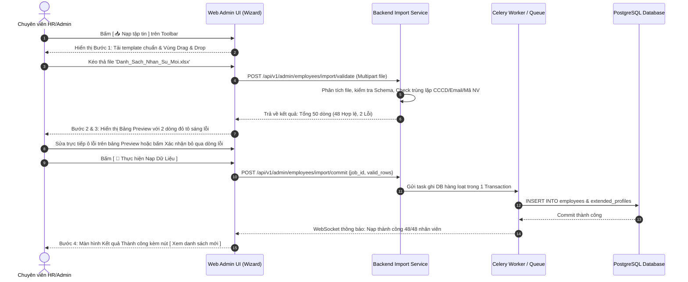

# TÀI LIỆU ĐẶC TẢ YÊU CẦU PHẦN MỀM (SRS)
## Phân hệ: Quản trị Nhân sự & Danh bạ Cư dân VMO trên Cổng Web Admin
### Module: Bảng Danh bạ Master, Bộ lọc 81 Đơn vị, Hồ sơ Đa tầng 7 Phân hệ, Xử lý Hàng loạt & Import/Export Excel

| Thông tin | Chi tiết |
| :--- | :--- |
| **Mã tài liệu** | `SRS_WEB_HR_ADMIN_DIRECTORY_001` |
| **Tên phân hệ** | Quản trị Nhân sự & Cư dân VMO trên Web Admin (Web Admin Employee & Directory Management) |
| **Dự án** | VMO ERP System - Web Admin Management Portal |
| **Nền tảng** | Web Application (Desktop Browser: Chrome, Edge, Safari, Firefox) + Backend API Microservices |
| **Tài liệu tham chiếu Mobile** | [SRS_Danh_Ba_Nhan_Vien_Cu_Dan_VMO.md](file:///Users/hoangkien/project/erp/SRS_Danh_Ba_Nhan_Vien_Cu_Dan_VMO.md), [SRS_Quan_Tri_Thong_Tin_Nhan_Su.md](file:///Users/hoangkien/project/erp/SRS_Quan_Tri_Thong_Tin_Nhan_Su.md) |
| **Tệp thiết kế nguồn** | `ERP - App.fig` (Các Frame Web Desktop: `Desktop - 2`, `Group 6885`, `Group 6889`, `Group 6890`, `Admin Menu`) |
| **Độ phân giải chuẩn** | Desktop ($1440 \times 1024$, $1920 \times 1080$), Co giãn tối thiểu $1280 \times 800$, Hỗ trợ màn hình siêu rộng (Ultra-wide 2K/4K) |
| **Phiên bản SRS** | 1.0 (Chuẩn hóa toàn diện Bảng Data Table, Drawer 7 Tab, Quy trình Launch Plan, Import/Export & DDL PostgreSQL) |
| **Ngày tạo** | 21/10/2026 |
| **Trạng thái** | Sẵn sàng triển khai (Ready for Dev/QA) |

---

## 1. Giới thiệu tổng quan phân hệ (Overview & Scope)

### 1.1 Mục đích tài liệu
Tài liệu này đặc tả chi tiết toàn diện các yêu cầu giao diện người dùng (UI/UX), yêu cầu chức năng (FR), quy tắc nghiệp vụ (BR), kiến trúc dòng dữ liệu, hợp đồng API RESTful và lược đồ cơ sở dữ liệu quan hệ (PostgreSQL DDL) cho phân hệ **Quản trị Nhân sự & Danh bạ Cư dân VMO trên Web Admin**.

Nếu trên ứng dụng Mobile, phân hệ "Cư dân VMO" đóng vai trò là danh bạ số thu gọn để nhân viên tra cứu nhanh đồng nghiệp, và phân hệ "Quản trị Nhân sự" giúp cán bộ quản lý phê duyệt cơ động; thì trên **Cổng Web Admin Desktop**, đây là **Trung tâm Điều hành Dữ liệu Nhân sự Toàn diện (Core HR Hub)** phục vụ Ban Lãnh đạo (BOD), Giám đốc Khối/Trung tâm, Phòng Quản trị Nhân sự (HR/C&B), Quản lý Dự án (PM) và Quản trị viên Hệ thống (System Admin). Cổng Web giải quyết bài toán xử lý dữ liệu lớn, quản lý vòng đời nhân sự (Onboarding đến Offboarding), kiểm soát cơ cấu tổ chức 81 đơn vị, phân quyền bảo mật dữ liệu cấp dòng (Row-Level Security) và tự động hóa tác vụ hàng loạt.

### 1.2 Bảng so sánh Kiến trúc: Mobile App vs. Web Admin Desktop

| Tiêu chuẩn So sánh | Ứng dụng Di động (Mobile App) | Cổng Quản trị Web (Web Admin Portal) |
| :--- | :--- | :--- |
| **Đối tượng sử dụng** | Toàn bộ 921+ nhân viên và Cán bộ Quản lý on-the-go. | Ban Giám đốc (BOD), Trưởng phòng ban, Chuyên viên HR/C&B, IT Admin. |
| **Mục tiêu tương tác** | Tra cứu nhanh, xem thông tin liên hệ, gửi email/gọi điện trực tiếp, duyệt đơn lẻ. | Quản trị dữ liệu tập trung, phân tích định biên, xử lý dữ liệu hàng loạt, cấu hình chính sách. |
| **Bố cục hiển thị** | Dạng Thẻ (Card View) 1 cột cuộn dọc ($375 \times 812$), hiển thị 7-9 trường thông tin cơ bản. | **Bảng Dữ liệu Đa chiều (Data Table Grid - $1440 \times 1024$ / $1920 \times 1080$):** Cố định cột (Sticky Columns), Tùy biến ẩn/hiển thị cột, Phân trang 25/50/100 dòng, cuộn ngang mượt mà. |
| **Bộ lọc cơ cấu** | Danh sách chọn 1 cột cuộn dọc theo thứ tự đơn vị. | **Tab chuyển nhanh (Quick Tabs)** theo phòng ban trọng yếu + **Cây cơ cấu tổ chức 81 đơn vị (Org-Tree Dropdown)** kết hợp lọc đa chiều (Chức danh, Nơi làm việc, HĐ, Trạng thái). |
| **Xem & Sửa hồ sơ** | Chuyển trang chi tiết với 7 Accordion đóng mở dọc. | **Slide-Over Master Drawer (Ngăn kéo trượt phải 720px/960px)** hoặc Mở rộng Toàn màn hình (Full-Page) với 7 Tab chuyên sâu, chỉnh sửa trực tiếp không mất ngữ cảnh bảng. |
| **Tác vụ Dữ liệu lớn** | Thao tác từng nhân viên (Single action); Xuất danh bạ cố định 1 sheet. | **Bulk Actions (Hàng loạt):** Chọn nhiều checkbox để Chuyển bộ phận, Khóa/Lưu trữ, Đổi trạng thái, Gửi thông báo; **Smart Excel Import/Export** với kiểm tra lỗi trước khi nạp. |
| **Bảo mật & Kiểm toán** | Xem theo quyền cơ bản, không có nhật ký chi tiết thay đổi. | Phân quyền truy cập trường dữ liệu nhạy cảm (Lương, BHXH, CCCD, Thuế) + **Audit Log** lưu lịch sử sửa đổi từng trường dữ liệu kèm IP và thời gian. |

---

## 2. Danh mục Chức năng Phân hệ Web Admin (Functional Scope)

```mermaid
graph TD
    A[CỔNG WEB ADMIN: QUẢN TRỊ NHÂN SỰ & CƯ DÂN VMO] --> B[1. Dashboard & Thống kê Định biên]
    A --> C[2. Bảng Danh bạ Master Data Table]
    A --> D[3. Hồ sơ Nhân sự Đa tầng Master Drawer]
    A --> E[4. Khởi tạo & Onboarding Launch Plan]
    A --> F[5. Tác vụ Hàng loạt Bulk Actions]
    A --> G[6. Smart Import & Export Excel]
    A --> H[7. Offboarding & Lưu trữ Hồ sơ]
    A --> I[8. Phân quyền RBAC & Nhật ký Audit]

    B --> B1[Tổng headcount: Đang làm, Thử việc, Thực tập, Nghỉ việc]
    B --> B2[Biểu đồ cơ cấu 81 đơn vị & Trụ sở TTC11 / IDMC5 / Keangnam]
    
    C --> C1[Quick Tabs: All, Nhân sự, Kinh doanh, QA, SWAT...]
    C --> C2[Thanh tìm kiếm Full-Text Search + Bộ lọc nâng cao Popover]
    C --> C3[Bảng tương tác: Sticky Header, Checkbox hàng loạt, Action Menu]
    
    D --> D1[Tab 1: Resumé - Kỹ năng & Kinh nghiệm]
    D --> D2[Tab 2: Thông tin liên hệ đa kênh]
    D --> D3[Tab 3: Công việc, Bậc chức danh & Trụ sở]
    D --> D4[Tab 4: 21 Trường Lý lịch, CCCD, Thuế, Ngân hàng]
    D --> D5[Tab 5: Hợp đồng, Mức lương & BHXH]
    D --> D6[Tab 6: Checklist Tài liệu Pháp lý đã nộp]
    D --> D7[Tab 7: Thiết lập Nhân lực & Máy chấm công]

    E --> E1[Wizard 4 bước: Thông tin cá nhân -> Công việc -> Hợp đồng -> Cấp tài khoản]
    E --> E2[Tự động tạo mã nhân viên, cấp email @vmo.vn, gán ca làm việc]

    F --> F1[Chuyển bộ phận hàng loạt]
    F --> F2[Lưu trữ / Khóa tài khoản hàng loạt]
    F --> F3[Cập nhật chức danh & Nơi làm việc hàng loạt]

    G --> G1[Import Wizard: Tải template, Upload, Validation Grid, Báo cáo kết quả]
    G --> G2[Export Tùy chỉnh: Chọn cột cần xuất, Lọc dữ liệu, Xuất XLSX mã hóa]

    H --> H1[Quy trình Thôi việc: Biên bản bàn giao tài sản, Quyết định nghỉ việc]
    H --> H2[Tự động thu hồi quyền, ngắt phiên SSO Google, chuyển trạng thái Lưu trữ]

    I --> I1[Phân quyền dữ liệu theo Đơn vị phụ trách - RLS]
    I --> I2[Ghi vết thay đổi: Giá trị cũ, Giá trị mới, Người sửa, Thời gian]
```



---

## 3. Đặc tả Chi tiết Giao diện Web Desktop (Wireframes & Screen Specs)

---

### MÀN HÌNH 1: BẢNG DANH BẠ NHÂN SỰ MASTER (`SCR_WEB_HR_001`)
*Tham chiếu Figma Desktop:* Frame `Desktop - 2` ($1440 \times 1024$), `Group 6885`, `Group 6889`, `Admin Menu`.

#### 3.1 Bản vẽ Bố cục Giao diện Web Desktop ($1440 \times 1024$ px)
```
+-----------------------------------------------------------------------------------------------------------------------------+
| [LOGO VMO]   Tổng quan    [NHÂN VIÊN]*   Chấm công    Ngày nghỉ    Dự án    Thảo luận    Hướng dẫn        [🔍] [🔔 2] (Avatar v)|
+-----------------------------------------------------------------------------------------------------------------------------+
| Trang chủ > Quản trị Nhân sự > Danh bạ Cư dân VMO                                                          21/10/2026 14:30 |
|                                                                                                                             |
|  QUẢN LÝ NHÂN SỰ & CƯ DÂN VMO                                                        [ + Thêm mới v ] [ 📥 Nạp tập tin ] [ 📤 Xuất Excel ]
|  Tổng số: 921 nhân sự (Đang làm việc: 874 | Thử việc: 35 | Nghỉ thai sản: 12)                                               |
|                                                                                                                             |
|  +-----------------------------------------------------------------------------------------------------------------------+  |
|  | [All (921)]*  |  Phòng Nhân Sự (28)  |  Phòng Kinh Doanh (64)  |  Phòng Hành Chính (15)  |  Phòng QA (42)  |  SWAT (18)  |  |
|  +-----------------------------------------------------------------------------------------------------------------------+  |
|                                                                                                                             |
|  +-------------------------------------------------------------+ +--------------------+ +-----------------+ +----------------+  |
|  | [🔍 Tìm kiếm theo tên, mã NV, email, vị trí, kỹ năng...   ] | | [Ⴘ Cơ cấu 81 đơn vị] | | [🏢 Văn phòng v] | | [ Bộ lọc khác ]|  |
|  +-------------------------------------------------------------+ +--------------------+ +-----------------+ +----------------+  |
|                                                                                                                             |
|  [X Đã chọn 2 nhân viên] -> [ 🔁 Chuyển bộ phận ] [ 🔒 Lưu trữ hồ sơ ] [ ✉️ Gửi email/thông báo ] [ ⚙️ Thao tác khác v ]     |
|  +-----------------------------------------------------------------------------------------------------------------------+  |
|  | [X]| TÊN & MÃ NV        | BỘ PHẬN               | CẤP BẬC       | VỊ TRÍ     | VĂN PHÒNG | GIỚI TÍNH | QUÊ QUÁN  | TRẠNG THÁI | THAO TÁC |  |
|  +---+--------------------+-----------------------+---------------+------------+-----------+-----------+-----------+------------+----------+  |
|  | [X]| (Avatar)           | Trung Tâm PM Số 18    | Nhân Viên     | Tester     | IDMC 5    | Nam       | Hà Nội    | [ Đang làm ]| [👁][✏️][⋮]|  |
|  |   | Ian Chesnut        |                       |               |            |           |           |           |            |          |  |
|  |   | #0123              |                       |               |            |           |           |           |            |          |  |
|  +---+--------------------+-----------------------+---------------+------------+-----------+-----------+-----------+------------+----------+  |
|  | [X]| (Avatar)           | Trung Tâm PM Số 18    | Senior        | Developer  | IDMC 5    | Nữ        | Nam Định  | [ Đang làm ]| [👁][✏️][⋮]|  |
|  |   | Collins Jackson    |                       |               |            |           |           |           |            |          |  |
|  |   | #0125              |                       |               |            |           |           |           |            |          |  |
|  +---+--------------------+-----------------------+---------------+------------+-----------+-----------+-----------+------------+----------+  |
|  | [ ]| (Avatar)           | Phòng QA              | Lead          | QA Lead    | TTC 11    | Nữ        | Hải Phòng | [ Đang làm ]| [👁][✏️][⋮]|  |
|  |   | Sarah Jenkins      |                       |               |            |           |           |           |            |          |  |
|  |   | #0088              |                       |               |            |           |           |           |            |          |  |
|  +---+--------------------+-----------------------+---------------+------------+-----------+-----------+-----------+------------+----------+  |
|  | [ ]| (Avatar)           | SWAT                  | Chuyên viên   | DevOps     | Keangnam  | Nam       | Đà Nẵng   | [ Thử việc ]| [👁][✏️][⋮]|  |
|  |   | Alex Morgan        |                       |               |            |           |           |           |            |          |  |
|  |   | #0412              |                       |               |            |           |           |           |            |          |  |
|  +---+--------------------+-----------------------+---------------+------------+-----------+-----------+-----------+------------+----------+  |
|  | Hiển thị 1 - 25 của 921 kết quả                     | Số dòng mỗi trang: [25 v] | [<] [1] [2] [3] ... [37] [>]               |  |
|  +-----------------------------------------------------------------------------------------------------------------------+  |
+-----------------------------------------------------------------------------------------------------------------------------+
```

#### 3.2 Chi tiết các Thành phần Giao diện & Tương tác

1. **Thanh Điều hướng Topbar Chuẩn Doanh nghiệp:**
   * Logo VMO kích thước chuẩn $120 \times 32$ px (Vector SVG sắc nét).
   * Menu chính: `Tổng quan`, `Nhân viên` *(Active - gạch chân cam VMO `#F05A22` và chữ in đậm)*, `Chấm công`, `Ngày nghỉ`, `Dự án`, `Thảo luận`, `Hướng dẫn`.
   * Khối tiện ích bên phải: Ô tìm kiếm toàn cục `[🔍]`, Chuông thông báo `[🔔 2]` hiển thị chấm đỏ, Avatar người dùng kèm dropdown (`Hồ sơ của tôi`, `Cấu hình hệ thống`, `Nhật ký hoạt động`, `Đăng xuất`).

2. **Cụm Nút Tác vụ Chính (Action Toolbar):**
   * **Nút `[ + Thêm mới v ]`:** Màu cam thương hiệu (`#F05A22`), icon cộng trắng. Bấm vào hiển thị dropdown:
     * `Thêm nhanh nhân viên` (Mở modal nhập thông tin cơ bản).
     * `Khởi chạy kế hoạch nhân sự (Launch Plan)` (Mở quy trình Onboarding bài bản).
   * **Nút `[ 📥 Nạp tập tin ]`:** Nền trắng, viền xám, icon nạp file. Bấm vào mở Wizard Nạp Excel 4 bước (`SCR_WEB_HR_004`).
   * **Nút `[ 📤 Xuất Excel ]`:** Nền trắng, viền xám. Bấm vào mở Drawer chọn cột và xuất dữ liệu (`SCR_WEB_HR_006`).

3. **Thanh Tab Chuyển nhanh Bộ phận (Quick Department Tabs - Khớp Figma `Group 6885`):**
   * Danh sách tab ngang: `All`, `Phòng nhân sự`, `Phòng kinh doanh`, `Phòng hành chính`, `Phòng QA`, `Phòng truyền thông`, `Swat`.
   * Hiển thị số lượng nhân sự trực thuộc trong ngoặc đơn bên cạnh tên tab.
   * Tab đang chọn (`Active`) có thanh chỉ báo màu cam dày 3px (`Rectangle 63`) phía dưới và chữ màu đen đậm; các tab khác chữ màu xám `#666666`. Chuyển tab mượt mà bằng AJAX không tải lại trang.

4. **Khu vực Tìm kiếm & Bộ lọc Đa tầng:**
   * **Ô Tìm kiếm Full-Text:** Chiều rộng 360px, hỗ trợ gõ tìm tức thời (Debounce 300ms) theo: Họ tên, Mã nhân viên, Email, Vị trí công việc, Số điện thoại.
   * **Dropdown Cơ cấu 81 Đơn vị:** Hiển thị cây thư mục phân cấp cha - con có checkbox đa chọn. Hỗ trợ tìm nhanh tên phòng ban trong dropdown.
   * **Dropdown Văn phòng:** Lọc nhanh theo trụ sở thực tế: `TTC 11 Duy Tân`, `IDMC 5 Cầu Giấy`, `Keangnam Landmark 72`, `VP Đà Nẵng`, `VP Tokyo (Japan)`.
   * **Nút `[ Bộ lọc khác ]`:** Mở popover chứa các tiêu chí chuyên sâu:
     * Cấp bậc: `Intern`, `Fresher`, `Junior`, `Middle`, `Senior`, `Lead`, `Manager`, `Director`.
     * Loại hợp đồng: `Thử việc`, `Chính thức có thời hạn`, `Không xác định thời hạn`, `Cộng tác viên`.
     * Giới tính: `Nam`, `Nữ`, `Khác`.
     * Trạng thái làm việc: `Đang làm việc`, `Nghỉ thai sản`, `Tạm hoãn HĐ`, `Đã nghỉ việc`.

5. **Thanh Tác vụ Hàng loạt (Bulk Actions Bar):**
   * Tự động xuất hiện khi người dùng tích chọn từ 1 checkbox trở lên ở cột đầu tiên của bảng.
   * Hiển thị số lượng nhân sự đang được chọn: `Đã chọn [X] nhân viên` kèm nút `[ Bỏ chọn tất cả ]`.
   * Cung cấp các thao tác nhóm: `[ 🔁 Chuyển bộ phận ]`, `[ 🔒 Lưu trữ hồ sơ ]`, `[ ✉️ Gửi thông báo/Email ]`, `[ ⚙️ Thao tác khác v ]` (Xuất thẻ nhân viên, In danh sách, Xóa tạm).

6. **Bảng Dữ liệu Master (Data Table Grid - Khớp Figma `Frame 313253`):**
   * **Cột cố định bên trái (Sticky Left):** Checkbox chọn dòng + Cột `Tên & Mã NV` (gồm Avatar tròn 36px, Họ và tên in đậm, Mã NV màu xám phía dưới).
   * **Các cột nội dung:**
     * `Bộ phận`: Tên phòng ban / Trung tâm PM (Ví dụ: `Trung Tâm PM Số 18`).
     * `Cấp bậc`: `Nhân Viên`, `Senior`, `Lead`, `PM`...
     * `Vị trí làm việc`: `Tester`, `Developer`, `BA`, `DevOps`, `UI/UX Designer`.
     * `Văn phòng làm việc`: `IDMC 5`, `TTC 11`, `Keangnam`.
     * `Giới tính`: `Nam` / `Nữ`.
     * `Quê quán`: Tỉnh/Thành phố quê quán (Ví dụ: `Hà Nội`, `Nam Định`).
     * `Trạng thái`: Badge màu (Xanh lá: `Đang làm việc`, Cam: `Thử việc`, Vàng: `Thai sản`, Xám: `Đã nghỉ việc`).
   * **Cột cố định bên phải (Sticky Right):** Cột `Thao tác` gồm 3 nút icon:
     * Icon mắt `[👁]`: Xem nhanh Drawer hồ sơ 7 tab.
     * Icon bút chì `[✏️]`: Mở chế độ chỉnh sửa hồ sơ.
     * Icon ba chấm `[⋮]`: Mở Action Menu (`In hồ sơ`, `Nhân bản`, `Gửi email IT`, `Lưu trữ`, `Phân tích phép`).
   * **Tính năng bảng:** Hỗ trợ nhấp vào tiêu đề cột để sắp xếp (Sort tăng/giảm), kéo thả thay đổi độ rộng cột, cuộn ngang cố định 2 đầu.

7. **Thanh Phân trang (Pagination Footer):**
   * Hiển thị thông tin: `Hiển thị 1 - 25 của 921 kết quả`.
   * Dropdown chọn số bản ghi hiển thị: `[10]`, `[25]`, `[50]`, `[100]` bản ghi/trang.
   * Cụm nút điều hướng: Nút Trước `[<]`, các số trang `[1] [2] [3] ... [37]`, Nút Tiếp theo `[>]`.

---

### MÀN HÌNH 2: SLIDE-OVER MASTER PROFILE DRAWER - 7 PHÂN HỆ (`SCR_WEB_HR_002`)
*Chuyển đổi từ 7 Accordion trên Mobile ([SRS_Quan_Tri_Thong_Tin_Nhan_Su.md](file:///Users/hoangkien/project/erp/SRS_Quan_Tri_Thong_Tin_Nhan_Su.md)) sang Bố cục Ngăn kéo trượt Web Desktop.*

#### 3.3 Bản vẽ Bố cục Ngăn kéo Trượt Phải ($840$ px Width)
```
+----------------------------------------------------------------------------------+
| [X Đóng]   HỒ SƠ NHÂN SỰ CHI TIẾT                       [ 🖨 In ] [ ✏️ Sửa ] [ ⋮ ] |
+----------------------------------------------------------------------------------+
|  (Avatar 72px)  IAN CHESNUT                  Mã NV: VMO-0123   [ Đang làm việc ] |
|                 Tester - Trung Tâm PM Số 18  Email: ian.chesnut@vmogroup.com     |
|                 Văn phòng: IDMC 5 Cầu Giấy   SĐT: 0987.654.321                   |
+----------------------------------------------------------------------------------+
|  [1. Resumé]* | [2. Liên hệ] | [3. Công việc] | [4. Cá nhân] | [5. HĐ] | [6. Tài liệu] | [7. Cấu hình] |
+----------------------------------------------------------------------------------+
|                                                                                  |
|  [ TAB 1: RESUMÉ & KỸ NĂNG ]                                                     |
|  ------------------------------------------------------------------------------  |
|  • Chuyên môn chính: Manual Testing, API Automation, Postman, Selenium           |
|  • Kinh nghiệm làm việc:                                                         |
|    - 2023 - Nay: Tester tại VMO Holdings (Trung Tâm PM Số 18)                    |
|    - 2021 - 2023: QA Engineer tại FPT Software                                   |
|  • Bằng cấp / Chứng chỉ: ISTQB Foundation Level, TOEIC 785                       |
|                                                                                  |
|  [ TAB 2: THÔNG TIN LIÊN HỆ ĐA KÊNH ]                                            |
|  ------------------------------------------------------------------------------  |
|  • Số điện thoại cá nhân: 0987.654.321             Email cá nhân: ian@gmail.com  |
|  • Skype ID: live:ian.chesnut_1                    Facebook URL: fb.com/ian.vmo  |
|  • Liên hệ khẩn cấp (Người thân):                                               |
|    - Người liên hệ: Nguyễn Thị Lan (Mẹ ruột)                                     |
|    - SĐT người thân: 0912.345.678                  Quan hệ: Mẹ                   |
|                                                                                  |
|  [ TAB 3: THÔNG TIN CÔNG VIỆC & VỊ TRÍ ]                                         |
|  ------------------------------------------------------------------------------  |
|  • Email công việc: ian.chesnut@vmogroup.com       Phòng ban: Trung Tâm PM Số 18 |
|  • Trụ sở làm việc: IDMC 5 - Tầng 8                Cấp bậc: Nhân Viên (Level 2)  |
|  • Vị trí chức danh: Manual Tester                 Ngày bắt đầu làm: 15/03/2023  |
|  • Loại hình nhân viên: Toàn thời gian (Fulltime)  Trạng thái: Đang hoạt động    |
|                                                                                  |
|  [ TAB 4: 21 TRƯỜNG THÔNG TIN CÁ NHÂN CHUYÊN SÂU ]                               |
|  ------------------------------------------------------------------------------  |
|  • Họ và tên khai sinh: Ian Chesnut                Tên thường gọi: Ian           |
|  • Ngày sinh: 12/08/1996                           Giới tính: Nam                |
|  • Tình trạng hôn nhân: Độc thân                   Quốc tịch: Việt Nam           |
|  • Số CMND/CCCD: 001096001234                      Ngày cấp: 10/05/2021          |
|  • Nơi cấp: Cục Cảnh sát QLHC về TTXH              Mã số thuế cá nhân: 8392019281|
|  • Số tài khoản ngân hàng: 190348291029            Ngân hàng: Techcombank - HN   |
|  • Quê quán: Xã Đông Mỹ, Huyện Thanh Trì, Hà Nội                                 |
|  • Địa chỉ thường trú: Số 12 Ngõ 45 Cầu Giấy, Hà Nội                             |
|  • Địa chỉ tạm trú: Số 12 Ngõ 45 Cầu Giấy, Hà Nội                                |
|                                                                                  |
|  [ TAB 5: HỢP ĐỒNG LAO ĐỘNG & ĐÃI NGỘ ]                                          |
|  ------------------------------------------------------------------------------  |
|  • Số hợp đồng: HĐLĐ-2023/VMO-0123                 Loại HĐ: Xác định thời hạn 24T|
|  • Ngày bắt đầu: 15/03/2023                        Ngày kết thúc: 14/03/2025     |
|  • Lương cơ bản: [ 🔒 Ẩn - Yêu cầu quyền C&B ]     Phụ cấp ăn trưa: 730.000 VNĐ  |
|  • Đóng BHXH theo lương: Có                        Mã số BHXH: 7918291028        |
|                                                                                  |
|  [ TAB 6: HỒ SƠ & TÀI LIỆU PHÁP LÝ ĐÃ NỘP ]                                     |
|  ------------------------------------------------------------------------------  |
|  [X] Sơ yếu lý lịch (Đã nộp) - File: [so_yeu_ly_lich.pdf]                        |
|  [X] Bản sao CCCD công chứng (Đã nộp) - File: [cccd_scan.pdf]                    |
|  [X] Bản sao Bằng đại học (Đã nộp) - File: [bang_tot_nghiep.pdf]                 |
|  [!] Giấy khám sức khỏe (Còn thiếu - Hạn nộp: 30/10/2026) -> [ 📤 Tải file lên ] |
|  [X] Cam kết bảo mật NDA (Đã ký điện tử) - File: [nda_signed.pdf]                |
|                                                                                  |
|  [ TAB 7: THIẾT LẬP NHÂN LỰC & MÁY CHẤM CÔNG ]                                   |
|  ------------------------------------------------------------------------------  |
|  • Người phê duyệt cấp 1 (Trực tiếp): Trần Văn B (DUL Trung Tâm 18)              |
|  • Người phê duyệt cấp 2 (PMO/HR): Lê Thị C (HR Lead)                            |
|  • Mã chấm công sinh trắc học: 1023 (Máy chấm công Tầng 8 - IDMC 5)              |
|  • Tài khoản liên kết hệ thống: ian.chesnut (Đã đồng bộ Google Workspace & Slack)|
+----------------------------------------------------------------------------------+
| [ Đóng ]                                                 [ 💾 Lưu thay đổi ]     |
+----------------------------------------------------------------------------------+
```

---

### MÀN HÌNH 3: WIZARD NẠP TẬP TIN EXCEL THÔNG MINH (`SCR_WEB_HR_004`)
*Khắc phục hoàn toàn hạn chế của ứng dụng di động: Web Admin cung cấp quy trình Nạp Excel 4 bước với cơ chế kiểm tra lỗi trực quan.*

#### 3.4 Quy trình 4 Bước Import Excel


#### 3.5 Bản vẽ Wireframe Bảng Xem trước & Sửa lỗi (Bước 3 Validation Grid)
```
+--------------------------------------------------------------------------------------------------+
|  NẠP TẬP TIN NHÂN SỰ TỰ ĐỘNG (BƯỚC 3: KIỂM TRA & XÁC NHẬN DỮ LIỆU)                        [X]    |
+--------------------------------------------------------------------------------------------------+
|  Tiến độ: [1. Chọn tệp] ---> [2. Phân tích] ---> [3. Xác thực dữ liệu]* ---> [4. Hoàn tất]       |
|                                                                                                  |
|  Kết quả phân tích: Tổng cộng 50 dòng | [✅ 48 Hợp lệ] | [⚠️ 2 Dòng phát hiện lỗi cần xử lý]      |
|  Lựa chọn: (o) Bỏ qua dòng lỗi và chỉ nạp dòng hợp lệ    ( ) Sửa trực tiếp trên bảng dưới đây    |
|                                                                                                  |
|  +--------------------------------------------------------------------------------------------+  |
|  | DÒNG | MÃ NV  | HỌ VÀ TÊN     | EMAIL CÔNG TY        | CCCD         | BỘ PHẬN      | LỖI PHÁT HIỆN    |  |
|  +------+--------+---------------+----------------------+--------------+--------------+------------------+  |
|  | 02   | VMO0922| Nguyen Van An | an.nguyen@vmo.vn     | 001095002233 | TT PM Số 18  | [ Hợp lệ ]       |  |
|  | 03   | VMO0923| Tran Thi Binh | binh.tran@vmo.vn     | 001096004455 | Phòng QA     | [ Hợp lệ ]       |  |
|  | 04*  | VMO0924| Le Van Cuong  | cuong.le             | 001097008899 | TT PM Số 10  | [❌ Email sai cú  |  |
|  |      |        |               | ⚠️ Gõ lại: @vmo.vn   |              |              | pháp quy định]   |  |
|  | 05*  | VMO0123| Pham Duc Dan  | dan.pham@vmo.vn      | 001096001234 | Phòng Nhân Sự| [❌ Trùng Mã NV & |  |
|  |      |        |               |                      |              |              | CCCD với Ian C.] |  |
|  +--------------------------------------------------------------------------------------------+  |
|                                                                                                  |
|  [ Tải báo cáo lỗi (.xlsx) ]                                  [ Quay lại ]  [ 🚀 Thực hiện Nạp (48) ]|
+--------------------------------------------------------------------------------------------------+
```

---

### MÀN HÌNH 4: KHỞI TẠO NHÂN SỰ & ONBOARDING LAUNCH PLAN (`SCR_WEB_HR_003`)
*Quy trình Thiết lập Kế hoạch Nhân sự Mới (Launch Plan).*

#### 3.6 Bản vẽ Giao diện Wizard Onboarding 4 Bước
```
+--------------------------------------------------------------------------------------------------+
|  KHỞI TẠO HỒ SƠ NHÂN SỰ MỚI (LAUNCH PLAN)                                                  [X]    |
+--------------------------------------------------------------------------------------------------+
|  [BƯỚC 1: CÁ NHÂN]*  --->  [BƯỚC 2: CÔNG VIỆC]  --->  [BƯỚC 3: HỢP ĐỒNG]  --->  [BƯỚC 4: IT & TÀI KHOẢN]
|                                                                                                  |
|  1. Họ và tên nhân viên *:             2. Giới tính *:               3. Ngày sinh *:             |
|  +-----------------------------------+ +---------------------------+ +------------------------+  |
|  | Nhập họ tên đầy đủ (in hoa/thường)| | [ (o) Nam   ( ) Nữ ]      | | dd / mm / yyyy      [📅]|  |
|  +-----------------------------------+ +---------------------------+ +------------------------+  |
|                                                                                                  |
|  4. Số CMND/CCCD *:                    5. Ngày cấp *:                6. Nơi cấp *:               |
|  +-----------------------------------+ +---------------------------+ +------------------------+  |
|  | 12 chữ số căn cước                | | dd / mm / yyyy      [📅]  | | Cục Cảnh sát QLHC...   |  |
|  +-----------------------------------+ +---------------------------+ +------------------------+  |
|                                                                                                  |
|  7. Số điện thoại di động *:           8. Email cá nhân *:                                       |
|  +-----------------------------------+ +------------------------------------------------------+  |
|  | 09xx xxx xxx                      | | email.canhan@gmail.com                               |  |
|  +-----------------------------------+ +------------------------------------------------------+  |
|                                                                                                  |
|  9. Địa chỉ thường trú (theo CCCD) *:                                                            |
|  +--------------------------------------------------------------------------------------------+  |
|  | Số nhà, tên đường, phường/xã, quận/huyện, tỉnh/thành phố                                   |  |
|  +--------------------------------------------------------------------------------------------+  |
|                                                                                                  |
|  [X] Tự động tạo kế hoạch gửi Email Chào mừng (Welcome Email) vào ngày làm việc đầu tiên         |
|  [X] Gán checklist hồ sơ pháp lý yêu cầu nộp trong vòng 15 ngày làm việc                          |
|                                                                                                  |
|  [ Hủy bỏ ]                                                                 [ Tiếp tục: Bước 2 > ]|
+--------------------------------------------------------------------------------------------------+
```

---

### MÀN HÌNH 5: XỬ LÝ HÀNG LOẠT (BULK ACTIONS MODAL) (`SCR_WEB_HR_005`)

#### 3.7 Bảng Điều khiển Chuyển Bộ phận & Lưu trữ Hàng loạt
```
+-----------------------------------------------------------------------------------+
|  CHUYỂN ĐƠN VỊ CÔNG TÁC HÀNG LOẠT (BULK TRANSFER)                            [X]  |
+-----------------------------------------------------------------------------------+
|  Danh sách nhân sự đang chọn (2 nhân sự):                                         |
|  1. Ian Chesnut (#0123) - Đơn vị hiện tại: Trung Tâm PM Số 18                     |
|  2. Collins Jackson (#0125) - Đơn vị hiện tại: Trung Tâm PM Số 18                 |
|                                                                                   |
|  Đơn vị chuyển đến mới *:                                                         |
|  +-----------------------------------------------------------------------------+  |
|  | [🏢 Chọn từ cây 81 đơn vị: Trung Tâm PM Số 12 v ]                           |  |
|  +-----------------------------------------------------------------------------+  |
|                                                                                   |
|  Vị trí công việc mới:                                 Cấp bậc chức danh mới:     |
|  +---------------------------------------------------+ +-----------------------+  |
|  | Giữ nguyên vị trí hiện tại                         | | [ Giữ nguyên cấp bậc v]|  |
|  +---------------------------------------------------+ +-----------------------+  |
|                                                                                   |
|  Người phê duyệt mới (Manager trực tiếp) *:                                       |
|  +-----------------------------------------------------------------------------+  |
|  | Nguyen Van Manh (DUL TT 12) - manh.nguyen@vmogroup.com                      |  |
|  +-----------------------------------------------------------------------------+  |
|                                                                                   |
|  Ngày hiệu lực điều chuyển *:                          Lý do điều chuyển:         |
|  +---------------------------------------------------+ +-----------------------+  |
|  | 01 / 11 / 2026                                [📅]| | Tái cơ cấu dự án FinTech|  |
|  +---------------------------------------------------+ +-----------------------+  |
|                                                                                   |
|  [X] Gửi email thông báo tự động cho nhân viên và các quản lý liên quan           |
|  [X] Tự động cập nhật tuyến phê duyệt Chấm công, Nghỉ phép và OT sang quản lý mới|
|                                                                                   |
|  [ Hủy bỏ ]                                              [ 🚀 Xác nhận Điều chuyển ]|
+-----------------------------------------------------------------------------------+
```

---

## 4. Đặc tả Yêu cầu Chức năng (Functional Requirements) & Ma trận RBAC

### 4.1 Bảng Ma trận Phân quyền Truy cập & Tác vụ (RBAC Matrix)

| Chức năng / Tác vụ | `SUPER_ADMIN` | `HR_MANAGER` | `DEPT_LEAD / DUL` | `PROJECT_MANAGER` | `EMPLOYEE` |
| :--- | :---: | :---: | :---: | :---: | :---: |
| **Xem Danh bạ Master** | Toàn quyền (921+) | Toàn quyền (921+) | Chỉ xem đơn vị mình phụ trách | Chỉ xem thành viên dự án | Xem thông tin công khai (7 trường) |
| **Xem thông tin nhạy cảm (Lương, BHXH)** | Có | Có | Không | Không | Chỉ xem của chính mình |
| **Thêm mới nhân sự (Launch Plan)** | Có | Có | Không | Không | Không |
| **Chỉnh sửa hồ sơ 7 Tab** | Toàn quyền | Toàn quyền | Chỉ sửa phân công công việc | Không | Chỉ sửa Tab 2 (Liên hệ cá nhân) |
| **Xử lý hàng loạt (Chuyển bộ phận)** | Có | Có | Không | Không | Không |
| **Lưu trữ hồ sơ (Offboarding/Archive)**| Có | Có | Không | Không | Không |
| **Nạp dữ liệu Excel (Smart Import)** | Có | Có | Không | Không | Không |
| **Xuất dữ liệu Excel (Export)** | Toàn bộ cột | Toàn bộ cột | Cột không nhạy cảm | Cột thành viên dự án | Bị vô hiệu hóa trên Web |
| **Xem Nhật ký Kiểm toán (Audit Logs)**| Toàn hệ thống | Bộ phận HR | Không | Không | Không |

---

### 4.2 Chi tiết Quy tắc Nghiệp vụ Dữ liệu (Business Rules - BR)

1. **BR-HR-001 (Tính Duy nhất của Định danh Nhân sự):**
   * Mã nhân viên (`employee_code`) có định dạng chuẩn: `VMO` + 4 chữ số (Ví dụ: `VMO0123`). Trường này là duy nhất (Unique) trên toàn hệ thống và không được phép tái sử dụng ngay cả khi nhân sự đã nghỉ việc.
   * Số CCCD (12 chữ số) và Mã số thuế cá nhân (10 hoặc 13 chữ số) là duy nhất. Hệ thống phải từ chối thêm mới hoặc nạp Excel nếu phát hiện trùng CCCD với nhân sự đang hoạt động.
2. **BR-HR-002 (Chuẩn hóa Email Doanh nghiệp):**
   * Email công việc bắt buộc phải có đuôi miền `@vmo.vn` hoặc `@vmogroup.com`. Cú pháp mặc định tự động gợi ý: `{ten}.{ho_dem}@vmo.vn` (Ví dụ: `ian.chesnut@vmogroup.com`).
3. **BR-HR-003 (Nguyên tắc Cơ cấu Tổ chức Phân cấp - Hierarchy Tree):**
   * Mọi nhân sự bắt buộc phải thuộc về đúng 1 đơn vị trực tiếp (Leaf Unit) trong Cây cơ cấu 81 đơn vị. Khi điều chuyển nhân sự sang đơn vị mới, hệ thống tự động kế thừa tuyến người phê duyệt (`approver_id`) của đơn vị đó cho các phân hệ Chấm công, Phép và Overtime.
4. **BR-HR-004 (Ràng buộc Trạng thái Hồ sơ & Vòng đời):**
   * Vòng đời nhân sự gồm 4 trạng thái chính: `PROBATION` (Thử việc) $\rightarrow$ `ACTIVE` (Chính thức) $\rightarrow$ `SUSPENDED` (Tạm hoãn HĐ/Thai sản) $\rightarrow$ `ARCHIVED` (Lưu trữ/Nghỉ việc).
   * Khi chuyển sang trạng thái `ARCHIVED`:
     * Phiên đăng nhập SSO Google và Token ứng dụng Mobile bị hủy ngay lập tức.
     * Tài khoản chuyển sang trạng thái khóa (`is_active = FALSE`).
     * Hồ sơ được đưa vào Kho lưu trữ, không hiển thị trong danh bạ tìm kiếm thông thường của nhân viên nhưng vẫn lưu trữ vĩnh viễn trong CSDL phục vụ tra cứu lịch sử và kiểm toán.
5. **BR-HR-005 (An toàn Nhập liệu Hàng loạt - Transactional Batch Import):**
   * Quá trình nạp tập tin Excel chạy bất đồng bộ qua hàng đợi Celery/Redis. Nếu quản trị viên chọn chế độ "Chỉ nạp dòng hợp lệ", hệ thống nạp các dòng chuẩn và tự động kết xuất tệp `Error_Report_YYYYMMDD.xlsx` chứa danh sách dòng lỗi kèm chú thích chi tiết để tải về sửa lại.

---

## 5. Đặc tả Hợp đồng API Phía Backend (Backend RESTful API Contracts)

Tất cả các API yêu cầu xác thực qua HttpOnly Cookie (`access_token`) và Header kiểm tra chống tấn công CSRF (`X-CSRF-Token`).

---

### 5.1 API 1: Lấy Danh sách Nhân sự Master (`GET /api/v1/admin/employees`)
*Phục vụ hiển thị Bảng Data Table với đầy đủ tiêu chí lọc, sắp xếp và phân trang.*

* **Method:** `GET`
* **Path:** `/api/v1/admin/employees`
* **Query Parameters:**
  * `page` (int, default: 1): Trang hiện tại.
  * `limit` (int, default: 25, max: 100): Số bản ghi/trang.
  * `search` (string, optional): Từ khóa tìm kiếm (Họ tên, Mã NV, Email, Vị trí).
  * `department_id` (uuid, optional): ID đơn vị trong cây 81 đơn vị.
  * `quick_tab` (string, optional): Enum lọc nhanh (`ALL`, `HR`, `SALES`, `ADMIN`, `QA`, `SWAT`).
  * `office_location` (string, optional): Trụ sở làm việc (`TTC11`, `IDMC5`, `KEANGNAM`, `DANANG`, `JAPAN`).
  * `status` (string, optional): Trạng thái (`ACTIVE`, `PROBATION`, `SUSPENDED`, `ARCHIVED`).
  * `sort_by` (string, default: `created_at`): Tên cột sắp xếp (`name`, `employee_code`, `department`, `joined_date`).
  * `sort_order` (string, default: `desc`): `asc` hoặc `desc`.

* **Response Body JSON (200 OK):**
```json
{
  "success": true,
  "status_code": 200,
  "message": "Truy vấn danh sách nhân sự thành công",
  "data": {
    "summary": {
      "total_headcount": 921,
      "active_count": 874,
      "probation_count": 35,
      "suspended_count": 12,
      "archived_count": 48
    },
    "pagination": {
      "current_page": 1,
      "limit": 25,
      "total_records": 921,
      "total_pages": 37
    },
    "items": [
      {
        "id": "e4b3c2a1-0001-4000-8000-abcdef012345",
        "employee_code": "VMO0123",
        "full_name": "Ian Chesnut",
        "avatar_url": "https://cdn.vmo.vn/avatars/0123.jpg",
        "department": {
          "id": "d1a2b3c4-0018-4000-8000-000000000018",
          "name": "Trung Tâm PM Số 18",
          "code": "PM_CENTER_18"
        },
        "job_level": "Nhân Viên",
        "job_title": "Tester",
        "office_location": "IDMC 5",
        "gender": "MALE",
        "hometown": "Hà Nội",
        "phone_number": "0987654321",
        "work_email": "ian.chesnut@vmogroup.com",
        "employment_status": "ACTIVE",
        "joined_date": "2023-03-15",
        "contract_type": "Xác định thời hạn 24 tháng"
      }
    ]
  }
}
```

---

### 5.2 API 2: Lấy Chi tiết Hồ sơ Đa tầng 7 Phân hệ (`GET /api/v1/admin/employees/{id}`)

* **Method:** `GET`
* **Path:** `/api/v1/admin/employees/e4b3c2a1-0001-4000-8000-abcdef012345`
* **Response Body JSON (200 OK):**
```json
{
  "success": true,
  "status_code": 200,
  "data": {
    "basic_info": {
      "id": "e4b3c2a1-0001-4000-8000-abcdef012345",
      "employee_code": "VMO0123",
      "full_name": "Ian Chesnut",
      "status": "ACTIVE",
      "avatar_url": "https://cdn.vmo.vn/avatars/0123.jpg"
    },
    "tab_1_resume": {
      "skills": ["Manual Testing", "API Testing", "Postman", "Selenium"],
      "work_experiences": [
        {
          "company": "VMO Holdings",
          "role": "Tester",
          "from_date": "2023-03-15",
          "to_date": null,
          "is_current": true
        }
      ],
      "certifications": ["ISTQB Foundation Level", "TOEIC 785"]
    },
    "tab_2_contact": {
      "personal_phone": "0987654321",
      "personal_email": "ian@gmail.com",
      "skype_id": "live:ian.chesnut_1",
      "facebook_url": "https://facebook.com/ian.vmo",
      "emergency_contacts": [
        {
          "contact_name": "Nguyễn Thị Lan",
          "relation": "Mẹ ruột",
          "phone": "0912345678"
        }
      ]
    },
    "tab_3_work": {
      "work_email": "ian.chesnut@vmogroup.com",
      "department_name": "Trung Tâm PM Số 18",
      "office_location": "IDMC 5 - Tầng 8",
      "job_level": "Nhân Viên",
      "job_title": "Manual Tester",
      "joined_date": "2023-03-15",
      "official_date": "2023-05-15",
      "resigned_date": null
    },
    "tab_4_personal": {
      "birth_date": "1996-08-12",
      "gender": "MALE",
      "marital_status": "SINGLE",
      "nationality": "Việt Nam",
      "id_card_number": "001096001234",
      "id_card_issue_date": "2021-05-10",
      "id_card_issue_place": "Cục Cảnh sát QLHC về TTXH",
      "tax_code": "8392019281",
      "bank_account_number": "190348291029",
      "bank_name": "Techcombank",
      "permanent_address": "Số 12 Ngõ 45 Cầu Giấy, Hà Nội",
      "current_address": "Số 12 Ngõ 45 Cầu Giấy, Hà Nội"
    },
    "tab_5_contract": {
      "contract_number": "HĐLĐ-2023/VMO-0123",
      "contract_type": "FIXED_TERM_24M",
      "start_date": "2023-03-15",
      "end_date": "2025-03-14",
      "base_salary_encrypted": "$2b$12$eW...",
      "insurance_code": "7918291028",
      "has_insurance": true
    },
    "tab_6_documents": [
      {
        "document_type": "CURRICULUM_VITAE",
        "name": "Sơ yếu lý lịch",
        "status": "SUBMITTED",
        "file_url": "https://s3.vmo.vn/hr-docs/so_yeu_ly_lich.pdf",
        "submitted_at": "2023-03-15T09:00:00Z"
      },
      {
        "document_type": "HEALTH_CERTIFICATE",
        "name": "Giấy khám sức khỏe",
        "status": "MISSING",
        "due_date": "2026-10-30"
      }
    ],
    "tab_7_workforce_settings": {
      "direct_manager_id": "u1-manager-uuid",
      "direct_manager_name": "Trần Văn B (DUL TT 18)",
      "pmo_approver_id": "u2-hr-uuid",
      "biometric_clock_code": "1023",
      "biometric_device_ip": "192.168.1.201",
      "system_linked_username": "ian.chesnut"
    }
  }
}
```

---

### 5.3 API 3: Thực thi Thao tác Hàng loạt (`POST /api/v1/admin/employees/bulk-action`)

* **Method:** `POST`
* **Path:** `/api/v1/admin/employees/bulk-action`
* **Request Body JSON:**
```json
{
  "action_type": "TRANSFER_DEPARTMENT",
  "employee_ids": [
    "e4b3c2a1-0001-4000-8000-abcdef012345",
    "f5c4d3b2-0002-4000-8000-abcdef012346"
  ],
  "payload": {
    "target_department_id": "d1a2b3c4-0012-4000-8000-000000000012",
    "target_manager_id": "m9a8b7c6-0000-4000-8000-111122223333",
    "effective_date": "2026-11-01",
    "reason": "Tái cơ cấu nhân sự dự án FinTech trọng điểm",
    "notify_employees": true,
    "transfer_approval_workflows": true
  }
}
```
* **Response Body JSON (200 OK):**
```json
{
  "success": true,
  "status_code": 200,
  "message": "Thao tác hàng loạt chuyển bộ phận cho 2 nhân sự đã hoàn tất thành công",
  "data": {
    "processed_count": 2,
    "success_count": 2,
    "failed_count": 0,
    "affected_employee_ids": [
      "e4b3c2a1-0001-4000-8000-abcdef012345",
      "f5c4d3b2-0002-4000-8000-abcdef012346"
    ]
  }
}
```

---

### 5.4 API 4: Xác thực & Nạp Tập tin Excel (`POST /api/v1/admin/employees/import/validate`)

* **Method:** `POST`
* **Path:** `/api/v1/admin/employees/import/validate`
* **Content-Type:** `multipart/form-data`
* **Form Field:** `file: [Danh_Sach_Nhan_Su.xlsx]`
* **Response Body JSON (200 OK):**
```json
{
  "success": true,
  "status_code": 200,
  "message": "Phân tích tập tin Excel hoàn tất",
  "data": {
    "job_id": "job_imp_9a8b7c6d-20261021-001",
    "total_rows": 50,
    "valid_rows_count": 48,
    "error_rows_count": 2,
    "error_details": [
      {
        "row_index": 4,
        "employee_code": "VMO0924",
        "error_field": "work_email",
        "error_message": "Email 'cuong.le' không hợp lệ. Phải có đuôi @vmo.vn hoặc @vmogroup.com"
      },
      {
        "row_index": 5,
        "employee_code": "VMO0123",
        "error_field": "id_card_number",
        "error_message": "Số CCCD 001096001234 đã tồn tại trên hệ thống (Gắn với nhân viên Ian Chesnut)"
      }
    ]
  }
}
```

---

## 6. Lược đồ Cơ sở Dữ liệu Quan hệ (PostgreSQL Database DDL)

Cơ sở dữ liệu được thiết kế theo mô hình chuẩn hóa 3NF, hỗ trợ Partitioning theo trạng thái và Foreign Key toàn vẹn.

```sql
-- ============================================================================
-- PHÂN HỆ QUẢN TRỊ NHÂN SỰ & CƯ DÂN VMO (VMO ERP - WEB ADMIN PORTAL)
-- Lược đồ DDL PostgreSQL 15+
-- ============================================================================

-- Bật extension tạo UUID
CREATE EXTENSION IF NOT EXISTS "uuid-ossp";

-- 1. BẢNG CƠ CẤU TỔ CHỨC 81 ĐƠN VỊ (DEPARTMENTS HIERARCHY TREE)
CREATE TABLE departments (
    id UUID PRIMARY KEY DEFAULT uuid_generate_v4(),
    parent_id UUID REFERENCES departments(id) ON DELETE RESTRICT,
    code VARCHAR(50) NOT NULL UNIQUE,
    name VARCHAR(255) NOT NULL,
    unit_level INT NOT NULL DEFAULT 1, -- 1: BOD, 2: Khối/Trung tâm, 3: Phòng ban, 4: Bộ phận/Dự án
    path TEXT NOT NULL, -- Đường dẫn phân cấp: /root_id/parent_id/current_id
    manager_id UUID, -- Người phụ trách đơn vị (DUL/Trưởng phòng)
    headcount_quota INT DEFAULT 50,
    is_active BOOLEAN NOT NULL DEFAULT TRUE,
    created_at TIMESTAMP WITH TIME ZONE DEFAULT CURRENT_TIMESTAMP,
    updated_at TIMESTAMP WITH TIME ZONE DEFAULT CURRENT_TIMESTAMP
);

CREATE INDEX idx_departments_parent_path ON departments(parent_id, path);

-- 2. BẢNG NHÂN SỰ MASTER CỐT LÕI (CORE EMPLOYEES)
CREATE TYPE employment_status_enum AS ENUM ('PROBATION', 'ACTIVE', 'SUSPENDED', 'RESIGNED', 'ARCHIVED');
CREATE TYPE gender_enum AS ENUM ('MALE', 'FEMALE', 'OTHER');

CREATE TABLE employees (
    id UUID PRIMARY KEY DEFAULT uuid_generate_v4(),
    employee_code VARCHAR(20) NOT NULL UNIQUE, -- VMO0123
    full_name VARCHAR(150) NOT NULL,
    avatar_url TEXT,
    gender gender_enum NOT NULL DEFAULT 'MALE',
    birth_date DATE,
    department_id UUID NOT NULL REFERENCES departments(id) ON DELETE RESTRICT,
    job_level VARCHAR(50) NOT NULL, -- Nhân Viên, Senior, Lead, Manager, Director
    job_title VARCHAR(100) NOT NULL, -- Tester, Developer, QA Lead, BA...
    office_location VARCHAR(100) NOT NULL, -- IDMC 5, TTC 11, Keangnam
    hometown VARCHAR(150),
    phone_number VARCHAR(20) NOT NULL,
    work_email VARCHAR(150) NOT NULL UNIQUE,
    employment_status employment_status_enum NOT NULL DEFAULT 'PROBATION',
    joined_date DATE NOT NULL,
    official_date DATE,
    resigned_date DATE,
    archive_reason TEXT,
    created_by UUID,
    updated_by UUID,
    created_at TIMESTAMP WITH TIME ZONE DEFAULT CURRENT_TIMESTAMP,
    updated_at TIMESTAMP WITH TIME ZONE DEFAULT CURRENT_TIMESTAMP
);

CREATE INDEX idx_employees_dept_status ON employees(department_id, employment_status);
CREATE INDEX idx_employees_code_email ON employees(employee_code, work_email);
CREATE INDEX idx_employees_search ON employees USING gin (to_tsvector('simple', full_name || ' ' || employee_code || ' ' || work_email || ' ' || job_title));

-- 3. BẢNG HỒ SƠ LÝ LỊCH VÀ 21 TRƯỜNG THÔNG TIN MỞ RỘNG (EMPLOYEE_PROFILES_EXTENDED)
CREATE TABLE employee_profiles_extended (
    employee_id UUID PRIMARY KEY REFERENCES employees(id) ON DELETE CASCADE,
    id_card_number VARCHAR(20) NOT NULL UNIQUE, -- CCCD 12 số
    id_card_issue_date DATE,
    id_card_issue_place VARCHAR(200),
    tax_code VARCHAR(20) UNIQUE,
    marital_status VARCHAR(30) DEFAULT 'SINGLE', -- SINGLE, MARRIED, DIVORCED
    nationality VARCHAR(50) DEFAULT 'Việt Nam',
    ethnicity VARCHAR(50) DEFAULT 'Kinh',
    religion VARCHAR(50) DEFAULT 'Không',
    permanent_address TEXT NOT NULL,
    current_address TEXT NOT NULL,
    bank_account_number VARCHAR(50),
    bank_name VARCHAR(150),
    bank_branch VARCHAR(150),
    personal_email VARCHAR(150),
    skype_id VARCHAR(100),
    facebook_url TEXT,
    emergency_contact_name VARCHAR(150),
    emergency_contact_relation VARCHAR(50),
    emergency_contact_phone VARCHAR(20),
    academic_level VARCHAR(100), -- Cử nhân, Thạc sĩ, Kỹ sư
    training_place VARCHAR(200), -- Đại học Bách Khoa, FPT...
    major VARCHAR(150), -- Công nghệ thông tin
    graduation_year INT,
    resume_skills TEXT[], -- Mảng kỹ năng: ['Manual Testing', 'Postman']
    updated_at TIMESTAMP WITH TIME ZONE DEFAULT CURRENT_TIMESTAMP
);

-- 4. BẢNG HỢP ĐỒNG LAO ĐỘNG & ĐÃI NGỘ (EMPLOYEE_CONTRACTS)
CREATE TYPE contract_type_enum AS ENUM ('PROBATION_2M', 'FIXED_TERM_12M', 'FIXED_TERM_24M', 'FIXED_TERM_36M', 'INDEFINITE', 'COLLABORATOR');

CREATE TABLE employee_contracts (
    id UUID PRIMARY KEY DEFAULT uuid_generate_v4(),
    employee_id UUID NOT NULL REFERENCES employees(id) ON DELETE CASCADE,
    contract_number VARCHAR(100) NOT NULL UNIQUE,
    contract_type contract_type_enum NOT NULL,
    start_date DATE NOT NULL,
    end_date DATE,
    is_active BOOLEAN NOT NULL DEFAULT TRUE,
    base_salary_encrypted TEXT, -- Mã hóa AES-256 mức lương
    meal_allowance NUMERIC(12, 2) DEFAULT 730000,
    has_social_insurance BOOLEAN DEFAULT TRUE,
    social_insurance_code VARCHAR(50),
    sign_date DATE NOT NULL,
    signer_name VARCHAR(150),
    document_file_url TEXT,
    created_at TIMESTAMP WITH TIME ZONE DEFAULT CURRENT_TIMESTAMP
);

CREATE INDEX idx_contracts_emp_active ON employee_contracts(employee_id, is_active);

-- 5. BẢNG CHECKLIST HỒ SƠ PHÁP LÝ (EMPLOYEE_DOCUMENTS)
CREATE TYPE document_status_enum AS ENUM ('SUBMITTED', 'PENDING', 'MISSING', 'REJECTED');

CREATE TABLE employee_documents (
    id UUID PRIMARY KEY DEFAULT uuid_generate_v4(),
    employee_id UUID NOT NULL REFERENCES employees(id) ON DELETE CASCADE,
    document_code VARCHAR(50) NOT NULL, -- SYLL, CCCD_SCAN, DEGREE, HEALTH_CERT, NDA
    document_name VARCHAR(200) NOT NULL,
    status document_status_enum NOT NULL DEFAULT 'PENDING',
    file_url TEXT,
    file_size_bytes BIGINT,
    submitted_at TIMESTAMP WITH TIME ZONE,
    due_date DATE,
    note TEXT,
    verified_by UUID REFERENCES employees(id)
);

CREATE INDEX idx_employee_docs ON employee_documents(employee_id, document_code);

-- 6. BẢNG THIẾT LẬP NHÂN LỰC & MÁY CHẤM CÔNG (WORKFORCE_SETTINGS)
CREATE TABLE workforce_settings (
    employee_id UUID PRIMARY KEY REFERENCES employees(id) ON DELETE CASCADE,
    direct_manager_id UUID REFERENCES employees(id),
    pmo_approver_id UUID REFERENCES employees(id),
    biometric_clock_code VARCHAR(50), -- Mã nhân viên trên máy vân tay
    biometric_device_ip VARCHAR(50),
    auto_approve_ot BOOLEAN DEFAULT FALSE,
    system_linked_username VARCHAR(100),
    updated_at TIMESTAMP WITH TIME ZONE DEFAULT CURRENT_TIMESTAMP
);

-- 7. BẢNG THEO DÕI CÁC TÁC VỤ HÀNG LOẠT (BATCH_IMPORT_EXPORT_JOBS)
CREATE TABLE batch_jobs (
    id UUID PRIMARY KEY DEFAULT uuid_generate_v4(),
    job_code VARCHAR(100) NOT NULL UNIQUE,
    job_type VARCHAR(50) NOT NULL, -- EXCEL_IMPORT, EXCEL_EXPORT, BULK_TRANSFER, BULK_ARCHIVE
    created_by UUID NOT NULL REFERENCES employees(id),
    status VARCHAR(30) NOT NULL DEFAULT 'QUEUED', -- QUEUED, PROCESSING, COMPLETED, FAILED
    total_records INT DEFAULT 0,
    processed_records INT DEFAULT 0,
    success_records INT DEFAULT 0,
    failed_records INT DEFAULT 0,
    file_url TEXT,
    error_report_url TEXT,
    error_payload JSONB,
    created_at TIMESTAMP WITH TIME ZONE DEFAULT CURRENT_TIMESTAMP,
    completed_at TIMESTAMP WITH TIME ZONE
);

-- 8. BẢNG NHẬT KÝ KIỂM TOÁN THAY ĐỔI DỮ LIỆU NHÂN SỰ (HR_AUDIT_LOGS)
CREATE TABLE hr_audit_logs (
    id BIGSERIAL PRIMARY KEY,
    actor_id UUID NOT NULL REFERENCES employees(id),
    target_employee_id UUID REFERENCES employees(id),
    action_name VARCHAR(100) NOT NULL, -- CREATE_EMPLOYEE, UPDATE_PROFILE, BULK_TRANSFER, ARCHIVE
    ip_address VARCHAR(50) NOT NULL,
    user_agent TEXT,
    changed_fields JSONB NOT NULL, -- {"field": "job_title", "old_value": "Junior", "new_value": "Senior"}
    created_at TIMESTAMP WITH TIME ZONE DEFAULT CURRENT_TIMESTAMP
);

CREATE INDEX idx_hr_audit_actor_target ON hr_audit_logs(actor_id, target_employee_id, created_at);
```

---

## 7. Yêu cầu Phi chức năng (Non-Functional Requirements - NFR)

### 7.1 Hiệu năng Hệ thống & Xử lý Dữ liệu Lớn (Performance & Scalability)
1. **Tải Bảng Dữ liệu Tức thì (Data Table Speed):**
   * Thời gian phản hồi API truy vấn danh sách 921+ nhân sự có lọc kết hợp phải $\le 200$ ms.
   * Giao diện Web Desktop triển khai kỹ thuật **Virtual Scrolling (Cuộn ảo DOM)** và phân trang phía Server (Server-Side Pagination), đảm bảo độ trơn tru khi cuộn bảng đạt 60 FPS, không gây giật lag trình duyệt.
2. **Xử lý Bất đồng bộ với Tác vụ Nặng (Async Background Processing):**
   * Các thao tác nạp tệp Excel từ 50 đến 5.000 dòng hoặc xuất Excel toàn bộ công ty bắt buộc phải chạy trong Background Worker (Celery + Redis). Người dùng không bị chặn màn hình và nhận thông báo tiến độ thời gian thực qua kênh WebSocket.

### 7.2 An toàn & Bảo mật Dữ liệu Doanh nghiệp (Enterprise Security)
1. **Phòng chống Rò rỉ Dữ liệu Nhạy cảm (PII Protection):**
   * Các trường thông tin nhạy cảm đặc biệt như Mức lương cơ bản (`base_salary`), Số thẻ ngân hàng, Số CCCD bắt buộc phải được mã hóa theo tiêu chuẩn **AES-256** ở cấp cơ sở dữ liệu.
   * Giao diện Web chỉ giải mã và hiển thị khi người dùng mang vai trò `SUPER_ADMIN` hoặc `C&B_SPECIALIST` đã kích hoạt bảo mật 2 lớp (2FA).
2. **Chống Tấn công Web Phổ biến:**
   * Triệt tiêu hoàn toàn lỗ hổng XSS bằng cách mã hóa HTML Entity (HTML Escaping) toàn bộ dữ liệu đầu vào.
   * Toàn bộ thao tác cập nhật (`POST`, `PUT`, `DELETE`) được bảo vệ bằng Token chống tấn công giả mạo yêu cầu (CSRF Protection).

### 7.3 Trải nghiệm Người dùng & Tương thích Môi trường (UX & Browser Compatibility)
1. **Độ phân giải & Màn hình hiển thị:**
   * Tối ưu hóa hoàn hảo trên độ phân giải $1440 \times 1024$ (chuẩn MacBook 14"/16" và màn hình 24" Full HD $1920 \times 1080$).
   * Tự động hiển thị thanh cuộn ngang mượt mà cho bảng khi màn hình có kích thước dưới $1366$ px, đồng thời giữ cố định (Sticky) 2 cột quan trọng nhất: Cột Tên & Mã NV bên trái và Cột Thao tác bên phải.
2. **Phím tắt Tác vụ Tiện ích (Keyboard Shortcuts):**
   * Bấm phím `/` hoặc `Ctrl + K`: Nhảy con trỏ chuột vào ô Tìm kiếm nhân sự.
   * Bấm `Esc`: Đóng Drawer chi tiết hồ sơ hoặc các Modal đang mở.
   * Bấm `Ctrl + E`: Kích hoạt nhanh tác vụ Xuất Excel danh sách đang chọn.

---

## 8. Kế hoạch Kiểm thử & Tiêu chí Nghiệm thu (QA Acceptance Criteria)

| Mã Kịch bản | Tên Kịch bản Kiểm thử | Dữ liệu Đầu vào & Thao tác | Kết quả Mong đợi (Pass Criteria) |
| :--- | :--- | :--- | :--- |
| **TC_WEB_HR_001** | Lọc dữ liệu theo Quick Tab phòng ban | Chọn tab `Phòng QA` | Bảng Data Table lọc tức thì danh sách nhân sự thuộc Phòng QA, số lượng hiển thị đúng 42 bản ghi; thanh chỉ báo màu cam chuyển sang tab `Phòng QA`. |
| **TC_WEB_HR_002** | Tìm kiếm Full-Text tức thời | Nhập `0123` vào ô tìm kiếm | Bảng lọc ra đúng nhân viên `Ian Chesnut` (#0123) sau 300ms dừng gõ phím; không gửi request trùng lặp. |
| **TC_WEB_HR_003** | Mở Master Drawer 7 Phân hệ | Nhấp vào dòng nhân viên Ian Chesnut | Slide-over Drawer trượt từ mép phải màn hình sang với chiều rộng 840px, hiển thị đầy đủ thông tin trên 7 Tab mà không tải lại trang. |
| **TC_WEB_HR_004** | Nạp Excel có dòng lỗi dữ liệu | Tải lên file Excel chứa 1 dòng trùng CCCD và 1 dòng sai format email | Hệ thống hiển thị bảng Xem trước (Preview Grid), bôi đỏ 2 dòng lỗi kèm thông báo nguyên nhân; cho phép quản trị viên chọn nạp 48 dòng hợp lệ còn lại. |
| **TC_WEB_HR_005** | Chuyển bộ phận hàng loạt | Chọn 2 nhân sự bằng checkbox, chọn chuyển sang `Trung Tâm PM Số 12` | Cả 2 nhân sự được cập nhật phòng ban mới; quản lý trực tiếp được tự động gán sang DUL Trung Tâm 12; lịch sử được ghi vào `hr_audit_logs`. |
| **TC_WEB_HR_006** | Quyền riêng tư bảo mật lương | Đăng nhập tài khoản `PM` và mở hồ sơ nhân sự | Tab Hợp đồng hiển thị nhãn `[ 🔒 Ẩn - Yêu cầu quyền C&B ]`; không trả trường lương trong Response JSON của API. |
