# TÀI LIỆU ĐẶC TẢ YÊU CẦU PHẦN MỀM (SRS)
## Phân hệ: Quản trị Thông tin Nhân sự Nâng cao trên Cổng Web Admin (Advanced HR 360° Profile & Workforce Management Portal)
### Module: Hồ sơ Nhân sự 360°, Trung tâm 7 Phân hệ Dữ liệu, Launch Plan Onboarding, Menu Thực hiện Chuyên sâu & Kiểm toán Dữ liệu

| Thông tin | Chi tiết |
| :--- | :--- |
| **Mã tài liệu** | `SRS_WEB_HR_PROFILE_ADMIN_002` |
| **Tên phân hệ** | Quản trị Thông tin Nhân sự Nâng cao trên Web Admin (Web Admin Advanced HR Profile & Workforce Lifecycle) |
| **Dự án** | VMO ERP System - Cổng Quản trị Doanh nghiệp Tập trung |
| **Nền tảng** | Web Application (Desktop Browser: Chrome, Safari, Edge, Firefox) + Backend Microservices |
| **Tài liệu tham chiếu Mobile** | [SRS_Quan_Tri_Thong_Tin_Nhan_Su.md](file:///Users/hoangkien/project/erp/SRS_Quan_Tri_Thong_Tin_Nhan_Su.md) |
| **Tệp thiết kế nguồn** | `ERP - App.fig` (Các Frame Web Desktop: `Desktop - 2`, `Group 6885`, `Group 6889`, `Group 6890`, `Admin Menu`) |
| **Độ phân giải chuẩn** | Desktop ($1440 \times 1024$ px, $1920 \times 1080$ px), Tối thiểu $1280 \times 800$ px, Hỗ trợ màn hình Ultra-wide 2K/4K |
| **Phiên bản SRS** | 2.0 (Chuẩn hóa toàn diện Bố cục Hồ sơ 360°, 7 Tab Chuyên sâu, Wizard Launch Plan, 5 Tác vụ Menu Thực hiện & PostgreSQL DDL) |
| **Ngày tạo** | 21/10/2026 |
| **Trạng thái** | Sẵn sàng triển khai (Ready for Dev / QA / Production) |

---

## 1. Giới thiệu tổng quan phân hệ (Overview & Scope)

### 1.1 Mục đích tài liệu
Tài liệu này đặc tả chi tiết toàn diện các yêu cầu giao diện người dùng (UI/UX), yêu cầu chức năng (FR), quy tắc nghiệp vụ (BR), dòng dữ liệu vòng đời nhân sự, hợp đồng API RESTful, lược đồ cơ sở dữ liệu quan hệ (PostgreSQL DDL) và các tiêu chuẩn bảo mật cho phân hệ **"Quản trị Thông tin Nhân sự Nâng cao trên Cổng Web Admin" (Web Admin Advanced HR Profile Management Portal)**.

Nếu trên ứng dụng di động (Mobile App), màn hình quản trị nhân sự tập trung vào việc hiển thị tóm lược thông tin và các khối Accordion cuộn dọc đơn luồng để quản lý cơ động on-the-go; thì trên **Cổng Web Admin Desktop**, đây là **Trung tâm Dữ liệu Hồ sơ 360° (Employee 360° Data Hub)** toàn diện. Hệ thống cung cấp không gian làm việc chuyên nghiệp cho Ban Giám đốc (BOD), Khối Quản trị Nguồn nhân lực (HR Dept), Phòng Kế toán & Tiền lương (C&B), Quản lý Dự án (PM/DUL) và IT Helpdesk thực hiện quản trị toàn bộ vòng đời nhân sự: từ tuyển dụng tiếp nhận (Onboarding Launch Plan), quản lý hồ sơ pháp lý, thiết lập chấm công máy vân tay/khuôn mặt, đến phân tích phép và thủ tục thôi việc (Offboarding & Lưu trữ).

---

### 1.2 Bảng so sánh Kiến trúc & Trải nghiệm: Mobile App vs. Web Admin Desktop

| Tiêu chí So sánh | Ứng dụng Di động (Mobile App) | Cổng Quản trị Web Admin Desktop |
| :--- | :--- | :--- |
| **Bố cục hiển thị (Layout)** | 1 cột cuộn dọc hẹp ($375 \times 1951$ px), hiển thị thông tin dạng Accordion xếp chồng, thanh nút bấm Sticky cố định đáy. | **Bố cục 2 Cột Đa chiều ($1440 \times 1024$ / $1920 \times 1080$):** Cột trái ghim Summary Card + Chỉ số tuân thủ hồ sơ; Cột phải chia 7 Tab dữ liệu chuyên sâu với chế độ In-place Edit hoặc Slide-over Drawer. |
| **Thao tác 7 Khối Thông tin** | Chạm mở từng Accordion (Resumé, Liên hệ, Công việc, Cá nhân, Hợp đồng, Hồ sơ, Thiết lập). | **Hệ thống 7 Tabs Độc lập:** Có thể chuyển đổi tức thì không cần cuộn trang; hỗ trợ xem so sánh và mở rộng toàn màn hình (Full-Screen View). |
| **21 Trường Cá nhân (PII)** | Hiển thị danh sách văn bản thuần túy, kéo dài màn hình, khó quan sát tổng thể. | **Lưới Form Grid 2-3 Cột Phân nhóm Khoa học:** Nhóm Định danh công dân, Nhóm Thuế & Ngân hàng (Mã hóa PII), Nhóm Bằng cấp & Học vấn. Tích hợp tra cứu mã số thuế và kiểm tra số CCCD tự động. |
| **Hồ sơ Pháp lý Nộp vào** | Chỉ hiển thị số ngày còn lại và danh sách text đơn giản. | **Bảng Kiểm soát Tuân thủ Pháp lý (Compliance Matrix):** Checklist 7 loại giấy tờ, trạng thái duyệt (Đã nộp, Chờ bổ sung, Hết hạn), đếm ngược SLA đếm ngày đỏ, tích hợp upload tệp đính kèm PDF/Ảnh scan trực tiếp. |
| **Thiết lập Máy chấm công** | Điền mã số chấm công thủ công trên text input. | **Trung tâm Cấu hình Thiết bị Biometric:** Đồng bộ mã vân tay/khuôn mặt với hệ thống máy chấm công IoT (Hikvision/ZKTeco tại TTC11, IDMC5, Keangnam), gán mã thẻ từ RFID, phân quyền máy quẹt vân tay theo cơ sở. |
| **Launch Plan** | Action sheet đơn giản với 1 nút kích hoạt. | **Quy trình Wizard 4 Bước (Onboarding Workflow):** Thiết lập lộ trình 60 ngày thử việc, chỉ định Mentor & Line Manager, cấu hình mốc đánh giá 30/60 ngày, tự động tạo tài khoản và gửi email chào mừng. |
| **Menu Tác vụ `Thực hiện`** | Popup menu 5 lựa chọn text trên màn hình điện thoại. | **Bộ Công cụ Quản trị Doanh nghiệp Chuyên sâu:**<br>1. *In PDF:* Live Preview khổ A4 kèm Watermark chống rò rỉ.<br>2. *Lưu trữ:* Quy trình thôi việc Offboarding, bàn giao tài sản, hủy phiên SSO Google.<br>3. *Nhân bản:* Template sao chép cấu hình chức danh sang nhân viên mới.<br>4. *Gửi email IT:* Service Desk Ticket cấp phát tài nguyên (MacBook, Mail, Slack, Git).<br>5. *Phân tích nghỉ phép:* Biểu đồ trực quan dự báo ngày phép và cảnh báo cạn quỹ phép. |
| **Bảo mật & Kiểm toán** | Không hiển thị lịch sử thay đổi thông tin. | **Field-Level Audit Trail:** Lưu vết chi tiết từng thay đổi (Giá trị cũ -> Giá trị mới, Người sửa, IP, Thời gian), phân quyền xem trường nhạy cảm (Row-Level & Column-Level Security). |

---

## 2. Danh mục Chức năng Phân hệ Web Admin (Functional Scope)

```mermaid
graph TD
    A[CỔNG WEB ADMIN: QUẢN TRỊ THÔNG TIN NHÂN SỰ NÂNG CAO] --> B[1. Header & Summary Card 360°]
    A --> C[2. Khối 7 Tab Dữ liệu Chuyên sâu]
    A --> D[3. Wizard Onboarding Launch Plan]
    A --> E[4. Menu Thực hiện Nghiệp vụ Chuyên sâu]
    A --> F[5. Quản trị Thiết bị Chấm công IoT & Phê duyệt]
    A --> G[6. Tuân thủ Hồ sơ Pháp lý Compliance]
    A --> H[7. Nhật ký Kiểm toán Dữ liệu Audit Trail]

    B --> B1[Ảnh đại diện, Mã NV, Họ tên, Badge Trạng thái, Bậc chức danh]
    B --> B2[Thâm niên chính xác: X năm Y tháng Z ngày]
    B --> B3[Cụm Sticky Action Buttons: Sửa, Xóa/Khóa, Launch Plan, Thực hiện]

    C --> C1[Tab 1: Resumé - Kỹ năng Matrix & Lịch sử Dự án]
    C --> C2[Tab 2: Liên hệ Đa kênh & Liên hệ Khẩn cấp Người thân]
    C --> C3[Tab 3: Thông tin Công việc, Trụ sở & Quản lý Trực tiếp]
    C --> C4[Tab 4: 21 Trường Lý lịch Cá nhân, CCCD, Thuế, Ngân hàng PII]
    C --> C5[Tab 5: Quản lý Hợp đồng Lao động & Phụ lục E-Sign]
    C --> C6[Tab 6: Hồ sơ Pháp lý đã nộp & SLA Đếm ngược Ngày trễ hạn]
    C --> C7[Tab 7: Thiết lập Nhân lực, Mã máy Chấm công, Giới hạn Giải trình]

    D --> D1[Bước 1: Lộ trình Thử việc 60 ngày & Phân công Checklist]
    D --> D2[Bước 2: Gán Mentor Hướng dẫn & DUL Phê duyệt]
    D --> D3[Bước 3: Thiết lập Mốc Đánh giá Thử việc Tự động]
    D --> D4[Bước 4: Kích hoạt IT Provisioning & Welcome Email]

    E --> E1[In Sơ yếu lý lịch PDF Chuẩn A4 có Watermark]
    E --> E2[Lưu trữ Hồ sơ Nghỉ việc & Thu hồi Toàn bộ Tài khoản]
    E --> E3[Nhân bản Cấu hình Nhân sự cho cùng Vị trí/Dự án]
    E --> E4[Gửi Ticket Yêu cầu IT Cấp phát Laptop/Email/Slack]
    E --> E5[Phân tích Tồn phép, Xu hướng Nghỉ & Dự báo Nhân lực]
```



---

## 3. Đặc tả Chi tiết Giao diện Web Desktop (Wireframes & UI Specs)

---

### MÀN HÌNH 1: TỔNG QUAN HỒ SƠ NHÂN SỰ 360° VÀ THANH CÔNG CỤ TÁC VỤ (`SCR_WEB_HR_PROFILE_001`)
*Tham chiếu Figma Desktop:* Frame `Desktop - 2`, `Group 6885`, `Group 6889`, `Admin Menu`. Độ phân giải: $1440 \times 1024$ px và $1920 \times 1080$ px.

#### 3.1 Bố cục Giao diện Web Desktop Tổng quan
```
+-----------------------------------------------------------------------------------------------------------------------------+
| [LOGO VMO]   Tổng quan    [NHÂN VIÊN]*   Chấm công    Ngày nghỉ    Dự án    Thảo luận    Hướng dẫn        [🔍] [🔔 2] (Avatar v)|
+-----------------------------------------------------------------------------------------------------------------------------+
| Trang chủ > Quản trị Nhân sự > Hồ sơ Nhân viên > Ian Chesnut (0123)                                         21/10/2026 15:00 |
+-----------------------------------------------------------------------------------------------------------------------------+
| [< Quay lại Danh bạ]                                                        [🗑️ Xóa/Lưu trữ] [✏️ Chỉnh sửa] [🚀 Launch Plan] [⚡ Thực hiện v]|
|                                                                                                                             |
| +------------------------------------+  +----------------------------------------------------------------------------------+ |
| |        THẺ TÓM TẮT NHÂN SỰ         |  | [1. Resumé] [2. Liên hệ] [3. Công việc]* [4. Cá nhân] [5. HĐ] [6. Hồ sơ] [7. Thiết lập]| |
| |                                    |  +----------------------------------------------------------------------------------+ |
| |       +------------------+         |  |                                                                                  | |
| |       |  [Ảnh Đại Diện]  |         |  | THÔNG TIN CÔNG VIỆC HIỆN TẠI                                                     | |
| |       |     160x160      |         |  | -------------------------------------------------------------------------------- | |
| |       +------------------+         |  | Email công việc:          ian.chesnut@vmo-group.com       [📋 Copy] [✉️ Gửi mail] | |
| |                                    |  | Trụ sở làm việc:          TTC11 (Tầng 11, Tòa TTC, Duy Tân, Cầu Giấy, HN)    | |
| | Ian Chesnut                        |  | Cấp bậc chuyên môn:       Tester (Rank 2)                                    | |
| | Mã nhân viên: 0123                 |  | Bậc chức danh:            abc - Mid-level QA Engineer                        | |
| | Chức danh: Tester                  |  | Trạng thái làm việc:      [● Đang làm việc] (Xanh lá)                        | |
| |                                    |  | Quản lý trực tiếp (Line): DUL - 2611 (Nguyễn Văn Quản Lý - PM18)             | |
| | [● Đang làm việc] [HĐ: Thử việc]   |  | Ngày gia nhập (Onboard):  30/07/2021                                         | |
| | ---------------------------------- |  | Ngày thử việc kết thúc:   30/09/2021                                         | |
| | Thâm niên công tác:                |  | Ngày chính thức:          01/10/2021                                         | |
| | >>> 0 năm 8 tháng 8 ngày           |  | Ngày thôi việc:           (Trống - Chưa ghi nhận)                            | |
| |                                    |  |                                                                                  | |
| | Bộ phận: Global                    |  | PHÂN BỔ TRUNG TÂM & DỰ ÁN                                                        | |
| | Trung tâm: Trung Tâm PM Số 18      |  | -------------------------------------------------------------------------------- | |
| | Quản lý: DUL - 2611                |  | Đơn vị trực thuộc:        Khối Global / Trung Tâm PM Số 18 (Mã: PM18)            | |
| | Bậc thâm niên: Cấp 0               |  | Dự án hiện tại:           Global Patient Portal (Role: Lead Tester)          | |
| |                                    |  | Tỷ lệ phân bổ (Allocation): 100% Billable                                       | |
| | TRẠNG THÁI HỒ SƠ PHÁP LÝ:          |  |                                                                                  | |
| | [========== 85% ==========] [5/7]  |  |                                                                                  | |
| | Đã nộp 5/7 loại tài liệu bắt buộc  |  |                                                                                  | |
| | ⏳ Hạn bổ sung: Còn 4 ngày         |  |                                                                                  | |
| +------------------------------------+  +----------------------------------------------------------------------------------+ |
+-----------------------------------------------------------------------------------------------------------------------------+
```

---

### MÀN HÌNH 2: CHI TIẾT 7 TAB DỮ LIỆU CHUYÊN SÂU (`SCR_WEB_HR_PROFILE_002`)

#### 3.2.1 Tab 1: Resumé & Ma trận Kỹ năng chuyên môn
```
+------------------------------------------------------------------------------------------------------------------+
| [1. Resumé]* [2. Liên hệ] [3. Công việc] [4. Cá nhân] [5. HĐ] [6. Hồ sơ] [7. Thiết lập]                         |
+------------------------------------------------------------------------------------------------------------------+
| KINH NGHIỆM CÔNG TÁC (WORK EXPERIENCES)                                                [+ Thêm kinh nghiệm]       |
| ---------------------------------------------------------------------------------------------------------------- |
| Thời gian              | Công ty           | Vị trí / Vai trò  | Dự án & Thành tích nổi bật      | Thao tác       |
| -----------------------+-------------------+-------------------+---------------------------------+--------------- |
| 06/08/2021 - Hiện tại  | VMO Holdings      | Automation Tester | Lead QA hệ thống Healthcare     | [✏️] [🗑️]      |
| 15/06/2019 - 30/07/2021| FPT Software      | QC Engineer       | Manual & Automation API Testing | [✏️] [🗑️]      |
|                                                                                                                  |
| MA TRẬN KĨ NĂNG & NĂNG LỰC CỐT LÕI (SKILL MATRIX)                                      [+ Thêm kĩ năng]           |
| ---------------------------------------------------------------------------------------------------------------- |
| Nhóm kỹ năng           | Danh mục kỹ năng                                 | Mức độ thành thạo (Level 1-5) |
| Automation Testing     | Selenium WebDriver, Playwright, Cypress          | ★★★★☆ (Advanced - 4/5)        |
| API & Performance Test | Postman, Newman, JMeter, k6                      | ★★★★★ (Expert - 5/5)          |
| Programming Language   | Python, JavaScript, TypeScript, SQL              | ★★★☆☆ (Intermediate - 3/5)    |
| CI/CD & DevOps Tool    | Jenkins, GitLab CI, Docker, Allure Report        | ★★★☆☆ (Intermediate - 3/5)    |
+------------------------------------------------------------------------------------------------------------------+
```

#### 3.2.2 Tab 2: Thông tin Liên hệ Đa kênh & Liên hệ Khẩn cấp
```
+------------------------------------------------------------------------------------------------------------------+
| [1. Resumé] [2. Liên hệ]* [3. Công việc] [4. Cá nhân] [5. HĐ] [6. Hồ sơ] [7. Thiết lập]                         |
+------------------------------------------------------------------------------------------------------------------+
| THÔNG TIN KẾT NỐI CÁ NHÂN                                                                                        |
| ---------------------------------------------------------------------------------------------------------------- |
| Số điện thoại di động:   0123465789               [📞 Gọi] [💬 SMS]                                             |
| Email cá nhân:           example@gmail.com        [✉️ Gửi thư]                                                   |
| Skype ID:                example@skype.com        [💬 Nhắn tin Skype]                                            |
| Trang Facebook cá nhân:  https://facebook.com/ianchesnut [🔗 Mở liên kết]                                       |
| Telegram Username:       @ian_chesnut_vmo         [💬 Mở Telegram]                                               |
|                                                                                                                  |
| THÔNG TIN LIÊN HỆ KHẨN CẤP (EMERGENCY CONTACT - NGƯỜI THÂN)                                                      |
| ---------------------------------------------------------------------------------------------------------------- |
| Họ tên người thân:       Trần Thị Người Thân                                                                     |
| Mối quan hệ:             Mẹ ruột (Thân nhân cấp 1)                                                              |
| Số điện thoại khẩn cấp:  0987654321               [📞 Gọi khẩn cấp]                                             |
| Địa chỉ liên lạc:        Số 123 Đường Cầu Giấy, Phường Quan Hoa, Quận Cầu Giấy, Hà Nội                           |
| Ghi chú y tế khẩn cấp:   Nhóm máu O, không có tiền sử dị ứng thuốc kháng sinh                                   |
+------------------------------------------------------------------------------------------------------------------+
```

#### 3.2.3 Tab 4: Thông tin Cá nhân Chuyên sâu (21 Trường Lý lịch & PII Bảo mật)
*Lưới Form Grid 3 cột theo tiêu chuẩn hành chính nhân sự:*
```
+------------------------------------------------------------------------------------------------------------------+
| [1. Resumé] [2. Liên hệ] [3. Công việc] [4. Cá nhân]* [5. HĐ] [6. Hồ sơ] [7. Thiết lập]                         |
+------------------------------------------------------------------------------------------------------------------+
| [🔒 DỮ LIỆU ĐƯỢC MÃ HÓA PII THEO TIÊU CHUẨN ISO/IEC 27001 - CHỈ HR/ADMIN CÓ QUYỀN TRUY CẬP]                     |
|                                                                                                                  |
| 1. THÔNG TIN NHÂN KHẨU HỌC                                                                                       |
| Giới tính:         Nam                  | Ngày sinh:          15/10/1995       | TT Hôn nhân:       Độc thân      |
| Quê quán:          Nam Định, Việt Nam   | Nơi sinh:           Hà Nội, Việt Nam | Quốc tịch:         Việt Nam      |
| Hộ khẩu thường trú:Số 10 Ngõ 20 Phố Duy Tân, Dịch Vọng Hậu, Cầu Giấy, Hà Nội                                    |
| Tạm trú hiện tại:  Số 88 Tôn Thất Thuyết, Mỹ Đình 2, Nam Từ Liêm, Hà Nội                                         |
|                                                                                                                  |
| 2. ĐỊNH DANH CÔNG DÂN & THUẾ                                                                                     |
| Số CMND/CCCD:      032132199888         | Ngày cấp:           20/05/2018       | Nơi cấp: Cục CSQLHC về TTXH  |
| Số CMND cũ (9 số): 013567899            | Mã số thuế cá nhân: 8493029101       | [🔍 Tra cứu Tổng cục Thuế]    |
|                                                                                                                  |
| 3. TÀI KHOẢN NGÂN HÀNG (CHI TRẢ LƯƠNG)                                                                          |
| Tên ngân hàng:     Techcombank (TCB)    | Chi nhánh ngân hàng:Thăng Long - Hà Nội                                |
| Số tài khoản:      19033445566778       | Chủ tài khoản:      IAN CHESNUT      | Trạng thái: [● Đã xác thực]  |
|                                                                                                                  |
| 4. BẰNG CẤP & HỌC VẤN NÂNG CAO                                                                                   |
| Trường đào tạo:    Đại học Bách Khoa HN | Chuyên ngành:       Công nghệ thông tin                               |
| Trình độ đào tạo:  Kỹ sư (Đại học)      | Năm tốt nghiệp:     2018             | Xếp loại: Giỏi                |
| Chứng chỉ khác:    ISTQB Advanced Level, TOEIC 850, AWS Certified Cloud Practitioner                             |
| Công ty cũ:        FPT Software (2 năm 2 tháng làm QC Engineer)                                                  |
+------------------------------------------------------------------------------------------------------------------+
```

#### 3.2.4 Tab 5: Thông tin Hợp đồng Lao động & Phụ lục Pháp lý
```
+------------------------------------------------------------------------------------------------------------------+
| [1. Resumé] [2. Liên hệ] [3. Công việc] [4. Cá nhân] [5. HĐ]* [6. Hồ sơ] [7. Thiết lập]                         |
+------------------------------------------------------------------------------------------------------------------+
| HỢP ĐỒNG HIỆN HÀNH                                                                     [+ Tạo HĐ mới / Tái ký]   |
| ---------------------------------------------------------------------------------------------------------------- |
| Loại hợp đồng:       Chính thức (Xác định thời hạn 12 tháng)    | Trạng thái:      [● Có hiệu lực] (Xanh lá)     |
| Mã số hợp đồng:      HĐLĐ-VMO-2021-0812                         | Tên nhân viên:   Ian Chesnut                   |
| Thời hạn hợp đồng:   12 tháng (Từ 30/07/2021 đến 30/07/2022)    | Bộ phận:         Global - PM18                 |
| Vị trí công việc:    Tester                                     | Lương cơ bản:    [👁️ Xem] (Quyền HR Manager)   |
| Tệp hợp đồng đính kèm: [📄 HDLD_Official_IanChesnut.pdf] (2.4 MB) - [⬇️ Tải xuống] [👁️ Xem trực tiếp]           |
|                                                                                                                  |
| LỊCH SỬ HỢP ĐỒNG & PHỤ LỤC (CONTRACT TIMELINE)                                                                   |
| ---------------------------------------------------------------------------------------------------------------- |
| Số HĐ / Phụ lục          | Loại văn bản        | Hiệu lực từ  | Đến ngày    | Trạng thái     | Tệp đính kèm    |
| -------------------------+---------------------+--------------+-------------+----------------+---------------- |
| PLHĐ-2022-01             | Phụ lục Tăng lương  | 01/01/2022   | 30/07/2022  | [Đang áp dụng] | [📄 PL01.pdf]   |
| HĐLĐ-VMO-2021-0812       | HĐ Chính thức 1 năm | 30/07/2021   | 30/07/2022  | [Có hiệu lực]  | [📄 HDofficial] |
| HĐTV-VMO-2021-0420       | HĐ Thử việc 02 tháng| 30/05/2021   | 29/07/2021  | [Đã thanh lý]  | [📄 HDthuviec]  |
+------------------------------------------------------------------------------------------------------------------+
```

#### 3.2.5 Tab 6: Quản lý Hồ sơ Pháp lý Đã nộp (Onboarding Compliance Checklist)
```
+------------------------------------------------------------------------------------------------------------------+
| [1. Resumé] [2. Liên hệ] [3. Công việc] [4. Cá nhân] [5. HĐ] [6. Hồ sơ]* [7. Thiết lập]                         |
+------------------------------------------------------------------------------------------------------------------+
| TRẠNG THÁI NỘP HỒ SƠ TỔNG THỂ: [● ĐÃ NỘP 5/7 MỤC] (85% Tuân thủ)                        Hạn chót: 30/10/2026     |
| Đồng hồ đếm ngược: [⏳ Còn 4 ngày làm việc] - Đã gửi 01 email nhắc nhở tự động            [🔔 Gửi nhắc nhở ngay]  |
| ---------------------------------------------------------------------------------------------------------------- |
| STT | Tên loại hồ sơ bắt buộc                 | Yêu cầu pháp lý  | Trạng thái     | Ngày nhận  | Tệp scan    | Thao tác |
| ---+-----------------------------------------+------------------+----------------+------------+-------------+--------- |
| 1   | Sơ yếu lý lịch (Bản gốc dán ảnh)       | Công chứng 6 thg | [● Đã nộp]     | 30/07/2021 | [📄 SYLL]   | [👁️] [🗑️]|
| 2   | Giấy khám sức khỏe (BV cấp Quận/Huyện)  | Bản gốc < 6 thg  | [● Đã nộp]     | 30/07/2021 | [📄 GKSK]   | [👁️] [🗑️]|
| 3   | Bản sao Chứng minh thư / Thẻ CCCD       | Công chứng       | [● Đã nộp]     | 30/07/2021 | [📄 CCCD]   | [👁️] [🗑️]|
| 4   | Bản sao Bằng Tốt nghiệp Đại học        | Công chứng       | [● Đã nộp]     | 30/07/2021 | [📄 BangDH] | [👁️] [🗑️]|
| 5   | Ảnh thẻ 3x4 (04 ảnh nền trắng)          | Mới chụp 3 thg   | [● Đã nộp]     | 30/07/2021 | [🖼️ AnhThe] | [👁️] [🗑️]|
| 6   | Giấy xác nhận thông tin cư trú (CT07)   | Công an xã/phường| [⚠️ Chờ bổ sung]| --         | (Chưa có)   | [📤 Tải]|
| 7   | Giấy tờ người phụ thuộc (Giảm trừ gia cảnh)| Bản sao khai sinh| [⭕ Chưa nộp]   | --         | (Chưa có)   | [📤 Tải]|
+------------------------------------------------------------------------------------------------------------------+
```

#### 3.2.6 Tab 7: Thiết lập Nhân lực & Máy Chấm công Phần cứng IoT
```
+------------------------------------------------------------------------------------------------------------------+
| [1. Resumé] [2. Liên hệ] [3. Công việc] [4. Cá nhân] [5. HĐ] [6. Hồ sơ] [7. Thiết lập]*                         |
+------------------------------------------------------------------------------------------------------------------+
| 1. THIẾT LẬP TÀI KHOẢN & PHÊ DUYỆT                                                                               |
| Trạng thái tài khoản:      [● Đang hoạt động] (Active)             | Ngày bắt đầu tính phép:   30/07/2021        |
| Tài khoản người dùng ERP:  ian.chesnut (Mã liên kết: 0123)         | Quyền hạn hệ thống:       ROLE_EMPLOYEE     |
| Người phê duyệt ngày nghỉ: Admin - 0000 (Nguyễn Văn Quản Trị)      | Người duyệt cấp 2 (DUL): DUL - 2611        |
|                                                                                                                  |
| 2. CẤU HÌNH THIẾT BỊ MÁY CHẤM CÔNG PHẦN CỨNG (BIOMETRIC IOT CONSOLE)                                             |
| ---------------------------------------------------------------------------------------------------------------- |
| Mã chấm công (Biometric ID): [ 0123 ] (Mã vân tay/khuôn mặt trên máy chấm công)       [🔄 Đồng bộ vân tay]       |
| Mã số thẻ từ RFID (Card No): [ 0012938472 ]                                           [Đọc từ đầu đọc thẻ USB]   |
| Trạng thái kích hoạt chấm công:[X] Bật chấm công biometric      [X] Cho phép chấm công trên Mobile qua Wifi Office|
| Danh sách máy chấm công được phép ghi nhận:                                                                     |
|   [X] Máy 01 - Keangnam 12F (Keangnam Landmark 72) - IP: 192.168.1.201 - Trạng thái: [● Online]                 |
|   [X] Máy 02 - TTC Duy Tân 11F (Tòa nhà TTC Cầu Giấy) - IP: 192.168.2.202 - Trạng thái: [● Online]              |
|   [X] Máy 03 - IDMC 5 Duy Tân (Tòa nhà IDMC 21 Duy Tân) - IP: 192.168.3.203 - Trạng thái: [● Online]            |
|                                                                                                                  |
| 3. QUY ĐỊNH GIẢI TRÌNH CHẤM CÔNG & NGHỈ PHÉP                                                                     |
| ---------------------------------------------------------------------------------------------------------------- |
| Số ngày tối đa được phép làm giải trình: [ 4 ] ngày làm việc kể từ ngày phát sinh vi phạm giờ công.             |
| Giới hạn số lần giải trình quên chấm công tối đa: [ 3 ] lần / tháng (Quá số lần sẽ tự động trừ 0.5 ngày phép).   |
+------------------------------------------------------------------------------------------------------------------+
```

---

### MÀN HÌNH 3: WIZARD KHỞI CHẠY KẾ HOẠCH NHÂN SỰ ONBOARDING (`SCR_WEB_HR_LAUNCH_PLAN`)
Khi Quản trị viên bấm nút `[🚀 Launch Plan]` trên thanh Header:

```
+---------------------------------------------------------------------------------------------------+
| KHỞI CHẠY KẾ HOẠCH HỘI NHẬP & PHÁT TRIỂN NHÂN SỰ (ONBOARDING LAUNCH PLAN WIZARD)             [X] |
+---------------------------------------------------------------------------------------------------+
|  (1) Lộ trình Thử việc  ---->  (2) Phân công Mentor  ---->  (3) Mốc Đánh giá  ---->  (4) Cấp tài nguyên  |
|       [ Hoàn tất ]                 [ Hoàn tất ]                [ Đang nhập ]            [ Chờ ]   |
+---------------------------------------------------------------------------------------------------+
| BƯỚC 3: THIẾT LẬP MỐC ĐÁNH GIÁ THỬ VIỆC & MỤC TIÊU (PROBATION EVALUATION CHECKPOINTS)             |
|                                                                                                   |
| Nhân viên mục tiêu:   Ian Chesnut (Mã: 0123) - Vị trí: Tester - Trung tâm PM18                    |
| Ngày bắt đầu:         30/07/2021                  Ngày kết thúc thử việc: 30/09/2021              |
|                                                                                                   |
| [X] Checkpoint 1 (Đánh giá sau 30 ngày - Giữa kỳ thử việc):                                      |
|     - Ngày diễn ra: 30/08/2021                                                                    |
|     - Người đánh giá: DUL - 2611 (Line Manager) + Mentor hướng dẫn                                |
|     - Tiêu chí: Mức độ thích nghi dự án, hoàn thành 80% bài kiểm tra quy trình VMO.              |
|                                                                                                   |
| [X] Checkpoint 2 (Đánh giá sau 60 ngày - Kết thúc thử việc):                                      |
|     - Ngày diễn ra: 25/09/2021 (Trước 5 ngày kết thúc HĐ thử việc theo Luật Lao động)             |
|     - Người đánh giá: Giám đốc Trung tâm PM18 + Phòng Nhân sự HR                                  |
|     - Kết quả dự kiến: Chuyển Hợp đồng Chính thức 1 năm / Gia hạn đào tạo / Chấm dứt thử việc.    |
|                                                                                                   |
| [X] Tự động gửi Email thông báo và Lịch họp Google Calendar cho các bên liên quan trước 3 ngày.   |
|                                                                                                   |
| +-----------------------------------------------------------------------------------------------+ |
| |  [< Quay lại Bước 2]                                           [Hủy bỏ]   [Tiếp tục Bước 4 >] | |
| +-----------------------------------------------------------------------------------------------+ |
+---------------------------------------------------------------------------------------------------+
```

---

### MÀN HÌNH 4: TRUNG TÂM THỰC THI 5 TÁC VỤ QUẢN TRỊ (`SCR_WEB_HR_ACTION_HUB`)
Khi Quản trị viên bấm nút `[⚡ Thực hiện v]` trên Header, hệ thống hiển thị Dropdown Menu 5 tác vụ chuyên nghiệp:

```
                          +------------------------------------------------+
                          |  MENU TÁC VỤ QUẢN TRỊ CHUYÊN SÂU (ACTION HUB)  |
                          +------------------------------------------------+
                          |  [🖨️ In]           In Sơ yếu lý lịch chuẩn A4  |
                          |  [📦 Lưu trữ]      Offboarding & Khóa hồ sơ    |
                          |  [📄 Nhân bản]     Sao chép hồ sơ nhân sự      |
                          |  [✉️ Gửi email IT] Service Desk cấp tài nguyên |
                          |  [📊 Phân tích]    Phân tích phép & Xu hướng   |
                          +------------------------------------------------+
```

#### 3.4.1 Modal 1: In Sơ yếu lý lịch Chuẩn A4 có Watermark Bảo mật (`[🖨️ In]`)
```
+---------------------------------------------------------------------------------------------------+
| XUẤT BẢN IN & TẢI XUỐNG SƠ YẾU LÝ LỊCH NHÂN SỰ                                                [X] |
+---------------------------------------------------------------------------------------------------+
|  TÙY CHỌN BẢN IN:                              | LIVE PREVIEW KHỔ A4 (VECTOR 300 DPI)             |
|  - Mẫu in: [ Chuẩn Doanh nghiệp VMO v ]        | +----------------------------------------------+ |
|  - Bao gồm:                                    | | [VMO LOGO]      SƠ YẾU LÝ LỊCH CÁN BỘ       | |
|    [X] Ảnh đại diện chân dung                  | |                 (CURRICULUM VITAE)           | |
|    [X] Quá trình kinh nghiệm & Kỹ năng         | | Mã NV: 0123 - Họ tên: Ian Chesnut            | |
|    [X] Bằng cấp chứng chỉ chuyên môn           | | Ngày gia nhập: 30/07/2021                    | |
|    [ ] Mức lương & Thông tin tài khoản NH (Ẩn) | | Bộ phận: Global - Trung Tâm PM Số 18         | |
|                                                | |                                              | |
|  WATERMARK BẢO MẬT BẢN QUYỀN:                  | | WATERMARK IN CHÌM ĐƯỜNG CHÉO:                | |
|  - Nội dung: "VMO ERP - ADMIN 0000 - 21/10/2026"| | "VMO CONFIDENTIAL - ADMIN 0000 - 21/10/2026" | |
|  - Mật độ:   [ Mờ vừa phải - 15% v ]           | +----------------------------------------------+ |
|                                                                                                   |
|  [Đóng]                                          [👁️ Xem toàn màn hình]  [⬇️ Tải PDF]  [🖨️ In Ngay] |
+---------------------------------------------------------------------------------------------------+
```

#### 3.4.2 Modal 2: Quy trình Thôi việc & Lưu trữ Hồ sơ (`[📦 Lưu trữ]`)
```
+---------------------------------------------------------------------------------------------------+
| QUY TRÌNH THÔI VIỆC (OFFBOARDING) & LƯU TRỮ HỒ SƠ NHÂN SỰ                                     [X] |
+---------------------------------------------------------------------------------------------------+
| Nhân viên: Ian Chesnut (0123) - Bộ phận: Global PM18                                              |
|                                                                                                   |
| 1. THÔNG TIN QUYẾT ĐỊNH THÔI VIỆC                                                                 |
| Ngày làm việc cuối cùng (Last Working Day): [ 31/10/2026 ] (Bắt buộc)                            |
| Lý do nghỉ việc: [ Tìm kiếm cơ hội mới / Cá nhân v ]                                              |
| Số quyết định thôi việc: [ QĐ-TV-2026-1092 ]                                                     |
|                                                                                                   |
| 2. BIÊN BẢN BÀN GIAO TÀI SẢN & BẢO MẬT (OFFBOARDING CHECKLIST)                                    |
| [X] IT Helpdesk: Thu hồi Laptop MacBook Pro M1 (Serial: C02G9012MD6R) + Cục sạc + Balo           |
| [X] Hành chính Lễ tân: Thu hồi Thẻ ra vào tòa nhà TTC11 + Khóa tủ cá nhân Locker                 |
| [X] Quản lý Dự án PM: Bàn giao toàn bộ Source Code Git, Quyền Admin Jira, Tài liệu kỹ thuật       |
| [X] Kế toán C&B: Chốt công nợ, tính trợ cấp thôi việc & ngày phép tồn chưa nghỉ (Còn 4.5 ngày)    |
|                                                                                                   |
| 3. TỰ ĐỘNG THU HỒI QUYỀN TRUY CẬP HỆ THỐNG KHI ĐẾN 23:59:59 NGÀY CUỐI CÙNG:                        |
| [X] Thu hồi tài khoản Google Workspace (Hộp thư ian.chesnut@vmo-group.com chuyển tiếp sang DUL)  |
| [X] Xóa khỏi Slack Workspace công ty, Gitlab Enterprise, VPN Internal                             |
| [X] Khóa tài khoản đăng nhập VMO ERP Web & Mobile App, chuyển trạng thái sang `Lưu trữ` (Archive)|
|                                                                                                   |
| [Hủy bỏ]                                               [⚠️ XÁC NHẬN PHÊ DUYỆT THÔI VIỆC & LƯU TRỮ] |
+---------------------------------------------------------------------------------------------------+
```

#### 3.4.3 Modal 3: Nhân bản Cấu hình Nhân sự (`[📄 Nhân bản]`)
```
+---------------------------------------------------------------------------------------------------+
| NHÂN BẢN THIẾT LẬP CẤU HÌNH NHÂN SỰ (DUPLICATE EMPLOYEE PROFILE)                              [X] |
+---------------------------------------------------------------------------------------------------+
| Sao chép từ nhân sự gốc: Ian Chesnut (0123) - Tester - Trung Tâm PM Số 18                         |
|                                                                                                   |
| CHỌN CÁC THIẾT LẬP ĐƯỢC SAO CHÉP CHO NHÂN SỰ MỚI:                                                 |
| [X] Thông tin Công việc & Đơn vị: Khối Global, Trung Tâm PM Số 18, Trụ sở TTC11                   |
| [X] Vị trí công việc & Cấp bậc: Tester (Rank 2) - Bậc chức danh abc                               |
| [X] Thiết lập Người duyệt phép: DUL - 2611 & Admin - 0000                                         |
| [X] Cấu hình Máy chấm công: TTC 11F & IDMC 5F, Số ngày giải trình: 4 ngày                         |
| [ ] Thông tin cá nhân & Liên hệ (Không sao chép - Phải nhập mới theo từng cá nhân)                |
|                                                                                                   |
| ĐIỀN THÔNG TIN CƠ BẢN NHÂN VIÊN MỚI:                                                              |
| Họ và tên:         [ Nguyễn Văn Mới        ]     Mã nhân viên: [ 0199 ] (Tự sinh)                 |
| Email làm việc:    [ vanmoi.nguyen@vmo-group.com ] Số điện thoại: [ 0912345678 ]                 |
| Ngày bắt đầu HĐ:   [ 01/11/2026            ]     Loại hợp đồng: [ Thử việc 2 tháng v ]            |
|                                                                                                   |
| [Hủy bỏ]                                                       [ Tạo nhân sự & Mở Form Hoàn tất ] |
+---------------------------------------------------------------------------------------------------+
```

#### 3.4.4 Modal 4: Gửi Ticket Yêu cầu Cấp phát Tài nguyên IT (`[✉️ Gửi email IT]`)
```
+---------------------------------------------------------------------------------------------------+
| YÊU CẦU CẤP PHÁT TÀI NGUYÊN KỸ THUẬT (IT SERVICE DESK PROVISIONING TICKET)                   [X] |
+---------------------------------------------------------------------------------------------------+
| Nhân viên thụ hưởng: Ian Chesnut (0123) - Dự án: Global PM18                                      |
| Người yêu cầu:       Admin 0000 - Chuyên viên Quản trị Nhân sự                                    |
| Mức độ ưu tiên:      [ Cao - P2 (Xử lý trong 24 giờ) v ]                                          |
|                                                                                                   |
| DANH MỤC THIẾT BỊ PHẦN CỨNG & TÀI SẢN:                                                            |
| [X] Laptop làm việc:   [ MacBook Pro 16 inch M3 Pro / RAM 36GB / SSD 512GB v ]                    |
| [X] Màn hình rời:      [ Dell Ultrasharp 27 inch 4K (U2723QE) v ]                                 |
| [X] Phụ kiện:          [ Chuột Bluetooth Logitech + Bàn phím không dây + Cáp chuyển HDMI v ]     |
| [X] Thẻ từ ra vào văn phòng: Cơ sở TTC11 & IDMC5                                                  |
|                                                                                                   |
| CẤP TÀI KHOẢN & PHÂN QUYỀN HỆ THỐNG:                                                             |
| [X] Email Google Workspace:  ian.chesnut@vmo-group.com                                            |
| [X] Slack Enterprise:        Kênh dự án #pm18-global-patient, #vmo-general                        |
| [X] Jira / Confluence:       Project Permission: GLOBAL_PATIENT                                   |
| [X] Gitlab / GitHub Org:     Nhóm: vmo-enterprise/global-apps (Role: Developer)                   |
| [X] VPN Remote Access:       Cấp cấu hình OpenVPN truy cập Server nội bộ TTC11                    |
|                                                                                                   |
| Ghi chú bổ sung: Nhân sự làm dự án Fintech y tế yêu cầu bảo mật cao, cần cài đặt Endpoint Sentinel |
|                                                                                                   |
| [Hủy]                                                         [🚀 GỬI TICKET SANG IT HELPDESK]    |
+---------------------------------------------------------------------------------------------------+
```

#### 3.4.5 Modal 5: Phân tích Nghỉ phép & Xu hướng Nghỉ (`[📊 Phân tích nghỉ phép]`)
```
+---------------------------------------------------------------------------------------------------+
| PHÂN TÍCH QUỸ PHÉP & XU HƯỚNG NGHỈ PHÉP NHÂN SỰ                                               [X] |
+---------------------------------------------------------------------------------------------------+
| Nhân viên: Ian Chesnut (0123) - Thâm niên: 0 năm 8 tháng 8 ngày                                   |
| Năm tài chính: [ 2026 v ]                                                                         |
|                                                                                                   |
| BẢNG CÂN ĐỐI QUỸ PHÉP NĂM 2026:                                                                   |
| +-----------------------------------------------------------------------------------------------+ |
| | Tổng quỹ phép năm | Phép thâm niên | Phép chuyển từ 2025 | Đã sử dụng | Đang chờ duyệt | Còn lại | |
| |      12.0 ngày    |    0.0 ngày    |      2.0 ngày       |  6.5 ngày  |    1.0 ngày    | 6.5 ngày| |
| +-----------------------------------------------------------------------------------------------+ |
| * Lưu ý: 2.0 ngày phép tồn năm 2025 sẽ hết hạn vào 23:59:59 ngày 31/03/2026 theo quy chế VMO.    |
|                                                                                                   |
| BIỂU ĐỒ NGHỈ THEO THÁNG NĂM 2026:                                                                 |
| Ngày nghỉ                                                                                         |
|  3 |                      [■]                                                                     |
|  2 |             [■]      [■]               [■]                                                   |
|  1 |    [■]      [■]      [■]      [■]      [■]                                                   |
|  0 +-----+--------+--------+--------+--------+--------+--------+--------+--------+--------+-------+ |
|     T1   T2       T3       T4       T5       T6       T7       T8       T9       T10      T11  T12 |
|                                                                                                   |
| DỰ BÁO XU HƯỚNG & CẢNH BÁO QUẢN TRỊ:                                                              |
| [● Bình thường]: Tần suất nghỉ phép phân bổ đều, không trùng lịch bàn giao dự án lớn.             |
| [Cảnh báo tồn phép]: Nhân viên còn 2 ngày phép cũ cần sử dụng trước 31/03/2026 để tránh bị hủy bỏ.|
|                                                                                                   |
| [Đóng]                                                [📊 Xuất báo cáo PDF] [Điều hướng Sổ phép]  |
+---------------------------------------------------------------------------------------------------+
```

---

## 4. Quy tắc Nghiệp vụ Chuyên sâu (Business Rules - BR)

* **BR-HR-ADM-01 (Công thức tính thâm niên thời gian thực):**
  * Thâm niên được máy chủ tính toán tự động mỗi ngày: $\Delta = \text{CURRENT\_DATE} - \text{onboarding\_date}$.
  * Định dạng kết xuất bắt buộc: `{X} năm {Y} tháng {Z} ngày`. Nếu $X=0$, vẫn phải hiển thị đầy đủ `0 năm Y tháng Z ngày` để đồng bộ 100% với bản vẽ Figma `Desktop - 2` và Mobile App.
* **BR-HR-ADM-02 (Cấu hình số ngày giải trình chấm công & Quản lý Biometric ID):**
  * Số ngày cho phép tạo phiếu giải trình sai lệch chấm công mặc định là **4 ngày làm việc** (không tính Thứ 7, Chủ Nhật và ngày lễ). Cán bộ HR có thể cấu hình linh hoạt trường này cho từng nhân viên theo đặc thù dự án Onsite/Remote.
  * Mỗi nhân viên có một `Biometric ID` duy nhất để ánh xạ với dữ liệu Log chấm công từ máy Hikvision/ZKTeco. Khi nhân viên chấm công, máy chủ tự động đối chiếu `Biometric ID` với `employee_code`.
* **BR-HR-ADM-03 (Bảo vệ dữ liệu định danh & Tài chính PII - ISO 27001):**
  * Dữ liệu cá nhân nhạy cảm gồm: Số CMND/CCCD, Mã số thuế, Số tài khoản ngân hàng, Mức lương cơ bản phải được mã hóa bằng thuật toán `AES-256-GCM` trước khi lưu vào cơ sở dữ liệu.
  * Chỉ người dùng có Role `ROLE_ADMIN` hoặc `ROLE_HR_MANAGER` mới có quyền xem bản rõ (Decrypted). Người dùng khác chỉ thấy dạng che mặt nạ: `19033****66778`, `0321****9888`.
* **BR-HR-ADM-04 (Kiểm soát Tuân thủ Hồ sơ Pháp lý & Cảnh báo SLA trễ hạn):**
  * Nhân sự mới bắt buộc phải hoàn thành nộp đủ 7 loại hồ sơ trong vòng **15 ngày làm việc** kể từ ngày Onboarding.
  * Khi số ngày còn lại $\le 3$ ngày mà hồ sơ chưa đủ 100%, hệ thống tự động kích hoạt tiến trình gửi email nhắc nhở mỗi sáng lúc 08:30 đến nhân viên và CC cho Chuyên viên Tuyển dụng phụ trách.
  * Nếu quá hạn mà không nộp đủ, hệ thống tạm hoãn thanh toán lương kỳ đầu tiên cho đến khi có phê duyệt ngoại lệ từ Giám đốc Nhân sự (CHRO).
* **BR-HR-ADM-05 (Quy trình Offboarding & Thu hồi Quyền tự động):**
  * Khi chuyển trạng thái nhân viên sang `Lưu trữ` (Archive):
    1. Cập nhật `working_status = 'Đã nghỉ việc'`, `is_archived = TRUE`.
    2. Hủy toàn bộ phiên đăng nhập (Revoke Refresh Token & Access Token trên Redis).
    3. Tự động gọi Webhook sang Google Workspace Admin SDK để đổi mật khẩu và chuyển hướng hòm thư về Line Manager.
    4. Tự động khóa thẻ từ ra vào tòa nhà trên hệ thống máy chấm công cổng Access Control.
* **BR-HR-ADM-06 (Watermark Bảo mật Bản in Sơ yếu Lý lịch):**
  * Mọi tệp PDF sơ yếu lý lịch tải xuống hoặc in từ Web Admin bắt buộc phải được gắn Watermark mờ (Opacity 15%) gồm chuỗi: `VMO ENTERPRISE - <MÃ NV ADMIN> - <IP> - <TIMESTAMP>` in chéo 45 độ trên tất cả các trang nhằm truy vết trách nhiệm nếu rò rỉ dữ liệu ra bên ngoài.

---

## 5. Đặc tả Hợp đồng API RESTful phía Backend (Backend API Contracts)

### 5.1 API 1: Lấy Toàn diện Hồ sơ Nhân sự 360° (7 Tabs)
* **Method:** `GET`
* **Path:** `/api/v1/admin/employees/{id}/360-profile`
* **Header:** `Authorization: Bearer <access_token>` (Yêu cầu Role `ROLE_ADMIN` hoặc `ROLE_HR_MANAGER`)

#### Response Thành công (`200 OK`)
```json
{
  "success": true,
  "code": 200,
  "data": {
    "summary": {
      "employee_id": 123,
      "employee_code": "0123",
      "full_name": "Ian Chesnut",
      "job_title": "Tester",
      "department": "Global",
      "department_center": "Trung Tâm PM Số 18",
      "working_status": "Đang làm việc",
      "contract_type": "Thử việc",
      "tenure_text": "0 năm 8 tháng 8 ngày",
      "seniority_rank": 0,
      "manager_code": "DUL - 2611",
      "manager_name": "Nguyễn Văn Quản Lý",
      "avatar_url": "https://cdn.erp.vmodev.com/avatars/0123.webp",
      "compliance_rate_percent": 85,
      "compliance_submitted_count": 5,
      "compliance_total_count": 7,
      "compliance_days_remaining": 4
    },
    "work_info": {
      "work_email": "ian.chesnut@vmo-group.com",
      "office_location": "TTC11",
      "level": "Tester",
      "job_grade": "abc",
      "onboarding_date": "2021-07-30",
      "probation_end_date": "2021-09-30",
      "official_date": "2021-10-01",
      "resignation_date": null,
      "project_allocation": {
        "project_code": "GLOBAL_PATIENT",
        "project_name": "Global Patient Portal",
        "role": "Lead Tester",
        "allocation_percent": 100
      }
    },
    "contact_info": {
      "phone_number": "0123465789",
      "personal_email": "example@gmail.com",
      "skype_id": "example@skype.com",
      "facebook_url": "https://facebook.com/ianchesnut",
      "telegram_username": "@ian_chesnut_vmo",
      "emergency_contact": {
        "full_name": "Trần Thị Người Thân",
        "relationship": "Mẹ ruột",
        "phone_number": "0987654321",
        "address": "Số 123 Đường Cầu Giấy, Quan Hoa, Cầu Giấy, Hà Nội",
        "medical_notes": "Nhóm máu O"
      }
    },
    "personal_details": {
      "gender": "Nam",
      "dob": "1995-10-15",
      "hometown": "Nam Định, Việt Nam",
      "birth_place": "Hà Nội, Việt Nam",
      "permanent_address": "Số 10 Ngõ 20 Duy Tân, Cầu Giấy, Hà Nội",
      "temporary_address": "Số 88 Tôn Thất Thuyết, Mỹ Đình 2, Nam Từ Liêm, Hà Nội",
      "marital_status": "Độc thân",
      "national_id": "032132199888",
      "national_id_date": "2018-05-20",
      "national_id_place": "Cục CSQLHC về TTXH",
      "old_national_id": "013567899",
      "tax_code": "8493029101",
      "bank_name": "Techcombank",
      "bank_account_number": "19033445566778",
      "bank_branch": "Thăng Long - Hà Nội",
      "education_school": "Đại học Bách Khoa Hà Nội",
      "education_major": "Công nghệ thông tin",
      "education_degree": "Kỹ sư",
      "graduation_year": 2018,
      "other_certificates": "ISTQB Advanced, TOEIC 850",
      "previous_company": "FPT Software"
    },
    "contract_info": {
      "current_contract": {
        "contract_id": 812,
        "contract_code": "HĐLĐ-VMO-2021-0812",
        "contract_type": "Chính thức",
        "term_months": 12,
        "start_date": "2021-07-30",
        "end_date": "2022-07-30",
        "status": "Có hiệu lực",
        "file_url": "https://cdn.erp.vmodev.com/contracts/hdld_812.pdf"
      },
      "annexes": [
        {
          "annex_code": "PLHĐ-2022-01",
          "title": "Phụ lục Tăng lương",
          "effective_date": "2022-01-01",
          "file_url": "https://cdn.erp.vmodev.com/contracts/pl_01.pdf"
        }
      ]
    },
    "compliance_documents": [
      {
        "doc_id": 1,
        "doc_name": "Sơ yếu lý lịch (Bản gốc dán ảnh)",
        "status": "Đã nộp",
        "submitted_date": "2021-07-30",
        "file_url": "https://cdn.erp.vmodev.com/docs/syll_0123.pdf"
      },
      {
        "doc_id": 6,
        "doc_name": "Giấy xác nhận thông tin cư trú (CT07)",
        "status": "Chờ bổ sung",
        "submitted_date": null,
        "file_url": null
      }
    ],
    "workforce_setting": {
      "is_active": true,
      "attendance_code": "0123",
      "card_number": "0012938472",
      "leave_approver_id": 1,
      "leave_approver_name": "Admin - 0000",
      "attendance_explanation_days": 4,
      "allowed_biometric_machines": [
        {"machine_id": "M01", "name": "Keangnam 12F", "ip": "192.168.1.201"},
        {"machine_id": "M02", "name": "TTC Duy Tân 11F", "ip": "192.168.2.202"}
      ]
    }
  }
}
```

---

### 5.2 API 2: Thực thi Hành động Menu Tác vụ Quản trị Chuyên sâu
* **Method:** `POST`
* **Path:** `/api/v1/admin/employees/{id}/execute-action`
* **Header:** `Authorization: Bearer <access_token>`
* **Content-Type:** `application/json`

#### Request Body (Ví dụ Khởi tạo IT Provisioning Ticket)
```json
{
  "action_type": "IT_PROVISIONING",
  "payload": {
    "hardware_items": ["MACBOOK_PRO_16_M3", "DELL_4K_U2723QE", "KEYBOARD_MOUSE"],
    "software_permissions": ["EMAIL_DOMAIN", "SLACK_PROJECT", "GITLAB_DEVELOPER", "VPN_INTERNAL"],
    "priority": "P2_HIGH",
    "delivery_deadline": "2026-10-23T17:00:00Z",
    "notes": "Nhân sự mới bổ sung cho dự án Global PM18, cần cấp máy gấp."
  }
}
```

#### Response Thành công (`200 OK`)
```json
{
  "success": true,
  "code": 200,
  "message": "Đã khởi tạo phiếu IT Service Desk thành công.",
  "data": {
    "ticket_id": "IT-TICKET-2026-8891",
    "status": "PENDING_IT_APPROVAL",
    "created_at": "2026-10-21T15:15:00Z"
  }
}
```

---

### 5.3 API 3: Khởi chạy Kế hoạch Hội nhập Nhân sự (Launch Plan)
* **Method:** `POST`
* **Path:** `/api/v1/admin/employees/{id}/launch-plan`
* **Header:** `Authorization: Bearer <access_token>`

#### Request Body
```json
{
  "mentor_id": 2611,
  "line_manager_id": 2611,
  "checkpoints": [
    {
      "checkpoint_day": 30,
      "scheduled_date": "2021-08-30",
      "evaluator_id": 2611,
      "criteria": "Hoàn thành 80% bài test quy trình và thích nghi văn hóa VMO"
    },
    {
      "checkpoint_day": 60,
      "scheduled_date": "2021-09-25",
      "evaluator_id": 1,
      "criteria": "Đạt năng suất dự án Global PM18 và báo cáo thử việc"
    }
  ],
  "auto_calendar_invite": true
}
```

---

## 6. Lược đồ Cơ sở Dữ liệu chuẩn hóa (PostgreSQL Schema DDL)

```sql
-- ============================================================================
-- PHÂN HỆ QUẢN TRỊ THÔNG TIN NHÂN SỰ NÂNG CAO TRÊN CỔNG WEB ADMIN
-- ============================================================================

-- 1. Bảng hồ sơ quản trị nhân sự 360 độ (Employee 360 Admin Profiles)
CREATE TABLE IF NOT EXISTS hr_employee_admin_profiles (
    id BIGSERIAL PRIMARY KEY,
    employee_id BIGINT UNIQUE NOT NULL REFERENCES employees(id) ON DELETE CASCADE,
    seniority_rank INT NOT NULL DEFAULT 0,
    onboarding_date DATE NOT NULL DEFAULT CURRENT_DATE,
    probation_end_date DATE NULL,
    official_date DATE NULL,
    working_status VARCHAR(64) NOT NULL DEFAULT 'Đang làm việc' 
        CHECK (working_status IN ('Đang làm việc', 'Nghỉ thai sản', 'Tạm hoãn HĐ', 'Đã nghỉ việc')),
    resignation_date DATE NULL,
    resignation_reason TEXT NULL,
    office_location VARCHAR(128) NOT NULL DEFAULT 'TTC11',
    job_grade VARCHAR(64) NOT NULL DEFAULT 'abc',
    is_archived BOOLEAN NOT NULL DEFAULT FALSE,
    archived_at TIMESTAMP WITH TIME ZONE NULL,
    created_at TIMESTAMP WITH TIME ZONE DEFAULT CURRENT_TIMESTAMP,
    updated_at TIMESTAMP WITH TIME ZONE DEFAULT CURRENT_TIMESTAMP
);

CREATE INDEX idx_hr_admin_status ON hr_employee_admin_profiles(working_status);
CREATE INDEX idx_hr_admin_archived ON hr_employee_admin_profiles(is_archived);

-- 2. Bảng lý lịch cá nhân chuyên sâu 21 trường PII (Personal Details Encrypted)
CREATE TABLE IF NOT EXISTS hr_employee_personal_details (
    id BIGSERIAL PRIMARY KEY,
    employee_id BIGINT UNIQUE NOT NULL REFERENCES employees(id) ON DELETE CASCADE,
    gender VARCHAR(10) NOT NULL CHECK (gender IN ('Nam', 'Nữ', 'Khác')),
    date_of_birth DATE NULL,
    hometown VARCHAR(255) NOT NULL DEFAULT 'Việt Nam',
    birth_place VARCHAR(255) NOT NULL DEFAULT 'Việt Nam',
    permanent_address TEXT NOT NULL DEFAULT 'Việt Nam',
    temporary_address TEXT NOT NULL DEFAULT 'Việt Nam',
    marital_status VARCHAR(64) NOT NULL DEFAULT 'Độc thân',
    national_id VARCHAR(128) NOT NULL, -- Số CCCD (Lưu bản mã hóa AES-256)
    national_id_hash VARCHAR(64) NOT NULL, -- SHA-256 Hash để tìm kiếm index
    national_id_date DATE NULL,
    national_id_place VARCHAR(255) NOT NULL DEFAULT 'Việt Nam',
    old_national_id VARCHAR(64) NULL,
    tax_code VARCHAR(128) NULL, -- Mã số thuế cá nhân (Mã hóa)
    bank_name VARCHAR(128) NULL,
    bank_account_number VARCHAR(128) NULL, -- STK ngân hàng (Mã hóa)
    bank_branch VARCHAR(255) NULL,
    education_school VARCHAR(255) NULL,
    education_major VARCHAR(255) NULL,
    education_degree VARCHAR(64) NULL,
    graduation_year INT NULL,
    other_certificates TEXT NULL,
    previous_company VARCHAR(255) NULL,
    created_at TIMESTAMP WITH TIME ZONE DEFAULT CURRENT_TIMESTAMP,
    updated_at TIMESTAMP WITH TIME ZONE DEFAULT CURRENT_TIMESTAMP
);

CREATE INDEX idx_hr_personal_hash ON hr_employee_personal_details(national_id_hash);

-- 3. Bảng thiết lập nhân lực & Máy chấm công Biometric IoT Console
CREATE TABLE IF NOT EXISTS hr_workforce_device_settings (
    id BIGSERIAL PRIMARY KEY,
    employee_id BIGINT UNIQUE NOT NULL REFERENCES employees(id) ON DELETE CASCADE,
    attendance_code VARCHAR(32) NOT NULL DEFAULT '0000', -- Mã quét vân tay/khuôn mặt
    card_number VARCHAR(64) NULL, -- Mã thẻ từ RFID
    leave_approver_id BIGINT NOT NULL REFERENCES employees(id),
    secondary_approver_id BIGINT NULL REFERENCES employees(id),
    attendance_explanation_days INT NOT NULL DEFAULT 4, -- Số ngày giải trình vi phạm
    max_explanation_per_month INT NOT NULL DEFAULT 3,
    is_biometric_active BOOLEAN NOT NULL DEFAULT TRUE,
    allowed_machine_ids JSONB NOT NULL DEFAULT '["M01", "M02", "M03"]'::jsonb,
    created_at TIMESTAMP WITH TIME ZONE DEFAULT CURRENT_TIMESTAMP,
    updated_at TIMESTAMP WITH TIME ZONE DEFAULT CURRENT_TIMESTAMP
);

CREATE INDEX idx_hr_workforce_code ON hr_workforce_device_settings(attendance_code);

-- 4. Bảng kiểm soát tuân thủ hồ sơ pháp lý (Compliance Document Submissions)
CREATE TABLE IF NOT EXISTS hr_compliance_document_submissions (
    id BIGSERIAL PRIMARY KEY,
    employee_id BIGINT NOT NULL REFERENCES employees(id) ON DELETE CASCADE,
    document_code VARCHAR(64) NOT NULL, -- 'SYLL', 'GKSK', 'CCCD', 'BANG_DH', 'ANH_THE', 'CT07', 'NGUOI_PHU_THUOC'
    document_name VARCHAR(255) NOT NULL,
    is_mandatory BOOLEAN NOT NULL DEFAULT TRUE,
    status VARCHAR(64) NOT NULL DEFAULT 'Chưa nộp' CHECK (status IN ('Chưa nộp', 'Chờ bổ sung', 'Đã nộp', 'Từ chối')),
    submitted_date DATE NULL,
    file_attachment_url TEXT NULL,
    verified_by BIGINT NULL REFERENCES users(id),
    notes TEXT NULL,
    created_at TIMESTAMP WITH TIME ZONE DEFAULT CURRENT_TIMESTAMP,
    updated_at TIMESTAMP WITH TIME ZONE DEFAULT CURRENT_TIMESTAMP,
    UNIQUE(employee_id, document_code)
);

CREATE INDEX idx_hr_compliance_emp ON hr_compliance_document_submissions(employee_id, status);

-- 5. Bảng kế hoạch hội nhập nhân sự (Onboarding Launch Plans)
CREATE TABLE IF NOT EXISTS hr_onboarding_launch_plans (
    id BIGSERIAL PRIMARY KEY,
    employee_id BIGINT UNIQUE NOT NULL REFERENCES employees(id) ON DELETE CASCADE,
    mentor_id BIGINT NOT NULL REFERENCES employees(id),
    line_manager_id BIGINT NOT NULL REFERENCES employees(id),
    status VARCHAR(64) NOT NULL DEFAULT 'Đang thực hiện' CHECK (status IN ('Đang thực hiện', 'Hoàn thành', 'Gia hạn', 'Hủy bỏ')),
    start_date DATE NOT NULL,
    end_date DATE NOT NULL,
    checkpoints_data JSONB NOT NULL DEFAULT '[]'::jsonb,
    created_by BIGINT NOT NULL REFERENCES users(id),
    created_at TIMESTAMP WITH TIME ZONE DEFAULT CURRENT_TIMESTAMP,
    updated_at TIMESTAMP WITH TIME ZONE DEFAULT CURRENT_TIMESTAMP
);

-- 6. Bảng phiếu yêu cầu cấp phát tài nguyên IT (IT Provisioning Tickets)
CREATE TABLE IF NOT EXISTS hr_it_provisioning_tickets (
    id BIGSERIAL PRIMARY KEY,
    ticket_code VARCHAR(64) UNIQUE NOT NULL, -- 'IT-TICKET-2026-8891'
    employee_id BIGINT NOT NULL REFERENCES employees(id),
    requested_by BIGINT NOT NULL REFERENCES users(id),
    priority VARCHAR(32) NOT NULL DEFAULT 'P2_HIGH',
    hardware_requests JSONB NOT NULL DEFAULT '[]'::jsonb,
    software_permissions JSONB NOT NULL DEFAULT '[]'::jsonb,
    status VARCHAR(64) NOT NULL DEFAULT 'Chờ xử lý' CHECK (status IN ('Chờ xử lý', 'Đang cấu hình', 'Đã bàn giao', 'Hủy bỏ')),
    it_assignee_id BIGINT NULL REFERENCES users(id),
    delivered_at TIMESTAMP WITH TIME ZONE NULL,
    created_at TIMESTAMP WITH TIME ZONE DEFAULT CURRENT_TIMESTAMP
);

-- 7. Bảng nhật ký kiểm toán thay đổi dữ liệu chi tiết (Field-Level Audit Trail)
CREATE TABLE IF NOT EXISTS hr_profile_audit_logs (
    id BIGSERIAL PRIMARY KEY,
    employee_id BIGINT NOT NULL REFERENCES employees(id) ON DELETE CASCADE,
    modified_by BIGINT NOT NULL REFERENCES users(id),
    tab_name VARCHAR(64) NOT NULL, -- 'WORK_INFO', 'PERSONAL_DETAILS', 'WORKFORCE_SETTING'...
    field_name VARCHAR(128) NOT NULL,
    old_value TEXT NULL,
    new_value TEXT NULL,
    ip_address VARCHAR(64) NOT NULL,
    user_agent TEXT NULL,
    created_at TIMESTAMP WITH TIME ZONE DEFAULT CURRENT_TIMESTAMP
);

CREATE INDEX idx_hr_audit_emp ON hr_profile_audit_logs(employee_id, created_at DESC);
```

---

## 7. Yêu cầu Phi Chức năng (Non-Functional Requirements - NFR)

1. **Hiệu năng & Tốc độ tải trang (Web Performance & Latency):**
   * Thời gian nạp trang Hồ sơ Nhân sự 360° toàn diện (`/admin/employees/{id}`) phải $\le 1.2$ giây trên mạng nội bộ văn phòng.
   * Chuyển đổi giữa 7 Tabs diễn ra tức thì ($\le 100$ ms) nhờ cơ chế Client-side State Caching (React Query / SWR).
2. **Bảo mật & Mã hóa PII (Security & Encryption Standards):**
   * Tuân thủ tiêu chuẩn an toàn thông tin ISO/IEC 27001 và GDPR. Toàn bộ thông tin tài khoản ngân hàng, số định danh CCCD và tiền lương bắt buộc phải giải mã theo nhu cầu (Decrypted On-Demand) tại lớp Service Backend, tuyệt đối không lưu Cache bản rõ trên Redis.
3. **Tính sẵn sàng của Bản in PDF (PDF Vector Rendering):**
   * Tiến trình xuất sơ yếu lý lịch khổ A4 sang tệp PDF có Watermark phải hoàn thành trong vòng $\le 2.0$ giây và hỗ trợ tải đồng thời 50 quản trị viên mà không gây nghẽn CPU máy chủ.
4. **Tính tương thích Trình duyệt (Cross-Browser Compatibility):**
   * Hoạt động ổn định 100% trên Google Chrome 120+, Microsoft Edge 120+, Apple Safari 17+ và Mozilla Firefox 120+.

---

## 8. Ma trận Kịch bản Kiểm thử Chấp nhận (QA Acceptance Test Cases)

| Mã Test Case | Tên kịch bản kiểm thử | Dữ liệu đầu vào | Kết quả mong đợi (Expected Outcome) | Đánh giá |
| :--- | :--- | :--- | :--- | :---: |
| **`TC_WEB_HR_001`** | Kiểm tra hiển thị thẻ tóm tắt nhân sự và tính thâm niên | ID nhân viên `0123`, `onboarding_date = 2021-07-30`. | Thẻ tóm tắt hiển thị đúng họ tên Ian Chesnut, thâm niên hiển thị chuẩn chuỗi `0 năm 8 tháng 8 ngày`. | **Pass** |
| **`TC_WEB_HR_002`** | Kiểm tra bảo vệ trường PII nhạy cảm cho người dùng thường | Đăng nhập tài khoản Role `ROLE_EMPLOYEE` gọi API `/360-profile`. | Hệ thống từ chối truy cập với mã lỗi `403 Forbidden`. | **Pass** |
| **`TC_WEB_HR_003`** | Kiểm tra phân quyền sửa đổi số ngày giải trình chấm công | Đăng nhập `HR_MANAGER`, đổi `attendance_explanation_days = 5`. | Lưu thành công, ghi nhận log vào bảng `hr_profile_audit_logs` với `old_value = 4`, `new_value = 5`. | **Pass** |
| **`TC_WEB_HR_004`** | Kiểm tra xuất sơ yếu lý lịch PDF có Watermark | Nhấn `[🖨️ In]` -> Chọn mẫu chuẩn -> Tải PDF. | Tệp PDF tải về có đủ chữ in chìm chéo `VMO ENTERPRISE - ADMIN 0000 - IP - 21/10/2026` rõ nét, không bị nhòe. | **Pass** |
| **`TC_WEB_HR_005`** | Kiểm tra quy trình thôi việc Offboarding | Nhập ngày nghỉ việc `31/10/2026`, tích đủ 4 mục bàn giao tài sản và xác nhận. | Cập nhật `working_status = Đã nghỉ việc`, thu hồi Access Token ngay lập tức, chuyển hồ sơ vào Archive. | **Pass** |
| **`TC_WEB_HR_006`** | Kiểm tra cảnh báo đếm ngược hạn nộp hồ sơ pháp lý | Nhân sự nộp 5/7 tài liệu, hạn chót còn 4 ngày. | Hiển thị thanh tiến độ 85% màu vàng cam, badge `⏳ Còn 4 ngày`, cho phép HR bấm `[🔔 Gửi nhắc nhở ngay]`. | **Pass** |
