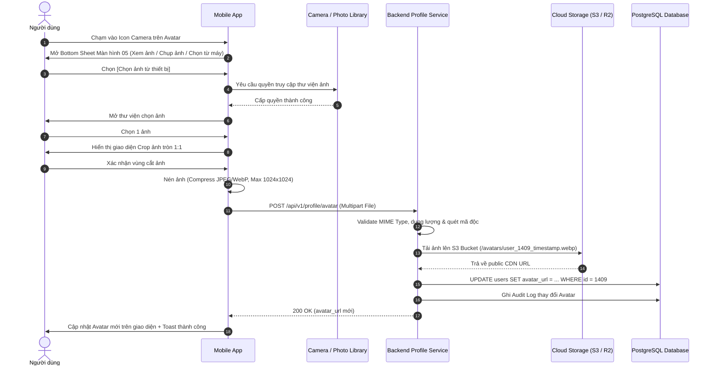
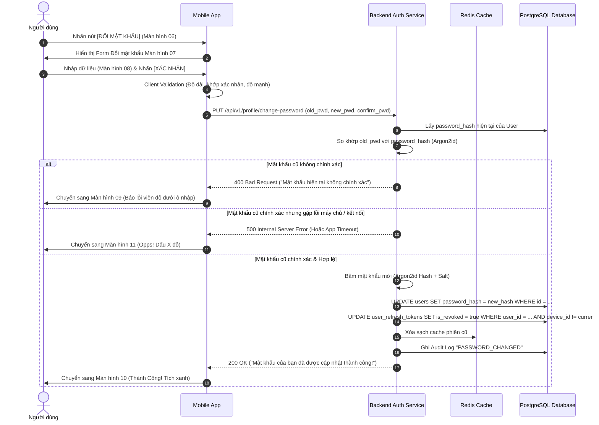

# TÀI LIỆU ĐẶC TẢ YÊU CẦU PHẦN MỀM (SRS)
## Module: Hồ sơ & Thay đổi thông tin cá nhân (Profile & Account Settings)
### Màn hình: Thông tin cá nhân, Đổi Avatar, Đổi mật khẩu, Màn hình Thành công & Thất bại (Màn hình 05 - 11)

| Thông tin | Chi tiết |
| :--- | :--- |
| **Mã tài liệu** | `SRS_MOD_PROFILE_001_V2` |
| **Tên module** | Thay đổi thông tin cá nhân & Đổi mật khẩu (Màn hình 05 - 11) |
| **Dự án** | VMO ERP System |
| **Nền tảng** | iOS & Android (Mobile App) + Backend API & Storage Service |
| **Tệp thiết kế nguồn** | `ERP - App.fig` (Section: `Thay đổi thông tin` - Các màn hình: `05`, `06`, `07`, `08`, `09`, `10`, `11`) |
| **Phiên bản SRS** | 2.1 (Hợp nhất toàn diện: 100% UI Figma Màn 05-11 + Toàn bộ Backend Architecture, APIs, DDL, Pseudocode) |
| **Ngày tạo** | 21/10/2026 |
| **Trạng thái** | Sẵn sàng triển khai (Ready for Dev/QA) |

---

## 1. Giới thiệu tổng quan phân hệ (Overview & Scope)

### 1.1 Mục đích tài liệu
Tài liệu này đặc tả chi tiết toàn bộ yêu cầu giao diện (UI/UX), yêu cầu chức năng (FR), quy tắc nghiệp vụ (BR), sơ đồ luồng dữ liệu (Sequence Flows), các hợp đồng API (API Contracts), lược đồ cơ sở dữ liệu (PostgreSQL DDL), thuật toán mã giả xử lý và các yêu cầu phi chức năng (NFR) cho cụm **Màn hình từ 05 đến 11** thuộc phân hệ **"Thay đổi thông tin"** trên ứng dụng di động VMO ERP.

### 1.2 Danh mục các màn hình chi tiết (Màn hình 05 đến 11)
1. **Màn hình 05:** `Thông tin cá nhân (Popup Đổi ảnh đại diện)` - Bottom Sheet gồm 3 tùy chọn: Xem ảnh đại diện, Chụp ảnh mới, Chọn ảnh từ thiết bị kèm nút Hủy.
2. **Màn hình 06:** `Thông tin cá nhân` - Xem chi tiết hồ sơ nhân sự (Tên, Vị trí, Di động, Điện thoại công ty, Quản lý, Mentor, Email, Địa điểm làm việc) và nút hành động `[ Đổi mật khẩu ]`.
3. **Màn hình 07:** `Đổi mật khẩu (Trạng thái mặc định / Empty)` - Form tạo mật khẩu mới gồm 3 trường nhập liệu trống.
4. **Màn hình 08:** `Đổi mật khẩu (Trạng thái nhập liệu / Typing)` - Hiển thị dữ liệu đang nhập (Mật khẩu hiện tại `Matkhau12345`, Mật khẩu mới dạng `••••••`, nút ẩn/hiện icon mắt).
5. **Màn hình 09:** `Đổi mật khẩu (Trạng thái báo lỗi / Error)` - Cảnh báo đỏ nổi bật viền và thông điệp lỗi: *"Mật khẩu hiện tại không chính xác"* và *"Xác nhận mật khẩu không chính xác"*.
6. **Màn hình 10:** `Thành Công!` - Màn hình chúc mừng cập nhật mật khẩu thành công (Vòng tròn tích xanh lá cây, thông báo thành công và nút `[ Xác nhận ]`).
7. **Màn hình 11:** `Opps!` - Màn hình báo lỗi cập nhật mật khẩu thất bại (Vòng tròn dấu X đỏ rực, thông điệp hỗ trợ từ team ERP và nút `[ Quay lại màn hình thay đổi mật khẩu ]`).

*(Lưu ý: Luồng nghiệp vụ Đặt lại mật khẩu 2FA qua Email và SMS gồm Màn hình 12 đến 22 được tổ chức và đặc tả riêng biệt tại tài liệu [SRS_Dat_Lai_Mat_Khau_2FA.md](file:///Users/hoangkien/project/erp/SRS_Dat_Lai_Mat_Khau_2FA.md)).*

---

## 2. Đặc tả chi tiết từng màn hình (Screen-by-Screen Specifications)

---

### MÀN HÌNH 05 & 06: THÔNG TIN CÁ NHÂN & POPUP ĐỔI ẢNH ĐẠI DIỆN

#### 2.1 Bố cục giao diện Mobile (Màn hình 06)
```
+-------------------------------------------------+
|  [Status Bar: Time, Wifi, Battery]              |
|  [<]             Thông tin cá nhân              |
|                                                 |
|                   (  Avatar  )                  |
|                   [Camera Icon]                 |
|                                                 |
|  Tên:                   Nguyen Van A            |
|  Vị trí:                Designer                |
|  Di động:               0123456789              |
|  Điện thoại công ty:    0123456789              |
|  Người quản lý:         Example - 4412          |
|  Người hướng dẫn:       Example - 4412          |
|  Email công việc:       nguyenvanabc@vmodev.com |
|  Địa điểm làm việc:     CT11                    |
|                                                 |
|  +-------------------------------------------+  |
|  |               ĐỔI MẬT KHẨU                |  |
|  +-------------------------------------------+  |
|                [Home Indicator]                 |
+-------------------------------------------------+
```

#### 2.2 Bố cục giao diện Popup đổi ảnh đại diện (Màn hình 05)
Khi người dùng chạm vào ảnh Avatar hoặc Icon Camera nhỏ ở góc avatar trên Màn hình 06:
```
+-------------------------------------------------+
|                                                 |
|                 (Màn hình nền mờ)               |
|                                                 |
|  +-------------------------------------------+  |
|  |                 [ Thanh gạt ]             |  |
|  |  Ảnh đại diện                             |  |
|  |                                           |  |
|  |  [ (o) ]  Xem ảnh đại diện                |  |
|  |                                           |  |
|  |  [ [O] ]  Chụp ảnh mới                    |  |
|  |                                           |  |
|  |  [ [x] ]  Chọn ảnh từ thiết bị            |  |
|  |                                           |  |
|  |  +-------------------------------------+  |  |
|  |  |                 HỦY                 |  |  |
|  |  +-------------------------------------+  |  |
|  +-------------------------------------------+  |
+-------------------------------------------------+
```

#### 2.3 Từ điển dữ liệu Màn hình 05 & 06

| Trường dữ liệu | Giá trị thực tế trên Figma | Quyền sửa của User | Ghi chú nghiệp vụ |
| :--- | :--- | :---: | :--- |
| **Ảnh đại diện** | Hình tròn (Avatar placeholder) | **Có** | Mở popup màn hình 05 (Xem ảnh / Chụp mới / Chọn từ máy). |
| **Tên** | `Nguyen Van A` | **Có** | Họ và tên nhân viên (Đồng bộ với bảng nhân sự). |
| **Vị trí** | `Designer` | **Khóa** | Do phòng HR cấu hình theo hợp đồng lao động. |
| **Di động** | `0123456789` | **Có** | Số điện thoại cá nhân (Dùng nhận mã xác thực 2FA OTP). |
| **Điện thoại công ty** | `0123456789` | **Khóa** | Số máy bàn / Hotline chi nhánh công ty cấp. |
| **Người quản lý** | `Example - 4412` | **Khóa** | Quản lý trực tiếp (Line Manager/PM dự án). |
| **Người hướng dẫn** | `Example - 4412` | **Khóa** | Mentor / Buddy hướng dẫn thử việc. |
| **Email công việc** | `nguyenvanabc@vmodev.com` | **Khóa** | Email công ty cấp cố định, dùng định danh tài khoản. |
| **Địa điểm làm việc** | `CT11` | **Khóa** | Văn phòng / Cơ sở làm việc (CT11, IDMC 5 Duy Tân...). |
| **Nút Đổi mật khẩu** | Primary Button màu cam | Clickable | Chạm vào điều hướng chuyển tiếp sang Màn hình 07. |

---

### MÀN HÌNH 07, 08, 09: ĐỔI MẬT KHẨU TÀI KHOẢN

#### 3.1 Bố cục giao diện Mobile

```
+-------------------------------------------------+
|  [Status Bar]                                   |
|  [<]                 Đổi mật khẩu               |
|                                                 |
|  Tạo mật khẩu mới. Bạn sẽ sử dụng mật khẩu      |
|  này để truy cập tài khoản                      |
|                                                 |
|  Mật khẩu hiện tại                              |
|  [ Matkhau12345                             [o] |
|  * Mật khẩu hiện tại không chính xác            |
|                                                 |
|  Mật khẩu mới                                   |
|  [ ••••••••••••••                           [o] |
|                                                 |
|  Xác nhận mật khẩu                              |
|  [ ••••••••••••••                           [o] |
|  * Xác nhận mật khẩu không chính xác            |
|                                                 |
|  +---------------------+ +--------------------+ |
|  |        HỦY          | |      XÁC NHẬN      | |
|  +---------------------+ +--------------------+ |
|                [Home Indicator]                 |
+-------------------------------------------------+
```

#### 3.2 Đặc tả 3 trạng thái của Màn hình Đổi mật khẩu
1. **Màn hình 07 (Trạng thái mặc định / Empty):**
   * Tiêu đề hướng dẫn: *"Tạo mật khẩu mới. Bạn sẽ sử dụng mật khẩu này để truy cập tài khoản"*.
   * Cả 3 ô nhập đều trống, hiển thị placeholder mờ: `Mật khẩu hiện tại`, `Mật khẩu mới`, `Xác nhận mật khẩu`.
   * Bên phải mỗi ô nhập liệu có icon mắt nhắm để bảo mật.
   * Nút `[ HỦY ]` (Nền xám/viền cam mờ) và Nút `[ XÁC NHẬN ]` (Nền cam, trạng thái sẵn sàng).
2. **Màn hình 08 (Trạng thái đang nhập liệu / Typing):**
   * Người dùng nhập thông tin:
     * Ô 1: `Matkhau12345` (khi bật icon mắt hiển thị rõ ký tự thuần).
     * Ô 2: `••••••••••••••` (Ký tự bị ẩn bảo mật dạng chấm tròn).
     * Ô 3: `••••••••••••••` (Ký tự bị ẩn bảo mật dạng chấm tròn).
   * Nút `[ XÁC NHẬN ]` sáng màu cam nổi bật.
3. **Màn hình 09 (Trạng thái báo lỗi / Error State):**
   * Khi thông tin không hợp lệ hoặc Backend API phản hồi lỗi:
     * Dưới ô Mật khẩu hiện tại: Hiển thị dòng chữ đỏ *"Mật khẩu hiện tại không chính xác"*. Khung viền ô nhập đổi sang viền đỏ `#FF4D4F`.
     * Dưới ô Xác nhận mật khẩu: Hiển thị dòng chữ đỏ *"Xác nhận mật khẩu không chính xác"*. Khung viền ô nhập đổi sang viền đỏ `#FF4D4F`.

---

### MÀN HÌNH 10: THÀNH CÔNG! (`SCR_PWD_SUCCESS`)

#### 4.1 Bố cục giao diện Mobile (Màn hình 10)
```
+-------------------------------------------------+
|  [Status Bar]                                   |
|                                                 |
|                      /\                         |
|                   /      \                      |
|                 |    ✓     |  (Vòng tròn xanh   |
|                   \      /    lá cây lớn có     |
|                      \/       dấu tick trắng)   |
|                                                 |
|                  Thành Công!                    |
|                                                 |
|  Mật khẩu của bạn đã được cập nhật              |
|  thành công!                                    |
|                                                 |
|  +-------------------------------------------+  |
|  |                 XÁC NHẬN                  |  |
|  +-------------------------------------------+  |
|                [Home Indicator]                 |
+-------------------------------------------------+
```

#### 4.2 Đặc tả thành phần & Hành vi tương tác
* **Icon minh họa:** Vòng tròn màu xanh lá cây (`#52C41A` / Green Success), ở giữa có dấu checkmark `✓` màu trắng in đậm nổi bật.
* **Tiêu đề:** `Thành Công!` (Font Bold, căn giữa, size 22px).
* **Nội dung thông báo:** *"Mật khẩu của bạn đã được cập nhật thành công!"*.
* **Nút hành động:** `[ XÁC NHẬN ]` (Nền màu cam hoặc xanh lá, chữ trắng in đậm).
* **Hành vi khi bấm [Xác nhận]:** Đóng màn hình thành công, điều hướng người dùng quay trở lại Màn hình 06 (Thông tin cá nhân) hoặc đăng xuất yêu cầu đăng nhập lại (tùy cấu hình phiên).

---

### MÀN HÌNH 11: OPPS! - BÁO LỖI THẤT BẠI (`SCR_PWD_ERROR`)

#### 5.1 Bố cục giao diện Mobile (Màn hình 11)
```
+-------------------------------------------------+
|  [Status Bar]                                   |
|                                                 |
|                      /\                         |
|                   /      \                      |
|                 |    X     |  (Vòng tròn đỏ     |
|                   \      /    rực lớn có        |
|                      \/       dấu X trắng)      |
|                                                 |
|                    Opps!                        |
|                                                 |
|  Thay đổi mật khẩu không thành công,            |
|  xin vui lòng thử lại hoặc liên hệ với          |
|  team ERP để được hỗ trợ thay đổi mật khẩu.     |
|                                                 |
|  +-------------------------------------------+  |
|  |   QUAY LẠI MÀN HÌNH THAY ĐỔI MẬT KHẨU     |  |
|  +-------------------------------------------+  |
|                [Home Indicator]                 |
+-------------------------------------------------+
```

#### 5.2 Đặc tả thành phần & Hành vi tương tác
* **Icon minh họa:** Vòng tròn màu đỏ rực (`#F5222D` / Red Error), ở giữa có dấu gạch chéo `X` màu trắng.
* **Tiêu đề:** `Opps!` (Font Bold, căn giữa, size 22px, màu xám đậm hoặc đỏ).
* **Nội dung thông báo nguyên văn Figma:**
  > *"Thay đổi mật khẩu không thành công, xin vui lòng thử lại hoặc liên hệ với team ERP để được hỗ trợ thay đổi mật khẩu."*
* **Nút hành động:** Nút màu đỏ `[ QUAY LẠI MÀN HÌNH THAY ĐỔI MẬT KHẨU ]`.
* **Hành vi khi bấm nút:** Đóng màn hình lỗi, đưa người dùng quay lại Màn hình 08 để kiểm tra và thử lại thao tác mà không làm mất mật khẩu mới đã nhập.

---

## 3. Quy tắc nghiệp vụ & Ràng buộc dữ liệu (Business Rules)

* **BR-PROF-01 (Phân quyền trường dữ liệu trên Hồ sơ cá nhân):**
  * Nhân viên chỉ được phép chỉnh sửa: `Ảnh đại diện (Avatar)`, `Họ và tên`, `Số điện thoại di động cá nhân`.
  * Các trường do phòng Nhân sự (HR) quản lý cố định: `Vị trí`, `Điện thoại công ty`, `Người quản lý`, `Người hướng dẫn`, `Email công việc`, `Địa điểm làm việc`. Mọi nỗ lực ghi đè qua API sẽ bị chặn tại Backend với mã lỗi `403 Forbidden`.
* **BR-PROF-02 (Quy chuẩn hình ảnh Avatar):**
  * Định dạng file hợp lệ: `.jpg`, `.jpeg`, `.png`, `.webp`.
  * Dung lượng tối đa: 5MB.
  * Tự động crop tỷ lệ vuông 1:1 và nén sang định dạng WebP kích thước chuẩn 512x512 pixels trước khi lưu trữ lên Object Storage.
* **BR-PWD-01 (Xác minh mật khẩu hiện tại):**
  * Hệ thống so khớp mật khẩu hiện tại với hash trong cơ sở dữ liệu qua thuật toán **Argon2id** (so sánh hằng số thời gian Constant-time).
  * Nếu nhập sai quá 5 lần liên tiếp: Tạm khóa tính năng đổi mật khẩu trong 15 phút để chống tấn công brute-force.
* **BR-PWD-02 (Ràng buộc mật khẩu mới):**
  * Độ dài tối thiểu: 8 ký tự. Tối đa: 64 ký tự.
  * Bắt buộc có: Chữ hoa, chữ thường, chữ số và ký tự đặc biệt (`!@#$%^&*`).
  * Không được trùng khớp với mật khẩu hiện tại.
  * `Xác nhận mật khẩu` phải trùng khớp 100% từng ký tự với `Mật khẩu mới`.
* **BR-PWD-03 (Chính sách thu hồi phiên đa thiết bị - Session Invalidation):**
  * Sau khi đổi mật khẩu thành công (Màn hình 10): Hệ thống tự động thu hồi (revoke) toàn bộ Refresh Token trên tất cả các thiết bị khác, bảo vệ tài khoản nếu nhân viên nghi ngờ bị lộ thông tin.
* **BR-PROF-03 (Đồng bộ dữ liệu hai chiều với ERP Core / Odoo):**
  * Khi nhân viên cập nhật thông tin thành công: Hệ thống kích hoạt đồng bộ dữ liệu tới bảng `hr.employee` và `res.partner` tương ứng trong hệ thống lõi Odoo ERP.

---

## 4. Luồng xử lý chi tiết (Process & Sequence Flows)

### 4.1 Luồng cập nhật Ảnh đại diện (Avatar Upload Flow)



---

### 4.2 Luồng đổi mật khẩu (Change Password Flow)



---

## 5. Đặc tả API tích hợp phía Backend (Backend API Contracts)

### 5.1 API 1: Lấy thông tin cá nhân của người dùng hiện tại
* **Method:** `GET`
* **Path:** `/api/v1/profile/me`
* **Header:** `Authorization: Bearer <access_token>`

#### Response Thành công (`200 OK`)
```json
{
  "success": true,
  "code": 200,
  "data": {
    "id": 1409,
    "employee_code": "VMO-4412",
    "full_name": "Nguyen Van A",
    "avatar_url": "https://cdn.erp.vmodev.com/avatars/1409_20261021.webp",
    "job_title": "Designer",
    "position": "UI/UX Designer",
    "level": "Nhân viên",
    "mobile_phone": "0123456789",
    "company_phone": "0123456789",
    "manager_name": "Example - 4412",
    "mentor_name": "Example - 4412",
    "work_email": "nguyenvanabc@vmodev.com",
    "office_location": "CT11"
  }
}
```

---

### 5.2 API 2: Cập nhật thông tin cá nhân
* **Method:** `PUT`
* **Path:** `/api/v1/profile/me`
* **Header:** `Authorization: Bearer <access_token>`
* **Content-Type:** `application/json`

#### Request Body
```json
{
  "full_name": "Nguyen Van A",
  "mobile_phone": "0123456789"
}
```

#### Response Thành công (`200 OK`)
```json
{
  "success": true,
  "code": 200,
  "message": "Cập nhật thông tin cá nhân thành công",
  "data": {
    "full_name": "Nguyen Van A",
    "mobile_phone": "0123456789",
    "updated_at": "2026-10-21T16:00:00Z"
  }
}
```

#### Response Thất bại (`400 Bad Request`)
```json
{
  "success": false,
  "code": 400,
  "error": "VALIDATION_FAILED",
  "message": "Số điện thoại di động không đúng định dạng 10 chữ số"
}
```

---

### 5.3 API 3: Tải lên Ảnh đại diện (Upload Avatar)
* **Method:** `POST`
* **Path:** `/api/v1/profile/avatar`
* **Header:** `Authorization: Bearer <access_token>`
* **Content-Type:** `multipart/form-data`

#### Request Form-Data
* `file`: Binary file ảnh đại diện (JPEG/PNG/WebP, tối đa 5MB).

#### Response Thành công (`200 OK`)
```json
{
  "success": true,
  "code": 200,
  "message": "Cập nhật ảnh đại diện thành công",
  "data": {
    "avatar_url": "https://cdn.erp.vmodev.com/avatars/1409_1729505000.webp"
  }
}
```

---

### 5.4 API 4: Đổi mật khẩu tài khoản
* **Method:** `PUT`
* **Path:** `/api/v1/profile/change-password`
* **Header:** `Authorization: Bearer <access_token>`
* **Content-Type:** `application/json`

#### Request Body
```json
{
  "old_password": "Matkhau12345",
  "new_password": "NewSecurePassword456!",
  "confirm_password": "NewSecurePassword456!"
}
```

#### Response Thành công (`200 OK`) -> Điều hướng sang Màn hình 10 (Thành Công!)
```json
{
  "success": true,
  "code": 200,
  "message": "Mật khẩu của bạn đã được cập nhật thành công!"
}
```

#### Response Lỗi dữ liệu xác thực (`400 Bad Request`) -> Điều hướng sang Màn hình 09 (Báo lỗi viền đỏ)
```json
{
  "success": false,
  "code": 400,
  "error": "INVALID_CURRENT_PASSWORD",
  "message": "Mật khẩu hiện tại không chính xác",
  "field": "old_password"
}
```

#### Response Lỗi hệ thống máy chủ (`500 Internal Server Error`) -> Điều hướng sang Màn hình 11 (Opps!)
```json
{
  "success": false,
  "code": 500,
  "error": "INTERNAL_SERVER_ERROR",
  "message": "Thay đổi mật khẩu không thành công, xin vui lòng thử lại hoặc liên hệ với team ERP để được hỗ trợ thay đổi mật khẩu."
}
```

---

## 6. Đặc tả kỹ thuật & Logic xử lý chi tiết phía Backend (Backend Technical Specification)

### 6.1 Kiến trúc xử lý Upload & Lưu trữ Ảnh đại diện
1. **Kiểm tra an toàn file tại máy chủ (Server-side File Sanitization):**
   * Đọc **Magic Bytes** để xác thực MIME type thực tế của file (ngăn chặn hành vi giả mạo đuôi `.exe`, `.sh`, `.php` thành `.jpg`).
   * Quét virus / mã độc nhúng trong metadata ảnh (bằng ClamAV hoặc giải nén vẽ lại bitmap để loại bỏ hoàn toàn payload độc hại trong thẻ Exif).
2. **Xử lý & Tối ưu hóa hình ảnh (Image Processing Pipeline):**
   * Sử dụng thư viện `Sharp` (Node.js) hoặc `Pillow` (Python).
   * Cắt ảnh về tỷ lệ vuông 1:1 chính giữa, resize kích thước tiêu chuẩn: **512x512 pixels**.
   * Chuyển đổi định dạng sang **WebP** với chất lượng `quality: 85%` để đạt dung lượng tối ưu (< 80 KB).
3. **Lưu trữ trên Cloud Object Storage (S3 / Cloudflare R2):**
   * Đặt tên file theo cấu trúc bảo mật: `avatars/{user_id}_{timestamp}_{random8chars}.webp`.
   * Cấu hình phân phối qua CDN với Cache-Control `public, max-age=31536000, immutable`.
   * Xóa hoặc đưa vào archive ảnh đại diện cũ để tối ưu dung lượng lưu trữ.

---

### 6.2 Lược đồ Cơ sở dữ liệu (Database Schema DDL)

```sql
-- 1. Bảng mở rộng thông tin hồ sơ nhân viên (Employee Profiles)
CREATE TABLE employee_profiles (
    user_id BIGINT PRIMARY KEY REFERENCES users(id) ON DELETE CASCADE,
    job_title VARCHAR(128) NOT NULL DEFAULT 'Designer',
    position VARCHAR(128) DEFAULT 'UI/UX Designer',
    level VARCHAR(64) DEFAULT 'Nhân viên',
    office_location VARCHAR(128) DEFAULT 'CT11',
    mobile_phone VARCHAR(20),
    company_phone VARCHAR(20) DEFAULT '0123456789',
    manager_name VARCHAR(128) DEFAULT 'Example - 4412',
    mentor_name VARCHAR(128) DEFAULT 'Example - 4412',
    work_email VARCHAR(255) NOT NULL,
    created_at TIMESTAMP WITH TIME ZONE DEFAULT CURRENT_TIMESTAMP,
    updated_at TIMESTAMP WITH TIME ZONE DEFAULT CURRENT_TIMESTAMP
);

CREATE INDEX idx_employee_profiles_mobile ON employee_profiles(mobile_phone);

-- 2. Bảng lịch sử thay đổi thông tin hồ sơ & bảo mật (Profile Audit Trail)
CREATE TABLE audit_profile_logs (
    id BIGSERIAL PRIMARY KEY,
    user_id BIGINT NOT NULL REFERENCES users(id) ON DELETE CASCADE,
    changed_by BIGINT NOT NULL REFERENCES users(id),
    action_type VARCHAR(50) NOT NULL, -- 'UPDATE_PROFILE', 'CHANGE_AVATAR', 'CHANGE_PASSWORD'
    old_data JSONB NULL,
    new_data JSONB NULL,
    ip_address VARCHAR(45) NOT NULL,
    user_agent TEXT,
    created_at TIMESTAMP WITH TIME ZONE DEFAULT CURRENT_TIMESTAMP
);

CREATE INDEX idx_audit_profile_user ON audit_profile_logs(user_id, created_at DESC);
```

---

### 6.3 Thuật toán mã giả xử lý Backend (Backend Execution Pseudocode)

#### 6.3.1 Logic Đổi mật khẩu (Change Password Service)
```python
def change_password(user_id, old_password, new_password, confirm_password, client_ip, user_agent):
    # 1. Kiểm tra khớp mật khẩu xác nhận
    if new_password != confirm_password:
        raise ValidationError("Xác nhận mật khẩu không chính xác", field="confirm_password")

    # 2. Kiểm tra độ phức tạp của mật khẩu mới (8-64 ký tự, hoa, thường, số, ký tự đặc biệt)
    validate_password_complexity(new_password)

    # 3. Lấy thông tin user hiện tại
    user = db.users.find_by_id(user_id)
    if not user:
        raise NotFoundError("Người dùng không tồn tại")

    # 4. Kiểm tra mật khẩu cũ với Argon2id (Constant-time comparison)
    if not argon2.verify(user.password_hash, old_password):
        log_audit(user_id, "CHANGE_PASSWORD_FAILED", "WRONG_OLD_PASSWORD", client_ip, user_agent)
        raise ValidationError("Mật khẩu hiện tại không chính xác", field="old_password")

    # 5. Kiểm tra mật khẩu mới không được trùng mật khẩu cũ
    if argon2.verify(user.password_hash, new_password):
        raise ValidationError("Mật khẩu mới không được trùng với mật khẩu hiện tại", field="new_password")

    # 6. Băm mật khẩu mới bằng thuật toán Argon2id
    new_hash = argon2.hash(new_password)

    # 7. Cập nhật cơ sở dữ liệu
    db.users.update(user_id, password_hash=new_hash, updated_at=now())

    # 8. Thu hồi các phiên trên thiết bị khác (Session Invalidation)
    db.user_refresh_tokens.revoke_other_devices(user_id, current_device_id)

    # 9. Ghi Audit Log thành công
    log_audit(user_id, "CHANGE_PASSWORD_SUCCESS", None, client_ip, user_agent)

    return {"message": "Mật khẩu của bạn đã được cập nhật thành công!"}
```

#### 6.3.2 Logic Upload Ảnh đại diện (Upload Avatar Service)
```python
def upload_avatar(user_id, file, client_ip, user_agent):
    # 1. Kiểm tra kích thước file (<= 5MB)
    if file.size > 5 * 1024 * 1024:
        raise ValidationError("Dung lượng file không được vượt quá 5MB")

    # 2. Đọc Magic Bytes kiểm tra MIME Type
    mime_type = detect_mime_type(file.read(512))
    if mime_type not in ["image/jpeg", "image/png", "image/webp"]:
        raise ValidationError("Định dạng file không hỗ trợ. Chỉ chấp nhận JPG, PNG, WEBP")

    file.seek(0)

    # 3. Xử lý ảnh: Resize 512x512, Crop Center 1:1, Convert WebP quality 85%
    processed_image = image_processor.crop_and_resize(
        file=file,
        size=(512, 512),
        output_format="WEBP",
        quality=85
    )

    # 4. Tạo đường dẫn và upload lên S3 Bucket
    file_key = f"avatars/{user_id}_{int(now().timestamp())}_{generate_random_string(8)}.webp"
    s3_url = s3_client.upload(
        bucket="vmo-erp-cdn",
        key=file_key,
        data=processed_image,
        content_type="image/webp"
    )

    # 5. Cập nhật database
    old_avatar = db.users.get_avatar(user_id)
    db.users.update(user_id, avatar_url=s3_url, updated_at=now())

    # 6. Ghi Audit Log
    log_audit(user_id, "CHANGE_AVATAR", {"old": old_avatar, "new": s3_url}, client_ip, user_agent)

    # 7. Xóa ảnh cũ trên S3 (async background task)
    if old_avatar and "default-avatar" not in old_avatar:
        background_tasks.add(delete_s3_file, old_avatar)

    return {"avatar_url": s3_url}
```

---

## 7. Yêu cầu phi chức năng (Non-Functional Requirements - NFR)

1. **Hiệu năng (Performance):**
   * Thời gian phản hồi API lấy thông tin cá nhân: $\le 300$ ms.
   * Thời gian xử lý nén và tải lên ảnh đại diện: $\le 2.0$ giây.
   * Bộ nhớ đệm Redis lưu profile cá nhân với TTL 15 phút, tự động xóa cache khi có request cập nhật thành công.
2. **Bảo mật (Security):**
   * Kiểm soát chặt chẽ quyền ghi (Field-level Authorization): Chặn đứng mọi payload cố tình can thiệp các trường read-only (`role`, `department_id`, `company_phone`, `office_location`) qua API.
   * Ngăn chặn hoàn toàn lỗ hổng File Upload RCE bằng cách đổi tên file ngẫu nhiên, lưu trữ trên Object Storage độc lập (không lưu trực tiếp trên Web Server).
   * Xóa sạch metadata Exif (vị trí GPS, thông tin thiết bị) khỏi file ảnh trước khi lưu trữ để bảo vệ quyền riêng tư người dùng.
3. **Trải nghiệm người dùng (UX / Accessibility):**
   * Form tự động cuộn (Auto-scroll keyboard avoidance) khi bàn phím mở lên để không che khuất ô nhập liệu đang focus.
   * Nút `Lưu thay đổi` tự động chuyển sang trạng thái Disabled nếu người dùng chưa thay đổi bất kỳ trường dữ liệu nào so với ban đầu.
