# TÀI LIỆU ĐẶC TẢ YÊU CẦU PHẦN MỀM (SRS)
## Phân hệ: Hồ sơ Cá nhân, Đổi Mật khẩu & Cài đặt Tài khoản trên Cổng Web Admin (Web Admin Personal Profile, Password Security & Account Portal)
### Module: Quản lý Hồ sơ Cá nhân, Avatar Studio, Đổi Mật khẩu Enterprise, Phiên Đăng nhập Đa thiết bị & Nhật ký Bảo mật

| Thông tin | Chi tiết |
| :--- | :--- |
| **Mã tài liệu** | `SRS_WEB_PROFILE_SETTINGS_001` |
| **Tên phân hệ** | Hồ sơ Cá nhân, Đổi Mật khẩu & Cài đặt Bảo mật Tài khoản trên Web Admin |
| **Dự án** | VMO ERP System - Cổng Quản trị Doanh nghiệp Tập trung |
| **Nền tảng** | Web Application (Desktop Browser: Chrome, Safari, Edge, Firefox) + Backend API Services |
| **Tài liệu tham chiếu Mobile** | [SRS_Thay_Doi_Thong_Tin.md](file:///Users/hoangkien/project/erp/SRS_Thay_Doi_Thong_Tin.md) (Màn hình 05 - 11) |
| **Tệp thiết kế nguồn** | `ERP - App.fig` (Các màn hình Mobile `05` đến `11` kết hợp Frame Web Desktop: `Desktop - 2`, `Group 6885`, `Group 6889`, `Admin Menu`) |
| **Độ phân giải chuẩn** | Desktop ($1440 \times 1024$ px, $1920 \times 1080$ px), Co giãn tối thiểu $1280 \times 800$ px |
| **Phiên bản SRS** | 2.0 (Chuẩn hóa toàn diện Bố cục Settings Portal 2 Cột, Avatar Studio Drag & Drop, Đổi mật khẩu chuẩn Enterprise, Quản lý Phiên & PostgreSQL DDL) |
| **Ngày tạo** | 21/10/2026 |
| **Trạng thái** | Sẵn sàng triển khai (Ready for Dev / QA / Production) |

---

## 1. Giới thiệu tổng quan phân hệ (Overview & Scope)

### 1.1 Mục đích tài liệu
Tài liệu này đặc tả chi tiết toàn diện các yêu cầu giao diện người dùng (UI/UX), yêu cầu chức năng (FR), quy tắc nghiệp vụ (BR), dòng dữ liệu bảo mật, hợp đồng API RESTful và lược đồ cơ sở dữ liệu quan hệ (PostgreSQL DDL) cho phân hệ **"Hồ sơ Cá nhân, Đổi Mật khẩu & Cài đặt Tài khoản trên Cổng Web Admin"** thuộc Hệ thống VMO ERP.

Nếu trên ứng dụng di động (Mobile App), phân hệ này được thiết kế dạng trang cuộn đơn giản (Màn hình 06) với popup chọn ảnh từ thư viện/chụp ảnh (Màn hình 05), form đổi mật khẩu và 2 màn hình chuyển tiếp riêng biệt (`Thành công!` - Màn hình 10 và `Opps!` - Màn hình 11); thì trên **Cổng Web Admin Desktop**, đây là **Trung tâm Cài đặt Tài khoản & Bảo mật Tập trung (Account & Security Settings Portal)**. Cổng Web cung cấp trải nghiệm tối ưu cho người dùng và quản trị viên với giao diện chia 2 cột hiện đại: Cột trái điều hướng các danh mục cài đặt, Cột phải cho phép chỉnh sửa hồ sơ, tải ảnh đại diện qua Avatar Studio (Drag & Drop + Crop tương tác), đổi mật khẩu với thước đo độ phức tạp zxcvbn thời gian thực, quản lý và thu hồi phiên đăng nhập đa thiết bị (Session Management), và tra cứu nhật ký an ninh tài khoản.

---

### 1.2 Bảng so sánh Kiến trúc: Mobile App vs. Web Admin Desktop

| Tiêu chí So sánh | Ứng dụng Di động (Mobile App - Màn hình 05-11) | Cổng Quản trị Web Admin Desktop |
| :--- | :--- | :--- |
| **Bố cục hiển thị (Layout)** | Màn hình 1 cột dọc hẹp ($375 \times 812$ px), mỗi tác vụ là 1 màn hình chuyển tiếp toàn trang (Full-screen push). | **Bố cục Settings Portal 2 Cột chuẩn Desktop ($1440 \times 1024$ / $1920 \times 1080$):** Cột trái cố định menu danh mục (260px); Cột phải hiển thị nội dung chi tiết theo Tab, thao tác mượt mà không cần chuyển trang. |
| **Quản lý Ảnh đại diện (Avatar)** | Bottom sheet 3 tùy chọn (Màn hình 05: Xem ảnh, Chụp mới, Chọn từ máy) phụ thuộc API hệ điều hành iOS/Android. | **Avatar Studio Trực quan:** Kéo thả ảnh (Drag & Drop), tải tệp từ máy tính, công cụ Crop ảnh tròn 1:1 trực tiếp trên trình duyệt (Zoom, xoay, cân chỉnh góc), tùy chọn tạo avatar mặc định từ chữ cái tên viết tắt (Initials Avatar). |
| **Phân quyền trường dữ liệu** | Hiển thị danh sách dọc gồm 8 trường dữ liệu; chỉ cho sửa Tên, SĐT; các trường HR bị khóa không có tooltip giải thích. | **Phân nhóm Thông tin Khoa học:** Nhóm "Thông tin công khai cá nhân" (được sửa) và Nhóm "Thông tin tổ chức do HR quản lý" (chỉ đọc kèm Badge khóa và Tooltip hướng dẫn liên hệ HR khi có sai sót). |
| **Form Đổi mật khẩu** | Form 3 ô nhập tách biệt trên màn hình 07-09, kiểm tra lỗi sau khi nhấn nút xác nhận. | **Đổi mật khẩu Tương tác Thời gian thực (Real-time Validation):** Đánh giá độ mạnh mật khẩu (zxcvbn meter), Checklist động kiểm tra điều kiện (Hoa, thường, số, ký tự đặc biệt, không trùng mật khẩu cũ), hiển thị lỗi inline tức thì. |
| **Phản hồi Thành công & Thất bại** | Chuyển hẳn sang màn hình 10 (Thành công - Tích xanh) hoặc màn hình 11 (Opps! - Dấu X đỏ). | **Modal Thông báo Chuyên nghiệp (Dialog / Toast Alerts):** Hiển thị Modal Popup tích xanh lá chuẩn Figma khi thành công (kèm tùy chọn *"Đăng xuất khỏi tất cả các thiết bị khác"*), hoặc Banner cảnh báo đỏ Opps! có mã lỗi và nút liên hệ IT Helpdesk. |
| **Quản lý Phiên đăng nhập** | Không có màn hình quản trị phiên, chỉ tự động hủy token trên thiết bị khác khi đổi mật khẩu. | **Trung tâm Quản lý Phiên Đăng nhập Đa thiết bị (Active Sessions):** Xem danh sách tất cả các thiết bị đang đăng nhập (Trình duyệt, Hệ điều hành, Địa chỉ IP, Vị trí gần đúng, Thời gian hoạt động), nút [Đăng xuất phiên này] và [Đăng xuất toàn bộ thiết bị khác]. |
| **Nhật ký An toàn Tài khoản** | Không hỗ trợ người dùng xem lịch sử. | **Bảng Nhật ký Bảo mật Cá nhân (Security Activity Log):** Theo dõi 30 ngày lịch sử đăng nhập, đổi mật khẩu, đổi avatar kèm địa chỉ IP và trình duyệt. |

---

## 2. Danh mục Chức năng Phân hệ Web Admin (Functional Scope)

```mermaid
graph TD
    A[CỔNG WEB ADMIN: HỒ SƠ CÁ NHÂN & CÀI ĐẶT BẢO MẬT] --> B[1. Quản lý Hồ sơ Cá nhân]
    A --> C[2. Avatar Studio Trực quan]
    A --> D[3. Đổi Mật khẩu Enterprise]
    A --> E[4. Quản lý Phiên Đa thiết bị]
    A --> F[5. Trung tâm Xác thực 2FA]
    A --> G[6. Nhật ký Hoạt động Bảo mật]
    A --> H[7. Tùy chọn Giao diện & Thông báo]

    B --> B1[Chỉnh sửa: Họ tên, Số di động cá nhân, Địa chỉ tạm trú]
    B --> B2[Xem thông tin HR: Mã NV, Vị trí, Bộ phận, Line Manager, Mentor, Email]
    
    C --> C1[Kéo thả tệp PNG/JPG/WebP hoặc chọn từ máy tính]
    C --> C2[Crop ảnh tròn 1:1, phóng to thu nhỏ, xoay ảnh]
    C --> C3[Tự động nén WebP 512x512, xóa Exif GPS, tối ưu dung lượng < 80KB]

    D --> D1[3 Trường nhập: Mật khẩu cũ, Mật khẩu mới, Xác nhận mật khẩu]
    D --> D2[Thước đo độ mạnh mật khẩu zxcvbn & Dynamic Checklist]
    D --> D3[Modal Thành Công tích xanh chuẩn Figma Màn 10]
    D --> D4[Modal Opps! Thất bại dấu X đỏ chuẩn Figma Màn 11]

    E --> E1[Danh sách thiết bị: Chrome MacOS, Safari iPhone, Edge Windows...]
    E --> E2[Đăng xuất từng phiên đơn lẻ hoặc Thu hồi toàn bộ phiên khác]

    F --> F1[Bật/Tắt xác thực TOTP Google/Microsoft Authenticator]
    F --> F2[Tạo và in danh sách 10 Mã dự phòng khẩn cấp Backup Codes]

    G --> G1[Lịch sử đăng nhập thành công/thất bại 30 ngày qua]
    G --> G2[Lịch sử thay đổi mật khẩu và cập nhật hồ sơ]

    H --> H1[Chế độ Giao diện: Sáng Light / Tối Dark / Theo hệ điều hành]
    H --> H2[Ngôn ngữ hiển thị: Tiếng Việt / English]
```



---

## 3. Đặc tả Chi tiết Giao diện Web Desktop (Wireframes & UI Specs)

---

### MÀN HÌNH 1: BỐ CỤC KHUNG CÀI ĐẶT & HỒ SƠ CÁ NHÂN (`SCR_WEB_PROFILE_001`)
*Tham chiếu Figma:* Góc trên bên phải Topbar Desktop bấm Avatar $\rightarrow$ Chọn `Cài đặt tài khoản` (Account Settings). Kích thước chuẩn: $1440 \times 1024$ px.

#### 3.1 Bố cục Giao diện Web Desktop
```
+-----------------------------------------------------------------------------------------------------------------------------+
| [LOGO VMO]   Tổng quan    Nhân viên    Chấm công    Ngày nghỉ    Dự án    Thảo luận    Hướng dẫn        [🔍] [🔔 2] (Avatar v)|
+-----------------------------------------------------------------------------------------------------------------------------+
| Trang chủ > Cài đặt tài khoản > Hồ sơ cá nhân                                                               21/10/2026 15:30 |
+-----------------------------------------------------------------------------------------------------------------------------+
|                                                                                                                             |
| +-------------------------+  +--------------------------------------------------------------------------------------------+ |
| | CÀI ĐẶT TÀI KHOẢN       |  | HỒ SƠ CÁ NHÂN                                                                               | |
| |                         |  | Quản lý thông tin hồ sơ của bạn và cách hiển thị trong toàn hệ thống VMO ERP                | |
| | [👤 Hồ sơ cá nhân]*     |  | ------------------------------------------------------------------------------------------ | |
| | [🔒 Đổi mật khẩu]       |  |                                                                                            | |
| | [💻 Phiên đăng nhập]    |  | ẢNH ĐẠI DIỆN                                                                               | |
| | [🛡️ Bảo mật 2FA]        |  | +--------------+   +---------------------------------------------------------------------+ | |
| | [🔔 Thông báo]          |  | |              |   | [📤 Tải ảnh mới lên]    [🗑️ Xóa ảnh]                                 | | |
| | [🎨 Giao diện]          |  | | [Ảnh Avatar] |   | Cho phép định dạng PNG, JPG, WEBP. Dung lượng tối đa 5MB.           | | |
| |                         |  | |   140x140    |   | Ảnh sẽ được tự động cắt tỉ lệ 1:1 chuẩn nhận diện công ty.          | | |
| | ----------------------- |  | +--------------+   +---------------------------------------------------------------------+ | |
| | [🚪 Đăng xuất]          |  |                                                                                            | |
| +-------------------------+  | THÔNG TIN LIÊN HỆ CÁ NHÂN (CHO PHÉP CHỈNH SỬA)                                             | |
|                              | ------------------------------------------------------------------------------------------ | |
|                              | Họ và tên hiển thị: [*]                                                                    | |
|                              | [ Nguyen Van A                                                                           ] | |
|                              |                                                                                            | |
|                              | Số điện thoại di động cá nhân: [*] (Dùng nhận mã xác thực 2FA OTP)                         | |
|                              | [ 0123456789                                                                             ] | |
|                              |                                                                                            | |
|                              | Địa chỉ tạm trú hiện tại:                                                                  | |
|                              | [ Số 88 Tôn Thất Thuyết, Mỹ Đình 2, Nam Từ Liêm, Hà Nội                                  ] | |
|                              |                                                                                            | |
|                              | THÔNG TIN CÔNG VIỆC DO PHÒNG NHÂN SỰ QUẢN LÝ (CHỈ ĐỌC - READ ONLY)                         | |
|                              | ------------------------------------------------------------------------------------------ | |
|                              | Mã nhân viên:       [ VMO-4412                🔒]   Vị trí công việc: [ Designer           🔒] | |
|                              | Bậc chức danh:      [ UI/UX Designer          🔒]   Cấp bậc:          [ Nhân viên          🔒] | |
|                              | Email công việc:    [ nguyenvanabc@vmodev.com 🔒]   Điện thoại bàn:   [ 0123456789         🔒] | |
|                              | Quản lý trực tiếp:  [ Example - 4412          🔒]   Người hướng dẫn:  [ Example - 4412     🔒] | |
|                              | Địa điểm làm việc:  [ CT11 (Tòa nhà TTC Duy Tân)🔒]                                        | |
|                              | (ℹ️ Nếu thông tin công việc có sai sót, vui lòng liên hệ HR Helpdesk qua email hr@vmo.vn)   | |
|                              |                                                                                            | |
|                              | ------------------------------------------------------------------------------------------ | |
|                              |                                                    [ Hủy bỏ ]   [ Lưu thay đổi hồ sơ ]      | |
|                              +--------------------------------------------------------------------------------------------+ |
+-----------------------------------------------------------------------------------------------------------------------------+
```

---

### MÀN HÌNH 2: AVATAR STUDIO MODAL - CROP & CHỈNH SỬA ẢNH ĐẠI DIỆN (`SCR_WEB_AVATAR_MODAL`)
Khi người dùng bấm vào nút `[📤 Tải ảnh mới lên]` hoặc click trực tiếp vào khung ảnh đại diện:

```
+---------------------------------------------------------------------------------------------------+
| CẬP NHẬT ẢNH ĐẠI DIỆN (AVATAR STUDIO)                                                         [X] |
+---------------------------------------------------------------------------------------------------+
|                                                                                                   |
|    +------------------------------------------+    KÉO THẢ TỆP HOẶC TẢI LÊN TỪ MÁY TÍNH           |
|    |                                          |    ---------------------------------------------- |
|    |           .------------------.           |    Định dạng hỗ trợ: JPG, PNG, WEBP (Tối đa 5MB)  |
|    |          /                    \          |                                                   |
|    |         |    [ VÙNG CHỌN CẮT   |         |    XEM TRƯỚC HIỂN THỊ TRÊN CÁC GIAO DIỆN:         |
|    |         |     KHUNG TRÒN 1:1 ] |         |    +-------+   +-----+   +---+                    |
|    |         |                      |         |    | ( O ) |   | (O) |   |(o)|                    |
|    |          \                    /          |    +-------+   +-----+   +---+                    |
|    |           '------------------'           |    120x120     64x64     32x32                    |
|    |                                          |    (Profile)   (Topbar)  (Chat/Comment)           |
|    +------------------------------------------+                                                   |
|                                                                                                   |
|    CÔNG CỤ ĐIỀU CHỈNH:                                                                            |
|    Thu nhỏ [ - ] -----------o------------------ [ + ] Phóng to (100% - 300%)                      |
|    [ ↺ Xoay trái 90° ]   [ ↻ Xoay phải 90° ]   [ ↔ Lật gương ]   [ 🔄 Khôi phục ban đầu ]         |
|                                                                                                   |
| +-----------------------------------------------------------------------------------------------+ |
| |  [ Hủy bỏ ]                                                  [ ✂️ Cắt ảnh & Lưu ảnh đại diện ] | |
| +-----------------------------------------------------------------------------------------------+ |
+---------------------------------------------------------------------------------------------------+
```

---

### MÀN HÌNH 3: ĐỔI MẬT KHẨU TÀI KHOẢN TRÊN WEB ADMIN (`SCR_WEB_PWD_001`)
*Tham chiếu Figma:* Màn hình Mobile `07` (Empty), `08` (Typing), `09` (Error). Trên Web Admin, toàn bộ logic được tích hợp trong 1 giao diện tương tác động:

```
+-----------------------------------------------------------------------------------------------------------------------------+
| Trang chủ > Cài đặt tài khoản > Đổi mật khẩu                                                                21/10/2026 15:35 |
+-----------------------------------------------------------------------------------------------------------------------------+
| +-------------------------+  +--------------------------------------------------------------------------------------------+ |
| | CÀI ĐẶT TÀI KHOẢN       |  | ĐỔI MẬT KHẨU TÀI KHOẢN                                                                     | |
| |                         |  | Tạo mật khẩu mới an toàn. Bạn sẽ sử dụng mật khẩu này để truy cập toàn bộ hệ thống VMO ERP | |
| | [👤 Hồ sơ cá nhân]      |  | ------------------------------------------------------------------------------------------ | |
| | [🔒 Đổi mật khẩu]*      |  |                                                                                            | |
| | [💻 Phiên đăng nhập]    |  | Mật khẩu hiện tại: [*]                                                                     | |
| | [🛡️ Bảo mật 2FA]        |  | +----------------------------------------------------------------------------------------+ | |
| | [🔔 Thông báo]          |  | | Matkhau12345                                                                       [👁️] | | |
| | [🎨 Giao diện]          |  | +----------------------------------------------------------------------------------------+ | |
| |                         |  | * Mật khẩu hiện tại không chính xác (Nếu nhập sai - Viền đỏ rực)                           | |
| | ----------------------- |  |                                                                                            | |
| | [🚪 Đăng xuất]          |  | Mật khẩu mới: [*]                                                                          | |
| +-------------------------+  | +----------------------------------------------------------------------------------------+ | |
|                              | | ••••••••••••••                                                                     [👁️] | | |
|                              | +----------------------------------------------------------------------------------------+ | |
|                              | Thước đo độ mạnh mật khẩu:                                                                 | |
|                              | [========================= RẤT MẠNH =========================] (Xanh lá - 4/4 điểm zxcvbn)  | |
|                              |                                                                                            | |
|                              | Tiêu chuẩn an toàn mật khẩu VMO Enterprise:                                                | |
|                              |   [✓] Tối thiểu 8 ký tự (Đã đạt: 14 ký tự)                                                 | |
|                              |   [✓] Bao gồm chữ hoa (A-Z) và chữ thường (a-z)                                            | |
|                              |   [✓] Bao gồm ít nhất một chữ số (0-9)                                                     | |
|                              |   [✓] Bao gồm ít nhất một ký tự đặc biệt (!@#$%^&*...)                                     | |
|                              |   [✓] Không trùng lặp với mật khẩu hiện tại                                                | |
|                              |                                                                                            | |
|                              | Xác nhận mật khẩu mới: [*]                                                                 | |
|                              | +----------------------------------------------------------------------------------------+ | |
|                              | | ••••••••••••••                                                                     [👁️] | | |
|                              | +----------------------------------------------------------------------------------------+ | |
|                              | [✓] Mật khẩu xác nhận hoàn toàn trùng khớp (Viền xanh lá cây)                              | |
|                              |                                                                                            | |
|                              | Tùy chọn bảo mật bổ sung:                                                                  | |
|                              | [X] Tự động đăng xuất tài khoản khỏi tất cả các thiết bị khác sau khi đổi mật khẩu         | |
|                              |                                                                                            | |
|                              | ------------------------------------------------------------------------------------------ | |
|                              |                                                  [ HỦY BỎ ]    [ XÁC NHẬN ĐỔI MẬT KHẨU ]   | |
|                              +--------------------------------------------------------------------------------------------+ |
+-----------------------------------------------------------------------------------------------------------------------------+
```

---

### MÀN HÌNH 4: MODAL THÀNH CÔNG! (`SCR_WEB_PWD_SUCCESS`)
*Tham chiếu Figma:* Màn hình Mobile `10` (Vòng tròn tích xanh lá cây). Trên Web Admin, hiển thị dưới dạng Modal Popup trọng tâm:

```
+---------------------------------------------------------------------------------------------------+
|                                                                                               [X] |
|                                              /\                                                   |
|                                           /      \                                                |
|                                         |    ✓     |  (VÒNG TRÒN MÀU XANH LÁ CÂY LỚN              |
|                                           \      /    CÓ DẤU CHECKMARK TRẮNG - CHUẨN FIGMA MÀN 10)|
|                                              \/                                                   |
|                                                                                                   |
|                                         Thành Công!                                               |
|                                                                                                   |
|                           Mật khẩu của bạn đã được cập nhật thành công!                           |
|                                                                                                   |
|             Hệ thống đã tự động vô hiệu hóa các phiên đăng nhập cũ trên thiết bị khác để          |
|             bảo vệ tài khoản của bạn. Bạn có thể tiếp tục làm việc trên phiên hiện tại.           |
|                                                                                                   |
|                                   +-------------------------+                                     |
|                                   |        XÁC NHẬN         |                                     |
|                                   +-------------------------+                                     |
|                                                                                                   |
+---------------------------------------------------------------------------------------------------+
```

---

### MÀN HÌNH 5: MODAL OPPS! - BÁO LỖI THẤT BẠI (`SCR_WEB_PWD_ERROR`)
*Tham chiếu Figma:* Màn hình Mobile `11` (Vòng tròn đỏ rực dấu X). Trên Web Admin, hiển thị dạng Error Modal rõ ràng:

```
+---------------------------------------------------------------------------------------------------+
|                                                                                               [X] |
|                                              /\                                                   |
|                                           /      \                                                |
|                                         |    X     |  (VÒNG TRÒN MÀU ĐỎ RỰC LỚN                   |
|                                           \      /    CÓ DẤU GẠCH CHÉO TRẮNG - FIGMA MÀN 11)      |
|                                              \/                                                   |
|                                                                                                   |
|                                            Opps!                                                  |
|                                                                                                   |
|                           Thay đổi mật khẩu không thành công,                                     |
|                           xin vui lòng thử lại hoặc liên hệ với                                   |
|                           team ERP để được hỗ trợ thay đổi mật khẩu.                              |
|                                                                                                   |
| Mã lỗi hệ thống: ERR_AUTH_SESSION_EXPIRED (Thời gian thao tác đã quá hạn)                         |
| Kênh hỗ trợ: it-helpdesk@vmo.vn | Hotline nội bộ: 1900-2611                                       |
|                                                                                                   |
|                        +---------------------------------------------+                            |
|                        |     QUAY LẠI MÀN HÌNH THAY ĐỔI MẬT KHẨU     |                            |
|                        +---------------------------------------------+                            |
|                                                                                                   |
+---------------------------------------------------------------------------------------------------+
```

---

### MÀN HÌNH 6: QUẢN LÝ PHIÊN ĐĂNG NHẬP ĐA THIẾT BỊ (`SCR_WEB_SESSION_001`)
*Cung cấp khả năng kiểm soát bảo mật nâng cao mà Mobile chưa hỗ trợ:*

```
+-----------------------------------------------------------------------------------------------------------------------------+
| Trang chủ > Cài đặt tài khoản > Phiên đăng nhập                                                             21/10/2026 15:40 |
+-----------------------------------------------------------------------------------------------------------------------------+
| +-------------------------+  +--------------------------------------------------------------------------------------------+ |
| | CÀI ĐẶT TÀI KHOẢN       |  | PHIÊN ĐĂNG NHẬP HOẠT ĐỘNG (ACTIVE SESSIONS)                                                | |
| |                         |  | Kiểm tra danh sách các thiết bị và trình duyệt hiện đang có quyền truy cập vào tài khoản    | |
| | [👤 Hồ sơ cá nhân]      |  | ------------------------------------------------------------------------------------------ | |
| | [🔒 Đổi mật khẩu]       |  |                                                                                            | |
| | [💻 Phiên đăng nhập]*   |  | PHIÊN ĐANG SỬ DỤNG HIỆN TẠI (THIS DEVICE)                                                  | |
| | [🛡️ Bảo mật 2FA]        |  | +----------------------------------------------------------------------------------------+ | |
| | [🔔 Thông báo]          |  | | 💻 Google Chrome 120 (macOS Sonoma 14.5) - [● ĐANG HOẠT ĐỘNG]                          | | |
| | [🎨 Giao diện]          |  | | Địa chỉ IP: 118.70.190.12 (Hà Nội, Việt Nam) - Đăng nhập lúc: 21/10/2026 08:30        | | |
| |                         |  | +----------------------------------------------------------------------------------------+ | |
| | ----------------------- |  |                                                                                            | |
| | [🚪 Đăng xuất]          |  | CÁC PHIÊN ĐĂNG NHẬP KHÁC ĐANG HOẠT ĐỘNG                    [🚨 ĐĂNG XUẤT TẤT CẢ THIẾT BỊ]   | |
| +-------------------------+  | ------------------------------------------------------------------------------------------ | |
|                              | Thiết bị & Trình duyệt      | Vị trí IP         | Hoạt động cuối          | Thao tác       | |
|                              | ----------------------------+-------------------+-------------------------+--------------- | |
|                              | 📱 VMO ERP App (iPhone 15)  | 14.162.15.89 (HN) | 10 phút trước           | [Đăng xuất]    | |
|                              | 💻 Microsoft Edge (Windows) | 118.70.190.12(TTC)| Hôm qua, lúc 18:15      | [Đăng xuất]    | |
|                              | 📱 Safari (iPad Pro M2)     | 42.113.88.204(ĐN) | 3 ngày trước            | [Đăng xuất]    | |
|                              +--------------------------------------------------------------------------------------------+ |
+-----------------------------------------------------------------------------------------------------------------------------+
```

---

## 4. Quy tắc Nghiệp vụ Chuyên sâu (Business Rules - BR)

* **BR-WEB-PROF-01 (Phân quyền trường dữ liệu đọc/ghi trên Hồ sơ):**
  * Người dùng cá nhân chỉ được phép sửa: `Họ và tên hiển thị`, `Số điện thoại di động cá nhân`, `Địa chỉ tạm trú`, `Ảnh đại diện (Avatar)`.
  * Các trường quản trị do phòng HR cố định (Read-only): `Mã nhân viên`, `Vị trí`, `Cấp bậc`, `Bậc chức danh`, `Bộ phận`, `Line Manager`, `Mentor`, `Email công việc`, `Điện thoại bàn`, `Địa điểm làm việc`. Mọi payload gửi lên API cố tình sửa các trường này sẽ bị Backend bỏ qua hoặc từ chối với mã lỗi `403 Forbidden`.
* **BR-WEB-PROF-02 (Quy chuẩn nạp và xử lý hình ảnh Avatar Studio):**
  * Định dạng cho phép: `.jpg`, `.jpeg`, `.png`, `.webp`.
  * Dung lượng tệp tối đa: $5 \text{ MB}$.
  * Phải kiểm tra **Magic Bytes** ở Backend để xác định MIME Type thực tế (ngăn chặn file thực thi giả mạo đuôi ảnh).
  * Pipeline xử lý ảnh: Cắt vuông tỉ lệ 1:1 theo tọa độ crop từ giao diện Web, nén định dạng **WebP** chất lượng 85%, kích thước chuẩn $512 \times 512$ pixels, tự động loại bỏ toàn bộ siêu dữ liệu **Exif** (vị trí GPS, thông tin máy ảnh) để bảo vệ quyền riêng tư.
* **BR-WEB-PWD-01 (Xác minh mật khẩu cũ & Phòng chống Brute-force):**
  * So khớp mật khẩu cũ với mã băm trong DB bằng thuật toán **Argon2id** (so sánh Constant-time để chống tấn công Timing Attack).
  * Nếu nhập sai mật khẩu cũ quá 5 lần liên tiếp trong vòng 15 phút: Hệ thống tự động khóa tính năng đổi mật khẩu của tài khoản trong 15 phút và gửi email cảnh báo bảo mật tới người dùng.
* **BR-WEB-PWD-02 (Ràng buộc Mật khẩu Mới chuẩn Doanh nghiệp):**
  * Độ dài: Tối thiểu 8 ký tự, tối đa 64 ký tự.
  * Phải chứa ít nhất: 1 chữ hoa, 1 chữ thường, 1 chữ số và 1 ký tự đặc biệt (`!@#$%^&*()_+-=[]{}|;:,.<>?`).
  * Điểm đánh giá độ mạnh theo thuật toán **zxcvbn** phải đạt tối thiểu $3/4$ điểm (Mạnh hoặc Rất mạnh).
  * Không được trùng khớp với mật khẩu hiện tại và không được trùng với 3 mật khẩu gần nhất đã sử dụng trong lịch sử (`user_password_history`).
* **BR-WEB-PWD-03 (Chính sách thu hồi phiên đa thiết bị - Session Invalidation):**
  * Sau khi đổi mật khẩu thành công (Màn hình 10): Mặc định hệ thống tự động thu hồi (revoke) toàn bộ Refresh Token trên tất cả các thiết bị khác, ngoại trừ phiên Web hiện tại mà người dùng vừa thao tác (hoặc đăng xuất toàn bộ nếu người dùng chọn checkbox).
* **BR-WEB-AUDIT-01 (Ghi log kiểm toán an ninh tài khoản):**
  * Bất kỳ thay đổi nào liên quan đến Hồ sơ, Avatar hoặc Mật khẩu đều phải ghi nhận log vào bảng `audit_profile_logs` với đầy đủ: `user_id`, `action_type`, `old_value`, `new_value`, `ip_address`, `user_agent`, `timestamp`.

---

## 5. Đặc tả Hợp đồng API RESTful phía Backend (Backend API Contracts)

### 5.1 API 1: Lấy thông tin cá nhân của người dùng hiện tại
* **Method:** `GET`
* **Path:** `/api/v1/profile/me`
* **Header:** `Authorization: Bearer <access_token>`

#### Response Thành công (`200 OK`)
```json
{
  "success": true,
  "code": 200,
  "data": {
    "id": 1409,
    "employee_code": "VMO-4412",
    "full_name": "Nguyen Van A",
    "avatar_url": "https://cdn.erp.vmodev.com/avatars/1409_20261021.webp",
    "mobile_phone": "0123456789",
    "temporary_address": "Số 88 Tôn Thất Thuyết, Mỹ Đình 2, Nam Từ Liêm, Hà Nội",
    "hr_managed_info": {
      "job_title": "Designer",
      "position": "UI/UX Designer",
      "level": "Nhân viên",
      "department": "Khối Sản Xuất - Trung Tâm PM Số 18",
      "company_phone": "0123456789",
      "manager_name": "Example - 4412",
      "mentor_name": "Example - 4412",
      "work_email": "nguyenvanabc@vmodev.com",
      "office_location": "CT11"
    }
  }
}
```

---

### 5.2 API 2: Cập nhật thông tin cá nhân cho phép chỉnh sửa
* **Method:** `PUT`
* **Path:** `/api/v1/profile/me`
* **Header:** `Authorization: Bearer <access_token>`
* **Content-Type:** `application/json`

#### Request Body
```json
{
  "full_name": "Nguyen Van A",
  "mobile_phone": "0123456789",
  "temporary_address": "Số 88 Tôn Thất Thuyết, Mỹ Đình 2, Nam Từ Liêm, Hà Nội"
}
```

#### Response Thành công (`200 OK`)
```json
{
  "success": true,
  "code": 200,
  "message": "Cập nhật thông tin hồ sơ cá nhân thành công",
  "data": {
    "full_name": "Nguyen Van A",
    "mobile_phone": "0123456789",
    "temporary_address": "Số 88 Tôn Thất Thuyết, Mỹ Đình 2, Nam Từ Liêm, Hà Nội",
    "updated_at": "2026-10-21T15:45:00Z"
  }
}
```

---

### 5.3 API 3: Tải lên và Crop Ảnh đại diện (Avatar Studio)
* **Method:** `POST`
* **Path:** `/api/v1/profile/avatar`
* **Header:** `Authorization: Bearer <access_token>`
* **Content-Type:** `multipart/form-data`

#### Request Form-Data
* `file`: Binary file ảnh đại diện (JPG/PNG/WebP, tối đa 5MB).
* `crop_x`: Tọa độ X bắt đầu cắt (pixel).
* `crop_y`: Tọa độ Y bắt đầu cắt (pixel).
* `crop_width`: Chiều rộng vùng cắt.
* `crop_height`: Chiều cao vùng cắt.

#### Response Thành công (`200 OK`)
```json
{
  "success": true,
  "code": 200,
  "message": "Cập nhật ảnh đại diện thành công",
  "data": {
    "avatar_url": "https://cdn.erp.vmodev.com/avatars/1409_1729505000_a8f9c2.webp"
  }
}
```

---

### 5.4 API 4: Đổi mật khẩu tài khoản (Change Password)
* **Method:** `PUT`
* **Path:** `/api/v1/profile/change-password`
* **Header:** `Authorization: Bearer <access_token>`
* **Content-Type:** `application/json`

#### Request Body
```json
{
  "old_password": "Matkhau12345",
  "new_password": "NewSecurePassword456!",
  "confirm_password": "NewSecurePassword456!",
  "revoke_other_sessions": true
}
```

#### Response Thành công (`200 OK`) $\rightarrow$ Kích hoạt Modal Figma Màn 10 (Thành Công!)
```json
{
  "success": true,
  "code": 200,
  "message": "Mật khẩu của bạn đã được cập nhật thành công!",
  "data": {
    "revoked_sessions_count": 3,
    "changed_at": "2026-10-21T15:50:00Z"
  }
}
```

#### Response Lỗi dữ liệu xác thực (`400 Bad Request`) $\rightarrow$ Báo lỗi viền đỏ Figma Màn 09
```json
{
  "success": false,
  "code": 400,
  "error": "INVALID_CURRENT_PASSWORD",
  "message": "Mật khẩu hiện tại không chính xác",
  "field": "old_password"
}
```

#### Response Lỗi hệ thống máy chủ (`500 Internal Server Error`) $\rightarrow$ Kích hoạt Modal Figma Màn 11 (Opps!)
```json
{
  "success": false,
  "code": 500,
  "error": "INTERNAL_SERVER_ERROR",
  "message": "Thay đổi mật khẩu không thành công, xin vui lòng thử lại hoặc liên hệ với team ERP để được hỗ trợ thay đổi mật khẩu."
}
```

---

### 5.5 API 5: Lấy danh sách và Thu hồi Phiên đăng nhập (Session Management)
* **GET** `/api/v1/profile/sessions`: Lấy danh sách tất cả các phiên đăng nhập.
* **POST** `/api/v1/profile/sessions/revoke`: Thu hồi phiên. Body: `{"session_id": "sess_abc123"}` hoặc `{"revoke_all_except_current": true}`.

---

## 6. Lược đồ Cơ sở Dữ liệu chuẩn hóa (PostgreSQL Schema DDL)

```sql
-- ============================================================================
-- PHÂN HỆ HỒ SƠ CÁ NHÂN & CÀI ĐẶT BẢO MẬT TRÊN CỔNG WEB ADMIN
-- ============================================================================

-- 1. Bảng mở rộng thông tin hồ sơ nhân viên (Employee Profiles)
CREATE TABLE IF NOT EXISTS employee_profiles (
    user_id BIGINT PRIMARY KEY REFERENCES users(id) ON DELETE CASCADE,
    employee_code VARCHAR(32) UNIQUE NOT NULL,
    full_name VARCHAR(128) NOT NULL,
    avatar_url TEXT NULL,
    mobile_phone VARCHAR(20) NOT NULL,
    temporary_address TEXT NULL,
    job_title VARCHAR(128) NOT NULL DEFAULT 'Designer',
    position VARCHAR(128) DEFAULT 'UI/UX Designer',
    level VARCHAR(64) DEFAULT 'Nhân viên',
    office_location VARCHAR(128) DEFAULT 'CT11',
    company_phone VARCHAR(20) DEFAULT '0123456789',
    manager_name VARCHAR(128) DEFAULT 'Example - 4412',
    mentor_name VARCHAR(128) DEFAULT 'Example - 4412',
    work_email VARCHAR(255) NOT NULL,
    created_at TIMESTAMP WITH TIME ZONE DEFAULT CURRENT_TIMESTAMP,
    updated_at TIMESTAMP WITH TIME ZONE DEFAULT CURRENT_TIMESTAMP
);

CREATE INDEX idx_emp_prof_mobile ON employee_profiles(mobile_phone);
CREATE INDEX idx_emp_prof_code ON employee_profiles(employee_code);

-- 2. Bảng lịch sử mật khẩu (Chống tái sử dụng mật khẩu cũ)
CREATE TABLE IF NOT EXISTS user_password_history (
    id BIGSERIAL PRIMARY KEY,
    user_id BIGINT NOT NULL REFERENCES users(id) ON DELETE CASCADE,
    password_hash VARCHAR(255) NOT NULL,
    created_at TIMESTAMP WITH TIME ZONE DEFAULT CURRENT_TIMESTAMP
);

CREATE INDEX idx_pwd_hist_user ON user_password_history(user_id, created_at DESC);

-- 3. Bảng quản lý phiên đăng nhập thiết bị (Active Sessions)
CREATE TABLE IF NOT EXISTS user_active_sessions (
    id VARCHAR(64) PRIMARY KEY, -- Session UUID
    user_id BIGINT NOT NULL REFERENCES users(id) ON DELETE CASCADE,
    device_name VARCHAR(128) NOT NULL, -- 'Google Chrome 120 (macOS)'
    device_type VARCHAR(32) NOT NULL DEFAULT 'WEB', -- 'WEB', 'MOBILE_IOS', 'MOBILE_ANDROID'
    ip_address VARCHAR(45) NOT NULL,
    location_estimate VARCHAR(128) NULL, -- 'Hà Nội, Việt Nam'
    refresh_token_hash VARCHAR(64) NOT NULL,
    is_current BOOLEAN NOT NULL DEFAULT FALSE,
    is_revoked BOOLEAN NOT NULL DEFAULT FALSE,
    last_activity_at TIMESTAMP WITH TIME ZONE DEFAULT CURRENT_TIMESTAMP,
    created_at TIMESTAMP WITH TIME ZONE DEFAULT CURRENT_TIMESTAMP
);

CREATE INDEX idx_sessions_user ON user_active_sessions(user_id, is_revoked);

-- 4. Bảng nhật ký kiểm toán thay đổi thông tin & bảo mật (Profile Audit Logs)
CREATE TABLE IF NOT EXISTS audit_profile_logs (
    id BIGSERIAL PRIMARY KEY,
    user_id BIGINT NOT NULL REFERENCES users(id) ON DELETE CASCADE,
    changed_by BIGINT NOT NULL REFERENCES users(id),
    action_type VARCHAR(50) NOT NULL, -- 'UPDATE_PROFILE', 'CHANGE_AVATAR', 'CHANGE_PASSWORD', 'REVOKE_SESSION'
    old_data JSONB NULL,
    new_data JSONB NULL,
    ip_address VARCHAR(45) NOT NULL,
    user_agent TEXT NULL,
    created_at TIMESTAMP WITH TIME ZONE DEFAULT CURRENT_TIMESTAMP
);

CREATE INDEX idx_audit_prof_user ON audit_profile_logs(user_id, created_at DESC);
```

---

## 7. Yêu cầu Phi Chức năng (Non-Functional Requirements - NFR)

1. **Hiệu năng & Tối ưu Băng thông (Performance & Latency):**
   * Tải trang Cài đặt Hồ sơ cá nhân hoàn tất trong $\le 0.8$ giây.
   * Xử lý Crop ảnh tại Client và nén WebP tại Backend hoàn thành trong $\le 1.5$ giây với tệp ảnh 5MB.
   * Sử dụng CDN Cache-Control vĩnh viễn (`immutable`) cho các tệp avatar kèm Hash ngẫu nhiên để không bị lỗi cache ảnh cũ.
2. **Tiêu chuẩn An ninh & Mật khẩu (Enterprise Security Standard):**
   * Sử dụng thuật toán băm mật khẩu hiện đại nhất **Argon2id** (Memory: 64MB, Iterations: 3, Parallelism: 4) theo khuyến nghị OWASP Password Storage Cheat Sheet.
   * Tuyệt đối không lưu mật khẩu dạng thô (Plaintext) hoặc thuật toán lỗi thời (MD5, SHA1, SHA256 thuần).
3. **Trải nghiệm Người dùng (UX & Accessibility):**
   * Form đổi mật khẩu hỗ trợ phím tắt `Enter` để gửi form và phím `Esc` để đóng modal.
   * Hỗ trợ Drag & Drop tệp ảnh trực tiếp từ Desktop vào vùng Avatar Studio.
   * Trực quan hóa lỗi bằng hiệu ứng rung nhẹ (Shake animation) và đổi viền đỏ `#FF4D4F` chuẩn Figma.

---

## 8. Ma trận Kịch bản Kiểm thử Chấp nhận (QA Acceptance Test Cases)

| Mã Test Case | Tên kịch bản kiểm thử | Dữ liệu đầu vào | Kết quả mong đợi (Expected Outcome) | Đánh giá |
| :--- | :--- | :--- | :--- | :---: |
| **`TC_WEB_PROF_001`** | Cập nhật số điện thoại cá nhân hợp lệ | Đổi SĐT từ `0123456789` sang `0987654321`. | Lưu thành công, hiển thị thông báo Toast xanh, ghi nhận audit log `old=0123456789`, `new=0987654321`. | **Pass** |
| **`TC_WEB_PROF_002`** | Kiểm tra chặn sửa các trường HR quản lý | Gửi payload API cố tình sửa `job_title = 'Director'`. | Backend chặn và trả về lỗi `403 Forbidden` hoặc không ghi đè dữ liệu. | **Pass** |
| **`TC_WEB_PROF_003`** | Tải lên ảnh avatar định dạng độc hại giả mạo | Đổi tên file script `shell.php` thành `avatar.jpg`. | Backend đọc Magic Bytes phát hiện không phải ảnh, từ chối tải lên và báo lỗi MIME Type. | **Pass** |
| **`TC_WEB_PROF_004`** | Đổi mật khẩu thành công | Nhập đúng mật khẩu cũ `Matkhau12345`, mật khẩu mới hợp lệ `NewPass@2026!`. | Hiển thị Modal Figma Màn 10 (Thành Công! Tích xanh lá cây), thu hồi toàn bộ token trên thiết bị khác. | **Pass** |
| **`TC_WEB_PROF_005`** | Đổi mật khẩu với mật khẩu cũ sai | Nhập mật khẩu cũ sai `SaiPass123`. | Hiển thị viền đỏ và text đỏ dưới ô: *"Mật khẩu hiện tại không chính xác"* chuẩn Figma Màn 09. | **Pass** |
| **`TC_WEB_PROF_006`** | Mô phỏng lỗi máy chủ khi đổi mật khẩu | Ngắt kết nối Database / Trả về mã lỗi 500. | Hiển thị Modal Figma Màn 11 (Opps! Dấu X đỏ rực) kèm thông điệp hướng dẫn liên hệ team ERP. | **Pass** |
| **`TC_WEB_PROF_007`** | Thu hồi phiên đăng nhập từ xa | Nhấn nút `[Đăng xuất]` phiên iPhone 15 từ màn hình Web. | Phiên trên iPhone 15 bị ngắt ngay lập tức, người dùng trên điện thoại bị điều hướng về màn hình Login. | **Pass** |
